# neat-ui

The shared look and components of SiMa.ai's Neat apps, for Angular. Build your app from the kit's
shell, controls, charts, diagrams, video tiles and bird's-eye view, and it looks and behaves like
every other Neat app, in light and dark.

## Components

<!-- gallery: written by `npm run docs:gallery` from the @gallery examples -->

### Theme

<table>
<tr>
<td align="center" valign="top" width="33%">
<a href="projects/showcase/src/app/examples/colors/"><picture>
<source media="(prefers-color-scheme: dark)" srcset="docs/images/colors/color-scales.dark.webp">
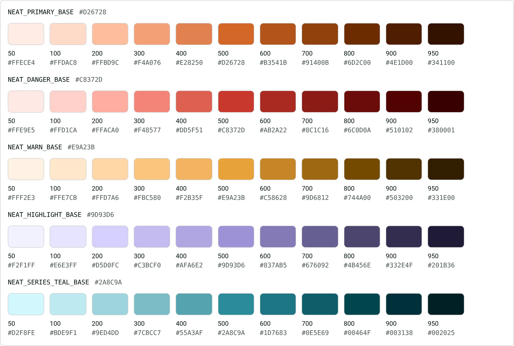
</picture></a><br>
<a href="projects/showcase/src/app/examples/colors/"><b>Colors</b></a>
</td>
<td align="center" valign="top" width="33%">
<a href="projects/showcase/src/app/examples/icons/"><picture>
<source media="(prefers-color-scheme: dark)" srcset="docs/images/icons/gallery.dark.webp">
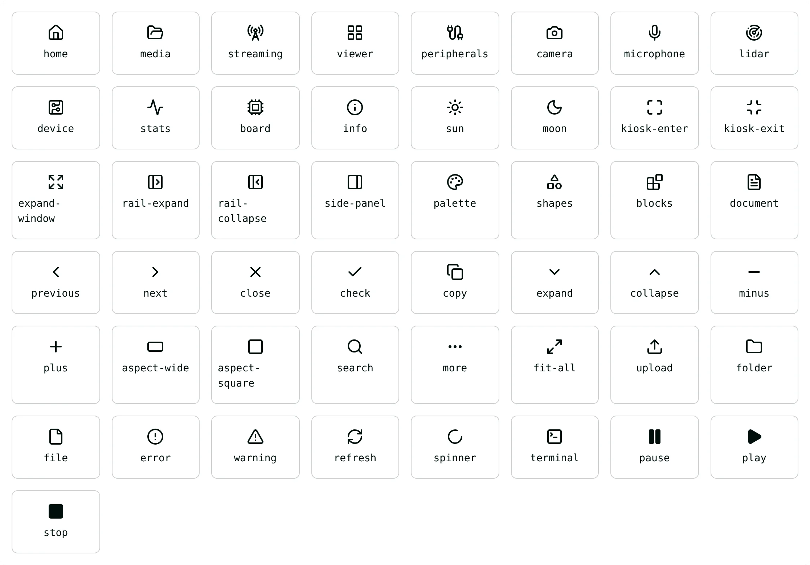
</picture></a><br>
<a href="projects/showcase/src/app/examples/icons/"><b>Icons</b></a>
</td>
</tr>
</table>

Also: Tokens.

### Layout

<table>
<tr>
<td align="center" valign="top" width="33%">
<a href="projects/showcase/src/app/examples/page/"><picture>
<source media="(prefers-color-scheme: dark)" srcset="docs/images/page/overview.dark.webp">
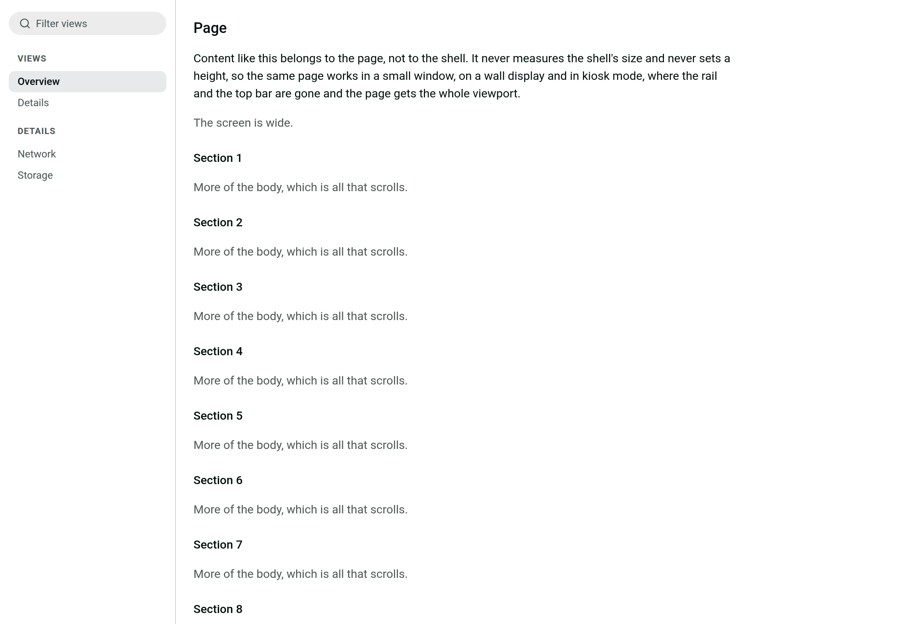
</picture></a><br>
<a href="projects/showcase/src/app/examples/page/"><b>Page</b></a>
</td>
<td align="center" valign="top" width="33%">
<a href="projects/showcase/src/app/examples/aside/"><picture>
<source media="(prefers-color-scheme: dark)" srcset="docs/images/aside/source-panel.dark.webp">
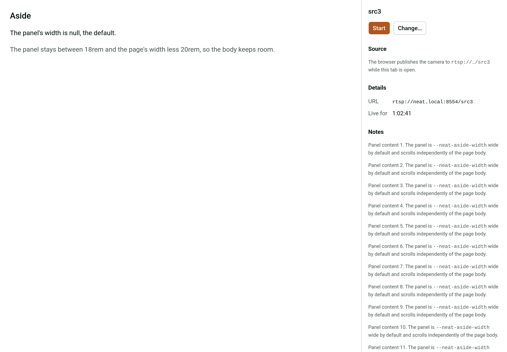
</picture></a><br>
<a href="projects/showcase/src/app/examples/aside/"><b>Aside</b></a>
</td>
</tr>
</table>

Also: [Shell](projects/showcase/src/app/examples/shell/).

### Actions

<table>
<tr>
<td align="center" valign="top" width="33%">
<a href="projects/showcase/src/app/examples/button/"><picture>
<source media="(prefers-color-scheme: dark)" srcset="docs/images/button/variants.dark.webp">
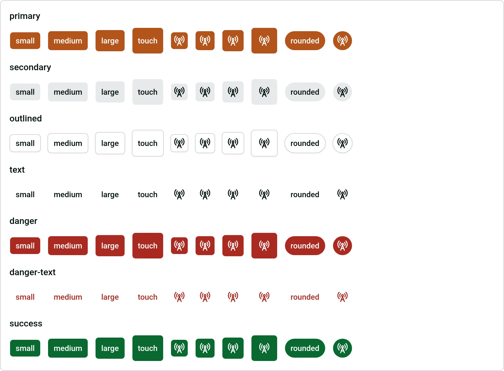
</picture></a><br>
<a href="projects/showcase/src/app/examples/button/"><b>Button</b></a>
</td>
<td align="center" valign="top" width="33%">
<a href="projects/showcase/src/app/examples/inline-button/"><picture>
<source media="(prefers-color-scheme: dark)" srcset="docs/images/inline-button/in-a-line.dark.webp">
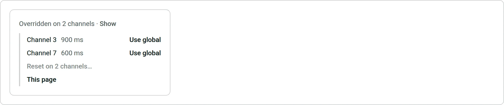
</picture></a><br>
<a href="projects/showcase/src/app/examples/inline-button/"><b>Inline button</b></a>
</td>
<td align="center" valign="top" width="33%">
<a href="projects/showcase/src/app/examples/breadcrumbs/"><picture>
<source media="(prefers-color-scheme: dark)" srcset="docs/images/breadcrumbs/walking-a-path.dark.webp">

</picture></a><br>
<a href="projects/showcase/src/app/examples/breadcrumbs/"><b>Breadcrumbs</b></a>
</td>
</tr>
<tr>
<td align="center" valign="top" width="33%">
<a href="projects/showcase/src/app/examples/tooltip/"><picture>
<source media="(prefers-color-scheme: dark)" srcset="docs/images/tooltip/positions.dark.webp">
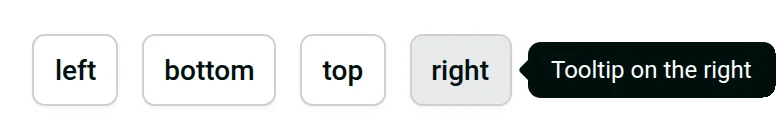
</picture></a><br>
<a href="projects/showcase/src/app/examples/tooltip/"><b>Tooltip</b></a>
</td>
<td align="center" valign="top" width="33%">
<a href="projects/showcase/src/app/examples/popover/"><picture>
<source media="(prefers-color-scheme: dark)" srcset="docs/images/popover/menu.dark.webp">
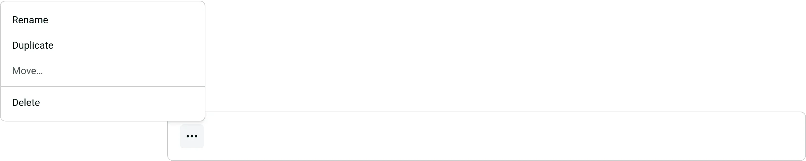
</picture></a><br>
<a href="projects/showcase/src/app/examples/popover/"><b>Popover</b></a>
</td>
<td align="center" valign="top" width="33%">
<a href="projects/showcase/src/app/examples/confirm/"><picture>
<source media="(prefers-color-scheme: dark)" srcset="docs/images/confirm/asking.dark.webp">

</picture></a><br>
<a href="projects/showcase/src/app/examples/confirm/"><b>Confirm</b></a>
</td>
</tr>
<tr>
<td align="center" valign="top" width="33%">
<a href="projects/showcase/src/app/examples/dialog/"><picture>
<source media="(prefers-color-scheme: dark)" srcset="docs/images/dialog/rename-a-source.dark.webp">
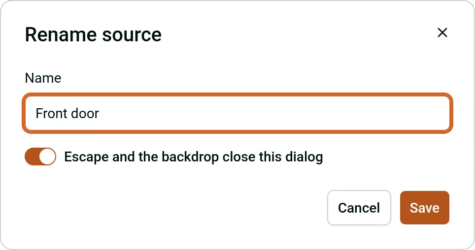
</picture></a><br>
<a href="projects/showcase/src/app/examples/dialog/"><b>Dialog</b></a>
</td>
<td align="center" valign="top" width="33%">
<a href="projects/showcase/src/app/examples/toast/"><picture>
<source media="(prefers-color-scheme: dark)" srcset="docs/images/toast/kinds.dark.webp">
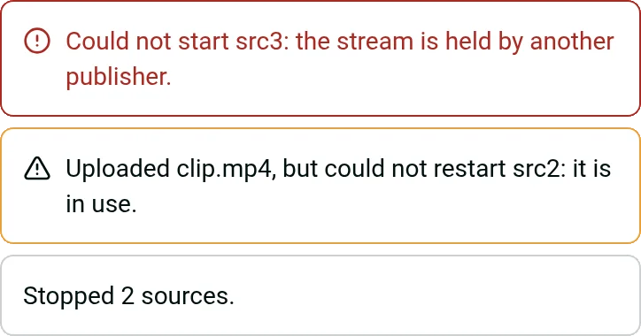
</picture></a><br>
<a href="projects/showcase/src/app/examples/toast/"><b>Toast</b></a>
</td>
</tr>
</table>

### Forms

<table>
<tr>
<td align="center" valign="top" width="33%">
<a href="projects/showcase/src/app/examples/input/"><picture>
<source media="(prefers-color-scheme: dark)" srcset="docs/images/input/sizes-and-states.dark.webp">
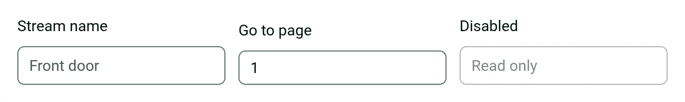
</picture></a><br>
<a href="projects/showcase/src/app/examples/input/"><b>Input</b></a>
</td>
<td align="center" valign="top" width="33%">
<a href="projects/showcase/src/app/examples/number-field/"><picture>
<source media="(prefers-color-scheme: dark)" srcset="docs/images/number-field/page-with-a-limit.dark.webp">
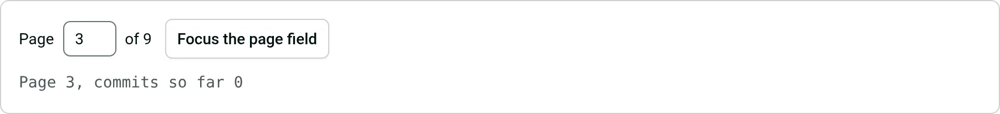
</picture></a><br>
<a href="projects/showcase/src/app/examples/number-field/"><b>Number field</b></a>
</td>
<td align="center" valign="top" width="33%">
<a href="projects/showcase/src/app/examples/field/"><picture>
<source media="(prefers-color-scheme: dark)" srcset="docs/images/field/hint-and-error.dark.webp">
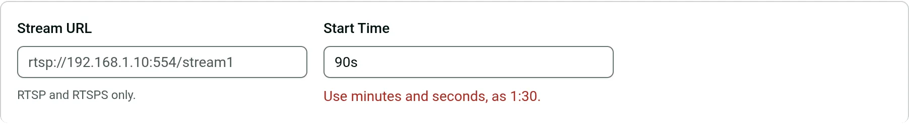
</picture></a><br>
<a href="projects/showcase/src/app/examples/field/"><b>Field</b></a>
</td>
</tr>
<tr>
<td align="center" valign="top" width="33%">
<a href="projects/showcase/src/app/examples/select/"><picture>
<source media="(prefers-color-scheme: dark)" srcset="docs/images/select/label-positions.dark.webp">
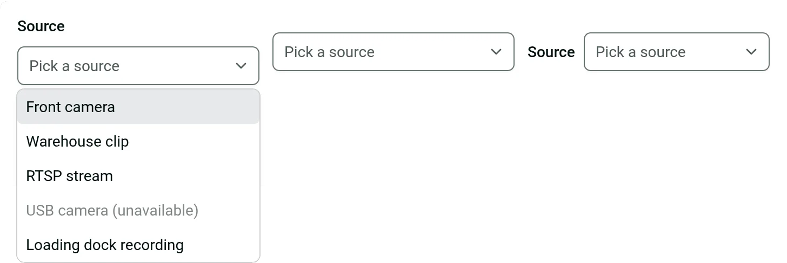
</picture></a><br>
<a href="projects/showcase/src/app/examples/select/"><b>Select</b></a>
</td>
<td align="center" valign="top" width="33%">
<a href="projects/showcase/src/app/examples/switch/"><picture>
<source media="(prefers-color-scheme: dark)" srcset="docs/images/switch/on-and-off.dark.webp">
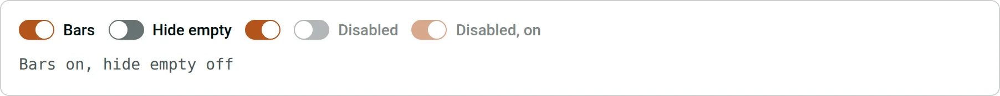
</picture></a><br>
<a href="projects/showcase/src/app/examples/switch/"><b>Switch</b></a>
</td>
<td align="center" valign="top" width="33%">
<a href="projects/showcase/src/app/examples/slider/"><picture>
<source media="(prefers-color-scheme: dark)" srcset="docs/images/slider/described-and-disabled.dark.webp">

</picture></a><br>
<a href="projects/showcase/src/app/examples/slider/"><b>Slider</b></a>
</td>
</tr>
<tr>
<td align="center" valign="top" width="33%">
<a href="projects/showcase/src/app/examples/segmented/"><picture>
<source media="(prefers-color-scheme: dark)" srcset="docs/images/segmented/choices.dark.webp">

</picture></a><br>
<a href="projects/showcase/src/app/examples/segmented/"><b>Segmented</b></a>
</td>
<td align="center" valign="top" width="33%">
<a href="projects/showcase/src/app/examples/tabs/"><picture>
<source media="(prefers-color-scheme: dark)" srcset="docs/images/tabs/channel-settings.dark.webp">
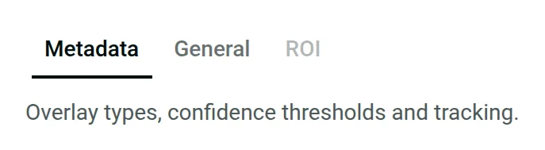
</picture></a><br>
<a href="projects/showcase/src/app/examples/tabs/"><b>Tabs</b></a>
</td>
<td align="center" valign="top" width="33%">
<a href="projects/showcase/src/app/examples/drop-zone/"><picture>
<source media="(prefers-color-scheme: dark)" srcset="docs/images/drop-zone/accepted-files.dark.webp">
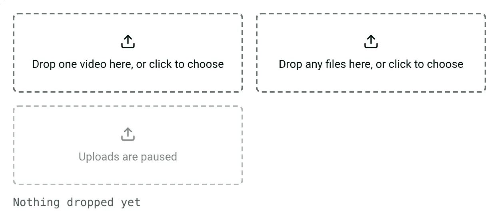
</picture></a><br>
<a href="projects/showcase/src/app/examples/drop-zone/"><b>Drop zone</b></a>
</td>
</tr>
</table>

### Status

<table>
<tr>
<td align="center" valign="top" width="33%">
<a href="projects/showcase/src/app/examples/status-chip/"><picture>
<source media="(prefers-color-scheme: dark)" srcset="docs/images/status-chip/tones.dark.webp">

</picture></a><br>
<a href="projects/showcase/src/app/examples/status-chip/"><b>Status chip</b></a>
</td>
<td align="center" valign="top" width="33%">
<a href="projects/showcase/src/app/examples/callout/"><picture>
<source media="(prefers-color-scheme: dark)" srcset="docs/images/callout/tones.dark.webp">

</picture></a><br>
<a href="projects/showcase/src/app/examples/callout/"><b>Callout</b></a>
</td>
<td align="center" valign="top" width="33%">
<a href="projects/showcase/src/app/examples/note/"><picture>
<source media="(prefers-color-scheme: dark)" srcset="docs/images/note/under-a-control.dark.webp">
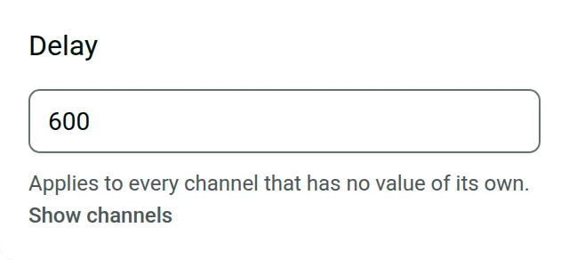
</picture></a><br>
<a href="projects/showcase/src/app/examples/note/"><b>Note</b></a>
</td>
</tr>
<tr>
<td align="center" valign="top" width="33%">
<a href="projects/showcase/src/app/examples/live-dot/"><picture>
<source media="(prefers-color-scheme: dark)" srcset="docs/images/live-dot/badges.dark.webp">
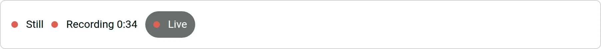
</picture></a><br>
<a href="projects/showcase/src/app/examples/live-dot/"><b>Live dot</b></a>
</td>
<td align="center" valign="top" width="33%">
<a href="projects/showcase/src/app/examples/progress/"><picture>
<source media="(prefers-color-scheme: dark)" srcset="docs/images/progress/titled-readout.dark.webp">
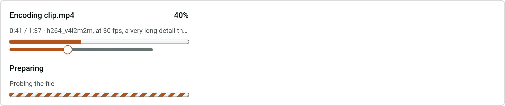
</picture></a><br>
<a href="projects/showcase/src/app/examples/progress/"><b>Progress</b></a>
</td>
<td align="center" valign="top" width="33%">
<a href="projects/showcase/src/app/examples/level-meter/"><picture>
<source media="(prefers-color-scheme: dark)" srcset="docs/images/level-meter/sine-wave.dark.webp">
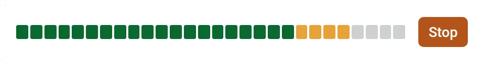
</picture></a><br>
<a href="projects/showcase/src/app/examples/level-meter/"><b>Level meter</b></a>
</td>
</tr>
</table>

Also: [Stale](projects/showcase/src/app/examples/stale/), [Motion](projects/showcase/src/app/examples/motion/), [Time](projects/showcase/src/app/examples/time/).

### Data

<table>
<tr>
<td align="center" valign="top" width="33%">
<a href="projects/showcase/src/app/examples/table/"><picture>
<source media="(prefers-color-scheme: dark)" srcset="docs/images/table/run-metrics.dark.webp">

</picture></a><br>
<a href="projects/showcase/src/app/examples/table/"><b>Table</b></a>
</td>
<td align="center" valign="top" width="33%">
<a href="projects/showcase/src/app/examples/details/"><picture>
<source media="(prefers-color-scheme: dark)" srcset="docs/images/details/source-facts.dark.webp">
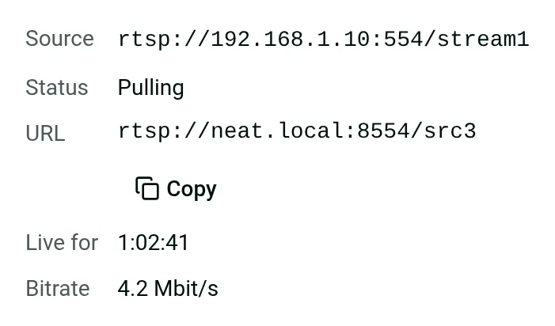
</picture></a><br>
<a href="projects/showcase/src/app/examples/details/"><b>Details</b></a>
</td>
<td align="center" valign="top" width="33%">
<a href="projects/showcase/src/app/examples/line-list/"><picture>
<source media="(prefers-color-scheme: dark)" srcset="docs/images/line-list/regions.dark.webp">

</picture></a><br>
<a href="projects/showcase/src/app/examples/line-list/"><b>Line list</b></a>
</td>
</tr>
<tr>
<td align="center" valign="top" width="33%">
<a href="projects/showcase/src/app/examples/select-list/"><picture>
<source media="(prefers-color-scheme: dark)" srcset="docs/images/select-list/toned.dark.webp">
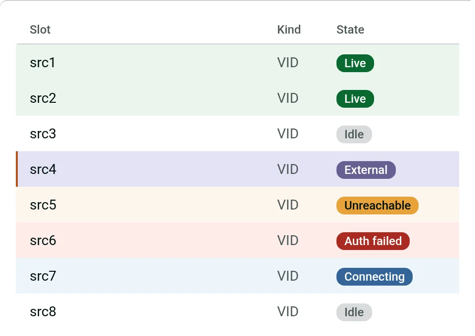
</picture></a><br>
<a href="projects/showcase/src/app/examples/select-list/"><b>Select list</b></a>
</td>
<td align="center" valign="top" width="33%">
<a href="projects/showcase/src/app/examples/file-browser/"><picture>
<source media="(prefers-color-scheme: dark)" srcset="docs/images/file-browser/managing.dark.webp">

</picture></a><br>
<a href="projects/showcase/src/app/examples/file-browser/"><b>File browser</b></a>
</td>
<td align="center" valign="top" width="33%">
<a href="projects/showcase/src/app/examples/card/"><picture>
<source media="(prefers-color-scheme: dark)" srcset="docs/images/card/filling-the-row.dark.webp">

</picture></a><br>
<a href="projects/showcase/src/app/examples/card/"><b>Card</b></a>
</td>
</tr>
</table>

Also: [Collapsible](projects/showcase/src/app/examples/collapsible/), [Stored signal](projects/showcase/src/app/examples/stored-signal/).

### Charts

<table>
<tr>
<td align="center" valign="top" width="33%">
<a href="projects/showcase/src/app/examples/sparkline/"><picture>
<source media="(prefers-color-scheme: dark)" srcset="docs/images/sparkline/tones.dark.webp">
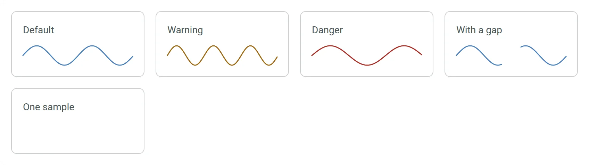
</picture></a><br>
<a href="projects/showcase/src/app/examples/sparkline/"><b>Sparkline</b></a>
</td>
<td align="center" valign="top" width="33%">
<a href="projects/showcase/src/app/examples/time-chart/"><picture>
<source media="(prefers-color-scheme: dark)" srcset="docs/images/time-chart/several-series.dark.webp">

</picture></a><br>
<a href="projects/showcase/src/app/examples/time-chart/"><b>Time chart</b></a>
</td>
<td align="center" valign="top" width="33%">
<a href="projects/showcase/src/app/examples/stacked-chart/"><picture>
<source media="(prefers-color-scheme: dark)" srcset="docs/images/stacked-chart/power-rails.dark.webp">
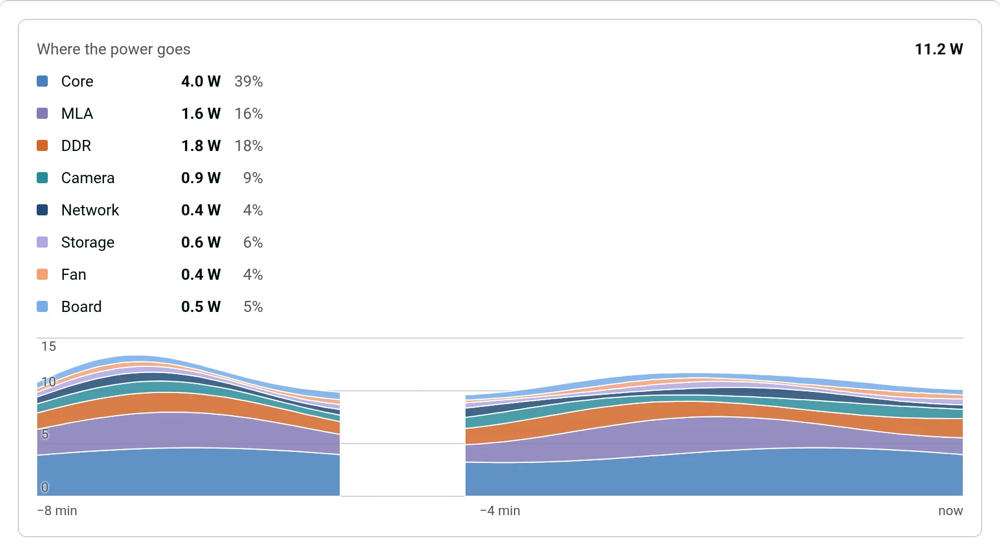
</picture></a><br>
<a href="projects/showcase/src/app/examples/stacked-chart/"><b>Stacked chart</b></a>
</td>
</tr>
<tr>
<td align="center" valign="top" width="33%">
<a href="projects/showcase/src/app/examples/heatmap/"><picture>
<source media="(prefers-color-scheme: dark)" srcset="docs/images/heatmap/core-load.dark.webp">

</picture></a><br>
<a href="projects/showcase/src/app/examples/heatmap/"><b>Heatmap</b></a>
</td>
<td align="center" valign="top" width="33%">
<a href="projects/showcase/src/app/examples/score-bars/"><picture>
<source media="(prefers-color-scheme: dark)" srcset="docs/images/score-bars/score-bars.dark.webp">
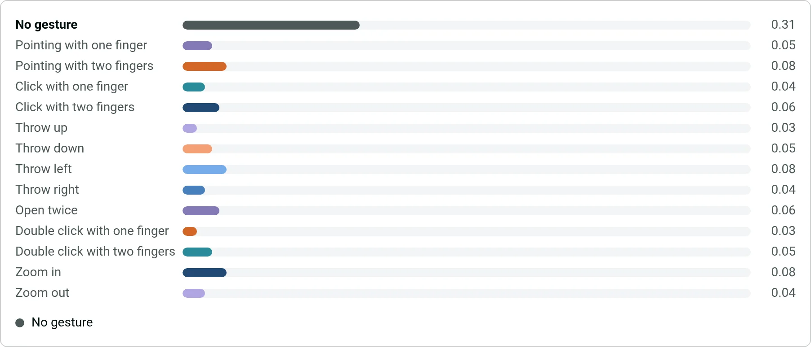
</picture></a><br>
<a href="projects/showcase/src/app/examples/score-bars/"><b>Score bars</b></a>
</td>
<td align="center" valign="top" width="33%">
<a href="projects/showcase/src/app/examples/label-timeline/"><picture>
<source media="(prefers-color-scheme: dark)" srcset="docs/images/label-timeline/name-rows.dark.webp">
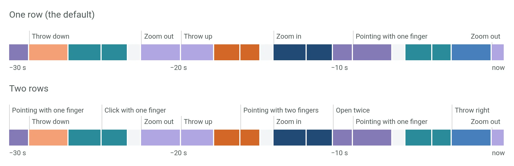
</picture></a><br>
<a href="projects/showcase/src/app/examples/label-timeline/"><b>Label timeline</b></a>
</td>
</tr>
<tr>
<td align="center" valign="top" width="33%">
<a href="projects/showcase/src/app/examples/chart-card/"><picture>
<source media="(prefers-color-scheme: dark)" srcset="docs/images/chart-card/selectable-cards.dark.webp">
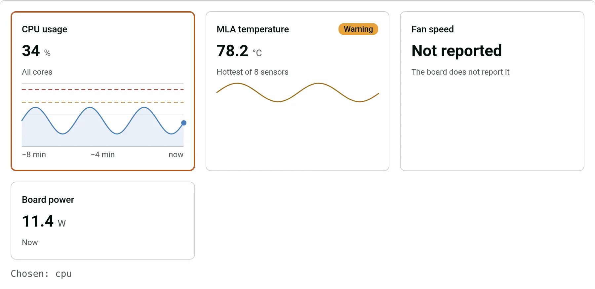
</picture></a><br>
<a href="projects/showcase/src/app/examples/chart-card/"><b>Chart card</b></a>
</td>
<td align="center" valign="top" width="33%">
<a href="projects/showcase/src/app/examples/series-swatch/"><picture>
<source media="(prefers-color-scheme: dark)" srcset="docs/images/series-swatch/run-chips.dark.webp">
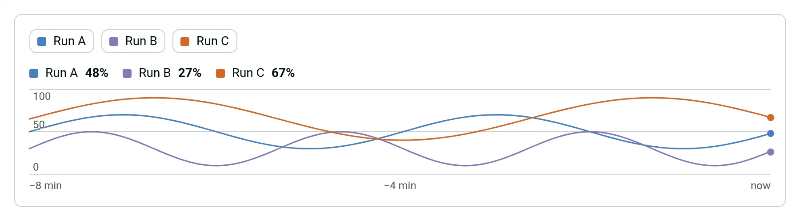
</picture></a><br>
<a href="projects/showcase/src/app/examples/series-swatch/"><b>Swatch</b></a>
</td>
<td align="center" valign="top" width="33%">
<a href="projects/showcase/src/app/examples/bev/"><picture>
<source media="(prefers-color-scheme: dark)" srcset="docs/images/bev/interaction.dark.webp">
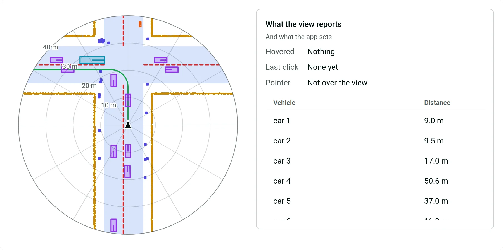
</picture></a><br>
<a href="projects/showcase/src/app/examples/bev/"><b>Bird's-eye view</b></a>
</td>
</tr>
</table>

### Diagram

<table>
<tr>
<td align="center" valign="top" width="33%">
<a href="projects/showcase/src/app/examples/diagram/"><picture>
<source media="(prefers-color-scheme: dark)" srcset="docs/images/diagram/filling-its-card.dark.webp">
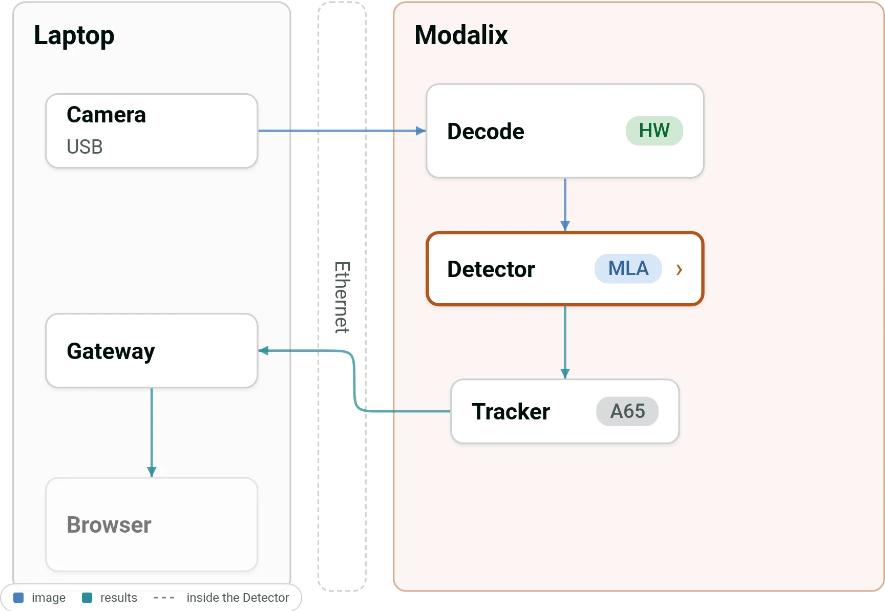
</picture></a><br>
<a href="projects/showcase/src/app/examples/diagram/"><b>Diagram</b></a>
</td>
<td align="center" valign="top" width="33%">
<a href="projects/showcase/src/app/examples/messaging/"><picture>
<source media="(prefers-color-scheme: dark)" srcset="docs/images/messaging/live-pipeline.dark.webp">
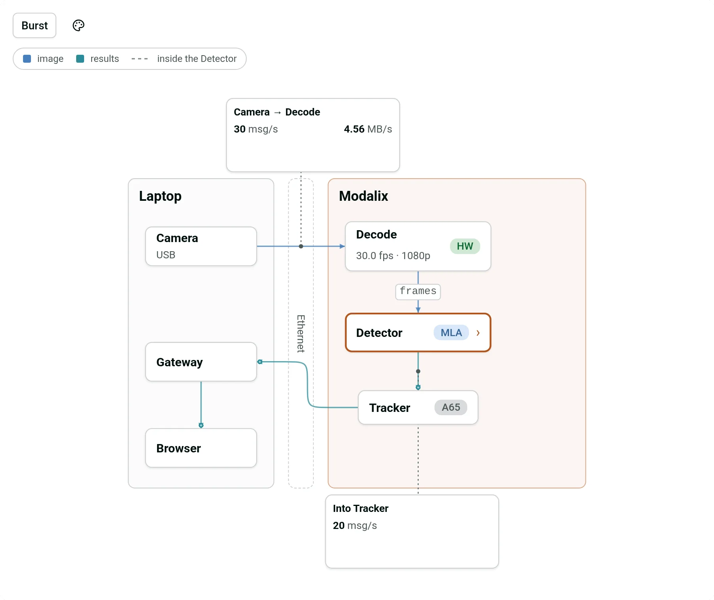
</picture></a><br>
<a href="projects/showcase/src/app/examples/messaging/"><b>Messaging</b></a>
</td>
<td align="center" valign="top" width="33%">
<a href="projects/showcase/src/app/examples/drill-down/"><picture>
<source media="(prefers-color-scheme: dark)" srcset="docs/images/drill-down/detector-level.dark.webp">
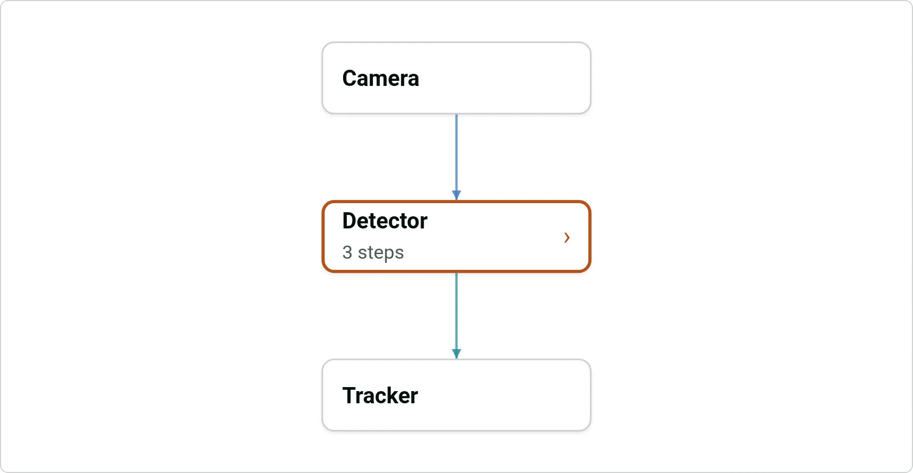
</picture></a><br>
<a href="projects/showcase/src/app/examples/drill-down/"><b>Drill-down</b></a>
</td>
</tr>
</table>

Also: [Legend](projects/showcase/src/app/examples/legend/).

### Video

<table>
<tr>
<td align="center" valign="top" width="33%">
<a href="projects/showcase/src/app/examples/video-tile/"><picture>
<source media="(prefers-color-scheme: dark)" srcset="docs/images/video-tile/poses.dark.webp">
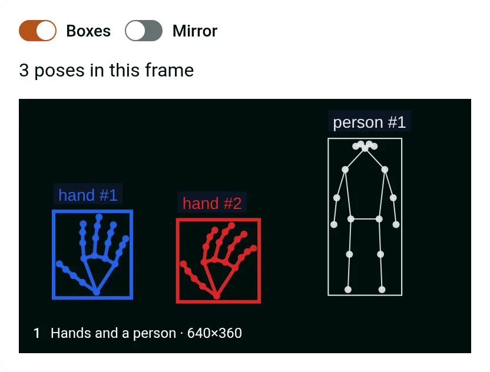
</picture></a><br>
<a href="projects/showcase/src/app/examples/video-tile/"><b>Video tile</b></a>
</td>
<td align="center" valign="top" width="33%">
<a href="projects/showcase/src/app/examples/roi-editor/"><picture>
<source media="(prefers-color-scheme: dark)" srcset="docs/images/roi-editor/drawing-regions.dark.webp">
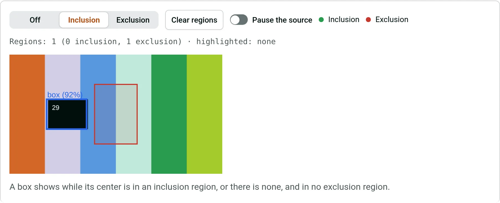
</picture></a><br>
<a href="projects/showcase/src/app/examples/roi-editor/"><b>ROI editor</b></a>
</td>
<td align="center" valign="top" width="33%">
<a href="projects/showcase/src/app/examples/metadata-sync/"><picture>
<source media="(prefers-color-scheme: dark)" srcset="docs/images/metadata-sync/late-notice.dark.webp">

</picture></a><br>
<a href="projects/showcase/src/app/examples/metadata-sync/"><b>Metadata sync</b></a>
</td>
</tr>
</table>

Also: [Tile grid](projects/showcase/src/app/examples/tile-grid/).

<!-- gallery end -->

## Quick start

The kit ships as a tarball that each app keeps in its repository. In your Angular app:

1. Install the tarball:

   ```bash
   npm install ./vendor/sima-neat-ui-<version>.tgz
   ```

2. Add the kit's providers in `app.config.ts`:

   ```ts
   import { ApplicationConfig } from '@angular/core';
   import { provideRouter } from '@angular/router';
   import { provideNeatTitles, provideNeatUi } from '@sima/neat-ui';
   import { routes } from './app.routes';

   export const appConfig: ApplicationConfig = {
     providers: [provideRouter(routes), provideNeatUi(), provideNeatTitles('My demo')],
   };
   ```

3. Add the kit's stylesheet before your own, in `angular.json`:

   ```json
   "styles": ["@sima/neat-ui/styles/neat-ui.css", "src/styles.css"]
   ```

4. Put your pages in the shell, with the toast host beside it:

   ```ts
   import { Component } from '@angular/core';
   import { RouterOutlet } from '@angular/router';
   import { NeatNavItem, NeatShell } from '@sima/neat-ui';
   import { NeatToastHost } from '@sima/neat-ui/toast';

   @Component({
     selector: 'app-root',
     imports: [NeatShell, NeatToastHost, RouterOutlet],
     template: `
       <neat-shell appName="My demo" [navItems]="navItems">
         <router-outlet />
       </neat-shell>
       <neat-toast-host />
     `,
   })
   export class App {
     protected readonly navItems: NeatNavItem[] = [
       { label: 'Overview', icon: 'stats', path: '/overview' },
       { label: 'Media', icon: 'media', path: '/media' },
     ];
   }
   ```

Your app needs no Tailwind: the stylesheet holds every style the kit uses.

## Learn more

- **See every component live.** Run the showcase from this repository with `npm ci && npm start`
  and open <http://localhost:4200>. Each topic shows its examples, their code and the API, in
  both themes.
- **Follow the rules for an app.** They ship with the package, in
  [projects/neat-ui/README.md](projects/neat-ui/README.md). Point your coding agent at
  `node_modules/@sima/neat-ui/README.md`.
- **Use the kit's words.** [docs/glossary.md](docs/glossary.md) names each thing the kit draws.
- **Work on the kit.** Start with [CONTRIBUTING.md](CONTRIBUTING.md). Coding agents read
  [AGENTS.md](AGENTS.md), the complete guide.
