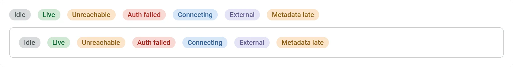
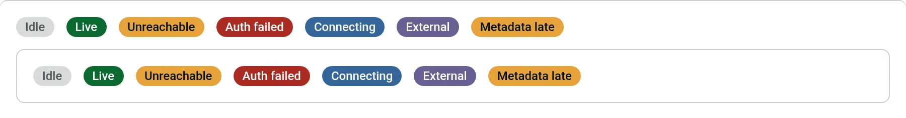
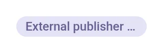

<!-- Written by `npm run docs:pages` from the kit and its examples. Do not edit. -->

# Badge

_Components › Status_ · [All topics](../README.md)

A short status or fact in a small pill, such as Live, Idle or HW.

```html
<neat-badge tone="success">Live</neat-badge>
```

<picture>
<source media="(prefers-color-scheme: dark)" srcset="../images/badge/tones.dark.webp">

</picture>

```ts
import { NeatBadge, NeatBadgeButton } from '@sima/neat-ui/badge';
import { NeatStatusChip, NeatStatusChipButton } from '@sima/neat-ui/status-chip';
```

## Examples

### Tones

The six tones on the page and on a card, each worded as a stream's slot states are. The words carry the state, and the color repeats it on a tint of itself. The gray of `neutral` shows on both surfaces.

The last badge is a [`NeatBadgeButton`](../components/badge.md#neatbadgebutton). It looks the same, and opens more about the status, here a video tile's "Metadata late".

<picture>
<source media="(prefers-color-scheme: dark)" srcset="../images/badge/tones.dark.webp">

</picture>

<details>
<summary>Code</summary>

`1-tones.example.ts`

```ts
import { ChangeDetectionStrategy, Component, signal } from '@angular/core';
import { NeatBadge, NeatBadgeButton } from '@sima/neat-ui/badge';
import { BADGES, SURFACES } from './badges';

@Component({
  selector: 'app-tones',
  imports: [NeatBadge, NeatBadgeButton],
  changeDetection: ChangeDetectionStrategy.OnPush,
  templateUrl: './1-tones.example.html',
  styleUrl: './surfaces.css',
})
export class Tones {
  protected readonly surfaces = SURFACES;
  protected readonly badges = BADGES;
  protected readonly opened = signal(false);
}
```

`1-tones.example.html`

```html
@for (surface of surfaces; track surface) {
  <div class="showcase-row" [class.card]="surface === 'card'">
    @for (badge of badges; track badge.tone) {
      <neat-badge [tone]="badge.tone">{{ badge.label }}</neat-badge>
    }
    <button neatBadge type="button" tone="warning" (click)="opened.set(true)">Metadata late</button>
  </div>
}
@if (opened()) {
  <p class="showcase-muted">The late notice would open here.</p>
}
```

`badges.ts`

```ts
/** The surfaces a badge is shown on: the page, and a card. */
export const SURFACES = ['page', 'card'] as const;

/** One badge per tone, each worded as a stream's slot states are. */
export const BADGES = [
  { tone: 'neutral', label: 'Idle' },
  { tone: 'success', label: 'Live' },
  { tone: 'warning', label: 'Unreachable' },
  { tone: 'danger', label: 'Auth failed' },
  { tone: 'info', label: 'Connecting' },
  { tone: 'highlight', label: 'External' },
] as const;
```

`surfaces.css`

```css
:host {
  display: flex;
  flex-direction: column;
  gap: var(--neat-space-3);
}

/*
 * A card as an app draws one: its own surface, so each badge is seen on it as well as on the
 * page.
 */
.card {
  --neat-surface: var(--card);

  padding: var(--neat-space-4);
  border: 1px solid var(--border);
  border-radius: var(--radius);
  background: var(--card);
  color: var(--card-foreground);
}
```

</details>

### Solid

`variant="solid"` fills each badge with its tone's status color, for the rare badge that must stand out, such as a video tile's notice over the picture, or a badge in a toned list row, whose selected fill is the soft badge's tint. `neutral` is the same gray as in the soft variant.

<picture>
<source media="(prefers-color-scheme: dark)" srcset="../images/badge/solid.dark.webp">

</picture>

<details>
<summary>Code</summary>

`2-solid.example.ts`

```ts
import { ChangeDetectionStrategy, Component } from '@angular/core';
import { NeatBadge, NeatBadgeButton } from '@sima/neat-ui/badge';
import { BADGES, SURFACES } from './badges';

@Component({
  selector: 'app-solid',
  imports: [NeatBadge, NeatBadgeButton],
  changeDetection: ChangeDetectionStrategy.OnPush,
  templateUrl: './2-solid.example.html',
  styleUrl: './surfaces.css',
})
export class Solid {
  protected readonly surfaces = SURFACES;
  protected readonly badges = BADGES;
}
```

`2-solid.example.html`

```html
@for (surface of surfaces; track surface) {
  <div class="showcase-row" [class.card]="surface === 'card'">
    @for (badge of badges; track badge.tone) {
      <neat-badge [tone]="badge.tone" variant="solid">{{ badge.label }}</neat-badge>
    }
    <button neatBadge type="button" tone="warning" variant="solid">Metadata late</button>
  </div>
}
```

`badges.ts`

```ts
/** The surfaces a badge is shown on: the page, and a card. */
export const SURFACES = ['page', 'card'] as const;

/** One badge per tone, each worded as a stream's slot states are. */
export const BADGES = [
  { tone: 'neutral', label: 'Idle' },
  { tone: 'success', label: 'Live' },
  { tone: 'warning', label: 'Unreachable' },
  { tone: 'danger', label: 'Auth failed' },
  { tone: 'info', label: 'Connecting' },
  { tone: 'highlight', label: 'External' },
] as const;
```

`surfaces.css`

```css
:host {
  display: flex;
  flex-direction: column;
  gap: var(--neat-space-3);
}

/*
 * A card as an app draws one: its own surface, so each badge is seen on it as well as on the
 * page.
 */
.card {
  --neat-surface: var(--card);

  padding: var(--neat-space-4);
  border: 1px solid var(--border);
  border-radius: var(--radius);
  background: var(--card);
  color: var(--card-foreground);
}
```

</details>

### Narrow column

A badge in a column narrower than its text. It cuts its text and keeps the column's width, where a list's cell or a bar would otherwise grow.

<picture>
<source media="(prefers-color-scheme: dark)" srcset="../images/badge/narrow-column.dark.webp">

</picture>

<details>
<summary>Code</summary>

`3-narrow-column.example.ts`

```ts
import { ChangeDetectionStrategy, Component } from '@angular/core';
import { NeatBadge } from '@sima/neat-ui/badge';

@Component({
  selector: 'app-narrow-column',
  imports: [NeatBadge],
  changeDetection: ChangeDetectionStrategy.OnPush,
  templateUrl: './3-narrow-column.example.html',
  styleUrl: './narrow-column.example.css',
})
export class NarrowColumn {}
```

`3-narrow-column.example.html`

```html
<div class="column">
  <neat-badge tone="highlight">External publisher on a very narrow column</neat-badge>
</div>
```

`narrow-column.example.css`

```css
.column {
  width: 8rem;
}
```

</details>

## API

### `NeatBadge`

Component from `@sima/neat-ui/badge`, selector `neat-badge`.

Use it for a state in a list's cell or over a panel: Live, Idle, External. Or use it for a fact beside a value, such as a codec that cannot be decoded, or where a part runs. The words are the app's. The color repeats them and is never the only way a state is told.

`highlight` is for a state that is none of the statuses but should stand out, such as a stream that someone else publishes. A `neat-select-list` row can take the same tone as its badge, with `rowTone`.

It is Spartan's badge in the kit's tones. A badge is never wider than the cell or bar that holds it, and cuts its text at that width.

**Inputs**

- **`tone`** `NeatTone`, default `'neutral'`

  The status the badge states, which sets its colors; `neutral` for a plain label.

- **`variant`** `NeatBadgeVariant`, default `'soft'`

  `soft` (the default) shows the tone on a light tint; `solid` fills the badge with it.

### `NeatBadgeButton`

Directive from `@sima/neat-ui/badge`, selector `button[neatBadge]`.

The badge as a button, for a status that opens more about itself.

```html
<button neatBadge tone="warning" type="button" (click)="showWhy()">Metadata late</button>
```

A video tile's "Metadata late", which shows why when pressed, is one. It looks like the badge of its tone, with a pointer and a focus ring. It stays a native button, with its focus, Enter and Space, and `disabled`. Its name is its text.

**Inputs**

- **`tone`** `NeatTone`, default `'neutral'`

  The status the badge states, which sets its colors; `neutral` for a plain label.

- **`variant`** `NeatBadgeVariant`, default `'soft'`

  `soft` (the default) shows the tone on a light tint; `solid` fills the badge with it.

### `NeatBadgeVariant`

Type from `@sima/neat-ui/badge`.

How a badge carries its tone: `soft` (the default) or `solid`.

`soft` is the tone's color on a light tint of itself, quiet enough for several badges side by side, such as a diagram block's. `solid` fills the badge with the tone's status color, for the rare badge that must stand out, such as a notice over video. Neutral is the same gray in both.

```ts
type NeatBadgeVariant = 'soft' | 'solid'
```

### `NeatStatusChip`

Component from `@sima/neat-ui/status-chip`, selector `neat-status-chip`.

**Deprecated.** Use [`NeatBadge`](../components/badge.md#neatbadge) (`neat-badge`) from `@sima/neat-ui/badge`; this name goes in a later release.

The old name of `neat-badge`, kept so apps that use it keep working. It defaults to `solid`, as the status chip did, where the badge defaults to `soft`.

**Inputs**

- **`tone`** `NeatTone`, default `'neutral'`

  The status the chip states, which sets its colors; `neutral` for a plain label.

- **`variant`** `NeatStatusChipVariant`, default `'solid'`

  `solid` (the default) fills the chip with the tone; `tinted` shows it on a light tint.

### `NeatStatusChipButton`

Directive from `@sima/neat-ui/status-chip`, selector `button[neatStatusChip]`.

**Deprecated.** Use [`NeatBadgeButton`](../components/badge.md#neatbadgebutton) (`button[neatBadge]`) from `@sima/neat-ui/badge`; this name goes in a later release.

The old name of `button[neatBadge]`, kept so apps that use it keep working. It defaults to `solid`, as the status chip did, where the badge defaults to `soft`.

**Inputs**

- **`tone`** `NeatTone`, default `'neutral'`

  The status the chip states, which sets its colors; `neutral` for a plain label.

- **`variant`** `NeatStatusChipVariant`, default `'solid'`

  `solid` (the default) fills the chip with the tone; `tinted` shows it on a light tint.

### `NeatStatusChipVariant`

Type from `@sima/neat-ui/status-chip`.

**Deprecated.** Use [`NeatBadgeVariant`](../components/badge.md#neatbadgevariant) from `@sima/neat-ui/badge`, where `tinted` is `soft`; this name goes in a later release.

How a chip carries its tone: `solid` (the default) or `tinted`.

```ts
type NeatStatusChipVariant = 'solid' | 'tinted'
```
