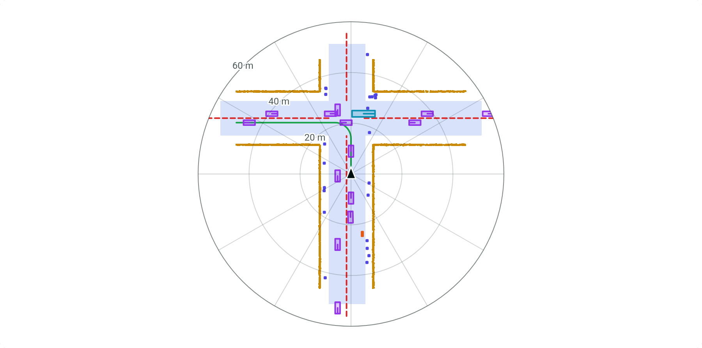
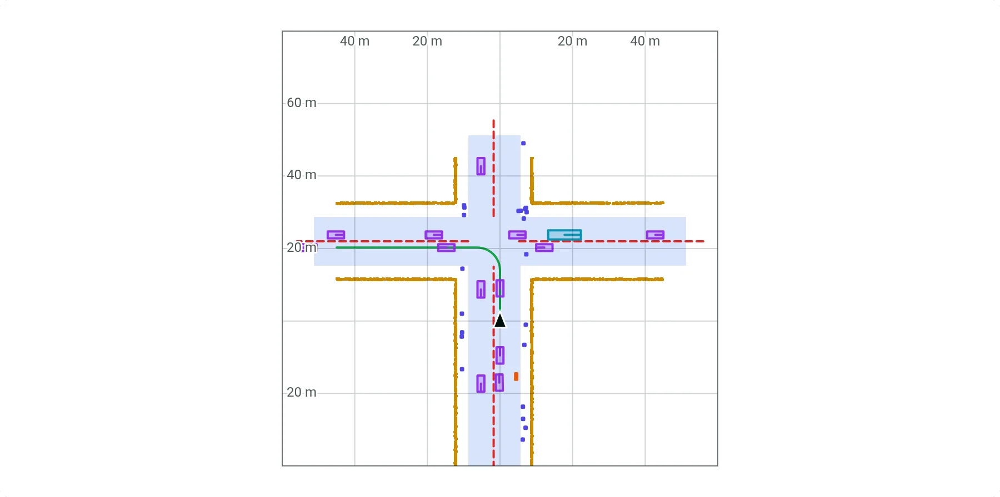
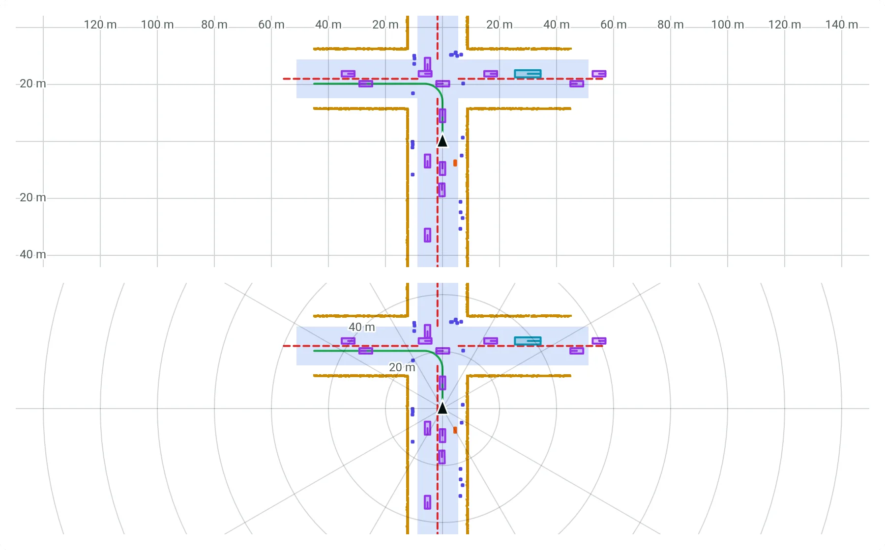
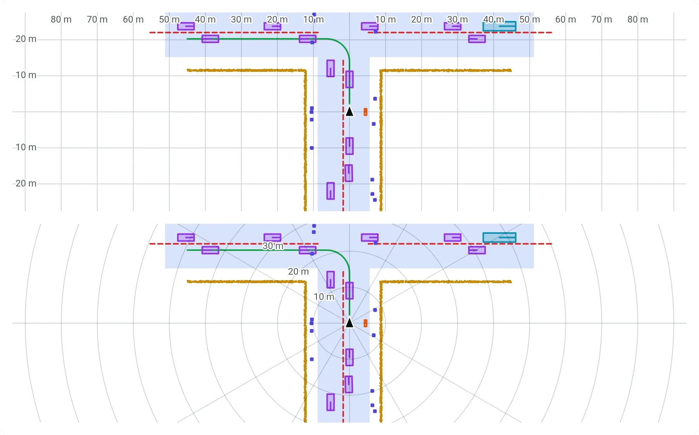
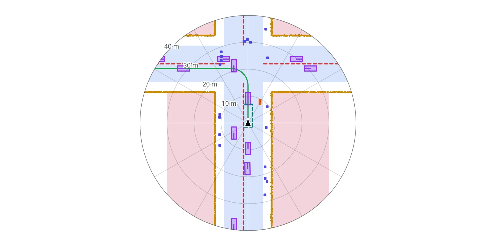
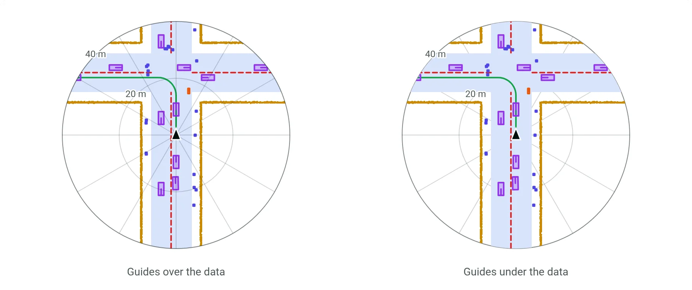
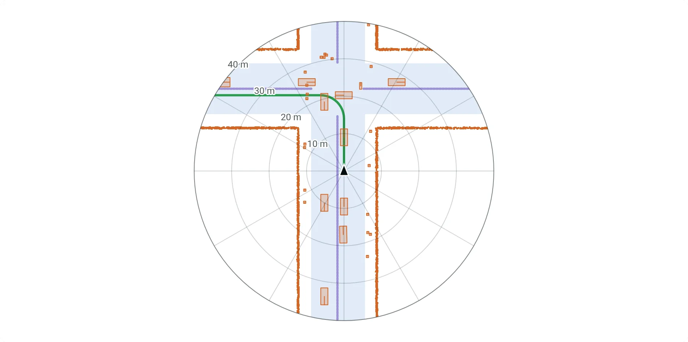
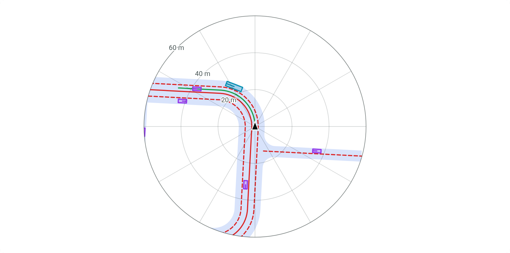

<!-- Written by `npm run docs:pages` from the kit and its examples. Do not edit. -->

# Bird's-eye view

_Components › Charts_ · [All topics](../README.md)

A bird's-eye view: what a vehicle sees around it, drawn from above.

```html
<neat-bev [frame]="frame()" [background]="map" [range]="60" zoom />
```

<picture>
<source media="(prefers-reduced-motion: reduce) and (prefers-color-scheme: dark)" srcset="../images/bev/round.dark.webp">
<source media="(prefers-reduced-motion: reduce)" srcset="../images/bev/round.light.webp">
<source media="(prefers-color-scheme: dark)" srcset="../images/bev/round.dark.animated.webp">

</picture>

```ts
import { NeatBev } from '@sima/neat-ui/bev';
```

## Examples

### Round

The round view, as a radar shows it: the street around a vehicle waiting at a crossing, 20 frames a second.

It has rings every 10 m out to the 60 m range, and spokes every 30°. The drivable area is a 128 × 128 grid, and the lidar's returns are one array of points. The lane markings and the planned turn are lines, and every car, cyclist and person is a box with its heading.

Each label takes its color from the page's class colors, as a video tile's classes do. Everything stops at the circle, and the guides lie over the data. Try hovering or tapping a box to read it out.

<picture>
<source media="(prefers-reduced-motion: reduce) and (prefers-color-scheme: dark)" srcset="../images/bev/round.dark.webp">
<source media="(prefers-reduced-motion: reduce)" srcset="../images/bev/round.light.webp">
<source media="(prefers-color-scheme: dark)" srcset="../images/bev/round.dark.animated.webp">

</picture>

<details>
<summary>Code</summary>

`1-round.example.ts`

```ts
import { ChangeDetectionStrategy, Component } from '@angular/core';
import { NeatBev } from '@sima/neat-ui/bev';
import { streetFrames } from './scene';

@Component({
  selector: 'app-round',
  imports: [NeatBev],
  changeDetection: ChangeDetectionStrategy.OnPush,
  templateUrl: './1-round.example.html',
  styleUrl: './bev.example.css',
})
export class Round {
  protected readonly frame = streetFrames();
}
```

`1-round.example.html`

```html
<neat-bev [frame]="frame()" />
```

`scene.ts`

```ts
import { DestroyRef, inject, signal, type Signal } from '@angular/core';
import type {
  NeatBevFrame,
  NeatBevGrid,
  NeatBevLine,
  NeatBevObject,
  NeatBevLayer,
} from '@sima/neat-ui/bev';

/*
 * A made-up street scene for the BEV examples, in the vehicle's frame (meters, x forward, y left):
 * the vehicle waits in the right lane of a road that crosses another 22 m ahead, with traffic,
 * people and a cyclist moving around it, a lidar's returns from the buildings, the lane markings,
 * a planned left turn and a six-camera rig. Nothing here comes from a real recording.
 */

/** The road the vehicle is on: its center line and half its width. */
const ROAD_Y = 1.75;
/** The crossing road: its center line, 22 m ahead. */
const CROSS_X = 22;
const HALF_ROAD = 7;
const LANE = 3.5;
/** How far the drivable grid reaches, and its cells: 128 × 128 at 0.8 m. */
const GRID_REACH = 51.2;
const GRID_CELLS = 128;
/** The buildings' walls at the four corners of the crossing, where the lidar sees them. */
const WALLS = {
  left: ROAD_Y + HALF_ROAD + 3.5,
  right: ROAD_Y - HALF_ROAD - 3.5,
  near: CROSS_X - HALF_ROAD - 3.5,
  far: CROSS_X + HALF_ROAD + 3.5,
} as const;
/** How far moving things travel before they wrap around. */
const WRAP = 56;

/** A deterministic random number generator, so the scene looks the same on every load. */
function random(seed: number): () => number {
  let state = seed >>> 0;
  return () => {
    state = (state * 1664525 + 1013904223) >>> 0;
    return state / 2 ** 32;
  };
}

function onRoad(x: number, y: number): boolean {
  return Math.abs(y - ROAD_Y) <= HALF_ROAD || Math.abs(x - CROSS_X) <= HALF_ROAD;
}

/** The drivable area: both roads, as a grid with row 0 forward and column 0 left. */
function drivableGrid(): NeatBevGrid {
  const size = (2 * GRID_REACH) / GRID_CELLS;
  const cells = new Uint8Array(GRID_CELLS * GRID_CELLS);
  for (let row = 0; row < GRID_CELLS; row++) {
    const x = GRID_REACH - (row + 0.5) * size;
    for (let column = 0; column < GRID_CELLS; column++) {
      const y = GRID_REACH - (column + 0.5) * size;
      if (onRoad(x, y)) cells[row * GRID_CELLS + column] = 255;
    }
  }
  return {
    label: 'drivable area',
    cells,
    columns: GRID_CELLS,
    rows: GRID_CELLS,
    x: [-GRID_REACH, GRID_REACH],
    y: [-GRID_REACH, GRID_REACH],
  };
}

/** x, y pairs from a list of points. */
const pairs = (points: readonly (readonly [number, number])[]): Float32Array =>
  Float32Array.from(points.flat());

/** The dashed center lines of both roads, broken where they cross. */
function laneMarkings(): NeatBevLine[] {
  const near = CROSS_X - HALF_ROAD;
  const far = CROSS_X + HALF_ROAD;
  const left = ROAD_Y + HALF_ROAD;
  const right = ROAD_Y - HALF_ROAD;
  return [
    [
      [-WRAP, ROAD_Y],
      [near, ROAD_Y],
    ],
    [
      [far, ROAD_Y],
      [WRAP, ROAD_Y],
    ],
    [
      [CROSS_X, -WRAP],
      [CROSS_X, right],
    ],
    [
      [CROSS_X, left],
      [CROSS_X, WRAP],
    ],
  ].map((points) => ({
    label: 'lane marking',
    xy: pairs(points as [number, number][]),
    style: 'dashed' as const,
  }));
}

/** The planned path: ahead to the crossing, a left turn into its far lane, and on. */
function plannedPath(): NeatBevLine {
  const radius = CROSS_X - LANE / 2 - 14;
  const points: [number, number][] = [
    [0, 0],
    [14, 0],
  ];
  for (let i = 1; i <= 12; i++) {
    const a = (i / 12) * (Math.PI / 2);
    points.push([14 + radius * Math.sin(a), radius - radius * Math.cos(a)]);
  }
  points.push([CROSS_X - LANE / 2, 45]);
  return { label: 'planned path', xy: pairs(points) };
}

/** The lidar's returns from the buildings' walls at the four corners of the crossing. */
function wallReturns(next: () => number): Float32Array {
  const points: number[] = [];
  const walls = WALLS;
  const along = (fixed: 'x' | 'y', at: number, from: number, to: number, count: number) => {
    for (let i = 0; i < count; i++) {
      const t = from + (to - from) * next();
      const depth = at + (next() - 0.5) * 0.4;
      points.push(fixed === 'x' ? depth : t, fixed === 'x' ? t : depth);
    }
  };
  along('y', walls.left, -45, walls.near, 900);
  along('y', walls.right, -45, walls.near, 900);
  along('y', walls.left, walls.far, 45, 500);
  along('y', walls.right, walls.far, 45, 500);
  along('x', walls.near, walls.left, 45, 500);
  along('x', walls.near, -45, walls.right, 500);
  along('x', walls.far, walls.left, 45, 400);
  along('x', walls.far, -45, walls.right, 400);
  return Float32Array.from(points);
}

/** Something that moves along a straight lane, wrapping around. */
interface Mover {
  /** Its track's id, as a tracker would give it: the label and a number ("car 3"). */
  readonly id: string;
  readonly label: string;
  readonly length: number;
  readonly width: number;
  /**
   * Where it starts, which way it faces (radians) and its speed in m/s, signed along x for a mover
   * heading along the road and along y for one heading across.
   */
  readonly x: number;
  readonly y: number;
  readonly yaw: number;
  readonly speed: number;
  readonly score: number;
}

const wrap = (value: number): number =>
  ((((value + WRAP) % (2 * WRAP)) + 2 * WRAP) % (2 * WRAP)) - WRAP;

function movers(next: () => number): Mover[] {
  const car = (x: number, y: number, yaw: number, speed: number): Omit<Mover, 'id'> => ({
    label: 'car',
    length: 4.5,
    width: 1.9,
    x,
    y,
    yaw,
    speed,
    score: 0.6 + 0.39 * next(),
  });
  const oncoming = ROAD_Y + LANE;
  const crossLeft = CROSS_X - LANE / 2;
  const crossRight = CROSS_X + LANE / 2;
  const list: Omit<Mover, 'id'>[] = [
    // Queued in the vehicle's lane, ahead and behind: waiting, as it is.
    car(9, 0, 0, 0),
    car(-9.5, 0, 0, 0),
    car(-17, 0.2, 0.02, 0),
    // Oncoming.
    ...[-40, -15, 12, 38].map((x) => car(x, oncoming, Math.PI, -9)),
    // Crossing, both ways.
    ...[-44, -20, 18, 41].map((y) => car(crossRight, y, -Math.PI / 2, -7)),
    ...[-35, -8, 30].map((y) => car(crossLeft, y, Math.PI / 2, 7)),
    {
      label: 'truck',
      length: 9,
      width: 2.5,
      x: crossRight,
      y: 5,
      yaw: -Math.PI / 2,
      speed: -7,
      score: 0.82,
    },
    {
      label: 'bicycle',
      length: 1.8,
      width: 0.6,
      x: -30,
      y: ROAD_Y - HALF_ROAD + 0.8,
      yaw: 0,
      speed: 4.5,
      score: 0.74,
    },
  ];
  // People on the pavements, and a group crossing the far side of the junction.
  const pavements = [ROAD_Y + HALF_ROAD + 1.5, ROAD_Y - HALF_ROAD - 1.5];
  for (let i = 0; i < 18; i++) {
    const side = pavements[i % 2];
    const forward = next() < 0.5;
    list.push({
      label: 'pedestrian',
      length: 0.6,
      width: 0.6,
      x: -50 + 100 * next(),
      y: side + (next() - 0.5),
      yaw: forward ? 0 : Math.PI,
      speed: (forward ? 1 : -1) * (0.9 + 0.6 * next()),
      score: 0.4 + 0.5 * next(),
    });
  }
  for (let i = 0; i < 5; i++) {
    list.push({
      label: 'pedestrian',
      length: 0.6,
      width: 0.6,
      x: CROSS_X + HALF_ROAD + 1 + next() * 1.5,
      y: -12 + 3 * next(),
      yaw: Math.PI / 2,
      speed: 1.2 + 0.3 * next(),
      score: 0.5 + 0.4 * next(),
    });
  }
  const counts = new Map<string, number>();
  return list.map((mover) => {
    const n = (counts.get(mover.label) ?? 0) + 1;
    counts.set(mover.label, n);
    return { ...mover, id: `${mover.label} ${n}` };
  });
}

/** The scene at `seconds`: everything moved on, the lidar's returns jittered a little. */
export class StreetScene {
  private readonly next = random(7);
  private readonly grid = drivableGrid();
  private readonly lanes = laneMarkings();
  private readonly path = plannedPath();
  private readonly walls = wallReturns(this.next);
  /** The returns as drawn: the walls, jittered in place each frame. */
  private readonly returns = new Float32Array(this.walls.length);
  private readonly movers = movers(this.next);

  frameAt(seconds: number): NeatBevFrame {
    for (let i = 0; i < this.walls.length; i++) {
      this.returns[i] = this.walls[i] + (this.next() - 0.5) * 0.15;
    }
    // A mover's speed is signed along its axis: x for those heading along the road, y across.
    const objects: NeatBevObject[] = this.movers.map((m) => {
      const traveled = m.speed * seconds;
      const along = Math.abs(Math.cos(m.yaw)) > 0.5;
      return {
        id: m.id,
        label: m.label,
        length: m.length,
        width: m.width,
        yaw: m.yaw,
        x: along ? wrap(m.x + traveled) : m.x,
        y: along ? m.y : wrap(m.y + traveled),
        text: `Score ${m.score.toFixed(2)}`,
      };
    });
    return {
      grids: [this.grid],
      lines: [...this.lanes, this.path],
      points: [{ label: 'lidar', xy: this.returns }],
      objects,
    };
  }
}

/**
 * The scene, moving on at 20 frames a second while the example is shown. Call in an injection
 * context.
 */
export function streetFrames(): Signal<NeatBevFrame> {
  const scene = new StreetScene();
  const started = performance.now();
  const frame = signal(scene.frameAt(0));
  const timer = setInterval(
    () => frame.set(scene.frameAt((performance.now() - started) / 1000)),
    50,
  );
  inject(DestroyRef).onDestroy(() => clearInterval(timer));
  return frame.asReadonly();
}

/** A rectangle, meters: back and front, right and left. */
const block = (back: number, front: number, right: number, left: number): Float32Array =>
  pairs([
    [back, right],
    [front, right],
    [front, left],
    [back, left],
  ]);

/**
 * What a map knows of the street, which does not move: the buildings' footprints, as polygons
 * for a view's `background`.
 */
export const BUILDINGS: NeatBevLayer = {
  lines: [
    block(-50, WALLS.near, WALLS.left, 30),
    block(-50, WALLS.near, -30, WALLS.right),
    block(WALLS.far, 60, WALLS.left, 30),
    block(WALLS.far, 60, -30, WALLS.right),
  ].map((xy) => ({ label: 'building', fill: true, xy })),
};

/** A zone the vehicle keeps clear ahead of it, dashed, for a view's `foreground`. */
export const SAFETY_ZONE: NeatBevLayer = {
  lines: [
    {
      label: 'safety zone',
      closed: true,
      style: 'dashed',
      xy: block(-1.5, 7, -1.6, 1.6),
    },
  ],
};
```

`bev.example.css`

```css
/* The views' sizes are the app's to set: a fixed height here, the wide ones lower. */
neat-bev {
  height: 26rem;
}

neat-bev.wide {
  height: 16rem;
}

.pair {
  display: grid;
  grid-template-columns: repeat(auto-fit, minmax(16rem, 1fr));
  gap: var(--neat-space-4);
}

.stack {
  display: grid;
  gap: var(--neat-space-4);
}

figure {
  display: flex;
  flex-direction: column;
  gap: var(--neat-space-2);
  margin: 0;
}

.pair neat-bev {
  height: 20rem;
}

figcaption {
  font-size: var(--neat-text-sm);
  color: var(--muted-foreground);
  text-align: center;
}

/* The view beside the card that reports on it; one above the other where there is no room. */
.interaction {
  display: grid;
  grid-template-columns: repeat(auto-fit, minmax(18rem, 1fr));
  gap: var(--neat-space-4);
  align-items: start;
}

.report {
  display: grid;
  grid-template-columns: auto 1fr;
  gap: var(--neat-space-2) var(--neat-space-4);
  margin: 0 0 var(--neat-space-3);
  font-size: var(--neat-text-sm);
}

.report dt {
  color: var(--muted-foreground);
}

.report dd {
  margin: 0;
  font-variant-numeric: tabular-nums;
}

/* The list fills its container, so the example gives it a height. */
.tracks {
  height: 14rem;
}
```

</details>

### Rect

The rectangle: a metric grid, in bounds of the app's, labeled along its left and top edges.

Here the bounds reach 80 m ahead and 40 m behind, and 60 m to either side. They span 120 m as the circle above does, in a view of the same height, so the two show the street at one scale. There are no spokes.

Without a height of the app's, the view takes the rectangle's proportions. Without `bounds`, the rectangle is the square of ±`range`.

<picture>
<source media="(prefers-color-scheme: dark)" srcset="../images/bev/rect.dark.webp">

</picture>

<details>
<summary>Code</summary>

`2-rect.example.ts`

```ts
import { ChangeDetectionStrategy, Component } from '@angular/core';
import { NeatBev, type NeatBevBounds } from '@sima/neat-ui/bev';
import { streetFrames } from './scene';

@Component({
  selector: 'app-rect',
  imports: [NeatBev],
  changeDetection: ChangeDetectionStrategy.OnPush,
  templateUrl: './2-rect.example.html',
  styleUrl: './bev.example.css',
})
export class Rect {
  protected readonly frame = streetFrames();
  protected readonly bounds: NeatBevBounds = { x: [-40, 80], y: [-60, 60] };
}
```

`2-rect.example.html`

```html
<neat-bev shape="rect" [bounds]="bounds" [spokes]="0" [frame]="frame()" />
```

`scene.ts`

```ts
import { DestroyRef, inject, signal, type Signal } from '@angular/core';
import type {
  NeatBevFrame,
  NeatBevGrid,
  NeatBevLine,
  NeatBevObject,
  NeatBevLayer,
} from '@sima/neat-ui/bev';

/*
 * A made-up street scene for the BEV examples, in the vehicle's frame (meters, x forward, y left):
 * the vehicle waits in the right lane of a road that crosses another 22 m ahead, with traffic,
 * people and a cyclist moving around it, a lidar's returns from the buildings, the lane markings,
 * a planned left turn and a six-camera rig. Nothing here comes from a real recording.
 */

/** The road the vehicle is on: its center line and half its width. */
const ROAD_Y = 1.75;
/** The crossing road: its center line, 22 m ahead. */
const CROSS_X = 22;
const HALF_ROAD = 7;
const LANE = 3.5;
/** How far the drivable grid reaches, and its cells: 128 × 128 at 0.8 m. */
const GRID_REACH = 51.2;
const GRID_CELLS = 128;
/** The buildings' walls at the four corners of the crossing, where the lidar sees them. */
const WALLS = {
  left: ROAD_Y + HALF_ROAD + 3.5,
  right: ROAD_Y - HALF_ROAD - 3.5,
  near: CROSS_X - HALF_ROAD - 3.5,
  far: CROSS_X + HALF_ROAD + 3.5,
} as const;
/** How far moving things travel before they wrap around. */
const WRAP = 56;

/** A deterministic random number generator, so the scene looks the same on every load. */
function random(seed: number): () => number {
  let state = seed >>> 0;
  return () => {
    state = (state * 1664525 + 1013904223) >>> 0;
    return state / 2 ** 32;
  };
}

function onRoad(x: number, y: number): boolean {
  return Math.abs(y - ROAD_Y) <= HALF_ROAD || Math.abs(x - CROSS_X) <= HALF_ROAD;
}

/** The drivable area: both roads, as a grid with row 0 forward and column 0 left. */
function drivableGrid(): NeatBevGrid {
  const size = (2 * GRID_REACH) / GRID_CELLS;
  const cells = new Uint8Array(GRID_CELLS * GRID_CELLS);
  for (let row = 0; row < GRID_CELLS; row++) {
    const x = GRID_REACH - (row + 0.5) * size;
    for (let column = 0; column < GRID_CELLS; column++) {
      const y = GRID_REACH - (column + 0.5) * size;
      if (onRoad(x, y)) cells[row * GRID_CELLS + column] = 255;
    }
  }
  return {
    label: 'drivable area',
    cells,
    columns: GRID_CELLS,
    rows: GRID_CELLS,
    x: [-GRID_REACH, GRID_REACH],
    y: [-GRID_REACH, GRID_REACH],
  };
}

/** x, y pairs from a list of points. */
const pairs = (points: readonly (readonly [number, number])[]): Float32Array =>
  Float32Array.from(points.flat());

/** The dashed center lines of both roads, broken where they cross. */
function laneMarkings(): NeatBevLine[] {
  const near = CROSS_X - HALF_ROAD;
  const far = CROSS_X + HALF_ROAD;
  const left = ROAD_Y + HALF_ROAD;
  const right = ROAD_Y - HALF_ROAD;
  return [
    [
      [-WRAP, ROAD_Y],
      [near, ROAD_Y],
    ],
    [
      [far, ROAD_Y],
      [WRAP, ROAD_Y],
    ],
    [
      [CROSS_X, -WRAP],
      [CROSS_X, right],
    ],
    [
      [CROSS_X, left],
      [CROSS_X, WRAP],
    ],
  ].map((points) => ({
    label: 'lane marking',
    xy: pairs(points as [number, number][]),
    style: 'dashed' as const,
  }));
}

/** The planned path: ahead to the crossing, a left turn into its far lane, and on. */
function plannedPath(): NeatBevLine {
  const radius = CROSS_X - LANE / 2 - 14;
  const points: [number, number][] = [
    [0, 0],
    [14, 0],
  ];
  for (let i = 1; i <= 12; i++) {
    const a = (i / 12) * (Math.PI / 2);
    points.push([14 + radius * Math.sin(a), radius - radius * Math.cos(a)]);
  }
  points.push([CROSS_X - LANE / 2, 45]);
  return { label: 'planned path', xy: pairs(points) };
}

/** The lidar's returns from the buildings' walls at the four corners of the crossing. */
function wallReturns(next: () => number): Float32Array {
  const points: number[] = [];
  const walls = WALLS;
  const along = (fixed: 'x' | 'y', at: number, from: number, to: number, count: number) => {
    for (let i = 0; i < count; i++) {
      const t = from + (to - from) * next();
      const depth = at + (next() - 0.5) * 0.4;
      points.push(fixed === 'x' ? depth : t, fixed === 'x' ? t : depth);
    }
  };
  along('y', walls.left, -45, walls.near, 900);
  along('y', walls.right, -45, walls.near, 900);
  along('y', walls.left, walls.far, 45, 500);
  along('y', walls.right, walls.far, 45, 500);
  along('x', walls.near, walls.left, 45, 500);
  along('x', walls.near, -45, walls.right, 500);
  along('x', walls.far, walls.left, 45, 400);
  along('x', walls.far, -45, walls.right, 400);
  return Float32Array.from(points);
}

/** Something that moves along a straight lane, wrapping around. */
interface Mover {
  /** Its track's id, as a tracker would give it: the label and a number ("car 3"). */
  readonly id: string;
  readonly label: string;
  readonly length: number;
  readonly width: number;
  /**
   * Where it starts, which way it faces (radians) and its speed in m/s, signed along x for a mover
   * heading along the road and along y for one heading across.
   */
  readonly x: number;
  readonly y: number;
  readonly yaw: number;
  readonly speed: number;
  readonly score: number;
}

const wrap = (value: number): number =>
  ((((value + WRAP) % (2 * WRAP)) + 2 * WRAP) % (2 * WRAP)) - WRAP;

function movers(next: () => number): Mover[] {
  const car = (x: number, y: number, yaw: number, speed: number): Omit<Mover, 'id'> => ({
    label: 'car',
    length: 4.5,
    width: 1.9,
    x,
    y,
    yaw,
    speed,
    score: 0.6 + 0.39 * next(),
  });
  const oncoming = ROAD_Y + LANE;
  const crossLeft = CROSS_X - LANE / 2;
  const crossRight = CROSS_X + LANE / 2;
  const list: Omit<Mover, 'id'>[] = [
    // Queued in the vehicle's lane, ahead and behind: waiting, as it is.
    car(9, 0, 0, 0),
    car(-9.5, 0, 0, 0),
    car(-17, 0.2, 0.02, 0),
    // Oncoming.
    ...[-40, -15, 12, 38].map((x) => car(x, oncoming, Math.PI, -9)),
    // Crossing, both ways.
    ...[-44, -20, 18, 41].map((y) => car(crossRight, y, -Math.PI / 2, -7)),
    ...[-35, -8, 30].map((y) => car(crossLeft, y, Math.PI / 2, 7)),
    {
      label: 'truck',
      length: 9,
      width: 2.5,
      x: crossRight,
      y: 5,
      yaw: -Math.PI / 2,
      speed: -7,
      score: 0.82,
    },
    {
      label: 'bicycle',
      length: 1.8,
      width: 0.6,
      x: -30,
      y: ROAD_Y - HALF_ROAD + 0.8,
      yaw: 0,
      speed: 4.5,
      score: 0.74,
    },
  ];
  // People on the pavements, and a group crossing the far side of the junction.
  const pavements = [ROAD_Y + HALF_ROAD + 1.5, ROAD_Y - HALF_ROAD - 1.5];
  for (let i = 0; i < 18; i++) {
    const side = pavements[i % 2];
    const forward = next() < 0.5;
    list.push({
      label: 'pedestrian',
      length: 0.6,
      width: 0.6,
      x: -50 + 100 * next(),
      y: side + (next() - 0.5),
      yaw: forward ? 0 : Math.PI,
      speed: (forward ? 1 : -1) * (0.9 + 0.6 * next()),
      score: 0.4 + 0.5 * next(),
    });
  }
  for (let i = 0; i < 5; i++) {
    list.push({
      label: 'pedestrian',
      length: 0.6,
      width: 0.6,
      x: CROSS_X + HALF_ROAD + 1 + next() * 1.5,
      y: -12 + 3 * next(),
      yaw: Math.PI / 2,
      speed: 1.2 + 0.3 * next(),
      score: 0.5 + 0.4 * next(),
    });
  }
  const counts = new Map<string, number>();
  return list.map((mover) => {
    const n = (counts.get(mover.label) ?? 0) + 1;
    counts.set(mover.label, n);
    return { ...mover, id: `${mover.label} ${n}` };
  });
}

/** The scene at `seconds`: everything moved on, the lidar's returns jittered a little. */
export class StreetScene {
  private readonly next = random(7);
  private readonly grid = drivableGrid();
  private readonly lanes = laneMarkings();
  private readonly path = plannedPath();
  private readonly walls = wallReturns(this.next);
  /** The returns as drawn: the walls, jittered in place each frame. */
  private readonly returns = new Float32Array(this.walls.length);
  private readonly movers = movers(this.next);

  frameAt(seconds: number): NeatBevFrame {
    for (let i = 0; i < this.walls.length; i++) {
      this.returns[i] = this.walls[i] + (this.next() - 0.5) * 0.15;
    }
    // A mover's speed is signed along its axis: x for those heading along the road, y across.
    const objects: NeatBevObject[] = this.movers.map((m) => {
      const traveled = m.speed * seconds;
      const along = Math.abs(Math.cos(m.yaw)) > 0.5;
      return {
        id: m.id,
        label: m.label,
        length: m.length,
        width: m.width,
        yaw: m.yaw,
        x: along ? wrap(m.x + traveled) : m.x,
        y: along ? m.y : wrap(m.y + traveled),
        text: `Score ${m.score.toFixed(2)}`,
      };
    });
    return {
      grids: [this.grid],
      lines: [...this.lanes, this.path],
      points: [{ label: 'lidar', xy: this.returns }],
      objects,
    };
  }
}

/**
 * The scene, moving on at 20 frames a second while the example is shown. Call in an injection
 * context.
 */
export function streetFrames(): Signal<NeatBevFrame> {
  const scene = new StreetScene();
  const started = performance.now();
  const frame = signal(scene.frameAt(0));
  const timer = setInterval(
    () => frame.set(scene.frameAt((performance.now() - started) / 1000)),
    50,
  );
  inject(DestroyRef).onDestroy(() => clearInterval(timer));
  return frame.asReadonly();
}

/** A rectangle, meters: back and front, right and left. */
const block = (back: number, front: number, right: number, left: number): Float32Array =>
  pairs([
    [back, right],
    [front, right],
    [front, left],
    [back, left],
  ]);

/**
 * What a map knows of the street, which does not move: the buildings' footprints, as polygons
 * for a view's `background`.
 */
export const BUILDINGS: NeatBevLayer = {
  lines: [
    block(-50, WALLS.near, WALLS.left, 30),
    block(-50, WALLS.near, -30, WALLS.right),
    block(WALLS.far, 60, WALLS.left, 30),
    block(WALLS.far, 60, -30, WALLS.right),
  ].map((xy) => ({ label: 'building', fill: true, xy })),
};

/** A zone the vehicle keeps clear ahead of it, dashed, for a view's `foreground`. */
export const SAFETY_ZONE: NeatBevLayer = {
  lines: [
    {
      label: 'safety zone',
      closed: true,
      style: 'dashed',
      xy: block(-1.5, 7, -1.6, 1.6),
    },
  ],
};
```

`bev.example.css`

```css
/* The views' sizes are the app's to set: a fixed height here, the wide ones lower. */
neat-bev {
  height: 26rem;
}

neat-bev.wide {
  height: 16rem;
}

.pair {
  display: grid;
  grid-template-columns: repeat(auto-fit, minmax(16rem, 1fr));
  gap: var(--neat-space-4);
}

.stack {
  display: grid;
  gap: var(--neat-space-4);
}

figure {
  display: flex;
  flex-direction: column;
  gap: var(--neat-space-2);
  margin: 0;
}

.pair neat-bev {
  height: 20rem;
}

figcaption {
  font-size: var(--neat-text-sm);
  color: var(--muted-foreground);
  text-align: center;
}

/* The view beside the card that reports on it; one above the other where there is no room. */
.interaction {
  display: grid;
  grid-template-columns: repeat(auto-fit, minmax(18rem, 1fr));
  gap: var(--neat-space-4);
  align-items: start;
}

.report {
  display: grid;
  grid-template-columns: auto 1fr;
  gap: var(--neat-space-2) var(--neat-space-4);
  margin: 0 0 var(--neat-space-3);
  font-size: var(--neat-text-sm);
}

.report dt {
  color: var(--muted-foreground);
}

.report dd {
  margin: 0;
  font-variant-numeric: tabular-nums;
}

/* The list fills its container, so the example gives it a height. */
.tracks {
  height: 14rem;
}
```

</details>

### Overflow

With `overflow="visible"`, nothing stops at the shape: the data and the guides run on over the whole box.

The shape still sets the scale, fitted in the box as before. The rest is extra view. Above is a grid that fills a wide box, and below are the rings running on past the range, both at the same 40 m range.

Neither draws an outline. With nothing cut at the shape, its edge would only cross the picture.

<picture>
<source media="(prefers-color-scheme: dark)" srcset="../images/bev/overflow.dark.webp">

</picture>

<details>
<summary>Code</summary>

`3-overflow.example.ts`

```ts
import { ChangeDetectionStrategy, Component } from '@angular/core';
import { NeatBev } from '@sima/neat-ui/bev';
import { streetFrames } from './scene';

@Component({
  selector: 'app-overflow',
  imports: [NeatBev],
  changeDetection: ChangeDetectionStrategy.OnPush,
  templateUrl: './3-overflow.example.html',
  styleUrl: './bev.example.css',
})
export class Overflow {
  protected readonly frame = streetFrames();
}
```

`3-overflow.example.html`

```html
<div class="stack">
  <neat-bev
    class="wide"
    shape="rect"
    overflow="visible"
    [outline]="false"
    [range]="40"
    [spokes]="0"
    [frame]="frame()"
  />
  <neat-bev class="wide" overflow="visible" [outline]="false" [range]="40" [frame]="frame()" />
</div>
```

`scene.ts`

```ts
import { DestroyRef, inject, signal, type Signal } from '@angular/core';
import type {
  NeatBevFrame,
  NeatBevGrid,
  NeatBevLine,
  NeatBevObject,
  NeatBevLayer,
} from '@sima/neat-ui/bev';

/*
 * A made-up street scene for the BEV examples, in the vehicle's frame (meters, x forward, y left):
 * the vehicle waits in the right lane of a road that crosses another 22 m ahead, with traffic,
 * people and a cyclist moving around it, a lidar's returns from the buildings, the lane markings,
 * a planned left turn and a six-camera rig. Nothing here comes from a real recording.
 */

/** The road the vehicle is on: its center line and half its width. */
const ROAD_Y = 1.75;
/** The crossing road: its center line, 22 m ahead. */
const CROSS_X = 22;
const HALF_ROAD = 7;
const LANE = 3.5;
/** How far the drivable grid reaches, and its cells: 128 × 128 at 0.8 m. */
const GRID_REACH = 51.2;
const GRID_CELLS = 128;
/** The buildings' walls at the four corners of the crossing, where the lidar sees them. */
const WALLS = {
  left: ROAD_Y + HALF_ROAD + 3.5,
  right: ROAD_Y - HALF_ROAD - 3.5,
  near: CROSS_X - HALF_ROAD - 3.5,
  far: CROSS_X + HALF_ROAD + 3.5,
} as const;
/** How far moving things travel before they wrap around. */
const WRAP = 56;

/** A deterministic random number generator, so the scene looks the same on every load. */
function random(seed: number): () => number {
  let state = seed >>> 0;
  return () => {
    state = (state * 1664525 + 1013904223) >>> 0;
    return state / 2 ** 32;
  };
}

function onRoad(x: number, y: number): boolean {
  return Math.abs(y - ROAD_Y) <= HALF_ROAD || Math.abs(x - CROSS_X) <= HALF_ROAD;
}

/** The drivable area: both roads, as a grid with row 0 forward and column 0 left. */
function drivableGrid(): NeatBevGrid {
  const size = (2 * GRID_REACH) / GRID_CELLS;
  const cells = new Uint8Array(GRID_CELLS * GRID_CELLS);
  for (let row = 0; row < GRID_CELLS; row++) {
    const x = GRID_REACH - (row + 0.5) * size;
    for (let column = 0; column < GRID_CELLS; column++) {
      const y = GRID_REACH - (column + 0.5) * size;
      if (onRoad(x, y)) cells[row * GRID_CELLS + column] = 255;
    }
  }
  return {
    label: 'drivable area',
    cells,
    columns: GRID_CELLS,
    rows: GRID_CELLS,
    x: [-GRID_REACH, GRID_REACH],
    y: [-GRID_REACH, GRID_REACH],
  };
}

/** x, y pairs from a list of points. */
const pairs = (points: readonly (readonly [number, number])[]): Float32Array =>
  Float32Array.from(points.flat());

/** The dashed center lines of both roads, broken where they cross. */
function laneMarkings(): NeatBevLine[] {
  const near = CROSS_X - HALF_ROAD;
  const far = CROSS_X + HALF_ROAD;
  const left = ROAD_Y + HALF_ROAD;
  const right = ROAD_Y - HALF_ROAD;
  return [
    [
      [-WRAP, ROAD_Y],
      [near, ROAD_Y],
    ],
    [
      [far, ROAD_Y],
      [WRAP, ROAD_Y],
    ],
    [
      [CROSS_X, -WRAP],
      [CROSS_X, right],
    ],
    [
      [CROSS_X, left],
      [CROSS_X, WRAP],
    ],
  ].map((points) => ({
    label: 'lane marking',
    xy: pairs(points as [number, number][]),
    style: 'dashed' as const,
  }));
}

/** The planned path: ahead to the crossing, a left turn into its far lane, and on. */
function plannedPath(): NeatBevLine {
  const radius = CROSS_X - LANE / 2 - 14;
  const points: [number, number][] = [
    [0, 0],
    [14, 0],
  ];
  for (let i = 1; i <= 12; i++) {
    const a = (i / 12) * (Math.PI / 2);
    points.push([14 + radius * Math.sin(a), radius - radius * Math.cos(a)]);
  }
  points.push([CROSS_X - LANE / 2, 45]);
  return { label: 'planned path', xy: pairs(points) };
}

/** The lidar's returns from the buildings' walls at the four corners of the crossing. */
function wallReturns(next: () => number): Float32Array {
  const points: number[] = [];
  const walls = WALLS;
  const along = (fixed: 'x' | 'y', at: number, from: number, to: number, count: number) => {
    for (let i = 0; i < count; i++) {
      const t = from + (to - from) * next();
      const depth = at + (next() - 0.5) * 0.4;
      points.push(fixed === 'x' ? depth : t, fixed === 'x' ? t : depth);
    }
  };
  along('y', walls.left, -45, walls.near, 900);
  along('y', walls.right, -45, walls.near, 900);
  along('y', walls.left, walls.far, 45, 500);
  along('y', walls.right, walls.far, 45, 500);
  along('x', walls.near, walls.left, 45, 500);
  along('x', walls.near, -45, walls.right, 500);
  along('x', walls.far, walls.left, 45, 400);
  along('x', walls.far, -45, walls.right, 400);
  return Float32Array.from(points);
}

/** Something that moves along a straight lane, wrapping around. */
interface Mover {
  /** Its track's id, as a tracker would give it: the label and a number ("car 3"). */
  readonly id: string;
  readonly label: string;
  readonly length: number;
  readonly width: number;
  /**
   * Where it starts, which way it faces (radians) and its speed in m/s, signed along x for a mover
   * heading along the road and along y for one heading across.
   */
  readonly x: number;
  readonly y: number;
  readonly yaw: number;
  readonly speed: number;
  readonly score: number;
}

const wrap = (value: number): number =>
  ((((value + WRAP) % (2 * WRAP)) + 2 * WRAP) % (2 * WRAP)) - WRAP;

function movers(next: () => number): Mover[] {
  const car = (x: number, y: number, yaw: number, speed: number): Omit<Mover, 'id'> => ({
    label: 'car',
    length: 4.5,
    width: 1.9,
    x,
    y,
    yaw,
    speed,
    score: 0.6 + 0.39 * next(),
  });
  const oncoming = ROAD_Y + LANE;
  const crossLeft = CROSS_X - LANE / 2;
  const crossRight = CROSS_X + LANE / 2;
  const list: Omit<Mover, 'id'>[] = [
    // Queued in the vehicle's lane, ahead and behind: waiting, as it is.
    car(9, 0, 0, 0),
    car(-9.5, 0, 0, 0),
    car(-17, 0.2, 0.02, 0),
    // Oncoming.
    ...[-40, -15, 12, 38].map((x) => car(x, oncoming, Math.PI, -9)),
    // Crossing, both ways.
    ...[-44, -20, 18, 41].map((y) => car(crossRight, y, -Math.PI / 2, -7)),
    ...[-35, -8, 30].map((y) => car(crossLeft, y, Math.PI / 2, 7)),
    {
      label: 'truck',
      length: 9,
      width: 2.5,
      x: crossRight,
      y: 5,
      yaw: -Math.PI / 2,
      speed: -7,
      score: 0.82,
    },
    {
      label: 'bicycle',
      length: 1.8,
      width: 0.6,
      x: -30,
      y: ROAD_Y - HALF_ROAD + 0.8,
      yaw: 0,
      speed: 4.5,
      score: 0.74,
    },
  ];
  // People on the pavements, and a group crossing the far side of the junction.
  const pavements = [ROAD_Y + HALF_ROAD + 1.5, ROAD_Y - HALF_ROAD - 1.5];
  for (let i = 0; i < 18; i++) {
    const side = pavements[i % 2];
    const forward = next() < 0.5;
    list.push({
      label: 'pedestrian',
      length: 0.6,
      width: 0.6,
      x: -50 + 100 * next(),
      y: side + (next() - 0.5),
      yaw: forward ? 0 : Math.PI,
      speed: (forward ? 1 : -1) * (0.9 + 0.6 * next()),
      score: 0.4 + 0.5 * next(),
    });
  }
  for (let i = 0; i < 5; i++) {
    list.push({
      label: 'pedestrian',
      length: 0.6,
      width: 0.6,
      x: CROSS_X + HALF_ROAD + 1 + next() * 1.5,
      y: -12 + 3 * next(),
      yaw: Math.PI / 2,
      speed: 1.2 + 0.3 * next(),
      score: 0.5 + 0.4 * next(),
    });
  }
  const counts = new Map<string, number>();
  return list.map((mover) => {
    const n = (counts.get(mover.label) ?? 0) + 1;
    counts.set(mover.label, n);
    return { ...mover, id: `${mover.label} ${n}` };
  });
}

/** The scene at `seconds`: everything moved on, the lidar's returns jittered a little. */
export class StreetScene {
  private readonly next = random(7);
  private readonly grid = drivableGrid();
  private readonly lanes = laneMarkings();
  private readonly path = plannedPath();
  private readonly walls = wallReturns(this.next);
  /** The returns as drawn: the walls, jittered in place each frame. */
  private readonly returns = new Float32Array(this.walls.length);
  private readonly movers = movers(this.next);

  frameAt(seconds: number): NeatBevFrame {
    for (let i = 0; i < this.walls.length; i++) {
      this.returns[i] = this.walls[i] + (this.next() - 0.5) * 0.15;
    }
    // A mover's speed is signed along its axis: x for those heading along the road, y across.
    const objects: NeatBevObject[] = this.movers.map((m) => {
      const traveled = m.speed * seconds;
      const along = Math.abs(Math.cos(m.yaw)) > 0.5;
      return {
        id: m.id,
        label: m.label,
        length: m.length,
        width: m.width,
        yaw: m.yaw,
        x: along ? wrap(m.x + traveled) : m.x,
        y: along ? m.y : wrap(m.y + traveled),
        text: `Score ${m.score.toFixed(2)}`,
      };
    });
    return {
      grids: [this.grid],
      lines: [...this.lanes, this.path],
      points: [{ label: 'lidar', xy: this.returns }],
      objects,
    };
  }
}

/**
 * The scene, moving on at 20 frames a second while the example is shown. Call in an injection
 * context.
 */
export function streetFrames(): Signal<NeatBevFrame> {
  const scene = new StreetScene();
  const started = performance.now();
  const frame = signal(scene.frameAt(0));
  const timer = setInterval(
    () => frame.set(scene.frameAt((performance.now() - started) / 1000)),
    50,
  );
  inject(DestroyRef).onDestroy(() => clearInterval(timer));
  return frame.asReadonly();
}

/** A rectangle, meters: back and front, right and left. */
const block = (back: number, front: number, right: number, left: number): Float32Array =>
  pairs([
    [back, right],
    [front, right],
    [front, left],
    [back, left],
  ]);

/**
 * What a map knows of the street, which does not move: the buildings' footprints, as polygons
 * for a view's `background`.
 */
export const BUILDINGS: NeatBevLayer = {
  lines: [
    block(-50, WALLS.near, WALLS.left, 30),
    block(-50, WALLS.near, -30, WALLS.right),
    block(WALLS.far, 60, WALLS.left, 30),
    block(WALLS.far, 60, -30, WALLS.right),
  ].map((xy) => ({ label: 'building', fill: true, xy })),
};

/** A zone the vehicle keeps clear ahead of it, dashed, for a view's `foreground`. */
export const SAFETY_ZONE: NeatBevLayer = {
  lines: [
    {
      label: 'safety zone',
      closed: true,
      style: 'dashed',
      xy: block(-1.5, 7, -1.6, 1.6),
    },
  ],
};
```

`bev.example.css`

```css
/* The views' sizes are the app's to set: a fixed height here, the wide ones lower. */
neat-bev {
  height: 26rem;
}

neat-bev.wide {
  height: 16rem;
}

.pair {
  display: grid;
  grid-template-columns: repeat(auto-fit, minmax(16rem, 1fr));
  gap: var(--neat-space-4);
}

.stack {
  display: grid;
  gap: var(--neat-space-4);
}

figure {
  display: flex;
  flex-direction: column;
  gap: var(--neat-space-2);
  margin: 0;
}

.pair neat-bev {
  height: 20rem;
}

figcaption {
  font-size: var(--neat-text-sm);
  color: var(--muted-foreground);
  text-align: center;
}

/* The view beside the card that reports on it; one above the other where there is no room. */
.interaction {
  display: grid;
  grid-template-columns: repeat(auto-fit, minmax(18rem, 1fr));
  gap: var(--neat-space-4);
  align-items: start;
}

.report {
  display: grid;
  grid-template-columns: auto 1fr;
  gap: var(--neat-space-2) var(--neat-space-4);
  margin: 0 0 var(--neat-space-3);
  font-size: var(--neat-text-sm);
}

.report dt {
  color: var(--muted-foreground);
}

.report dd {
  margin: 0;
  font-variant-numeric: tabular-nums;
}

/* The list fills its container, so the example gives it a height. */
.tracks {
  height: 14rem;
}
```

</details>

### Overflow zoom

The same two views with `zoom`, starting closer in, at a 25 m range.

`panBounds` reaches 60 m all around, so dragging reaches the whole street, the far end of the road ahead too. `zoomExtent` lets the view zoom out to half the default, as well as in to four times it.

Try scrolling or pinching to zoom, then reset with the button that shows.

<picture>
<source media="(prefers-color-scheme: dark)" srcset="../images/bev/overflow-zoom.dark.webp">

</picture>

<details>
<summary>Code</summary>

`4-overflow-zoom.example.ts`

```ts
import { ChangeDetectionStrategy, Component } from '@angular/core';
import { NeatBev, type NeatBevBounds } from '@sima/neat-ui/bev';
import { streetFrames } from './scene';

@Component({
  selector: 'app-overflow-zoom',
  imports: [NeatBev],
  changeDetection: ChangeDetectionStrategy.OnPush,
  templateUrl: './4-overflow-zoom.example.html',
  styleUrl: './bev.example.css',
})
export class OverflowZoom {
  protected readonly frame = streetFrames();
  protected readonly reach: NeatBevBounds = { x: [-60, 60], y: [-60, 60] };
}
```

`4-overflow-zoom.example.html`

```html
<div class="stack">
  <neat-bev
    class="wide"
    shape="rect"
    overflow="visible"
    zoom
    [panBounds]="reach"
    [zoomExtent]="[0.5, 4]"
    [outline]="false"
    [range]="25"
    [spokes]="0"
    [frame]="frame()"
  />
  <neat-bev
    class="wide"
    overflow="visible"
    zoom
    [panBounds]="reach"
    [zoomExtent]="[0.5, 4]"
    [outline]="false"
    [range]="25"
    [frame]="frame()"
  />
</div>
```

`scene.ts`

```ts
import { DestroyRef, inject, signal, type Signal } from '@angular/core';
import type {
  NeatBevFrame,
  NeatBevGrid,
  NeatBevLine,
  NeatBevObject,
  NeatBevLayer,
} from '@sima/neat-ui/bev';

/*
 * A made-up street scene for the BEV examples, in the vehicle's frame (meters, x forward, y left):
 * the vehicle waits in the right lane of a road that crosses another 22 m ahead, with traffic,
 * people and a cyclist moving around it, a lidar's returns from the buildings, the lane markings,
 * a planned left turn and a six-camera rig. Nothing here comes from a real recording.
 */

/** The road the vehicle is on: its center line and half its width. */
const ROAD_Y = 1.75;
/** The crossing road: its center line, 22 m ahead. */
const CROSS_X = 22;
const HALF_ROAD = 7;
const LANE = 3.5;
/** How far the drivable grid reaches, and its cells: 128 × 128 at 0.8 m. */
const GRID_REACH = 51.2;
const GRID_CELLS = 128;
/** The buildings' walls at the four corners of the crossing, where the lidar sees them. */
const WALLS = {
  left: ROAD_Y + HALF_ROAD + 3.5,
  right: ROAD_Y - HALF_ROAD - 3.5,
  near: CROSS_X - HALF_ROAD - 3.5,
  far: CROSS_X + HALF_ROAD + 3.5,
} as const;
/** How far moving things travel before they wrap around. */
const WRAP = 56;

/** A deterministic random number generator, so the scene looks the same on every load. */
function random(seed: number): () => number {
  let state = seed >>> 0;
  return () => {
    state = (state * 1664525 + 1013904223) >>> 0;
    return state / 2 ** 32;
  };
}

function onRoad(x: number, y: number): boolean {
  return Math.abs(y - ROAD_Y) <= HALF_ROAD || Math.abs(x - CROSS_X) <= HALF_ROAD;
}

/** The drivable area: both roads, as a grid with row 0 forward and column 0 left. */
function drivableGrid(): NeatBevGrid {
  const size = (2 * GRID_REACH) / GRID_CELLS;
  const cells = new Uint8Array(GRID_CELLS * GRID_CELLS);
  for (let row = 0; row < GRID_CELLS; row++) {
    const x = GRID_REACH - (row + 0.5) * size;
    for (let column = 0; column < GRID_CELLS; column++) {
      const y = GRID_REACH - (column + 0.5) * size;
      if (onRoad(x, y)) cells[row * GRID_CELLS + column] = 255;
    }
  }
  return {
    label: 'drivable area',
    cells,
    columns: GRID_CELLS,
    rows: GRID_CELLS,
    x: [-GRID_REACH, GRID_REACH],
    y: [-GRID_REACH, GRID_REACH],
  };
}

/** x, y pairs from a list of points. */
const pairs = (points: readonly (readonly [number, number])[]): Float32Array =>
  Float32Array.from(points.flat());

/** The dashed center lines of both roads, broken where they cross. */
function laneMarkings(): NeatBevLine[] {
  const near = CROSS_X - HALF_ROAD;
  const far = CROSS_X + HALF_ROAD;
  const left = ROAD_Y + HALF_ROAD;
  const right = ROAD_Y - HALF_ROAD;
  return [
    [
      [-WRAP, ROAD_Y],
      [near, ROAD_Y],
    ],
    [
      [far, ROAD_Y],
      [WRAP, ROAD_Y],
    ],
    [
      [CROSS_X, -WRAP],
      [CROSS_X, right],
    ],
    [
      [CROSS_X, left],
      [CROSS_X, WRAP],
    ],
  ].map((points) => ({
    label: 'lane marking',
    xy: pairs(points as [number, number][]),
    style: 'dashed' as const,
  }));
}

/** The planned path: ahead to the crossing, a left turn into its far lane, and on. */
function plannedPath(): NeatBevLine {
  const radius = CROSS_X - LANE / 2 - 14;
  const points: [number, number][] = [
    [0, 0],
    [14, 0],
  ];
  for (let i = 1; i <= 12; i++) {
    const a = (i / 12) * (Math.PI / 2);
    points.push([14 + radius * Math.sin(a), radius - radius * Math.cos(a)]);
  }
  points.push([CROSS_X - LANE / 2, 45]);
  return { label: 'planned path', xy: pairs(points) };
}

/** The lidar's returns from the buildings' walls at the four corners of the crossing. */
function wallReturns(next: () => number): Float32Array {
  const points: number[] = [];
  const walls = WALLS;
  const along = (fixed: 'x' | 'y', at: number, from: number, to: number, count: number) => {
    for (let i = 0; i < count; i++) {
      const t = from + (to - from) * next();
      const depth = at + (next() - 0.5) * 0.4;
      points.push(fixed === 'x' ? depth : t, fixed === 'x' ? t : depth);
    }
  };
  along('y', walls.left, -45, walls.near, 900);
  along('y', walls.right, -45, walls.near, 900);
  along('y', walls.left, walls.far, 45, 500);
  along('y', walls.right, walls.far, 45, 500);
  along('x', walls.near, walls.left, 45, 500);
  along('x', walls.near, -45, walls.right, 500);
  along('x', walls.far, walls.left, 45, 400);
  along('x', walls.far, -45, walls.right, 400);
  return Float32Array.from(points);
}

/** Something that moves along a straight lane, wrapping around. */
interface Mover {
  /** Its track's id, as a tracker would give it: the label and a number ("car 3"). */
  readonly id: string;
  readonly label: string;
  readonly length: number;
  readonly width: number;
  /**
   * Where it starts, which way it faces (radians) and its speed in m/s, signed along x for a mover
   * heading along the road and along y for one heading across.
   */
  readonly x: number;
  readonly y: number;
  readonly yaw: number;
  readonly speed: number;
  readonly score: number;
}

const wrap = (value: number): number =>
  ((((value + WRAP) % (2 * WRAP)) + 2 * WRAP) % (2 * WRAP)) - WRAP;

function movers(next: () => number): Mover[] {
  const car = (x: number, y: number, yaw: number, speed: number): Omit<Mover, 'id'> => ({
    label: 'car',
    length: 4.5,
    width: 1.9,
    x,
    y,
    yaw,
    speed,
    score: 0.6 + 0.39 * next(),
  });
  const oncoming = ROAD_Y + LANE;
  const crossLeft = CROSS_X - LANE / 2;
  const crossRight = CROSS_X + LANE / 2;
  const list: Omit<Mover, 'id'>[] = [
    // Queued in the vehicle's lane, ahead and behind: waiting, as it is.
    car(9, 0, 0, 0),
    car(-9.5, 0, 0, 0),
    car(-17, 0.2, 0.02, 0),
    // Oncoming.
    ...[-40, -15, 12, 38].map((x) => car(x, oncoming, Math.PI, -9)),
    // Crossing, both ways.
    ...[-44, -20, 18, 41].map((y) => car(crossRight, y, -Math.PI / 2, -7)),
    ...[-35, -8, 30].map((y) => car(crossLeft, y, Math.PI / 2, 7)),
    {
      label: 'truck',
      length: 9,
      width: 2.5,
      x: crossRight,
      y: 5,
      yaw: -Math.PI / 2,
      speed: -7,
      score: 0.82,
    },
    {
      label: 'bicycle',
      length: 1.8,
      width: 0.6,
      x: -30,
      y: ROAD_Y - HALF_ROAD + 0.8,
      yaw: 0,
      speed: 4.5,
      score: 0.74,
    },
  ];
  // People on the pavements, and a group crossing the far side of the junction.
  const pavements = [ROAD_Y + HALF_ROAD + 1.5, ROAD_Y - HALF_ROAD - 1.5];
  for (let i = 0; i < 18; i++) {
    const side = pavements[i % 2];
    const forward = next() < 0.5;
    list.push({
      label: 'pedestrian',
      length: 0.6,
      width: 0.6,
      x: -50 + 100 * next(),
      y: side + (next() - 0.5),
      yaw: forward ? 0 : Math.PI,
      speed: (forward ? 1 : -1) * (0.9 + 0.6 * next()),
      score: 0.4 + 0.5 * next(),
    });
  }
  for (let i = 0; i < 5; i++) {
    list.push({
      label: 'pedestrian',
      length: 0.6,
      width: 0.6,
      x: CROSS_X + HALF_ROAD + 1 + next() * 1.5,
      y: -12 + 3 * next(),
      yaw: Math.PI / 2,
      speed: 1.2 + 0.3 * next(),
      score: 0.5 + 0.4 * next(),
    });
  }
  const counts = new Map<string, number>();
  return list.map((mover) => {
    const n = (counts.get(mover.label) ?? 0) + 1;
    counts.set(mover.label, n);
    return { ...mover, id: `${mover.label} ${n}` };
  });
}

/** The scene at `seconds`: everything moved on, the lidar's returns jittered a little. */
export class StreetScene {
  private readonly next = random(7);
  private readonly grid = drivableGrid();
  private readonly lanes = laneMarkings();
  private readonly path = plannedPath();
  private readonly walls = wallReturns(this.next);
  /** The returns as drawn: the walls, jittered in place each frame. */
  private readonly returns = new Float32Array(this.walls.length);
  private readonly movers = movers(this.next);

  frameAt(seconds: number): NeatBevFrame {
    for (let i = 0; i < this.walls.length; i++) {
      this.returns[i] = this.walls[i] + (this.next() - 0.5) * 0.15;
    }
    // A mover's speed is signed along its axis: x for those heading along the road, y across.
    const objects: NeatBevObject[] = this.movers.map((m) => {
      const traveled = m.speed * seconds;
      const along = Math.abs(Math.cos(m.yaw)) > 0.5;
      return {
        id: m.id,
        label: m.label,
        length: m.length,
        width: m.width,
        yaw: m.yaw,
        x: along ? wrap(m.x + traveled) : m.x,
        y: along ? m.y : wrap(m.y + traveled),
        text: `Score ${m.score.toFixed(2)}`,
      };
    });
    return {
      grids: [this.grid],
      lines: [...this.lanes, this.path],
      points: [{ label: 'lidar', xy: this.returns }],
      objects,
    };
  }
}

/**
 * The scene, moving on at 20 frames a second while the example is shown. Call in an injection
 * context.
 */
export function streetFrames(): Signal<NeatBevFrame> {
  const scene = new StreetScene();
  const started = performance.now();
  const frame = signal(scene.frameAt(0));
  const timer = setInterval(
    () => frame.set(scene.frameAt((performance.now() - started) / 1000)),
    50,
  );
  inject(DestroyRef).onDestroy(() => clearInterval(timer));
  return frame.asReadonly();
}

/** A rectangle, meters: back and front, right and left. */
const block = (back: number, front: number, right: number, left: number): Float32Array =>
  pairs([
    [back, right],
    [front, right],
    [front, left],
    [back, left],
  ]);

/**
 * What a map knows of the street, which does not move: the buildings' footprints, as polygons
 * for a view's `background`.
 */
export const BUILDINGS: NeatBevLayer = {
  lines: [
    block(-50, WALLS.near, WALLS.left, 30),
    block(-50, WALLS.near, -30, WALLS.right),
    block(WALLS.far, 60, WALLS.left, 30),
    block(WALLS.far, 60, -30, WALLS.right),
  ].map((xy) => ({ label: 'building', fill: true, xy })),
};

/** A zone the vehicle keeps clear ahead of it, dashed, for a view's `foreground`. */
export const SAFETY_ZONE: NeatBevLayer = {
  lines: [
    {
      label: 'safety zone',
      closed: true,
      style: 'dashed',
      xy: block(-1.5, 7, -1.6, 1.6),
    },
  ],
};
```

`bev.example.css`

```css
/* The views' sizes are the app's to set: a fixed height here, the wide ones lower. */
neat-bev {
  height: 26rem;
}

neat-bev.wide {
  height: 16rem;
}

.pair {
  display: grid;
  grid-template-columns: repeat(auto-fit, minmax(16rem, 1fr));
  gap: var(--neat-space-4);
}

.stack {
  display: grid;
  gap: var(--neat-space-4);
}

figure {
  display: flex;
  flex-direction: column;
  gap: var(--neat-space-2);
  margin: 0;
}

.pair neat-bev {
  height: 20rem;
}

figcaption {
  font-size: var(--neat-text-sm);
  color: var(--muted-foreground);
  text-align: center;
}

/* The view beside the card that reports on it; one above the other where there is no room. */
.interaction {
  display: grid;
  grid-template-columns: repeat(auto-fit, minmax(18rem, 1fr));
  gap: var(--neat-space-4);
  align-items: start;
}

.report {
  display: grid;
  grid-template-columns: auto 1fr;
  gap: var(--neat-space-2) var(--neat-space-4);
  margin: 0 0 var(--neat-space-3);
  font-size: var(--neat-text-sm);
}

.report dt {
  color: var(--muted-foreground);
}

.report dd {
  margin: 0;
  font-variant-numeric: tabular-nums;
}

/* The list fills its container, so the example gives it a height. */
.tracks {
  height: 14rem;
}
```

</details>

### Layers

What the app draws besides the frame, which changes rarely.

Under the data (`background`) are the buildings' footprints from a map, as polygons. Over it (`foreground`) is a dashed zone the vehicle keeps clear ahead of it.

Both take lines, polygons and points, in their labels' colors. They are drawn with the view's cached layers, not every frame. A camera's field of view, a geofence or a map's lane lines go the same way.

<picture>
<source media="(prefers-color-scheme: dark)" srcset="../images/bev/layers.dark.webp">

</picture>

<details>
<summary>Code</summary>

`5-layers.example.ts`

```ts
import { ChangeDetectionStrategy, Component } from '@angular/core';
import { NeatBev } from '@sima/neat-ui/bev';
import { BUILDINGS, SAFETY_ZONE, streetFrames } from './scene';

@Component({
  selector: 'app-layers',
  imports: [NeatBev],
  changeDetection: ChangeDetectionStrategy.OnPush,
  templateUrl: './5-layers.example.html',
  styleUrl: './bev.example.css',
})
export class Layers {
  protected readonly frame = streetFrames();
  protected readonly buildings = BUILDINGS;
  protected readonly zone = SAFETY_ZONE;
}
```

`5-layers.example.html`

```html
<neat-bev [frame]="frame()" [background]="buildings" [foreground]="zone" [range]="40" />
```

`scene.ts`

```ts
import { DestroyRef, inject, signal, type Signal } from '@angular/core';
import type {
  NeatBevFrame,
  NeatBevGrid,
  NeatBevLine,
  NeatBevObject,
  NeatBevLayer,
} from '@sima/neat-ui/bev';

/*
 * A made-up street scene for the BEV examples, in the vehicle's frame (meters, x forward, y left):
 * the vehicle waits in the right lane of a road that crosses another 22 m ahead, with traffic,
 * people and a cyclist moving around it, a lidar's returns from the buildings, the lane markings,
 * a planned left turn and a six-camera rig. Nothing here comes from a real recording.
 */

/** The road the vehicle is on: its center line and half its width. */
const ROAD_Y = 1.75;
/** The crossing road: its center line, 22 m ahead. */
const CROSS_X = 22;
const HALF_ROAD = 7;
const LANE = 3.5;
/** How far the drivable grid reaches, and its cells: 128 × 128 at 0.8 m. */
const GRID_REACH = 51.2;
const GRID_CELLS = 128;
/** The buildings' walls at the four corners of the crossing, where the lidar sees them. */
const WALLS = {
  left: ROAD_Y + HALF_ROAD + 3.5,
  right: ROAD_Y - HALF_ROAD - 3.5,
  near: CROSS_X - HALF_ROAD - 3.5,
  far: CROSS_X + HALF_ROAD + 3.5,
} as const;
/** How far moving things travel before they wrap around. */
const WRAP = 56;

/** A deterministic random number generator, so the scene looks the same on every load. */
function random(seed: number): () => number {
  let state = seed >>> 0;
  return () => {
    state = (state * 1664525 + 1013904223) >>> 0;
    return state / 2 ** 32;
  };
}

function onRoad(x: number, y: number): boolean {
  return Math.abs(y - ROAD_Y) <= HALF_ROAD || Math.abs(x - CROSS_X) <= HALF_ROAD;
}

/** The drivable area: both roads, as a grid with row 0 forward and column 0 left. */
function drivableGrid(): NeatBevGrid {
  const size = (2 * GRID_REACH) / GRID_CELLS;
  const cells = new Uint8Array(GRID_CELLS * GRID_CELLS);
  for (let row = 0; row < GRID_CELLS; row++) {
    const x = GRID_REACH - (row + 0.5) * size;
    for (let column = 0; column < GRID_CELLS; column++) {
      const y = GRID_REACH - (column + 0.5) * size;
      if (onRoad(x, y)) cells[row * GRID_CELLS + column] = 255;
    }
  }
  return {
    label: 'drivable area',
    cells,
    columns: GRID_CELLS,
    rows: GRID_CELLS,
    x: [-GRID_REACH, GRID_REACH],
    y: [-GRID_REACH, GRID_REACH],
  };
}

/** x, y pairs from a list of points. */
const pairs = (points: readonly (readonly [number, number])[]): Float32Array =>
  Float32Array.from(points.flat());

/** The dashed center lines of both roads, broken where they cross. */
function laneMarkings(): NeatBevLine[] {
  const near = CROSS_X - HALF_ROAD;
  const far = CROSS_X + HALF_ROAD;
  const left = ROAD_Y + HALF_ROAD;
  const right = ROAD_Y - HALF_ROAD;
  return [
    [
      [-WRAP, ROAD_Y],
      [near, ROAD_Y],
    ],
    [
      [far, ROAD_Y],
      [WRAP, ROAD_Y],
    ],
    [
      [CROSS_X, -WRAP],
      [CROSS_X, right],
    ],
    [
      [CROSS_X, left],
      [CROSS_X, WRAP],
    ],
  ].map((points) => ({
    label: 'lane marking',
    xy: pairs(points as [number, number][]),
    style: 'dashed' as const,
  }));
}

/** The planned path: ahead to the crossing, a left turn into its far lane, and on. */
function plannedPath(): NeatBevLine {
  const radius = CROSS_X - LANE / 2 - 14;
  const points: [number, number][] = [
    [0, 0],
    [14, 0],
  ];
  for (let i = 1; i <= 12; i++) {
    const a = (i / 12) * (Math.PI / 2);
    points.push([14 + radius * Math.sin(a), radius - radius * Math.cos(a)]);
  }
  points.push([CROSS_X - LANE / 2, 45]);
  return { label: 'planned path', xy: pairs(points) };
}

/** The lidar's returns from the buildings' walls at the four corners of the crossing. */
function wallReturns(next: () => number): Float32Array {
  const points: number[] = [];
  const walls = WALLS;
  const along = (fixed: 'x' | 'y', at: number, from: number, to: number, count: number) => {
    for (let i = 0; i < count; i++) {
      const t = from + (to - from) * next();
      const depth = at + (next() - 0.5) * 0.4;
      points.push(fixed === 'x' ? depth : t, fixed === 'x' ? t : depth);
    }
  };
  along('y', walls.left, -45, walls.near, 900);
  along('y', walls.right, -45, walls.near, 900);
  along('y', walls.left, walls.far, 45, 500);
  along('y', walls.right, walls.far, 45, 500);
  along('x', walls.near, walls.left, 45, 500);
  along('x', walls.near, -45, walls.right, 500);
  along('x', walls.far, walls.left, 45, 400);
  along('x', walls.far, -45, walls.right, 400);
  return Float32Array.from(points);
}

/** Something that moves along a straight lane, wrapping around. */
interface Mover {
  /** Its track's id, as a tracker would give it: the label and a number ("car 3"). */
  readonly id: string;
  readonly label: string;
  readonly length: number;
  readonly width: number;
  /**
   * Where it starts, which way it faces (radians) and its speed in m/s, signed along x for a mover
   * heading along the road and along y for one heading across.
   */
  readonly x: number;
  readonly y: number;
  readonly yaw: number;
  readonly speed: number;
  readonly score: number;
}

const wrap = (value: number): number =>
  ((((value + WRAP) % (2 * WRAP)) + 2 * WRAP) % (2 * WRAP)) - WRAP;

function movers(next: () => number): Mover[] {
  const car = (x: number, y: number, yaw: number, speed: number): Omit<Mover, 'id'> => ({
    label: 'car',
    length: 4.5,
    width: 1.9,
    x,
    y,
    yaw,
    speed,
    score: 0.6 + 0.39 * next(),
  });
  const oncoming = ROAD_Y + LANE;
  const crossLeft = CROSS_X - LANE / 2;
  const crossRight = CROSS_X + LANE / 2;
  const list: Omit<Mover, 'id'>[] = [
    // Queued in the vehicle's lane, ahead and behind: waiting, as it is.
    car(9, 0, 0, 0),
    car(-9.5, 0, 0, 0),
    car(-17, 0.2, 0.02, 0),
    // Oncoming.
    ...[-40, -15, 12, 38].map((x) => car(x, oncoming, Math.PI, -9)),
    // Crossing, both ways.
    ...[-44, -20, 18, 41].map((y) => car(crossRight, y, -Math.PI / 2, -7)),
    ...[-35, -8, 30].map((y) => car(crossLeft, y, Math.PI / 2, 7)),
    {
      label: 'truck',
      length: 9,
      width: 2.5,
      x: crossRight,
      y: 5,
      yaw: -Math.PI / 2,
      speed: -7,
      score: 0.82,
    },
    {
      label: 'bicycle',
      length: 1.8,
      width: 0.6,
      x: -30,
      y: ROAD_Y - HALF_ROAD + 0.8,
      yaw: 0,
      speed: 4.5,
      score: 0.74,
    },
  ];
  // People on the pavements, and a group crossing the far side of the junction.
  const pavements = [ROAD_Y + HALF_ROAD + 1.5, ROAD_Y - HALF_ROAD - 1.5];
  for (let i = 0; i < 18; i++) {
    const side = pavements[i % 2];
    const forward = next() < 0.5;
    list.push({
      label: 'pedestrian',
      length: 0.6,
      width: 0.6,
      x: -50 + 100 * next(),
      y: side + (next() - 0.5),
      yaw: forward ? 0 : Math.PI,
      speed: (forward ? 1 : -1) * (0.9 + 0.6 * next()),
      score: 0.4 + 0.5 * next(),
    });
  }
  for (let i = 0; i < 5; i++) {
    list.push({
      label: 'pedestrian',
      length: 0.6,
      width: 0.6,
      x: CROSS_X + HALF_ROAD + 1 + next() * 1.5,
      y: -12 + 3 * next(),
      yaw: Math.PI / 2,
      speed: 1.2 + 0.3 * next(),
      score: 0.5 + 0.4 * next(),
    });
  }
  const counts = new Map<string, number>();
  return list.map((mover) => {
    const n = (counts.get(mover.label) ?? 0) + 1;
    counts.set(mover.label, n);
    return { ...mover, id: `${mover.label} ${n}` };
  });
}

/** The scene at `seconds`: everything moved on, the lidar's returns jittered a little. */
export class StreetScene {
  private readonly next = random(7);
  private readonly grid = drivableGrid();
  private readonly lanes = laneMarkings();
  private readonly path = plannedPath();
  private readonly walls = wallReturns(this.next);
  /** The returns as drawn: the walls, jittered in place each frame. */
  private readonly returns = new Float32Array(this.walls.length);
  private readonly movers = movers(this.next);

  frameAt(seconds: number): NeatBevFrame {
    for (let i = 0; i < this.walls.length; i++) {
      this.returns[i] = this.walls[i] + (this.next() - 0.5) * 0.15;
    }
    // A mover's speed is signed along its axis: x for those heading along the road, y across.
    const objects: NeatBevObject[] = this.movers.map((m) => {
      const traveled = m.speed * seconds;
      const along = Math.abs(Math.cos(m.yaw)) > 0.5;
      return {
        id: m.id,
        label: m.label,
        length: m.length,
        width: m.width,
        yaw: m.yaw,
        x: along ? wrap(m.x + traveled) : m.x,
        y: along ? m.y : wrap(m.y + traveled),
        text: `Score ${m.score.toFixed(2)}`,
      };
    });
    return {
      grids: [this.grid],
      lines: [...this.lanes, this.path],
      points: [{ label: 'lidar', xy: this.returns }],
      objects,
    };
  }
}

/**
 * The scene, moving on at 20 frames a second while the example is shown. Call in an injection
 * context.
 */
export function streetFrames(): Signal<NeatBevFrame> {
  const scene = new StreetScene();
  const started = performance.now();
  const frame = signal(scene.frameAt(0));
  const timer = setInterval(
    () => frame.set(scene.frameAt((performance.now() - started) / 1000)),
    50,
  );
  inject(DestroyRef).onDestroy(() => clearInterval(timer));
  return frame.asReadonly();
}

/** A rectangle, meters: back and front, right and left. */
const block = (back: number, front: number, right: number, left: number): Float32Array =>
  pairs([
    [back, right],
    [front, right],
    [front, left],
    [back, left],
  ]);

/**
 * What a map knows of the street, which does not move: the buildings' footprints, as polygons
 * for a view's `background`.
 */
export const BUILDINGS: NeatBevLayer = {
  lines: [
    block(-50, WALLS.near, WALLS.left, 30),
    block(-50, WALLS.near, -30, WALLS.right),
    block(WALLS.far, 60, WALLS.left, 30),
    block(WALLS.far, 60, -30, WALLS.right),
  ].map((xy) => ({ label: 'building', fill: true, xy })),
};

/** A zone the vehicle keeps clear ahead of it, dashed, for a view's `foreground`. */
export const SAFETY_ZONE: NeatBevLayer = {
  lines: [
    {
      label: 'safety zone',
      closed: true,
      style: 'dashed',
      xy: block(-1.5, 7, -1.6, 1.6),
    },
  ],
};
```

`bev.example.css`

```css
/* The views' sizes are the app's to set: a fixed height here, the wide ones lower. */
neat-bev {
  height: 26rem;
}

neat-bev.wide {
  height: 16rem;
}

.pair {
  display: grid;
  grid-template-columns: repeat(auto-fit, minmax(16rem, 1fr));
  gap: var(--neat-space-4);
}

.stack {
  display: grid;
  gap: var(--neat-space-4);
}

figure {
  display: flex;
  flex-direction: column;
  gap: var(--neat-space-2);
  margin: 0;
}

.pair neat-bev {
  height: 20rem;
}

figcaption {
  font-size: var(--neat-text-sm);
  color: var(--muted-foreground);
  text-align: center;
}

/* The view beside the card that reports on it; one above the other where there is no room. */
.interaction {
  display: grid;
  grid-template-columns: repeat(auto-fit, minmax(18rem, 1fr));
  gap: var(--neat-space-4);
  align-items: start;
}

.report {
  display: grid;
  grid-template-columns: auto 1fr;
  gap: var(--neat-space-2) var(--neat-space-4);
  margin: 0 0 var(--neat-space-3);
  font-size: var(--neat-text-sm);
}

.report dt {
  color: var(--muted-foreground);
}

.report dd {
  margin: 0;
  font-variant-numeric: tabular-nums;
}

/* The list fills its container, so the example gives it a height. */
.tracks {
  height: 14rem;
}
```

</details>

### Zoom

With `zoom`, the view zooms and pans. On the left the guides lie over the data, the default. On the right they lie under it.

The circle zooms with what it holds, in to four times the default. Every wheel over the view is its own, so the page does not scroll away under the pointer. Without `zoom`, the default, the wheel scrolls the page.

Try scrolling or pinching to zoom and dragging to pan, then reset with the button that shows. Or focus the view and use the arrow keys, `+`, `-` and `0`.

<picture>
<source media="(prefers-color-scheme: dark)" srcset="../images/bev/zoom.dark.webp">

</picture>

<details>
<summary>Code</summary>

`6-zoom.example.ts`

```ts
import { ChangeDetectionStrategy, Component } from '@angular/core';
import { NeatBev } from '@sima/neat-ui/bev';
import { streetFrames } from './scene';

@Component({
  selector: 'app-zoom',
  imports: [NeatBev],
  changeDetection: ChangeDetectionStrategy.OnPush,
  templateUrl: './6-zoom.example.html',
  styleUrl: './bev.example.css',
})
export class Zoom {
  protected readonly frame = streetFrames();
}
```

`6-zoom.example.html`

```html
<div class="pair">
  <figure>
    <neat-bev zoom [frame]="frame()" [range]="40" />
    <figcaption>Guides over the data</figcaption>
  </figure>
  <figure>
    <neat-bev zoom guides="under" [frame]="frame()" [range]="40" />
    <figcaption>Guides under the data</figcaption>
  </figure>
</div>
```

`scene.ts`

```ts
import { DestroyRef, inject, signal, type Signal } from '@angular/core';
import type {
  NeatBevFrame,
  NeatBevGrid,
  NeatBevLine,
  NeatBevObject,
  NeatBevLayer,
} from '@sima/neat-ui/bev';

/*
 * A made-up street scene for the BEV examples, in the vehicle's frame (meters, x forward, y left):
 * the vehicle waits in the right lane of a road that crosses another 22 m ahead, with traffic,
 * people and a cyclist moving around it, a lidar's returns from the buildings, the lane markings,
 * a planned left turn and a six-camera rig. Nothing here comes from a real recording.
 */

/** The road the vehicle is on: its center line and half its width. */
const ROAD_Y = 1.75;
/** The crossing road: its center line, 22 m ahead. */
const CROSS_X = 22;
const HALF_ROAD = 7;
const LANE = 3.5;
/** How far the drivable grid reaches, and its cells: 128 × 128 at 0.8 m. */
const GRID_REACH = 51.2;
const GRID_CELLS = 128;
/** The buildings' walls at the four corners of the crossing, where the lidar sees them. */
const WALLS = {
  left: ROAD_Y + HALF_ROAD + 3.5,
  right: ROAD_Y - HALF_ROAD - 3.5,
  near: CROSS_X - HALF_ROAD - 3.5,
  far: CROSS_X + HALF_ROAD + 3.5,
} as const;
/** How far moving things travel before they wrap around. */
const WRAP = 56;

/** A deterministic random number generator, so the scene looks the same on every load. */
function random(seed: number): () => number {
  let state = seed >>> 0;
  return () => {
    state = (state * 1664525 + 1013904223) >>> 0;
    return state / 2 ** 32;
  };
}

function onRoad(x: number, y: number): boolean {
  return Math.abs(y - ROAD_Y) <= HALF_ROAD || Math.abs(x - CROSS_X) <= HALF_ROAD;
}

/** The drivable area: both roads, as a grid with row 0 forward and column 0 left. */
function drivableGrid(): NeatBevGrid {
  const size = (2 * GRID_REACH) / GRID_CELLS;
  const cells = new Uint8Array(GRID_CELLS * GRID_CELLS);
  for (let row = 0; row < GRID_CELLS; row++) {
    const x = GRID_REACH - (row + 0.5) * size;
    for (let column = 0; column < GRID_CELLS; column++) {
      const y = GRID_REACH - (column + 0.5) * size;
      if (onRoad(x, y)) cells[row * GRID_CELLS + column] = 255;
    }
  }
  return {
    label: 'drivable area',
    cells,
    columns: GRID_CELLS,
    rows: GRID_CELLS,
    x: [-GRID_REACH, GRID_REACH],
    y: [-GRID_REACH, GRID_REACH],
  };
}

/** x, y pairs from a list of points. */
const pairs = (points: readonly (readonly [number, number])[]): Float32Array =>
  Float32Array.from(points.flat());

/** The dashed center lines of both roads, broken where they cross. */
function laneMarkings(): NeatBevLine[] {
  const near = CROSS_X - HALF_ROAD;
  const far = CROSS_X + HALF_ROAD;
  const left = ROAD_Y + HALF_ROAD;
  const right = ROAD_Y - HALF_ROAD;
  return [
    [
      [-WRAP, ROAD_Y],
      [near, ROAD_Y],
    ],
    [
      [far, ROAD_Y],
      [WRAP, ROAD_Y],
    ],
    [
      [CROSS_X, -WRAP],
      [CROSS_X, right],
    ],
    [
      [CROSS_X, left],
      [CROSS_X, WRAP],
    ],
  ].map((points) => ({
    label: 'lane marking',
    xy: pairs(points as [number, number][]),
    style: 'dashed' as const,
  }));
}

/** The planned path: ahead to the crossing, a left turn into its far lane, and on. */
function plannedPath(): NeatBevLine {
  const radius = CROSS_X - LANE / 2 - 14;
  const points: [number, number][] = [
    [0, 0],
    [14, 0],
  ];
  for (let i = 1; i <= 12; i++) {
    const a = (i / 12) * (Math.PI / 2);
    points.push([14 + radius * Math.sin(a), radius - radius * Math.cos(a)]);
  }
  points.push([CROSS_X - LANE / 2, 45]);
  return { label: 'planned path', xy: pairs(points) };
}

/** The lidar's returns from the buildings' walls at the four corners of the crossing. */
function wallReturns(next: () => number): Float32Array {
  const points: number[] = [];
  const walls = WALLS;
  const along = (fixed: 'x' | 'y', at: number, from: number, to: number, count: number) => {
    for (let i = 0; i < count; i++) {
      const t = from + (to - from) * next();
      const depth = at + (next() - 0.5) * 0.4;
      points.push(fixed === 'x' ? depth : t, fixed === 'x' ? t : depth);
    }
  };
  along('y', walls.left, -45, walls.near, 900);
  along('y', walls.right, -45, walls.near, 900);
  along('y', walls.left, walls.far, 45, 500);
  along('y', walls.right, walls.far, 45, 500);
  along('x', walls.near, walls.left, 45, 500);
  along('x', walls.near, -45, walls.right, 500);
  along('x', walls.far, walls.left, 45, 400);
  along('x', walls.far, -45, walls.right, 400);
  return Float32Array.from(points);
}

/** Something that moves along a straight lane, wrapping around. */
interface Mover {
  /** Its track's id, as a tracker would give it: the label and a number ("car 3"). */
  readonly id: string;
  readonly label: string;
  readonly length: number;
  readonly width: number;
  /**
   * Where it starts, which way it faces (radians) and its speed in m/s, signed along x for a mover
   * heading along the road and along y for one heading across.
   */
  readonly x: number;
  readonly y: number;
  readonly yaw: number;
  readonly speed: number;
  readonly score: number;
}

const wrap = (value: number): number =>
  ((((value + WRAP) % (2 * WRAP)) + 2 * WRAP) % (2 * WRAP)) - WRAP;

function movers(next: () => number): Mover[] {
  const car = (x: number, y: number, yaw: number, speed: number): Omit<Mover, 'id'> => ({
    label: 'car',
    length: 4.5,
    width: 1.9,
    x,
    y,
    yaw,
    speed,
    score: 0.6 + 0.39 * next(),
  });
  const oncoming = ROAD_Y + LANE;
  const crossLeft = CROSS_X - LANE / 2;
  const crossRight = CROSS_X + LANE / 2;
  const list: Omit<Mover, 'id'>[] = [
    // Queued in the vehicle's lane, ahead and behind: waiting, as it is.
    car(9, 0, 0, 0),
    car(-9.5, 0, 0, 0),
    car(-17, 0.2, 0.02, 0),
    // Oncoming.
    ...[-40, -15, 12, 38].map((x) => car(x, oncoming, Math.PI, -9)),
    // Crossing, both ways.
    ...[-44, -20, 18, 41].map((y) => car(crossRight, y, -Math.PI / 2, -7)),
    ...[-35, -8, 30].map((y) => car(crossLeft, y, Math.PI / 2, 7)),
    {
      label: 'truck',
      length: 9,
      width: 2.5,
      x: crossRight,
      y: 5,
      yaw: -Math.PI / 2,
      speed: -7,
      score: 0.82,
    },
    {
      label: 'bicycle',
      length: 1.8,
      width: 0.6,
      x: -30,
      y: ROAD_Y - HALF_ROAD + 0.8,
      yaw: 0,
      speed: 4.5,
      score: 0.74,
    },
  ];
  // People on the pavements, and a group crossing the far side of the junction.
  const pavements = [ROAD_Y + HALF_ROAD + 1.5, ROAD_Y - HALF_ROAD - 1.5];
  for (let i = 0; i < 18; i++) {
    const side = pavements[i % 2];
    const forward = next() < 0.5;
    list.push({
      label: 'pedestrian',
      length: 0.6,
      width: 0.6,
      x: -50 + 100 * next(),
      y: side + (next() - 0.5),
      yaw: forward ? 0 : Math.PI,
      speed: (forward ? 1 : -1) * (0.9 + 0.6 * next()),
      score: 0.4 + 0.5 * next(),
    });
  }
  for (let i = 0; i < 5; i++) {
    list.push({
      label: 'pedestrian',
      length: 0.6,
      width: 0.6,
      x: CROSS_X + HALF_ROAD + 1 + next() * 1.5,
      y: -12 + 3 * next(),
      yaw: Math.PI / 2,
      speed: 1.2 + 0.3 * next(),
      score: 0.5 + 0.4 * next(),
    });
  }
  const counts = new Map<string, number>();
  return list.map((mover) => {
    const n = (counts.get(mover.label) ?? 0) + 1;
    counts.set(mover.label, n);
    return { ...mover, id: `${mover.label} ${n}` };
  });
}

/** The scene at `seconds`: everything moved on, the lidar's returns jittered a little. */
export class StreetScene {
  private readonly next = random(7);
  private readonly grid = drivableGrid();
  private readonly lanes = laneMarkings();
  private readonly path = plannedPath();
  private readonly walls = wallReturns(this.next);
  /** The returns as drawn: the walls, jittered in place each frame. */
  private readonly returns = new Float32Array(this.walls.length);
  private readonly movers = movers(this.next);

  frameAt(seconds: number): NeatBevFrame {
    for (let i = 0; i < this.walls.length; i++) {
      this.returns[i] = this.walls[i] + (this.next() - 0.5) * 0.15;
    }
    // A mover's speed is signed along its axis: x for those heading along the road, y across.
    const objects: NeatBevObject[] = this.movers.map((m) => {
      const traveled = m.speed * seconds;
      const along = Math.abs(Math.cos(m.yaw)) > 0.5;
      return {
        id: m.id,
        label: m.label,
        length: m.length,
        width: m.width,
        yaw: m.yaw,
        x: along ? wrap(m.x + traveled) : m.x,
        y: along ? m.y : wrap(m.y + traveled),
        text: `Score ${m.score.toFixed(2)}`,
      };
    });
    return {
      grids: [this.grid],
      lines: [...this.lanes, this.path],
      points: [{ label: 'lidar', xy: this.returns }],
      objects,
    };
  }
}

/**
 * The scene, moving on at 20 frames a second while the example is shown. Call in an injection
 * context.
 */
export function streetFrames(): Signal<NeatBevFrame> {
  const scene = new StreetScene();
  const started = performance.now();
  const frame = signal(scene.frameAt(0));
  const timer = setInterval(
    () => frame.set(scene.frameAt((performance.now() - started) / 1000)),
    50,
  );
  inject(DestroyRef).onDestroy(() => clearInterval(timer));
  return frame.asReadonly();
}

/** A rectangle, meters: back and front, right and left. */
const block = (back: number, front: number, right: number, left: number): Float32Array =>
  pairs([
    [back, right],
    [front, right],
    [front, left],
    [back, left],
  ]);

/**
 * What a map knows of the street, which does not move: the buildings' footprints, as polygons
 * for a view's `background`.
 */
export const BUILDINGS: NeatBevLayer = {
  lines: [
    block(-50, WALLS.near, WALLS.left, 30),
    block(-50, WALLS.near, -30, WALLS.right),
    block(WALLS.far, 60, WALLS.left, 30),
    block(WALLS.far, 60, -30, WALLS.right),
  ].map((xy) => ({ label: 'building', fill: true, xy })),
};

/** A zone the vehicle keeps clear ahead of it, dashed, for a view's `foreground`. */
export const SAFETY_ZONE: NeatBevLayer = {
  lines: [
    {
      label: 'safety zone',
      closed: true,
      style: 'dashed',
      xy: block(-1.5, 7, -1.6, 1.6),
    },
  ],
};
```

`bev.example.css`

```css
/* The views' sizes are the app's to set: a fixed height here, the wide ones lower. */
neat-bev {
  height: 26rem;
}

neat-bev.wide {
  height: 16rem;
}

.pair {
  display: grid;
  grid-template-columns: repeat(auto-fit, minmax(16rem, 1fr));
  gap: var(--neat-space-4);
}

.stack {
  display: grid;
  gap: var(--neat-space-4);
}

figure {
  display: flex;
  flex-direction: column;
  gap: var(--neat-space-2);
  margin: 0;
}

.pair neat-bev {
  height: 20rem;
}

figcaption {
  font-size: var(--neat-text-sm);
  color: var(--muted-foreground);
  text-align: center;
}

/* The view beside the card that reports on it; one above the other where there is no room. */
.interaction {
  display: grid;
  grid-template-columns: repeat(auto-fit, minmax(18rem, 1fr));
  gap: var(--neat-space-4);
  align-items: start;
}

.report {
  display: grid;
  grid-template-columns: auto 1fr;
  gap: var(--neat-space-2) var(--neat-space-4);
  margin: 0 0 var(--neat-space-3);
  font-size: var(--neat-text-sm);
}

.report dt {
  color: var(--muted-foreground);
}

.report dd {
  margin: 0;
  font-variant-numeric: tabular-nums;
}

/* The list fills its container, so the example gives it a height. */
.tracks {
  height: 14rem;
}
```

</details>

### Shared styles

Style rows set a label's color, line and width, as a video tile's class rows do. Give the same rows to the tiles' settings and to the view, and a class looks the same in both.

Here the street reads in the brand's colors instead of the page's class colors: - the drivable area takes the brand's blue; - the planned path takes its green, thick; - the lane markings are a thick dotted line in the kit's purple, since the palette's own is too pale to read on the road; - the `default` row draws every other label in orange.

<picture>
<source media="(prefers-color-scheme: dark)" srcset="../images/bev/shared-styles.dark.webp">

</picture>

<details>
<summary>Code</summary>

`7-shared-styles.example.ts`

```ts
import { ChangeDetectionStrategy, Component } from '@angular/core';
import { NEAT_HIGHLIGHT_BASE, SIMA_PALETTE } from '@sima/neat-ui';
import { NeatBev } from '@sima/neat-ui/bev';
import type { NeatOverlayClassStyle } from '@sima/neat-ui/video';
import { streetFrames } from './scene';

@Component({
  selector: 'app-shared-styles',
  imports: [NeatBev],
  changeDetection: ChangeDetectionStrategy.OnPush,
  templateUrl: './7-shared-styles.example.html',
  styleUrl: './bev.example.css',
})
export class SharedStyles {
  protected readonly frame = streetFrames();
  protected readonly styles: readonly NeatOverlayClassStyle[] = [
    { label: 'drivable area', color: SIMA_PALETTE.blue, style: 'solid', width: 1 },
    { label: 'planned path', color: SIMA_PALETTE.green, style: 'solid', width: 3 },
    { label: 'lane marking', color: NEAT_HIGHLIGHT_BASE, style: 'dotted', width: 3 },
    { label: 'default', color: SIMA_PALETTE.orange, style: 'solid', width: 1 },
  ];
}
```

`7-shared-styles.example.html`

```html
<neat-bev [frame]="frame()" [styles]="styles" [range]="40" />
```

`scene.ts`

```ts
import { DestroyRef, inject, signal, type Signal } from '@angular/core';
import type {
  NeatBevFrame,
  NeatBevGrid,
  NeatBevLine,
  NeatBevObject,
  NeatBevLayer,
} from '@sima/neat-ui/bev';

/*
 * A made-up street scene for the BEV examples, in the vehicle's frame (meters, x forward, y left):
 * the vehicle waits in the right lane of a road that crosses another 22 m ahead, with traffic,
 * people and a cyclist moving around it, a lidar's returns from the buildings, the lane markings,
 * a planned left turn and a six-camera rig. Nothing here comes from a real recording.
 */

/** The road the vehicle is on: its center line and half its width. */
const ROAD_Y = 1.75;
/** The crossing road: its center line, 22 m ahead. */
const CROSS_X = 22;
const HALF_ROAD = 7;
const LANE = 3.5;
/** How far the drivable grid reaches, and its cells: 128 × 128 at 0.8 m. */
const GRID_REACH = 51.2;
const GRID_CELLS = 128;
/** The buildings' walls at the four corners of the crossing, where the lidar sees them. */
const WALLS = {
  left: ROAD_Y + HALF_ROAD + 3.5,
  right: ROAD_Y - HALF_ROAD - 3.5,
  near: CROSS_X - HALF_ROAD - 3.5,
  far: CROSS_X + HALF_ROAD + 3.5,
} as const;
/** How far moving things travel before they wrap around. */
const WRAP = 56;

/** A deterministic random number generator, so the scene looks the same on every load. */
function random(seed: number): () => number {
  let state = seed >>> 0;
  return () => {
    state = (state * 1664525 + 1013904223) >>> 0;
    return state / 2 ** 32;
  };
}

function onRoad(x: number, y: number): boolean {
  return Math.abs(y - ROAD_Y) <= HALF_ROAD || Math.abs(x - CROSS_X) <= HALF_ROAD;
}

/** The drivable area: both roads, as a grid with row 0 forward and column 0 left. */
function drivableGrid(): NeatBevGrid {
  const size = (2 * GRID_REACH) / GRID_CELLS;
  const cells = new Uint8Array(GRID_CELLS * GRID_CELLS);
  for (let row = 0; row < GRID_CELLS; row++) {
    const x = GRID_REACH - (row + 0.5) * size;
    for (let column = 0; column < GRID_CELLS; column++) {
      const y = GRID_REACH - (column + 0.5) * size;
      if (onRoad(x, y)) cells[row * GRID_CELLS + column] = 255;
    }
  }
  return {
    label: 'drivable area',
    cells,
    columns: GRID_CELLS,
    rows: GRID_CELLS,
    x: [-GRID_REACH, GRID_REACH],
    y: [-GRID_REACH, GRID_REACH],
  };
}

/** x, y pairs from a list of points. */
const pairs = (points: readonly (readonly [number, number])[]): Float32Array =>
  Float32Array.from(points.flat());

/** The dashed center lines of both roads, broken where they cross. */
function laneMarkings(): NeatBevLine[] {
  const near = CROSS_X - HALF_ROAD;
  const far = CROSS_X + HALF_ROAD;
  const left = ROAD_Y + HALF_ROAD;
  const right = ROAD_Y - HALF_ROAD;
  return [
    [
      [-WRAP, ROAD_Y],
      [near, ROAD_Y],
    ],
    [
      [far, ROAD_Y],
      [WRAP, ROAD_Y],
    ],
    [
      [CROSS_X, -WRAP],
      [CROSS_X, right],
    ],
    [
      [CROSS_X, left],
      [CROSS_X, WRAP],
    ],
  ].map((points) => ({
    label: 'lane marking',
    xy: pairs(points as [number, number][]),
    style: 'dashed' as const,
  }));
}

/** The planned path: ahead to the crossing, a left turn into its far lane, and on. */
function plannedPath(): NeatBevLine {
  const radius = CROSS_X - LANE / 2 - 14;
  const points: [number, number][] = [
    [0, 0],
    [14, 0],
  ];
  for (let i = 1; i <= 12; i++) {
    const a = (i / 12) * (Math.PI / 2);
    points.push([14 + radius * Math.sin(a), radius - radius * Math.cos(a)]);
  }
  points.push([CROSS_X - LANE / 2, 45]);
  return { label: 'planned path', xy: pairs(points) };
}

/** The lidar's returns from the buildings' walls at the four corners of the crossing. */
function wallReturns(next: () => number): Float32Array {
  const points: number[] = [];
  const walls = WALLS;
  const along = (fixed: 'x' | 'y', at: number, from: number, to: number, count: number) => {
    for (let i = 0; i < count; i++) {
      const t = from + (to - from) * next();
      const depth = at + (next() - 0.5) * 0.4;
      points.push(fixed === 'x' ? depth : t, fixed === 'x' ? t : depth);
    }
  };
  along('y', walls.left, -45, walls.near, 900);
  along('y', walls.right, -45, walls.near, 900);
  along('y', walls.left, walls.far, 45, 500);
  along('y', walls.right, walls.far, 45, 500);
  along('x', walls.near, walls.left, 45, 500);
  along('x', walls.near, -45, walls.right, 500);
  along('x', walls.far, walls.left, 45, 400);
  along('x', walls.far, -45, walls.right, 400);
  return Float32Array.from(points);
}

/** Something that moves along a straight lane, wrapping around. */
interface Mover {
  /** Its track's id, as a tracker would give it: the label and a number ("car 3"). */
  readonly id: string;
  readonly label: string;
  readonly length: number;
  readonly width: number;
  /**
   * Where it starts, which way it faces (radians) and its speed in m/s, signed along x for a mover
   * heading along the road and along y for one heading across.
   */
  readonly x: number;
  readonly y: number;
  readonly yaw: number;
  readonly speed: number;
  readonly score: number;
}

const wrap = (value: number): number =>
  ((((value + WRAP) % (2 * WRAP)) + 2 * WRAP) % (2 * WRAP)) - WRAP;

function movers(next: () => number): Mover[] {
  const car = (x: number, y: number, yaw: number, speed: number): Omit<Mover, 'id'> => ({
    label: 'car',
    length: 4.5,
    width: 1.9,
    x,
    y,
    yaw,
    speed,
    score: 0.6 + 0.39 * next(),
  });
  const oncoming = ROAD_Y + LANE;
  const crossLeft = CROSS_X - LANE / 2;
  const crossRight = CROSS_X + LANE / 2;
  const list: Omit<Mover, 'id'>[] = [
    // Queued in the vehicle's lane, ahead and behind: waiting, as it is.
    car(9, 0, 0, 0),
    car(-9.5, 0, 0, 0),
    car(-17, 0.2, 0.02, 0),
    // Oncoming.
    ...[-40, -15, 12, 38].map((x) => car(x, oncoming, Math.PI, -9)),
    // Crossing, both ways.
    ...[-44, -20, 18, 41].map((y) => car(crossRight, y, -Math.PI / 2, -7)),
    ...[-35, -8, 30].map((y) => car(crossLeft, y, Math.PI / 2, 7)),
    {
      label: 'truck',
      length: 9,
      width: 2.5,
      x: crossRight,
      y: 5,
      yaw: -Math.PI / 2,
      speed: -7,
      score: 0.82,
    },
    {
      label: 'bicycle',
      length: 1.8,
      width: 0.6,
      x: -30,
      y: ROAD_Y - HALF_ROAD + 0.8,
      yaw: 0,
      speed: 4.5,
      score: 0.74,
    },
  ];
  // People on the pavements, and a group crossing the far side of the junction.
  const pavements = [ROAD_Y + HALF_ROAD + 1.5, ROAD_Y - HALF_ROAD - 1.5];
  for (let i = 0; i < 18; i++) {
    const side = pavements[i % 2];
    const forward = next() < 0.5;
    list.push({
      label: 'pedestrian',
      length: 0.6,
      width: 0.6,
      x: -50 + 100 * next(),
      y: side + (next() - 0.5),
      yaw: forward ? 0 : Math.PI,
      speed: (forward ? 1 : -1) * (0.9 + 0.6 * next()),
      score: 0.4 + 0.5 * next(),
    });
  }
  for (let i = 0; i < 5; i++) {
    list.push({
      label: 'pedestrian',
      length: 0.6,
      width: 0.6,
      x: CROSS_X + HALF_ROAD + 1 + next() * 1.5,
      y: -12 + 3 * next(),
      yaw: Math.PI / 2,
      speed: 1.2 + 0.3 * next(),
      score: 0.5 + 0.4 * next(),
    });
  }
  const counts = new Map<string, number>();
  return list.map((mover) => {
    const n = (counts.get(mover.label) ?? 0) + 1;
    counts.set(mover.label, n);
    return { ...mover, id: `${mover.label} ${n}` };
  });
}

/** The scene at `seconds`: everything moved on, the lidar's returns jittered a little. */
export class StreetScene {
  private readonly next = random(7);
  private readonly grid = drivableGrid();
  private readonly lanes = laneMarkings();
  private readonly path = plannedPath();
  private readonly walls = wallReturns(this.next);
  /** The returns as drawn: the walls, jittered in place each frame. */
  private readonly returns = new Float32Array(this.walls.length);
  private readonly movers = movers(this.next);

  frameAt(seconds: number): NeatBevFrame {
    for (let i = 0; i < this.walls.length; i++) {
      this.returns[i] = this.walls[i] + (this.next() - 0.5) * 0.15;
    }
    // A mover's speed is signed along its axis: x for those heading along the road, y across.
    const objects: NeatBevObject[] = this.movers.map((m) => {
      const traveled = m.speed * seconds;
      const along = Math.abs(Math.cos(m.yaw)) > 0.5;
      return {
        id: m.id,
        label: m.label,
        length: m.length,
        width: m.width,
        yaw: m.yaw,
        x: along ? wrap(m.x + traveled) : m.x,
        y: along ? m.y : wrap(m.y + traveled),
        text: `Score ${m.score.toFixed(2)}`,
      };
    });
    return {
      grids: [this.grid],
      lines: [...this.lanes, this.path],
      points: [{ label: 'lidar', xy: this.returns }],
      objects,
    };
  }
}

/**
 * The scene, moving on at 20 frames a second while the example is shown. Call in an injection
 * context.
 */
export function streetFrames(): Signal<NeatBevFrame> {
  const scene = new StreetScene();
  const started = performance.now();
  const frame = signal(scene.frameAt(0));
  const timer = setInterval(
    () => frame.set(scene.frameAt((performance.now() - started) / 1000)),
    50,
  );
  inject(DestroyRef).onDestroy(() => clearInterval(timer));
  return frame.asReadonly();
}

/** A rectangle, meters: back and front, right and left. */
const block = (back: number, front: number, right: number, left: number): Float32Array =>
  pairs([
    [back, right],
    [front, right],
    [front, left],
    [back, left],
  ]);

/**
 * What a map knows of the street, which does not move: the buildings' footprints, as polygons
 * for a view's `background`.
 */
export const BUILDINGS: NeatBevLayer = {
  lines: [
    block(-50, WALLS.near, WALLS.left, 30),
    block(-50, WALLS.near, -30, WALLS.right),
    block(WALLS.far, 60, WALLS.left, 30),
    block(WALLS.far, 60, -30, WALLS.right),
  ].map((xy) => ({ label: 'building', fill: true, xy })),
};

/** A zone the vehicle keeps clear ahead of it, dashed, for a view's `foreground`. */
export const SAFETY_ZONE: NeatBevLayer = {
  lines: [
    {
      label: 'safety zone',
      closed: true,
      style: 'dashed',
      xy: block(-1.5, 7, -1.6, 1.6),
    },
  ],
};
```

`bev.example.css`

```css
/* The views' sizes are the app's to set: a fixed height here, the wide ones lower. */
neat-bev {
  height: 26rem;
}

neat-bev.wide {
  height: 16rem;
}

.pair {
  display: grid;
  grid-template-columns: repeat(auto-fit, minmax(16rem, 1fr));
  gap: var(--neat-space-4);
}

.stack {
  display: grid;
  gap: var(--neat-space-4);
}

figure {
  display: flex;
  flex-direction: column;
  gap: var(--neat-space-2);
  margin: 0;
}

.pair neat-bev {
  height: 20rem;
}

figcaption {
  font-size: var(--neat-text-sm);
  color: var(--muted-foreground);
  text-align: center;
}

/* The view beside the card that reports on it; one above the other where there is no room. */
.interaction {
  display: grid;
  grid-template-columns: repeat(auto-fit, minmax(18rem, 1fr));
  gap: var(--neat-space-4);
  align-items: start;
}

.report {
  display: grid;
  grid-template-columns: auto 1fr;
  gap: var(--neat-space-2) var(--neat-space-4);
  margin: 0 0 var(--neat-space-3);
  font-size: var(--neat-text-sm);
}

.report dt {
  color: var(--muted-foreground);
}

.report dd {
  margin: 0;
  font-variant-numeric: tabular-nums;
}

/* The list fills its container, so the example gives it a height. */
.tracks {
  height: 14rem;
}
```

</details>

### Polygons

Areas as polygons instead of grids: the drivable area of a small road network, given as pieces the way a map gives them.

Each piece is a line with `fill`: - a wide four-lane ring road with rounded corners; - a narrow road straight through it, with square crossings; - a side road joining it, with rounded corners;

- a ramp branching off it in a curve.

The pieces overlap where the roads meet. A label's polygons fill as one area, so the joins do not show.

The vehicle drives round the ring, with traffic in every lane. The view stays the vehicle's, so the world turns around it. With `zoom`, try scrolling or pinching to zoom, and dragging to pan.

<picture>
<source media="(prefers-reduced-motion: reduce) and (prefers-color-scheme: dark)" srcset="../images/bev/polygons.dark.webp">
<source media="(prefers-reduced-motion: reduce)" srcset="../images/bev/polygons.light.webp">
<source media="(prefers-color-scheme: dark)" srcset="../images/bev/polygons.dark.animated.webp">

</picture>

<details>
<summary>Code</summary>

`8-polygons.example.ts`

```ts
import { ChangeDetectionStrategy, Component } from '@angular/core';
import { NeatBev } from '@sima/neat-ui/bev';
import { roadFrames } from './roads';

@Component({
  selector: 'app-polygons',
  imports: [NeatBev],
  changeDetection: ChangeDetectionStrategy.OnPush,
  templateUrl: './8-polygons.example.html',
  styleUrl: './bev.example.css',
})
export class Polygons {
  protected readonly frame = roadFrames();
}
```

`8-polygons.example.html`

```html
<neat-bev zoom [frame]="frame()" />
```

`roads.ts`

```ts
import { DestroyRef, inject, signal, type Signal } from '@angular/core';
import type { NeatBevFrame, NeatBevLine, NeatBevObject } from '@sima/neat-ui/bev';

/*
 * A made-up road network for the polygon example, laid out in a world frame of its own (meters,
 * X east, Y north) and given as pieces of drivable area the way a map gives them: polygons that
 * overlap where roads meet and fill as one area. A wide four-lane ring road with rounded corners;
 * a narrow road straight through it, crossing it twice with square corners; a narrow side road
 * joining it from the east with rounded corners; and a ramp branching off it in a curve to the
 * south. The vehicle drives round the ring counterclockwise, and every frame the world is turned
 * into the vehicle's frame (x forward, y left), so the roads and the traffic move and turn
 * around it. Nothing here comes from a real recording.
 */

/** Lanes, and the roads' half widths: the ring's four lanes, the narrow roads' two of 3 m. */
const LANE = 3.5;
const RING_HALF = 2 * LANE;
const NARROW = 3;
/** The ring's center line: a rectangle 120 × 80 m with rounded corners. */
const RING_X = 60;
const RING_Y = 40;
const RING_CORNER = 18;
/** The road through the ring, north to south, and how far it reaches. */
const THROUGH_REACH = 80;
/** The side road, joining the ring's east side: its center line, its end and its corners' radius. */
const SIDE_Y = 10;
const SIDE_TO = 120;
const FILLET = 6;
/** The ramp: where it leaves the ring's south side, how sharply it turns, how far it runs on. */
const RAMP_FROM = 15;
const RAMP_RADIUS = 25;
const RAMP_ON = 60;
/** How finely curves and lines are drawn: meters between points. */
const STEP = 1.5;
/** The vehicle's speed round the ring, m/s, and how far ahead its planned path reaches. */
const VEHICLE_SPEED = 12;
const PLAN_AHEAD = 50;

/** Where something is and which way it heads (radians counterclockwise from east). */
interface Pose {
  readonly x: number;
  readonly y: number;
  readonly yaw: number;
}

/** A path things follow: its length, and where it is `s` meters along. */
interface Route {
  readonly length: number;
  at(s: number): Pose;
}

/** A straight run, or an arc turning left (positive) or right (negative) by `turn` radians. */
type Piece = { readonly straight: number } | { readonly radius: number; readonly turn: number };

/** Where `distance` meters along `piece` from `from` is. */
function along(from: Pose, piece: Piece, distance: number): Pose {
  if ('straight' in piece) {
    return {
      x: from.x + distance * Math.cos(from.yaw),
      y: from.y + distance * Math.sin(from.yaw),
      yaw: from.yaw,
    };
  }
  const side = Math.sign(piece.turn);
  // The arc's center lies `radius` to the left of the start (to the right for a right turn).
  const cx = from.x - side * piece.radius * Math.sin(from.yaw);
  const cy = from.y + side * piece.radius * Math.cos(from.yaw);
  const yaw = from.yaw + (side * distance) / piece.radius;
  return {
    x: cx + side * piece.radius * Math.sin(yaw),
    y: cy - side * piece.radius * Math.cos(yaw),
    yaw,
  };
}

/** A route from `start` along `pieces`, one after the other. */
function path(start: Pose, pieces: readonly Piece[]): Route {
  const starts: Pose[] = [];
  const lengths: number[] = [];
  let pose = start;
  for (const piece of pieces) {
    starts.push(pose);
    const length = 'straight' in piece ? piece.straight : piece.radius * Math.abs(piece.turn);
    lengths.push(length);
    pose = along(pose, piece, length);
  }
  const length = lengths.reduce((a, b) => a + b, 0);
  return {
    length,
    at(s) {
      let rest = Math.min(Math.max(s, 0), length);
      for (let i = 0; i < pieces.length - 1; i++) {
        if (rest <= lengths[i]) return along(starts[i], pieces[i], rest);
        rest -= lengths[i];
      }
      return along(starts[pieces.length - 1], pieces[pieces.length - 1], rest);
    },
  };
}

/** `route` moved `offset` meters to its left, and run the other way when `back`. */
function lane(route: Route, offset: number, back = false): Route {
  return {
    length: route.length,
    at(s) {
      const pose = route.at(back ? route.length - s : s);
      return {
        x: pose.x - offset * Math.sin(pose.yaw),
        y: pose.y + offset * Math.cos(pose.yaw),
        yaw: back ? pose.yaw + Math.PI : pose.yaw,
      };
    },
  };
}

/** The ring's center line, counterclockwise from the middle of its south side. */
const QUARTER = { radius: RING_CORNER, turn: Math.PI / 2 } as const;
const RING = path({ x: 0, y: -RING_Y, yaw: 0 }, [
  { straight: RING_X - RING_CORNER },
  QUARTER,
  { straight: 2 * (RING_Y - RING_CORNER) },
  QUARTER,
  { straight: 2 * (RING_X - RING_CORNER) },
  QUARTER,
  { straight: 2 * (RING_Y - RING_CORNER) },
  QUARTER,
  { straight: RING_X - RING_CORNER },
]);
const THROUGH = path({ x: 0, y: -THROUGH_REACH, yaw: Math.PI / 2 }, [
  { straight: 2 * THROUGH_REACH },
]);
const SIDE = path({ x: RING_X + RING_HALF, y: SIDE_Y, yaw: 0 }, [
  { straight: SIDE_TO - RING_X - RING_HALF },
]);
/** The ramp leaves the ring's outer eastbound lane and turns south. */
const RAMP = path({ x: RAMP_FROM, y: -RING_Y - 1.5 * LANE, yaw: 0 }, [
  { radius: RAMP_RADIUS, turn: -Math.PI / 2 },
  { straight: RAMP_ON },
]);

/** Every `STEP` meters along `route` from `from` to `to`, `to` included. */
function stations(route: Route, from = 0, to = route.length): number[] {
  const at: number[] = [];
  for (let s = from; s < to; s += STEP) at.push(s);
  at.push(to);
  return at;
}

/** The points of `route`, `offset` meters to its left. */
function trace(route: Route, offset = 0): [number, number][] {
  const side = lane(route, offset);
  return stations(route).map((s) => {
    const { x, y } = side.at(s);
    return [x, y];
  });
}

/** A road `half` wide either side of `route`: up its right edge and back down its left. */
const band = (route: Route, half: number): [number, number][] => [
  ...trace(route, -half),
  ...trace(route, half).reverse(),
];

/** A rectangle, meters: west and east, south and north. */
const box = (west: number, east: number, south: number, north: number): [number, number][] => [
  [west, south],
  [east, south],
  [east, north],
  [west, north],
];

/**
 * A rounded corner where a road meets another's edge at `corner`: the square `FILLET` meters
 * along the edge (`edge`, a unit direction away from the road) and along the road (`road`), less
 * the quarter circle that rounds it.
 */
function fillet(
  corner: readonly [number, number],
  edge: readonly [number, number],
  road: readonly [number, number],
): [number, number][] {
  const [px, py] = corner;
  const cx = px + FILLET * (edge[0] + road[0]);
  const cy = py + FILLET * (edge[1] + road[1]);
  const points: [number, number][] = [
    [px + FILLET * edge[0], py + FILLET * edge[1]],
    [px, py],
    [px + FILLET * road[0], py + FILLET * road[1]],
  ];
  // Round from the road's edge back to the other edge, bulging towards the corner.
  for (let i = 1; i < 12; i++) {
    const a = (i / 12) * (Math.PI / 2);
    points.push([
      cx - FILLET * (Math.cos(a) * edge[0] + Math.sin(a) * road[0]),
      cy - FILLET * (Math.cos(a) * edge[1] + Math.sin(a) * road[1]),
    ]);
  }
  return points;
}

/** A line in the world, and the line the view draws: its points in the vehicle's frame. */
interface Placed {
  readonly world: Float32Array;
  readonly line: NeatBevLine;
}

function placed(
  points: readonly (readonly [number, number])[],
  line: Omit<NeatBevLine, 'xy'>,
): Placed {
  const world = Float32Array.from(points.flat());
  return { world, line: { ...line, xy: new Float32Array(world.length) } };
}

/** The drivable area, as pieces that overlap where the roads meet. */
function drivableArea(): Placed[] {
  const edge = RING_X + RING_HALF;
  const area = { label: 'drivable area', fill: true } as const;
  return [
    band(RING, RING_HALF),
    box(-NARROW, NARROW, -THROUGH_REACH, THROUGH_REACH),
    box(edge - 1, SIDE_TO, SIDE_Y - NARROW, SIDE_Y + NARROW),
    fillet([edge, SIDE_Y + NARROW], [0, 1], [1, 0]),
    fillet([edge, SIDE_Y - NARROW], [0, -1], [1, 0]),
    band(RAMP, NARROW),
  ].map((points) => placed(points, area));
}

/** The lane lines: the ring's, the through road's (broken where it crosses) and the side road's. */
function laneMarkings(): Placed[] {
  const dashed = { label: 'lane marking', style: 'dashed' } as const;
  const outside = RING_Y + RING_HALF;
  const inside = RING_Y - RING_HALF;
  return [
    placed(trace(RING, -LANE), { ...dashed, closed: true }),
    placed(trace(RING, LANE), { ...dashed, closed: true }),
    placed(trace(RING), { label: 'lane marking', style: 'solid', closed: true }),
    ...[
      [-THROUGH_REACH, -outside],
      [-inside, inside],
      [outside, THROUGH_REACH],
    ].map(([from, to]) =>
      placed(
        [
          [0, from],
          [0, to],
        ],
        dashed,
      ),
    ),
    placed(
      [
        [RING_X + RING_HALF, SIDE_Y],
        [SIDE_TO, SIDE_Y],
      ],
      dashed,
    ),
  ];
}

/** The lanes traffic follows, on the right of each road in its direction. */
const ROUTES = {
  ring: lane(RING, -LANE / 2),
  ringOuter: lane(RING, -1.5 * LANE),
  ringBack: lane(RING, LANE / 2, true),
  ringBackOuter: lane(RING, 1.5 * LANE, true),
  north: lane(THROUGH, -NARROW / 2),
  south: lane(THROUGH, NARROW / 2, true),
  side: lane(SIDE, NARROW / 2, true),
  ramp: RAMP,
} as const satisfies Record<string, Route>;

/** Traffic: its track's id, its route, where along it it starts, its speed (m/s) and label. */
const TRAFFIC: readonly {
  readonly id: string;
  readonly route: keyof typeof ROUTES;
  readonly at: number;
  readonly speed: number;
  readonly label: string;
}[] = [
  { id: 'car 1', route: 'ring', at: 40, speed: VEHICLE_SPEED, label: 'car' },
  { id: 'car 2', route: 'ring', at: 250, speed: VEHICLE_SPEED, label: 'car' },
  { id: 'truck 1', route: 'ringOuter', at: 60, speed: 8, label: 'truck' },
  { id: 'car 3', route: 'ringOuter', at: 200, speed: 9, label: 'car' },
  { id: 'car 4', route: 'ringBack', at: 30, speed: 11, label: 'car' },
  { id: 'car 5', route: 'ringBack', at: 180, speed: 11, label: 'car' },
  { id: 'car 6', route: 'ringBackOuter', at: 120, speed: 9, label: 'car' },
  { id: 'car 7', route: 'north', at: 20, speed: 8, label: 'car' },
  { id: 'bicycle 1', route: 'south', at: 60, speed: 5, label: 'bicycle' },
  { id: 'car 8', route: 'side', at: 10, speed: 7, label: 'car' },
  { id: 'car 9', route: 'ramp', at: 30, speed: 9, label: 'car' },
];

const SIZES: Readonly<Record<string, readonly [length: number, width: number]>> = {
  car: [4.5, 1.9],
  truck: [9, 2.5],
  bicycle: [1.8, 0.6],
};

/** The vehicle's own lane round the ring, and the length of its lap. */
const OWN_LANE = ROUTES.ring;
export const LAP = OWN_LANE.length;
/** How many points the planned path has. */
const PLAN_POINTS = stations(OWN_LANE, 0, PLAN_AHEAD).length;

/** The network as the vehicle sees it `seconds` into its laps. */
export class RoadScene {
  private readonly placed = [...drivableArea(), ...laneMarkings()];
  private readonly plan = new Float32Array(2 * PLAN_POINTS);
  private readonly path: NeatBevLine = {
    label: 'planned path',
    xy: new Float32Array(2 * PLAN_POINTS),
  };

  frameAt(seconds: number): NeatBevFrame {
    const traveled = (VEHICLE_SPEED * seconds) % LAP;
    const vehicle = OWN_LANE.at(traveled);
    const cos = Math.cos(vehicle.yaw);
    const sin = Math.sin(vehicle.yaw);
    // World to vehicle: about the vehicle, turned so that its heading is forward.
    const into = (world: Float32Array, out: Float32Array) => {
      for (let i = 0; i + 1 < world.length; i += 2) {
        const dx = world[i] - vehicle.x;
        const dy = world[i + 1] - vehicle.y;
        out[i] = dx * cos + dy * sin;
        out[i + 1] = -dx * sin + dy * cos;
      }
    };
    for (const { world, line } of this.placed) into(world, line.xy);

    stations(OWN_LANE, 0, PLAN_AHEAD).forEach((d, i) => {
      const { x, y } = OWN_LANE.at((traveled + d) % LAP);
      this.plan[2 * i] = x;
      this.plan[2 * i + 1] = y;
    });
    into(this.plan, this.path.xy);

    const objects: NeatBevObject[] = TRAFFIC.map((mover) => {
      const route = ROUTES[mover.route];
      const pose = route.at((mover.at + mover.speed * seconds) % route.length);
      const [length, width] = SIZES[mover.label];
      const dx = pose.x - vehicle.x;
      const dy = pose.y - vehicle.y;
      return {
        id: mover.id,
        label: mover.label,
        x: dx * cos + dy * sin,
        y: -dx * sin + dy * cos,
        yaw: pose.yaw - vehicle.yaw,
        length,
        width,
        text: `${mover.speed} m/s`,
      };
    });
    return { lines: [...this.placed.map(({ line }) => line), this.path], objects };
  }
}

/** The network, moving on at 20 frames a second while the example is shown. */
export function roadFrames(): Signal<NeatBevFrame> {
  const scene = new RoadScene();
  const started = performance.now();
  const frame = signal(scene.frameAt(0));
  const timer = setInterval(
    () => frame.set(scene.frameAt((performance.now() - started) / 1000)),
    50,
  );
  inject(DestroyRef).onDestroy(() => clearInterval(timer));
  return frame.asReadonly();
}
```

`bev.example.css`

```css
/* The views' sizes are the app's to set: a fixed height here, the wide ones lower. */
neat-bev {
  height: 26rem;
}

neat-bev.wide {
  height: 16rem;
}

.pair {
  display: grid;
  grid-template-columns: repeat(auto-fit, minmax(16rem, 1fr));
  gap: var(--neat-space-4);
}

.stack {
  display: grid;
  gap: var(--neat-space-4);
}

figure {
  display: flex;
  flex-direction: column;
  gap: var(--neat-space-2);
  margin: 0;
}

.pair neat-bev {
  height: 20rem;
}

figcaption {
  font-size: var(--neat-text-sm);
  color: var(--muted-foreground);
  text-align: center;
}

/* The view beside the card that reports on it; one above the other where there is no room. */
.interaction {
  display: grid;
  grid-template-columns: repeat(auto-fit, minmax(18rem, 1fr));
  gap: var(--neat-space-4);
  align-items: start;
}

.report {
  display: grid;
  grid-template-columns: auto 1fr;
  gap: var(--neat-space-2) var(--neat-space-4);
  margin: 0 0 var(--neat-space-3);
  font-size: var(--neat-text-sm);
}

.report dt {
  color: var(--muted-foreground);
}

.report dd {
  margin: 0;
  font-variant-numeric: tabular-nums;
}

/* The list fills its container, so the example gives it a height. */
.tracks {
  height: 14rem;
}
```

</details>

### Interaction

The view tells the app what happens on it, and the app can set what it highlights.

The card beside it reads: - `hovered`, the object under the pointer, by its id; - `activated`, what a click hit, and where; - `pointerMove`, where the pointer is, in meters.

Its list of the vehicles is bound to `hovered` both ways. Try hovering a car in the view: its row is selected. Select a row, and the view outlines that car and reads it out, until the pointer comes back over the view.

The objects carry their tracks' ids, so a car is the same car from frame to frame.

<details>
<summary>Code</summary>

`9-interaction.example.ts`

```ts
import { ChangeDetectionStrategy, Component, computed, signal } from '@angular/core';
import {
  NeatBev,
  type NeatBevObject,
  type NeatBevObjectId,
  type NeatBevPick,
  type NeatBevPoint,
} from '@sima/neat-ui/bev';
import { NeatCard } from '@sima/neat-ui/card';
import { NeatColumn, NeatSelectList } from '@sima/neat-ui/select-list';
import { streetFrames } from './scene';

/** A vehicle in the card's list: its track, as the view names it. */
interface Track {
  readonly id: string;
  readonly label: string;
}

/** A point around the vehicle in words: "12.3 m ahead, 4.1 m right". */
function place({ x, y }: NeatBevPoint): string {
  const m = (value: number) => `${Math.abs(value).toFixed(1)} m`;
  return `${m(x)} ${x >= 0 ? 'ahead' : 'behind'}, ${m(y)} ${y >= 0 ? 'left' : 'right'}`;
}

const VEHICLES = new Set(['car', 'truck', 'bicycle']);

@Component({
  selector: 'app-interaction',
  imports: [NeatBev, NeatCard, NeatColumn, NeatSelectList],
  changeDetection: ChangeDetectionStrategy.OnPush,
  templateUrl: './9-interaction.example.html',
  styleUrl: './bev.example.css',
})
export class Interaction {
  protected readonly frame = streetFrames();
  protected readonly hovered = signal<NeatBevObjectId | null>(null);
  protected readonly picked = signal<NeatBevPick | null>(null);
  protected readonly pointer = signal<NeatBevPoint | null>(null);

  /** The vehicles, once: the list's rows stay put while the scene moves. */
  protected readonly tracks: readonly Track[] = (this.frame().objects ?? [])
    .filter((object) => VEHICLES.has(object.label))
    .map((object) => ({ id: String(object.id), label: object.label }));
  protected readonly trackId = (track: Track) => track.id;

  /** This frame's objects by id. */
  private readonly objects = computed(
    () => new Map((this.frame().objects ?? []).map((object) => [object.id, object])),
  );

  protected readonly selectedTrack = computed(
    () => this.tracks.find((track) => track.id === this.hovered()) ?? null,
  );

  protected readonly hoveredText = computed(() => {
    const id = this.hovered();
    const object = id === null ? undefined : this.objects().get(id);
    return object ? `${object.id}, ${distance(object)}` : 'Nothing';
  });

  protected readonly pickedText = computed(() => {
    const pick = this.picked();
    if (!pick) return 'None yet';
    const what = pick.object ? String(pick.id) : 'Nothing';
    return `${what}, at ${place(pick)}`;
  });

  protected readonly pointerText = computed(() => {
    const point = this.pointer();
    return point ? place(point) : 'Not over the view';
  });

  protected distanceText(id: string): string {
    const object = this.objects().get(id);
    return object ? distance(object) : '';
  }
}

function distance(object: NeatBevObject): string {
  return `${Math.hypot(object.x, object.y).toFixed(1)} m`;
}
```

`9-interaction.example.html`

```html
<div class="interaction">
  <neat-bev
    [frame]="frame()"
    [range]="40"
    [(hovered)]="hovered"
    (activated)="picked.set($event)"
    (pointerMove)="pointer.set($event)"
  />
  <neat-card title="What the view reports" subtitle="And what the app sets">
    <dl class="report">
      <dt>Hovered</dt>
      <dd>{{ hoveredText() }}</dd>
      <dt>Last click</dt>
      <dd>{{ pickedText() }}</dd>
      <dt>Pointer</dt>
      <dd>{{ pointerText() }}</dd>
    </dl>
    <div class="tracks">
      <neat-select-list
        label="Vehicles"
        [items]="tracks"
        [trackBy]="trackId"
        [selected]="selectedTrack()"
        (selectedChange)="hovered.set($event?.id ?? null)"
      >
        <ng-template neatColumn="track" header="Vehicle" let-track>{{ track.id }}</ng-template>
        <ng-template neatColumn="distance" header="Distance" width="6rem" let-track>{{
          distanceText(track.id)
        }}</ng-template>
      </neat-select-list>
    </div>
  </neat-card>
</div>
```

`scene.ts`

```ts
import { DestroyRef, inject, signal, type Signal } from '@angular/core';
import type {
  NeatBevFrame,
  NeatBevGrid,
  NeatBevLine,
  NeatBevObject,
  NeatBevLayer,
} from '@sima/neat-ui/bev';

/*
 * A made-up street scene for the BEV examples, in the vehicle's frame (meters, x forward, y left):
 * the vehicle waits in the right lane of a road that crosses another 22 m ahead, with traffic,
 * people and a cyclist moving around it, a lidar's returns from the buildings, the lane markings,
 * a planned left turn and a six-camera rig. Nothing here comes from a real recording.
 */

/** The road the vehicle is on: its center line and half its width. */
const ROAD_Y = 1.75;
/** The crossing road: its center line, 22 m ahead. */
const CROSS_X = 22;
const HALF_ROAD = 7;
const LANE = 3.5;
/** How far the drivable grid reaches, and its cells: 128 × 128 at 0.8 m. */
const GRID_REACH = 51.2;
const GRID_CELLS = 128;
/** The buildings' walls at the four corners of the crossing, where the lidar sees them. */
const WALLS = {
  left: ROAD_Y + HALF_ROAD + 3.5,
  right: ROAD_Y - HALF_ROAD - 3.5,
  near: CROSS_X - HALF_ROAD - 3.5,
  far: CROSS_X + HALF_ROAD + 3.5,
} as const;
/** How far moving things travel before they wrap around. */
const WRAP = 56;

/** A deterministic random number generator, so the scene looks the same on every load. */
function random(seed: number): () => number {
  let state = seed >>> 0;
  return () => {
    state = (state * 1664525 + 1013904223) >>> 0;
    return state / 2 ** 32;
  };
}

function onRoad(x: number, y: number): boolean {
  return Math.abs(y - ROAD_Y) <= HALF_ROAD || Math.abs(x - CROSS_X) <= HALF_ROAD;
}

/** The drivable area: both roads, as a grid with row 0 forward and column 0 left. */
function drivableGrid(): NeatBevGrid {
  const size = (2 * GRID_REACH) / GRID_CELLS;
  const cells = new Uint8Array(GRID_CELLS * GRID_CELLS);
  for (let row = 0; row < GRID_CELLS; row++) {
    const x = GRID_REACH - (row + 0.5) * size;
    for (let column = 0; column < GRID_CELLS; column++) {
      const y = GRID_REACH - (column + 0.5) * size;
      if (onRoad(x, y)) cells[row * GRID_CELLS + column] = 255;
    }
  }
  return {
    label: 'drivable area',
    cells,
    columns: GRID_CELLS,
    rows: GRID_CELLS,
    x: [-GRID_REACH, GRID_REACH],
    y: [-GRID_REACH, GRID_REACH],
  };
}

/** x, y pairs from a list of points. */
const pairs = (points: readonly (readonly [number, number])[]): Float32Array =>
  Float32Array.from(points.flat());

/** The dashed center lines of both roads, broken where they cross. */
function laneMarkings(): NeatBevLine[] {
  const near = CROSS_X - HALF_ROAD;
  const far = CROSS_X + HALF_ROAD;
  const left = ROAD_Y + HALF_ROAD;
  const right = ROAD_Y - HALF_ROAD;
  return [
    [
      [-WRAP, ROAD_Y],
      [near, ROAD_Y],
    ],
    [
      [far, ROAD_Y],
      [WRAP, ROAD_Y],
    ],
    [
      [CROSS_X, -WRAP],
      [CROSS_X, right],
    ],
    [
      [CROSS_X, left],
      [CROSS_X, WRAP],
    ],
  ].map((points) => ({
    label: 'lane marking',
    xy: pairs(points as [number, number][]),
    style: 'dashed' as const,
  }));
}

/** The planned path: ahead to the crossing, a left turn into its far lane, and on. */
function plannedPath(): NeatBevLine {
  const radius = CROSS_X - LANE / 2 - 14;
  const points: [number, number][] = [
    [0, 0],
    [14, 0],
  ];
  for (let i = 1; i <= 12; i++) {
    const a = (i / 12) * (Math.PI / 2);
    points.push([14 + radius * Math.sin(a), radius - radius * Math.cos(a)]);
  }
  points.push([CROSS_X - LANE / 2, 45]);
  return { label: 'planned path', xy: pairs(points) };
}

/** The lidar's returns from the buildings' walls at the four corners of the crossing. */
function wallReturns(next: () => number): Float32Array {
  const points: number[] = [];
  const walls = WALLS;
  const along = (fixed: 'x' | 'y', at: number, from: number, to: number, count: number) => {
    for (let i = 0; i < count; i++) {
      const t = from + (to - from) * next();
      const depth = at + (next() - 0.5) * 0.4;
      points.push(fixed === 'x' ? depth : t, fixed === 'x' ? t : depth);
    }
  };
  along('y', walls.left, -45, walls.near, 900);
  along('y', walls.right, -45, walls.near, 900);
  along('y', walls.left, walls.far, 45, 500);
  along('y', walls.right, walls.far, 45, 500);
  along('x', walls.near, walls.left, 45, 500);
  along('x', walls.near, -45, walls.right, 500);
  along('x', walls.far, walls.left, 45, 400);
  along('x', walls.far, -45, walls.right, 400);
  return Float32Array.from(points);
}

/** Something that moves along a straight lane, wrapping around. */
interface Mover {
  /** Its track's id, as a tracker would give it: the label and a number ("car 3"). */
  readonly id: string;
  readonly label: string;
  readonly length: number;
  readonly width: number;
  /**
   * Where it starts, which way it faces (radians) and its speed in m/s, signed along x for a mover
   * heading along the road and along y for one heading across.
   */
  readonly x: number;
  readonly y: number;
  readonly yaw: number;
  readonly speed: number;
  readonly score: number;
}

const wrap = (value: number): number =>
  ((((value + WRAP) % (2 * WRAP)) + 2 * WRAP) % (2 * WRAP)) - WRAP;

function movers(next: () => number): Mover[] {
  const car = (x: number, y: number, yaw: number, speed: number): Omit<Mover, 'id'> => ({
    label: 'car',
    length: 4.5,
    width: 1.9,
    x,
    y,
    yaw,
    speed,
    score: 0.6 + 0.39 * next(),
  });
  const oncoming = ROAD_Y + LANE;
  const crossLeft = CROSS_X - LANE / 2;
  const crossRight = CROSS_X + LANE / 2;
  const list: Omit<Mover, 'id'>[] = [
    // Queued in the vehicle's lane, ahead and behind: waiting, as it is.
    car(9, 0, 0, 0),
    car(-9.5, 0, 0, 0),
    car(-17, 0.2, 0.02, 0),
    // Oncoming.
    ...[-40, -15, 12, 38].map((x) => car(x, oncoming, Math.PI, -9)),
    // Crossing, both ways.
    ...[-44, -20, 18, 41].map((y) => car(crossRight, y, -Math.PI / 2, -7)),
    ...[-35, -8, 30].map((y) => car(crossLeft, y, Math.PI / 2, 7)),
    {
      label: 'truck',
      length: 9,
      width: 2.5,
      x: crossRight,
      y: 5,
      yaw: -Math.PI / 2,
      speed: -7,
      score: 0.82,
    },
    {
      label: 'bicycle',
      length: 1.8,
      width: 0.6,
      x: -30,
      y: ROAD_Y - HALF_ROAD + 0.8,
      yaw: 0,
      speed: 4.5,
      score: 0.74,
    },
  ];
  // People on the pavements, and a group crossing the far side of the junction.
  const pavements = [ROAD_Y + HALF_ROAD + 1.5, ROAD_Y - HALF_ROAD - 1.5];
  for (let i = 0; i < 18; i++) {
    const side = pavements[i % 2];
    const forward = next() < 0.5;
    list.push({
      label: 'pedestrian',
      length: 0.6,
      width: 0.6,
      x: -50 + 100 * next(),
      y: side + (next() - 0.5),
      yaw: forward ? 0 : Math.PI,
      speed: (forward ? 1 : -1) * (0.9 + 0.6 * next()),
      score: 0.4 + 0.5 * next(),
    });
  }
  for (let i = 0; i < 5; i++) {
    list.push({
      label: 'pedestrian',
      length: 0.6,
      width: 0.6,
      x: CROSS_X + HALF_ROAD + 1 + next() * 1.5,
      y: -12 + 3 * next(),
      yaw: Math.PI / 2,
      speed: 1.2 + 0.3 * next(),
      score: 0.5 + 0.4 * next(),
    });
  }
  const counts = new Map<string, number>();
  return list.map((mover) => {
    const n = (counts.get(mover.label) ?? 0) + 1;
    counts.set(mover.label, n);
    return { ...mover, id: `${mover.label} ${n}` };
  });
}

/** The scene at `seconds`: everything moved on, the lidar's returns jittered a little. */
export class StreetScene {
  private readonly next = random(7);
  private readonly grid = drivableGrid();
  private readonly lanes = laneMarkings();
  private readonly path = plannedPath();
  private readonly walls = wallReturns(this.next);
  /** The returns as drawn: the walls, jittered in place each frame. */
  private readonly returns = new Float32Array(this.walls.length);
  private readonly movers = movers(this.next);

  frameAt(seconds: number): NeatBevFrame {
    for (let i = 0; i < this.walls.length; i++) {
      this.returns[i] = this.walls[i] + (this.next() - 0.5) * 0.15;
    }
    // A mover's speed is signed along its axis: x for those heading along the road, y across.
    const objects: NeatBevObject[] = this.movers.map((m) => {
      const traveled = m.speed * seconds;
      const along = Math.abs(Math.cos(m.yaw)) > 0.5;
      return {
        id: m.id,
        label: m.label,
        length: m.length,
        width: m.width,
        yaw: m.yaw,
        x: along ? wrap(m.x + traveled) : m.x,
        y: along ? m.y : wrap(m.y + traveled),
        text: `Score ${m.score.toFixed(2)}`,
      };
    });
    return {
      grids: [this.grid],
      lines: [...this.lanes, this.path],
      points: [{ label: 'lidar', xy: this.returns }],
      objects,
    };
  }
}

/**
 * The scene, moving on at 20 frames a second while the example is shown. Call in an injection
 * context.
 */
export function streetFrames(): Signal<NeatBevFrame> {
  const scene = new StreetScene();
  const started = performance.now();
  const frame = signal(scene.frameAt(0));
  const timer = setInterval(
    () => frame.set(scene.frameAt((performance.now() - started) / 1000)),
    50,
  );
  inject(DestroyRef).onDestroy(() => clearInterval(timer));
  return frame.asReadonly();
}

/** A rectangle, meters: back and front, right and left. */
const block = (back: number, front: number, right: number, left: number): Float32Array =>
  pairs([
    [back, right],
    [front, right],
    [front, left],
    [back, left],
  ]);

/**
 * What a map knows of the street, which does not move: the buildings' footprints, as polygons
 * for a view's `background`.
 */
export const BUILDINGS: NeatBevLayer = {
  lines: [
    block(-50, WALLS.near, WALLS.left, 30),
    block(-50, WALLS.near, -30, WALLS.right),
    block(WALLS.far, 60, WALLS.left, 30),
    block(WALLS.far, 60, -30, WALLS.right),
  ].map((xy) => ({ label: 'building', fill: true, xy })),
};

/** A zone the vehicle keeps clear ahead of it, dashed, for a view's `foreground`. */
export const SAFETY_ZONE: NeatBevLayer = {
  lines: [
    {
      label: 'safety zone',
      closed: true,
      style: 'dashed',
      xy: block(-1.5, 7, -1.6, 1.6),
    },
  ],
};
```

`bev.example.css`

```css
/* The views' sizes are the app's to set: a fixed height here, the wide ones lower. */
neat-bev {
  height: 26rem;
}

neat-bev.wide {
  height: 16rem;
}

.pair {
  display: grid;
  grid-template-columns: repeat(auto-fit, minmax(16rem, 1fr));
  gap: var(--neat-space-4);
}

.stack {
  display: grid;
  gap: var(--neat-space-4);
}

figure {
  display: flex;
  flex-direction: column;
  gap: var(--neat-space-2);
  margin: 0;
}

.pair neat-bev {
  height: 20rem;
}

figcaption {
  font-size: var(--neat-text-sm);
  color: var(--muted-foreground);
  text-align: center;
}

/* The view beside the card that reports on it; one above the other where there is no room. */
.interaction {
  display: grid;
  grid-template-columns: repeat(auto-fit, minmax(18rem, 1fr));
  gap: var(--neat-space-4);
  align-items: start;
}

.report {
  display: grid;
  grid-template-columns: auto 1fr;
  gap: var(--neat-space-2) var(--neat-space-4);
  margin: 0 0 var(--neat-space-3);
  font-size: var(--neat-text-sm);
}

.report dt {
  color: var(--muted-foreground);
}

.report dd {
  margin: 0;
  font-variant-numeric: tabular-nums;
}

/* The list fills its container, so the example gives it a height. */
.tracks {
  height: 14rem;
}
```

</details>

## API

### `NeatBev`

Component from `@sima/neat-ui/bev`, selector `neat-bev`.

It draws three things:

- what the vehicle sees, `frame`: objects, points, lines and grids;
- what the app draws under it and over it, `background` and `foreground`;
- guides to read distances by, `shape`: rings in a circle, or a metric grid in a rectangle.

Positions are in the vehicle's own frame: meters, x forward and y to the left. Forward is up on the screen. Give the view a height, or it takes the shape's proportions.

The data and the guides stop at the shape's edge, or run on over the whole box with `overflow`. The guides lie over the data, or under it with `guides`.

Labels take their colors from the page's class colors, as the video overlays' classes do. So "car" has one color in the view and in every tile. `styles` sets a label's color and line, as the tiles' class rows do.

Hovering an object, or tapping it, reads it out beside it: its label, its distance from the vehicle and its `text`.

With `zoom`, the wheel, a pinch and a drag zoom and pan the view, the shape and all. The zoom stays within `zoomExtent`, up to four times the default view unless it says otherwise. Panning stays within what the default view shows and `panBounds`. With focus, the arrow keys pan, `+` and `-` zoom, and `0` resets, as the reset button does while the view is zoomed.

A screen reader hears the view as a figure named by `label`, with a summary of what it shows: "18 car, 51 pedestrian within 60 m". The summary changes at most once a second.

It draws on one canvas, outside change detection: at the next animation frame after anything changes, and never while the page is hidden.

**Inputs**

- **`frame`** `NeatBevFrame | null`, default `null`

  What to draw now; null draws only the plot. Give a new object for each moment.

- **`background`** `NeatBevLayer | null`, default `null`

  Lines, polygons and points drawn under the data, which change rarely: a map's lanes, a camera's field of view. Give a new object when it changes.

- **`foreground`** `NeatBevLayer | null`, default `null`

  The same, drawn over the data (and the guides): a zone around the vehicle, say.

- **`spokes`** `number | readonly NeatBevSpoke[]`, default `12`

  The spokes: a number of them spaced evenly, or a list that places each one.

  A number spaces that many evenly from straight ahead: 12, every 30°, by default, and 0 for none. A list places each one, from its own origin if it has one. That draws a rig's seams between its cameras, say, or lines from where the cameras are mounted.

- **`range`** `number`, default `60`

  Meters from the vehicle to the circle, and to the rectangle's edges without `bounds`.

- **`shape`** `NeatBevShape`, default `'round'`

  The circle of `range` with rings (`'round'`), or the rectangle `bounds` with a grid.

- **`bounds`** `NeatBevBounds | null`, default `null`

  The rectangle in meters (`'rect'`), as a grid sets one; null is ±`range`.

- **`outline`** `boolean`, default `true`, transform `booleanAttribute`

  Whether the shape's edge is drawn.

- **`overflow`** `NeatBevOverflow`, default `'clip'`

  Whether the data and the guides stop at the shape (`'clip'`) or run on over the box.

- **`guides`** `NeatBevGuides`, default `'over'`

  Whether rings or grid lines, spokes and the outline lie over the data.

- **`zoom`** `boolean`, default `false`, transform `booleanAttribute`

  Whether wheel, pinch, drag and keys zoom and pan the view; off, the page scrolls over it.

- **`panBounds`** `NeatBevBounds | null`, default `null`

  A rectangle in meters the view may also pan over, besides what the default view shows.

  With a smaller `range`, it makes a view that starts zoomed in and still reaches further out.

- **`zoomExtent`** `readonly [min: number, max: number]`, default `ZOOM_EXTENT`

  How far the view zooms out and in, relative to the default view (1).

  By default it zooms in up to four times, and not out. A min below 1 zooms out beyond the default view. The extent always takes in 1.

- **`styles`** `readonly NeatOverlayClassStyle[]`, default `[]`

  A label's color, line and width, as the video overlays' class rows set them for the tiles.

- **`label`** `string`, default `"Bird's-eye view"`

  The plot's accessible name.

**Models (two-way)**

- **`hovered`** `NeatBevObjectId | null`, default `null`

  The object outlined and read out, by its `id`, or its index without one.

  It is the one under the pointer while the pointer is over the view, and null once it leaves. Otherwise it is the one the app sets. It changes when another object comes under the pointer, not with every frame.

**Outputs**

- **`activated`** `NeatBevPick`

  A click or tap on the view that is no drag: the object it hit (or null) and the point.

- **`pointerMove`** `NeatBevPoint | null`

  Where a mouse or pen is over the view, in meters; null when it leaves.

  It emits at most once a frame, and only when the point changed. A zoom moves it too.

### `NeatBevFrame`

Interface from `@sima/neat-ui/bev`.

What `neat-bev` draws at one moment. Every part is optional.

**Members**

- **`objects`** `readonly NeatBevObject[]`, optional

- **`points`** `readonly NeatBevPoints[]`, optional

- **`lines`** `readonly NeatBevLine[]`, optional

- **`grids`** `readonly NeatBevGrid[]`, optional

### `NeatBevObject`

Interface from `@sima/neat-ui/bev`.

An object seen around the vehicle, such as a detection or a track.

It is a box centered on `x`, `y`: `length` long along its heading `yaw`, and `width` across it. It is drawn as a rotated rectangle, filled and outlined in its label's color. A line runs from its center to the middle of its front edge.

**Members**

- **`id`** `NeatBevObjectId`, optional

  What identifies it from frame to frame (a track's id), for `hovered` and `activated`. Give every object an id, or none: without one an object is known by its index in `objects`.

- **`x`** `number`

  Its center, meters forward of the vehicle.

- **`y`** `number`

  Its center, meters to the left of the vehicle.

- **`length`** `number`

  Meters along its heading.

- **`width`** `number`

  Meters across its heading.

- **`yaw`** `number`

  Its heading, radians counter-clockwise from the vehicle's forward axis.

- **`label`** `string`

  Its class ("car"): what picks its color, and what the readout and the summary name.

- **`text`** `string`, optional

  More for the readout, after the label and the distance (a score, a speed).

### `NeatBevPoints`

Interface from `@sima/neat-ui/bev`.

Points in one label's color, such as radar or lidar returns.

`xy` holds x, y pairs in meters. So a large cloud stays one typed array, and nothing is allocated to draw it.

**Members**

- **`label`** `string`

  What picks the points' color, and what the summary counts them as.

- **`xy`** `Float32Array`

  x, y pairs in meters: x forward, y left.

### `NeatBevLine`

Interface from `@sima/neat-ui/bev`.

A polyline in one label's color, such as a planned path, a lane or a boundary.

With `fill` it is a polygon, such as a road, a zone, or free space from a model. A polygon is an area, filled as a grid is: a light tint over the surface that covers what lies under it, without an outline.

A label's polygons fill as one area, so a road network given as overlapping pieces shows no darker joins. For an outline, give the same points again as a line without `fill`.

**Members**

- **`label`** `string`

  What picks its color.

- **`xy`** `Float32Array`

  x, y pairs in meters: x forward, y left.

- **`closed`** `boolean`, optional

  Whether the last point joins the first.

- **`fill`** `boolean`, optional

  Whether it is a polygon filled as an area, as a grid is, without an outline; it is closed.

- **`style`** `NeatOverlayLineStyle`, optional

  Its dash, as the video overlays' lines have it; a label's style row wins. Solid by default.

### `NeatBevGrid`

Interface from `@sima/neat-ui/bev`.

A grid of cells over a rectangle, such as a drivable area or an occupancy map.

It is drawn in its label's color. Each cell's value, 0 to 255, scales the grid's opacity, and 0 leaves the cell clear.

`cells` is row-major in screen order, so the array reads like the picture. Row 0 is the forward edge (`x[1]`), and column 0 the left edge (`y[1]`).

Give a new array for new cells. The grid is redrawn when its `cells` array changes, not when the same array is written to.

**Members**

- **`label`** `string`

  What picks its color.

- **`cells`** `Uint8Array`

  `columns` × `rows` values, 0 to 255, row 0 forward and column 0 left.

- **`columns`** `number`

- **`rows`** `number`

- **`x`** `readonly [min: number, max: number]`

  The rectangle's back and front edges, meters forward of the vehicle.

- **`y`** `readonly [min: number, max: number]`

  The rectangle's right and left edges, meters to the left of the vehicle.

### `NeatBevLayer`

Interface from `@sima/neat-ui/bev`.

What the app draws besides a frame, under the data (`background`) or over it (`foreground`).

It holds lines, polygons and points, in their labels' colors. Its polygons are lines with `fill`, and see-through here.

It is drawn with the view's cached layers, so it is for what changes rarely: a map's lanes, a camera's field of view, a zone around the vehicle. Give a new object when it changes.

**Members**

- **`lines`** `readonly NeatBevLine[]`, optional

- **`points`** `readonly NeatBevPoints[]`, optional

### `NeatBevSpoke`

Interface from `@sima/neat-ui/bev`.

A line out to the plot's edge: from `origin` (the vehicle's center by default) at `angle`, radians counter-clockwise from forward.

**Members**

- **`angle`** `number`

- **`origin`** `{ readonly x: number; readonly y: number }`, optional

### `NeatBevShape`

Type from `@sima/neat-ui/bev`.

The plot's shape: `'round'` or `'rect'`.

`'round'` is the circle of the view's range around the vehicle, with rings, as a radar shows it. `'rect'` is a rectangle (`bounds`) with a metric grid.

```ts
type NeatBevShape = 'round' | 'rect'
```

### `NeatBevBounds`

Interface from `@sima/neat-ui/bev`.

A rectangle around the vehicle in meters, as [`NeatBevGrid`](../components/bev.md#neatbevgrid) sets one.

`x` is its back and front edges, in meters forward. `y` is its right and left edges, in meters to the left.

**Members**

- **`x`** `readonly [min: number, max: number]`

- **`y`** `readonly [min: number, max: number]`

### `NeatBevOverflow`

Type from `@sima/neat-ui/bev`.

What lies outside the shape: `'clip'` or `'visible'`.

`'clip'` cuts the data and the guides at the shape's edge. `'visible'` draws both over the whole box, the rings and grid lines running on to its edges.

```ts
type NeatBevOverflow = 'clip' | 'visible'
```

### `NeatBevGuides`

Type from `@sima/neat-ui/bev`.

Where the guides (rings or grid lines, spokes, sensors' edges, the outline) are drawn: `'over'` the data or `'under'` it. Their labels and the vehicle's marker are always on top.

```ts
type NeatBevGuides = 'over' | 'under'
```

### `NeatBevObjectId`

Type from `@sima/neat-ui/bev`.

What identifies an object across frames: its `id`, or its index in `objects` without one.

```ts
type NeatBevObjectId = string | number
```

### `NeatBevPick`

Interface from `@sima/neat-ui/bev`.

A click or tap on the view (not a drag): what it hit, and where.

**Members**

- **`object`** `NeatBevObject | null`

  The object under it, or null for none.

- **`id`** `NeatBevObjectId | null`

  That object's id (its index without one), or null.

- **`event`** `MouseEvent`

  The click itself, for its modifier keys.

### `NeatBevPoint`

Interface from `@sima/neat-ui/bev`.

A point around the vehicle, meters: x forward, y to the left.

**Members**

- **`x`** `number`

- **`y`** `number`
