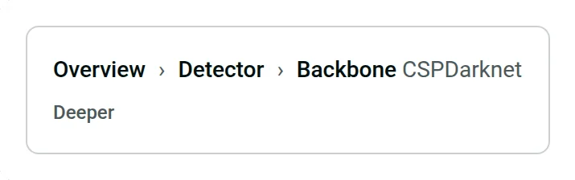

<!-- Written by `npm run docs:pages` from the kit and its examples. Do not edit. -->

# Breadcrumbs

_Components › Actions_ · [All topics](../README.md)

Where the user is and the way back, as the kit's one breadcrumb.

```html
<neat-breadcrumbs label="Current folder" [crumbs]="crumbs()" (go)="open($event)" />
```

<picture>
<source media="(prefers-color-scheme: dark)" srcset="../images/breadcrumbs/walking-a-path.dark.webp">

</picture>

```ts
import { NeatBreadcrumbs } from '@sima/neat-ui';
```

## Examples

### Walking a path

A model's levels as a path. `go` emits the index of the crumb pressed, and the app cuts the path there; press Deeper to walk it forward again. The last crumb shows its detail, muted.

<picture>
<source media="(prefers-color-scheme: dark)" srcset="../images/breadcrumbs/walking-a-path.dark.webp">

</picture>

<details>
<summary>Code</summary>

`1-walking-a-path.example.ts`

```ts
import { ChangeDetectionStrategy, Component, computed, signal } from '@angular/core';
import { type NeatBreadcrumb, NeatBreadcrumbs, NeatInlineButton, NeatNote } from '@sima/neat-ui';

const PLACES: readonly NeatBreadcrumb[] = [
  { label: 'Overview' },
  { label: 'Detector', detail: 'YOLOX' },
  { label: 'Backbone', detail: 'CSPDarknet' },
  { label: 'Stages', detail: 'four stages' },
];

@Component({
  selector: 'app-walking-a-path',
  imports: [NeatBreadcrumbs, NeatInlineButton, NeatNote],
  changeDetection: ChangeDetectionStrategy.OnPush,
  templateUrl: './1-walking-a-path.example.html',
  styleUrl: './walking-a-path.example.css',
})
export class WalkingAPath {
  protected readonly places = PLACES;
  /** How many of the places the path has walked. */
  protected readonly depth = signal(3);
  protected readonly path = computed(() => PLACES.slice(0, this.depth()));
}
```

`1-walking-a-path.example.html`

```html
<div class="card">
  <neat-breadcrumbs label="Example path" [crumbs]="path()" (go)="depth.set($event + 1)" />
  <p neatNote>
    <button
      neatInlineButton
      type="button"
      [disabled]="depth() === places.length"
      (click)="depth.set(depth() + 1)"
    >
      Deeper
    </button>
  </p>
</div>
```

`walking-a-path.example.css`

```css
.card {
  --neat-surface: var(--card);

  display: flex;
  flex-direction: column;
  gap: var(--neat-space-2);
  width: fit-content;
  max-width: 100%;
  padding: var(--neat-space-4);
  border: 1px solid var(--border);
  border-radius: var(--radius);
  background: var(--card);
  color: var(--card-foreground);
  font-size: var(--neat-text-xs);
}
```

</details>

## API

### `NeatBreadcrumbs`

Component from `@sima/neat-ui`, selector `neat-breadcrumbs`.

The file browser's folders and the diagram's levels use it.

It is a `nav` named by `label`, around an ordered list. Each crumb but the last is an inline button that emits its index on `go`. The last is plain text marked as the location (`aria-current="location"`), with its detail muted after it.

It takes Spartan's breadcrumb look: earlier crumbs muted, dark on hover, and the location in the text color. A decorative chevron icon sits between crumbs. A long path wraps onto further lines rather than scrolling.

A pressed crumb is usually gone once the app goes there, since it becomes the last. So the app moves the focus where the user's next step is.

**Inputs**

- **`label`** `string`, required

  The landmark's accessible name ("Current folder", "Levels").

- **`crumbs`** `readonly NeatBreadcrumb[]`, required

  From the first place to the one the user is at.

**Outputs**

- **`go`** `number`

  The index of the crumb pressed.

### `NeatBreadcrumb`

Interface from `@sima/neat-ui`.

A place on the way to where the user is: its name and, for the last, an optional detail.

**Members**

- **`label`** `string`

- **`detail`** `string`, optional

  Muted after the label; shown on the last crumb only, the place the user is at.
