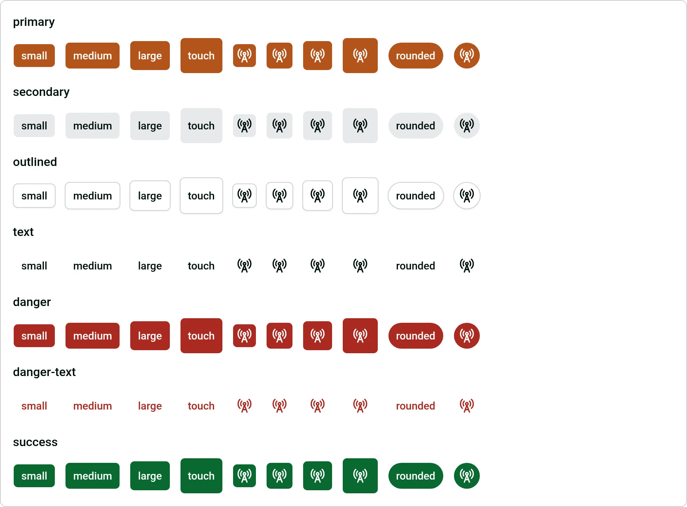
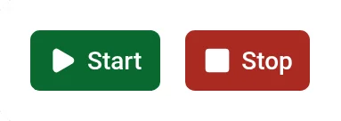
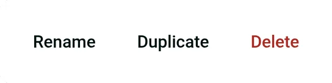
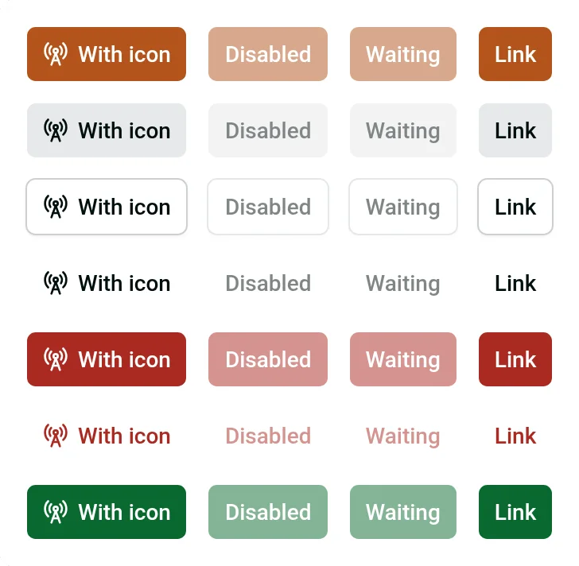
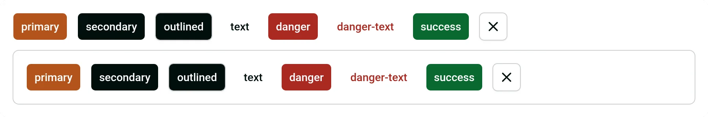
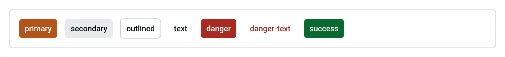

<!-- Written by `npm run docs:pages` from the kit and its examples. Do not edit. -->

# Button

_Components › Actions_ · [All topics](../README.md)

A button, or a link that looks like one.

```html
<button neatButton type="button" (click)="save()">Save</button>
```

<picture>
<source media="(prefers-color-scheme: dark)" srcset="../images/button/variants.dark.webp">

</picture>

```ts
import { NeatButton } from '@sima/neat-ui';
```

## Examples

### Variants

Each of the seven variants in the four sizes. Then the four sizes again as icon-only buttons, which need an `aria-label`, and `rounded` as a pill and as a circle.

<picture>
<source media="(prefers-color-scheme: dark)" srcset="../images/button/variants.dark.webp">

</picture>

<details>
<summary>Code</summary>

`1-variants.example.ts`

```ts
import { ChangeDetectionStrategy, Component } from '@angular/core';
import { NeatButton, type NeatButtonSize, NeatIcon } from '@sima/neat-ui';
import { VARIANTS } from './variants';

const SIZES: NeatButtonSize[] = ['small', 'medium', 'large', 'touch'];

@Component({
  selector: 'app-variants',
  imports: [NeatButton, NeatIcon],
  changeDetection: ChangeDetectionStrategy.OnPush,
  templateUrl: './1-variants.example.html',
  styleUrls: ['./stack.css', './variants.example.css'],
})
export class Variants {
  protected readonly variants = VARIANTS;
  protected readonly sizes = SIZES;
}
```

`1-variants.example.html`

```html
@for (variant of variants; track variant) {
  <section>
    <h4>{{ variant }}</h4>
    <div class="showcase-row">
      @for (size of sizes; track size) {
        <button neatButton type="button" [variant]="variant" [size]="size">{{ size }}</button>
      }
      @for (size of sizes; track size) {
        <button
          neatButton
          type="button"
          [variant]="variant"
          [size]="size"
          iconOnly
          [attr.aria-label]="'Stream, ' + size"
        >
          <neat-icon name="streaming" />
        </button>
      }
      <button neatButton type="button" [variant]="variant" rounded>rounded</button>
      <button
        neatButton
        type="button"
        [variant]="variant"
        rounded
        iconOnly
        aria-label="Stream, rounded"
      >
        <neat-icon name="streaming" />
      </button>
    </div>
  </section>
}
```

`variants.ts`

```ts
import type { NeatButtonVariant } from '@sima/neat-ui';

/** Every variant of the button, in the order its doc lists them. */
export const VARIANTS: readonly NeatButtonVariant[] = [
  'primary',
  'secondary',
  'outlined',
  'text',
  'danger',
  'danger-text',
  'success',
];
```

`stack.css`

```css
/* The example's rows one gap apart. */
:host {
  display: flex;
  flex-direction: column;
  gap: var(--neat-space-3);
}
```

`variants.example.css`

```css
/* A variant's name above its row of sizes. */
h4 {
  margin: 0 0 var(--neat-space-2);
  font-weight: 500;
}
```

</details>

### Start and stop

The action that starts something and the one that stops it: `success` with a filled `play` icon, and `danger` with a filled `stop` icon. The icon goes before the label, at 16 px.

<picture>
<source media="(prefers-color-scheme: dark)" srcset="../images/button/start-and-stop.dark.webp">

</picture>

<details>
<summary>Code</summary>

`2-start-and-stop.example.ts`

```ts
import { ChangeDetectionStrategy, Component } from '@angular/core';
import { NeatButton, NeatIcon } from '@sima/neat-ui';

@Component({
  selector: 'app-start-and-stop',
  imports: [NeatButton, NeatIcon],
  changeDetection: ChangeDetectionStrategy.OnPush,
  templateUrl: './2-start-and-stop.example.html',
})
export class StartAndStop {}
```

`2-start-and-stop.example.html`

```html
<div class="showcase-row">
  <button neatButton type="button" variant="success">
    <neat-icon name="play" [size]="16" />
    Start
  </button>
  <button neatButton type="button" variant="danger">
    <neat-icon name="stop" [size]="16" />
    Stop
  </button>
</div>
```

</details>

### Text actions

A destructive action among text buttons: Delete is `danger-text`, hovering as Rename and Duplicate do, with its label kept red.

<picture>
<source media="(prefers-color-scheme: dark)" srcset="../images/button/text-actions.dark.webp">

</picture>

<details>
<summary>Code</summary>

`3-text-actions.example.ts`

```ts
import { ChangeDetectionStrategy, Component } from '@angular/core';
import { NeatButton } from '@sima/neat-ui';

@Component({
  selector: 'app-text-actions',
  imports: [NeatButton],
  changeDetection: ChangeDetectionStrategy.OnPush,
  templateUrl: './3-text-actions.example.html',
})
export class TextActions {}
```

`3-text-actions.example.html`

```html
<div class="showcase-row">
  <button neatButton type="button" variant="text">Rename</button>
  <button neatButton type="button" variant="text">Duplicate</button>
  <button neatButton type="button" variant="danger-text">Delete</button>
</div>
```

</details>

### States

Per variant: with a `neat-icon` before the label, `disabled`, waiting and as a link. Look at the Waiting column: it is dimmed like Disabled, but Tab still reaches it and hover still works. The link leads back to this page, so trying it goes nowhere.

<picture>
<source media="(prefers-color-scheme: dark)" srcset="../images/button/states.dark.webp">

</picture>

<details>
<summary>Code</summary>

`4-states.example.ts`

```ts
import { ChangeDetectionStrategy, Component } from '@angular/core';
import { RouterLink } from '@angular/router';
import { NeatButton, NeatIcon } from '@sima/neat-ui';
import { VARIANTS } from './variants';

@Component({
  selector: 'app-states',
  imports: [NeatButton, NeatIcon, RouterLink],
  changeDetection: ChangeDetectionStrategy.OnPush,
  templateUrl: './4-states.example.html',
  styleUrl: './stack.css',
})
export class States {
  protected readonly variants = VARIANTS;
}
```

`4-states.example.html`

```html
@for (variant of variants; track variant) {
  <div class="showcase-row">
    <button neatButton type="button" [variant]="variant">
      <neat-icon name="streaming" [size]="16" />
      With icon
    </button>
    <button neatButton type="button" [variant]="variant" disabled>Disabled</button>
    <button neatButton type="button" [variant]="variant" aria-disabled="true">Waiting</button>
    <a neatButton [variant]="variant" routerLink="/components/actions/button">Link</a>
  </div>
}
```

`variants.ts`

```ts
import type { NeatButtonVariant } from '@sima/neat-ui';

/** Every variant of the button, in the order its doc lists them. */
export const VARIANTS: readonly NeatButtonVariant[] = [
  'primary',
  'secondary',
  'outlined',
  'text',
  'danger',
  'danger-text',
  'success',
];
```

`stack.css`

```css
/* The example's rows one gap apart. */
:host {
  display: flex;
  flex-direction: column;
  gap: var(--neat-space-3);
}
```

</details>

### Pressed

`[pressed]` on a toggle, on the page and on a card: click each one. Primary and success are solid fills, so look at their pressed state first. The last button leaves `pressed` unset, as a button that is not a toggle does: an icon-only `close` button with a tooltip.

<picture>
<source media="(prefers-color-scheme: dark)" srcset="../images/button/pressed.dark.webp">

</picture>

<details>
<summary>Code</summary>

`5-pressed.example.ts`

```ts
import { ChangeDetectionStrategy, Component, signal } from '@angular/core';
import { NeatButton, type NeatButtonVariant, NeatIcon, NeatTooltip } from '@sima/neat-ui';
import { VARIANTS } from './variants';

@Component({
  selector: 'app-pressed',
  imports: [NeatButton, NeatIcon, NeatTooltip],
  changeDetection: ChangeDetectionStrategy.OnPush,
  templateUrl: './5-pressed.example.html',
  styleUrls: ['./card.css', './stack.css'],
})
export class Pressed {
  protected readonly variants = VARIANTS;
  /** The surfaces a button sits on, as the contrast tests have it: the page and a card. */
  protected readonly surfaces = ['page', 'card'] as const;
  protected readonly pressedVariants = signal<ReadonlySet<NeatButtonVariant>>(
    new Set(['secondary', 'outlined']),
  );

  protected toggle(variant: NeatButtonVariant): void {
    this.pressedVariants.update((pressed) => {
      const next = new Set(pressed);
      if (!next.delete(variant)) next.add(variant);
      return next;
    });
  }
}
```

`5-pressed.example.html`

```html
@for (surface of surfaces; track surface) {
  <div class="showcase-row" [class.card]="surface === 'card'">
    @for (variant of variants; track variant) {
      <button
        neatButton
        type="button"
        [variant]="variant"
        [pressed]="pressedVariants().has(variant)"
        (click)="toggle(variant)"
      >
        {{ variant }}
      </button>
    }
    <button
      neatButton
      type="button"
      variant="outlined"
      iconOnly
      aria-label="Close"
      neatTooltip="Close"
    >
      <neat-icon name="close" />
    </button>
  </div>
}
```

`variants.ts`

```ts
import type { NeatButtonVariant } from '@sima/neat-ui';

/** Every variant of the button, in the order its doc lists them. */
export const VARIANTS: readonly NeatButtonVariant[] = [
  'primary',
  'secondary',
  'outlined',
  'text',
  'danger',
  'danger-text',
  'success',
];
```

`card.css`

```css
/*
 * A card as an app draws one: its own surface, which differs from the page's in dark mode, so a
 * fill that is visible on the page is checked on it too.
 */
.card {
  --neat-surface: var(--card);

  padding: var(--neat-space-4);
  border: 1px solid var(--border);
  border-radius: var(--radius);
  background: var(--card);
  color: var(--card-foreground);
}
```

`stack.css`

```css
/* The example's rows one gap apart. */
:host {
  display: flex;
  flex-direction: column;
  gap: var(--neat-space-3);
}
```

</details>

### On a card

Every variant on the card surface, which differs from the page's background in dark mode. Hover each one: the fill must stay visible.

<picture>
<source media="(prefers-color-scheme: dark)" srcset="../images/button/on-a-card.dark.webp">

</picture>

<details>
<summary>Code</summary>

`6-on-a-card.example.ts`

```ts
import { ChangeDetectionStrategy, Component } from '@angular/core';
import { NeatButton } from '@sima/neat-ui';
import { VARIANTS } from './variants';

@Component({
  selector: 'app-on-a-card',
  imports: [NeatButton],
  changeDetection: ChangeDetectionStrategy.OnPush,
  templateUrl: './6-on-a-card.example.html',
  styleUrl: './card.css',
})
export class OnACard {
  protected readonly variants = VARIANTS;
}
```

`6-on-a-card.example.html`

```html
<div class="card showcase-row">
  @for (variant of variants; track variant) {
    <button neatButton type="button" [variant]="variant">{{ variant }}</button>
  }
</div>
```

`variants.ts`

```ts
import type { NeatButtonVariant } from '@sima/neat-ui';

/** Every variant of the button, in the order its doc lists them. */
export const VARIANTS: readonly NeatButtonVariant[] = [
  'primary',
  'secondary',
  'outlined',
  'text',
  'danger',
  'danger-text',
  'success',
];
```

`card.css`

```css
/*
 * A card as an app draws one: its own surface, which differs from the page's in dark mode, so a
 * fill that is visible on the page is checked on it too.
 */
.card {
  --neat-surface: var(--card);

  padding: var(--neat-space-4);
  border: 1px solid var(--border);
  border-radius: var(--radius);
  background: var(--card);
  color: var(--card-foreground);
}
```

</details>

## API

### `NeatButton`

Directive from `@sima/neat-ui`, selector `button[neatButton], a[neatButton]`.

Its content is the label, a `neat-icon`, or both. An icon-only button needs an `aria-label`, and usually a `neatTooltip` with the same text.

A toggle button binds `pressed`, which sets `aria-pressed` and the pressed look. Leave `pressed` unset on a button that is no toggle: `aria-pressed="false"` would announce it as one.

A button that waits keeps the focus with `[attr.aria-disabled]="true"`: it is dimmed with a not-allowed cursor, stays focusable, and its tooltip still opens on hover. The kit only styles it. A click, Enter and Space still fire `click`, so the handler ignores presses while it waits.

**Inputs**

- **`variant`** `NeatButtonVariant`, default `'primary'`

  The look of the button, by the kind of action it starts; `primary` is the main one.

- **`size`** `NeatButtonSize`, default `'medium'`

  The button's height: `small`, `medium`, `large` or `touch` (3rem), for touch screens.

- **`iconOnly`** `boolean`, default `false`, transform `booleanAttribute`

  Square (or, with `rounded`, circular) and sized for a single icon.

- **`rounded`** `boolean`, default `false`, transform `booleanAttribute`

  Fully rounded ends: a pill, or a circle when `iconOnly`.

- **`pressed`** `boolean | undefined`, default `undefined`

  A toggle's state: `aria-pressed` and the pressed look.

  Leave it undefined for a button that is not a toggle. It is only for `button[neatButton]`: `aria-pressed` is not valid on a link.

  The primary, success and danger variants are solid fills already, so their pressed look is the least distinct. Against its resting fill, primary's is 2.78:1 in dark, success's 2.86:1 in light and 2.0:1 in dark, and danger's 2.87:1 in light and 2.48:1 in dark. Put toggles on the other variants.

- **`disabled`** `string | boolean | null | undefined`

  Turns the button off: dimmed, out of the Tab order and not clickable (a link gets no `disabled` attribute but the same look and `tabindex="-1"`). It loses the focus; use `aria-disabled` for a button that waits.

### `NeatButtonVariant`

Type from `@sima/neat-ui`.

The button's look, by what the action does.

- `primary`: the page's main action, in the app's accent.
- `secondary`: a quieter filled one, and the neutral choice.
- `outlined`: a bordered one.
- `text`: no fill and no border, for actions among others.
- `danger`: a solid red, for what stops or discards something (Stop recording).
- `danger-text`: that red as text, for a destructive action among text buttons.
- `success`: a solid green, for what starts something (Start recording).

`success` and `danger` pair with the filled `play` and `stop` icons. `danger-text` hovers as the text buttons beside it do, its label kept red, and focuses with danger's red ring.

```ts
type NeatButtonVariant = 'primary' | 'secondary' | 'outlined' | 'text' | 'danger' | 'danger-text' | 'success'
```

### `NeatButtonSize`

Type from `@sima/neat-ui`.

`touch` is a 3rem (48px) target, above the 44px minimum, for kiosk and touch screens.

```ts
type NeatButtonSize = 'small' | 'medium' | 'large' | 'touch'
```
