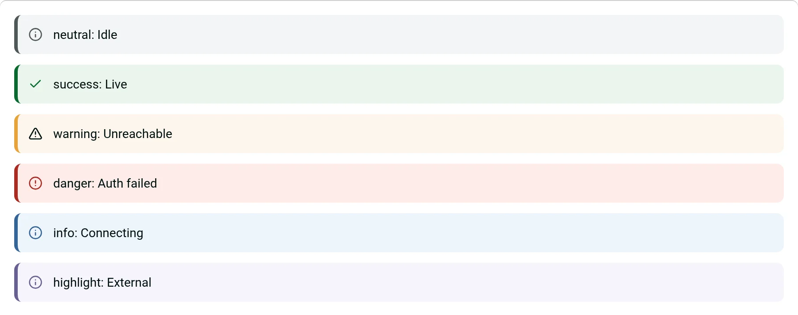
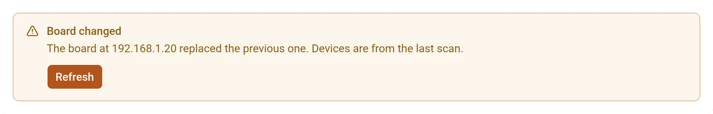

<!-- Written by `npm run docs:pages` from the kit and its examples. Do not edit. -->

# Callout

_Components › Status_ · [All topics](../README.md)

A note set apart on a status tint, with an optional heading and a row of actions:

```html
<neat-callout tone="warning" heading="Board changed" announce="status">
  The board at 192.168.1.20 replaced the previous one.
  <button neatButton neatCalloutActions type="button">Refresh</button>
</neat-callout>
```

<picture>
<source media="(prefers-color-scheme: dark)" srcset="../images/callout/tones.dark.webp">

</picture>

```ts
import { NeatCallout } from '@sima/neat-ui/callout';
```

## Examples

### Banner

A banner with a heading, a line of text and one action.

<picture>
<source media="(prefers-color-scheme: dark)" srcset="../images/callout/banner.dark.webp">

</picture>

<details>
<summary>Code</summary>

`1-banner.example.ts`

```ts
import { ChangeDetectionStrategy, Component } from '@angular/core';
import { NeatButton } from '@sima/neat-ui';
import { NeatCallout } from '@sima/neat-ui/callout';

@Component({
  selector: 'app-banner',
  imports: [NeatButton, NeatCallout],
  changeDetection: ChangeDetectionStrategy.OnPush,
  template: `
    <neat-callout tone="warning" heading="Board changed" region>
      The board at 192.168.1.20 replaced the previous one. Devices are from the last scan.
      <button neatButton neatCalloutActions type="button" size="small">Refresh</button>
    </neat-callout>
  `,
})
export class Banner {}
```

</details>

### Tones

One callout per tone, with no heading: the icon, the start border and the fill change.

<picture>
<source media="(prefers-color-scheme: dark)" srcset="../images/callout/tones.dark.webp">

</picture>

<details>
<summary>Code</summary>

`2-tones.example.ts`

```ts
import { ChangeDetectionStrategy, Component } from '@angular/core';
import { NeatCallout } from '@sima/neat-ui/callout';

@Component({
  selector: 'app-tones',
  imports: [NeatCallout],
  changeDetection: ChangeDetectionStrategy.OnPush,
  template: `
    @for (note of notes; track note.tone) {
      <neat-callout [tone]="note.tone">{{ note.tone }}: {{ note.text }}</neat-callout>
    }
  `,
  styleUrl: './tones.example.css',
})
export class Tones {
  protected readonly notes = [
    { tone: 'neutral', text: 'Idle' },
    { tone: 'success', text: 'Live' },
    { tone: 'warning', text: 'Unreachable' },
    { tone: 'danger', text: 'Auth failed' },
    { tone: 'info', text: 'Connecting' },
    { tone: 'highlight', text: 'External' },
  ] as const;
}
```

`tones.example.css`

```css
/* The callouts one gap apart, as banners stack over a page. */
:host {
  display: flex;
  flex-direction: column;
  gap: var(--neat-space-3);
}
```

</details>

## API

### `NeatCallout`

Component from `@sima/neat-ui/callout`, selector `neat-callout`.

For a banner over a page, a problem or a guide in a dialog, a note in a panel. `tone` (a [`NeatTone`](../theme/colors.md#neattone), `info` by default) picks the fill, the start border and the icon: `error` for danger, `warning`, `check` for success, `info` otherwise. The content is the body; elements marked `neatCalloutActions` go to a row under it.

The heading is a real heading (`role="heading"`), at `headingLevel`, 3 by default: under a dialog's title (a level 2) or a page's section, as heading navigation finds it. Pick the level that fits where the callout stands.

The fill is the page's color mixed with the tone (see TONES), so in a dialog it differs from the dialog's own surface, and a neutral callout in a dark one shows by its border and icon.

`region` makes the callout a landmark, for a notice a user should be able to jump to (the Viewer's late notice); the heading names it, and without a heading the callout takes no role, since a region with no name is no landmark. `announce` gives the host the live role to say the note with when it appears instead: `status` for news that can wait, `alert` for a failure that needs attention now; it wins over `region`, since a host has one role. A callout with a role is labeled by its heading (`aria-labelledby`); one with none is simply there. A live region speaks what is added to it, so render the callout when its news happens (an `@if`), not hidden beforehand.

**Inputs**

- **`tone`** `NeatTone`, default `'info'`

  The kind of note: sets the fill, the start border and the icon.

- **`heading`** `string`, default `''`

  A short heading over the body; none if empty.

- **`headingLevel`** `2 | 3 | 4 | 5 | 6`, default `3`

  The heading's level in the page's outline.

- **`region`** `boolean`, default `false`, transform `booleanAttribute`

  Whether the callout is a landmark, named by its heading (none without one); a live role wins over it.

- **`announce`** `'status' | 'alert' | null`, default `null`

  The live role the note is said with when it appears; none by default.
