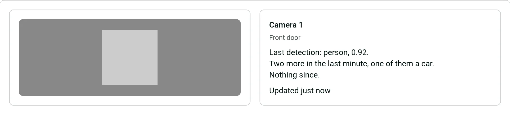
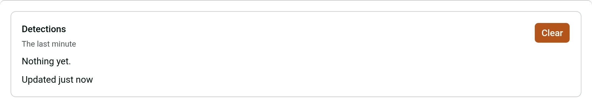
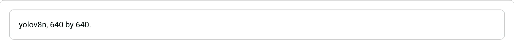
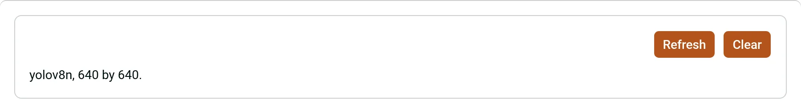
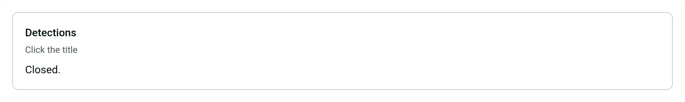

<!-- Written by `npm run docs:pages` from the kit and its examples. Do not edit. -->

# Card

_Components › Data_ · [All topics](../README.md)

A card: a surface with an optional title and subtitle, actions beside them and a footer:

```html
<neat-card title="Detections" subtitle="Last minute">
  <button neatButton neatCardActions type="button" size="small">Clear</button>
  <p>Nothing yet.</p>
  <p neatCardFooter>Updated now</p>
</neat-card>
```

<picture>
<source media="(prefers-color-scheme: dark)" srcset="../images/card/filling-the-row.dark.webp">

</picture>

```ts
import { NeatCard } from '@sima/neat-ui/card';
```

## Examples

### Titled card example

A card with a title, a subtitle, an action at the header's end and a footer. It is a landmark too: `region` names it by its title, for a user who jumps between regions.

<picture>
<source media="(prefers-color-scheme: dark)" srcset="../images/card/titled-card.dark.webp">

</picture>

<details>
<summary>Code</summary>

`1-titled-card.example.ts`

```ts
import { ChangeDetectionStrategy, Component } from '@angular/core';
import { NeatButton } from '@sima/neat-ui';
import { NeatCard } from '@sima/neat-ui/card';

@Component({
  selector: 'app-titled-card',
  imports: [NeatButton, NeatCard],
  changeDetection: ChangeDetectionStrategy.OnPush,
  template: `
    <neat-card title="Detections" subtitle="The last minute" region>
      <button neatButton neatCardActions type="button" size="small">Clear</button>
      <p>Nothing yet.</p>
      <p neatCardFooter>Updated just now</p>
    </neat-card>
  `,
  styleUrl: './card.example.css',
})
export class TitledCardExample {}
```

`card.example.css`

```css
p {
  margin: 0;
}

/* A title that is a button reads as the title does, and as something to click. */
.title-button {
  padding: 0;
  border: 0;
  background: none;
  color: inherit;
  font: inherit;
  cursor: pointer;
}
```

</details>

### Content only card example

A card with content only: no header, no landmark, and no space kept for either.

<picture>
<source media="(prefers-color-scheme: dark)" srcset="../images/card/content-only.dark.webp">

</picture>

<details>
<summary>Code</summary>

`2-content-only.example.ts`

```ts
import { ChangeDetectionStrategy, Component } from '@angular/core';
import { NeatCard } from '@sima/neat-ui/card';

@Component({
  selector: 'app-content-only-card',
  imports: [NeatCard],
  changeDetection: ChangeDetectionStrategy.OnPush,
  template: `
    <neat-card>
      <p>yolov8n, 640 by 640.</p>
    </neat-card>
  `,
  styleUrl: './card.example.css',
})
export class ContentOnlyCardExample {}
```

`card.example.css`

```css
p {
  margin: 0;
}

/* A title that is a button reads as the title does, and as something to click. */
.title-button {
  padding: 0;
  border: 0;
  background: none;
  color: inherit;
  font: inherit;
  cursor: pointer;
}
```

</details>

### Filling the row example

Two cards in a row of equal height.

The content takes the height the card has left. So the untitled card gives its image all of it, and a footer stands at the bottom of its card however little there is above it.

<picture>
<source media="(prefers-color-scheme: dark)" srcset="../images/card/filling-the-row.dark.webp">

</picture>

<details>
<summary>Code</summary>

`3-filling-the-row.example.ts`

```ts
import { ChangeDetectionStrategy, Component } from '@angular/core';
import { NeatCard } from '@sima/neat-ui/card';

@Component({
  selector: 'app-filling-the-row',
  imports: [NeatCard],
  changeDetection: ChangeDetectionStrategy.OnPush,
  template: `
    <neat-card>
      <div class="frame">
        
      </div>
    </neat-card>
    <neat-card title="Camera 1" subtitle="Front door">
      <p>Last detection: person, 0.92.</p>
      <p>Two more in the last minute, one of them a car.</p>
      <p>Nothing since.</p>
      <p neatCardFooter>Updated just now</p>
    </neat-card>
  `,
  styleUrl: './filling-the-row.example.css',
})
export class FillingTheRowExample {}
```

`filling-the-row.example.css`

```css
/* A row of cards, as tall as the tallest. */
:host {
  display: grid;
  grid-template-columns: repeat(2, minmax(0, 1fr));
  gap: var(--neat-space-4);
}

p {
  margin: 0;
}

/* The picture lies over the frame, which is as tall as the card leaves its content. */
.frame {
  position: relative;
  height: 100%;
}

.picture {
  position: absolute;
  inset: 0;
  width: 100%;
  height: 100%;
  object-fit: cover;
  border-radius: var(--radius);
}
```

</details>

### Actions only card example

A card with actions and no title: they still sit at the header's end, and the card is no region.

<picture>
<source media="(prefers-color-scheme: dark)" srcset="../images/card/actions-only.dark.webp">

</picture>

<details>
<summary>Code</summary>

`4-actions-only.example.ts`

```ts
import { ChangeDetectionStrategy, Component } from '@angular/core';
import { NeatButton } from '@sima/neat-ui';
import { NeatCard } from '@sima/neat-ui/card';

@Component({
  selector: 'app-actions-only-card',
  imports: [NeatButton, NeatCard],
  changeDetection: ChangeDetectionStrategy.OnPush,
  template: `
    <neat-card>
      <button neatButton neatCardActions type="button" size="small">Refresh</button>
      <button neatButton neatCardActions type="button" size="small">Clear</button>
      <p>yolov8n, 640 by 640.</p>
    </neat-card>
  `,
  styleUrl: './card.example.css',
})
export class ActionsOnlyCardExample {}
```

`card.example.css`

```css
p {
  margin: 0;
}

/* A title that is a button reads as the title does, and as something to click. */
.title-button {
  padding: 0;
  border: 0;
  background: none;
  color: inherit;
  font: inherit;
  cursor: pointer;
}
```

</details>

### Title button card example

A card whose title is a button, projected with `neatCardTitle` in place of the title's text: a card that opens its detail. Without a `title` the card has no heading role, so the button is the card's name as a control.

<picture>
<source media="(prefers-color-scheme: dark)" srcset="../images/card/title-as-a-button.dark.webp">

</picture>

<details>
<summary>Code</summary>

`5-title-as-a-button.example.ts`

```ts
import { ChangeDetectionStrategy, Component, signal } from '@angular/core';
import { NeatCard } from '@sima/neat-ui/card';

@Component({
  selector: 'app-title-button-card',
  imports: [NeatCard],
  changeDetection: ChangeDetectionStrategy.OnPush,
  template: `
    <neat-card subtitle="Click the title">
      <button type="button" neatCardTitle class="title-button" (click)="opened.set(!opened())">
        Detections
      </button>
      <p>{{ opened() ? 'Opened.' : 'Closed.' }}</p>
    </neat-card>
  `,
  styleUrl: './card.example.css',
})
export class TitleButtonCardExample {
  protected readonly opened = signal(false);
}
```

`card.example.css`

```css
p {
  margin: 0;
}

/* A title that is a button reads as the title does, and as something to click. */
.title-button {
  padding: 0;
  border: 0;
  background: none;
  color: inherit;
  font: inherit;
  cursor: pointer;
}
```

</details>

## API

### `NeatCard`

Component from `@sima/neat-ui/card`, selector `neat-card`.

The title stands at the start of the header, with the subtitle under it. Elements marked `neatCardActions` go to the header's end, and elements marked `neatCardFooter` to the footer. Everything else is the content.

An element marked `neatCardTitle`, such as a button, stands in the title's place as it is, inside the title's element. With `title` text as well, that element is in the heading and names the region. Without it, the card has no heading role.

The attributes are selectors of the card, not directives, so they need no import and cannot be forgotten into silence.

The header, the footer and the actions area are always in the template, and leave the layout while empty. So a card without a title, a subtitle or actions has no header, and actions alone still sit at the header's end.

The title is a real heading (`role="heading"`), at `headingLevel`, 3 by default, as the callout's is. Pick the level that fits where the card stands.

`region` makes the card a landmark (`role="region"`, labeled by the title), for a card a user should be able to jump to. Without a title it takes no role, since a region with no name is no landmark.

The card sets `--neat-surface` to its fill, for the charts it holds.

**Inputs**

- **`title`** `string`, default `''`

  The card's title, a heading at `headingLevel`; none if empty.

- **`headingLevel`** `2 | 3 | 4 | 5 | 6`, default `3`

  The title's level in the page's outline.

- **`region`** `boolean`, default `false`, transform `booleanAttribute`

  Whether the card is a landmark, named by its title (none without one).

- **`subtitle`** `string`, default `''`

  A line under the title; none if empty.
