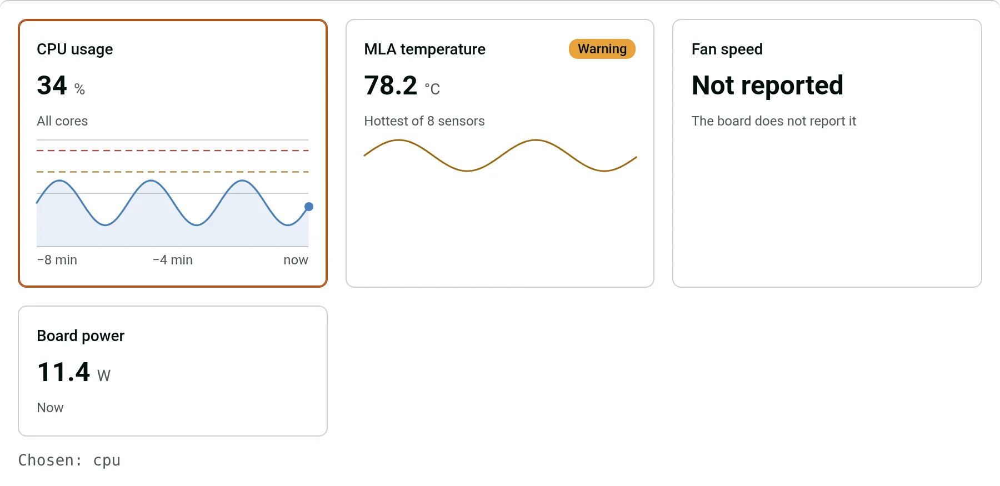

<!-- Written by `npm run docs:pages` from the kit and its examples. Do not edit. -->

# Chart card

_Components › Charts_ · [All topics](../README.md)

A card for a metric and its chart:

```html
<neat-chart-card heading="MLA temperature" value="62.4" unit="°C" caption="Hottest of 8 sensors"
  selectable [selected]="open() === 'mla'" (activate)="open.set('mla')">
  <neat-status-chip neatChartCardChip tone="warning">Warning</neat-status-chip>
  <neat-sparkline … />
</neat-chart-card>
```

<picture>
<source media="(prefers-color-scheme: dark)" srcset="../images/chart-card/selectable-cards.dark.webp">

</picture>

```ts
import { NeatChartCard } from '@sima/neat-ui/charts';
```

## Examples

### Selectable cards

Three selectable cards and one that is not; the readout says which is chosen. Click the first card's chart, not only its heading, to choose it. The second holds a chip and a sparkline, the third has nothing to show, and the fourth takes no click.

<picture>
<source media="(prefers-color-scheme: dark)" srcset="../images/chart-card/selectable-cards.dark.webp">

</picture>

<details>
<summary>Code</summary>

`1-selectable-cards.example.ts`

```ts
import { ChangeDetectionStrategy, Component, signal } from '@angular/core';
import { NeatChartCard, NeatSparkline, NeatTimeChart } from '@sima/neat-ui/charts';
import { NeatStatusChip } from '@sima/neat-ui/status-chip';
import { celsius, CPU, CPU_THRESHOLDS, percent, TEMPERATURE, TIMES } from './data';

@Component({
  selector: 'app-selectable-cards',
  imports: [NeatChartCard, NeatSparkline, NeatStatusChip, NeatTimeChart],
  changeDetection: ChangeDetectionStrategy.OnPush,
  templateUrl: './1-selectable-cards.example.html',
  styleUrl: './selectable-cards.example.css',
})
export class SelectableCards {
  protected readonly chosen = signal('cpu');
  protected readonly cpu = CPU;
  protected readonly thresholds = CPU_THRESHOLDS;
  protected readonly temperature = TEMPERATURE;
  protected readonly times = TIMES;
  protected readonly percent = percent;
  protected readonly celsius = celsius;
}
```

`1-selectable-cards.example.html`

```html
<div class="grid">
  <neat-chart-card
    heading="CPU usage"
    value="34"
    unit="%"
    caption="All cores"
    selectable
    [selected]="chosen() === 'cpu'"
    (activate)="chosen.set('cpu')"
  >
    <neat-time-chart
      label="CPU usage"
      headless
      [valueLabels]="false"
      [series]="cpu"
      [times]="times"
      [domain]="[0, 100]"
      [thresholds]="thresholds"
      [format]="percent"
    />
  </neat-chart-card>
  <neat-chart-card
    heading="MLA temperature"
    value="78.2"
    unit="°C"
    caption="Hottest of 8 sensors"
    selectable
    [selected]="chosen() === 'mla'"
    (activate)="chosen.set('mla')"
  >
    <neat-status-chip neatChartCardChip tone="warning">Warning</neat-status-chip>
    <neat-sparkline
      label="MLA temperature"
      tone="warning"
      [values]="temperature"
      [format]="celsius"
    />
  </neat-chart-card>
  <neat-chart-card
    heading="Fan speed"
    value="Not reported"
    caption="The board does not report it"
    selectable
    [selected]="chosen() === 'fan'"
    (activate)="chosen.set('fan')"
  />
  <neat-chart-card heading="Board power" value="11.4" unit="W" caption="Now" />
</div>
<p class="chosen showcase-code showcase-muted">Chosen: {{ chosen() }}</p>
```

`data.ts`

```ts
import type { NeatChartFormat, NeatSeries, NeatThreshold } from '@sima/neat-ui/charts';

/** A sine wave of `count` samples: a plausible, smooth metric. */
function sine(count: number, cycles: number, low: number, high: number): number[] {
  return Array.from({ length: count }, (_, index) => {
    const wave = (Math.sin((index / count) * cycles * 2 * Math.PI) + 1) / 2;
    return Number((low + wave * (high - low)).toFixed(2));
  });
}

/**
 * Eight minutes of samples four seconds apart, ending at a fixed instant so the demo stands
 * still.
 */
const SAMPLES = 120;
export const TIMES: readonly number[] = Array.from(
  { length: SAMPLES },
  (_, index) => Date.UTC(2026, 9, 24, 12, 0, 0) + index * 4000,
);

export const percent: NeatChartFormat = (value) => `${value.toFixed(0)}%`;
export const celsius: NeatChartFormat = (value) => `${value.toFixed(1)} °C`;

export const CPU: readonly NeatSeries[] = [
  { key: 'cpu', label: 'CPU', values: sine(SAMPLES, 3, 20, 62) },
];
export const CPU_THRESHOLDS: readonly NeatThreshold[] = [
  { value: 70, tone: 'warning', label: 'Warning 70%' },
  { value: 90, tone: 'danger', label: 'Critical 90%' },
];

export const TEMPERATURE: readonly number[] = sine(SAMPLES, 2, 62, 80);
```

`selectable-cards.example.css`

```css
:host {
  display: flex;
  flex-direction: column;
  gap: var(--neat-space-3);
}

.grid {
  display: grid;
  grid-template-columns: repeat(auto-fit, minmax(min(100%, 16rem), 1fr));
  gap: var(--neat-space-4);
}

.chosen {
  margin: 0;
}
```

</details>

## API

### `NeatChartCard`

Component from `@sima/neat-ui/charts`, selector `neat-chart-card`.

From top to bottom it shows:

- the heading, with the `[neatChartCardChip]` content beside it at the end;
- the value, large, with its unit smaller and muted after it;
- the caption;
- the default content, the chart.

The value and the caption are left out while they are empty.

With `selectable`, the card is one choice among its siblings. The heading is a button, so it is the keyboard's way in, and `aria-current` marks it while `selected`. A click anywhere on the card emits `activate` as well, its chart's plot included. The plot reads out a sample as the pointer moves over it, so a click there takes nothing from the readout, and the plot is most of the card.

The plot's keys stay the chart's: they move the readout and choose nothing. A control in the content, such as a button, a link or a form field, handles its own click and leaves the card alone. Not selectable, the heading is text and the card handles no clicks.

The card is a [`NeatCard`](../components/card.md#neatcard): the frame, the `--card` fill, and `--neat-surface` for the charts' label halos. It has no clipping and no stacking context, so a readout can hang below its plot. The chart card adds the selected look and what goes in it.

**Inputs**

- **`heading`** `string`, required

  What the card is about: "MLA temperature".

- **`value`** `string`, default `''`

  The current value, already worded: "62.4".

- **`unit`** `string`, default `''`

  The value's unit, after it: "°C".

- **`caption`** `string`, default `''`

  A line under the value: what it is the value of.

- **`selectable`** `boolean`, default `false`, transform `booleanAttribute`

  Whether the card can be chosen: its heading is a button, and a click on the card activates it.

- **`selected`** `boolean`, default `false`, transform `booleanAttribute`

  Whether this is the chosen card; only a selectable card shows it.

**Outputs**

- **`activate`** `void`

  The card was chosen, by its heading or a click on it.
