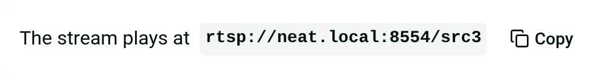

<!-- Written by `npm run docs:pages` from the kit and its examples. Do not edit. -->

# Code block

_Components › Data_ · [All topics](../README.md)

Code set apart on the muted fill, as written, with an optional Copy button at its end.

```html
<neat-code-block [code]="command" copy="install command" />
```

<picture>
<source media="(prefers-color-scheme: dark)" srcset="../images/code-block/install-command.dark.webp">

</picture>

```ts
import { NeatCodeBlock, NeatCopyButton, provideNeatCodeLanguages } from '@sima/neat-ui/code-block';
```

## Examples

### Install command

A command to run, with a Copy button named "Copy install command". A long command wraps.

Press Copy, then paste the command somewhere.

<picture>
<source media="(prefers-color-scheme: dark)" srcset="../images/code-block/install-command.dark.webp">

</picture>

<details>
<summary>Code</summary>

`1-install-command.example.ts`

```ts
import { ChangeDetectionStrategy, Component } from '@angular/core';
import { NeatCodeBlock } from '@sima/neat-ui/code-block';

@Component({
  selector: 'app-install-command',
  imports: [NeatCodeBlock],
  changeDetection: ChangeDetectionStrategy.OnPush,
  templateUrl: './1-install-command.example.html',
})
export class InstallCommand {
  protected readonly command = 'npm install ./vendor/sima-neat-ui-<version>.tgz';
}
```

`1-install-command.example.html`

```html
<neat-code-block [code]="command" copy="install command" />
```

</details>

### Whole file

A whole file, its lines and indents as written. With `overflow="scroll"` a long line keeps its shape, and the block scrolls sideways.

Make the window narrow and scroll the code.

<picture>
<source media="(prefers-color-scheme: dark)" srcset="../images/code-block/whole-file.dark.webp">

</picture>

<details>
<summary>Code</summary>

`2-whole-file.example.ts`

```ts
import { ChangeDetectionStrategy, Component } from '@angular/core';
import { NeatCodeBlock } from '@sima/neat-ui/code-block';

const APP_CONFIG = `import { ApplicationConfig } from '@angular/core';
import { provideRouter } from '@angular/router';
import { provideNeatTitles, provideNeatUi } from '@sima/neat-ui';
import { routes } from './app.routes';

export const appConfig: ApplicationConfig = {
  providers: [provideRouter(routes), provideNeatUi(), provideNeatTitles('Streams')],
};
`;

@Component({
  selector: 'app-whole-file',
  imports: [NeatCodeBlock],
  changeDetection: ChangeDetectionStrategy.OnPush,
  templateUrl: './2-whole-file.example.html',
})
export class WholeFile {
  protected readonly file = APP_CONFIG;
}
```

`2-whole-file.example.html`

```html
<neat-code-block [code]="file" copy="app.config.ts" overflow="scroll" />
```

</details>

### Python file

A Python file in the theme's code colors: `language="python"` names its language. The highlighter and the Python grammar load the first time a block shows Python, and until they are there the block shows the code plain, in the same lines.

Switch the theme to see the colors in both schemes, then press Copy: it copies the file as given.

<details>
<summary>Code</summary>

`3-python-file.example.ts`

```ts
import { ChangeDetectionStrategy, Component } from '@angular/core';
import { NeatCodeBlock } from '@sima/neat-ui/code-block';

const RUN_MODEL = `"""Run a ResNet-50 model on one image with pyneat."""
from pathlib import Path

import numpy as np
import pyneat

MODEL = Path("/data/models/resnet_50.tar.gz")


def build_options(size: int) -> pyneat.ModelOptions:
    options = pyneat.ModelOptions()
    options.preprocess.kind = pyneat.InputKind.Image
    options.preprocess.input_max_width = size
    options.preprocess.input_max_height = size
    options.preprocess.preset = pyneat.NormalizePreset.ImageNet
    return options


model = pyneat.Model(MODEL, build_options(224))
image = np.full((224, 224, 3), 99, dtype=np.uint8)  # a gray test frame
tensor = pyneat.Tensor.from_numpy(image, copy=True, image_format=pyneat.PixelFormat.RGB)
outputs = model.run([tensor], timeout_ms=2000)
print(f"top1={int(np.argmax(outputs[0].to_numpy()))}")
`;

@Component({
  selector: 'app-python-file',
  imports: [NeatCodeBlock],
  changeDetection: ChangeDetectionStrategy.OnPush,
  templateUrl: './3-python-file.example.html',
})
export class PythonFile {
  protected readonly file = RUN_MODEL;
}
```

`3-python-file.example.html`

```html
<neat-code-block [code]="file" language="python" copy="run_model.py" overflow="scroll" />
```

</details>

### Line numbers

A C++ file with its lines numbered: `[lineNumbers]="true"` adds a gutter as wide as the last number. The numbers are not part of the text.

Select a few lines and paste them somewhere: the numbers stay behind.

<details>
<summary>Code</summary>

`4-line-numbers.example.ts`

```ts
import { ChangeDetectionStrategy, Component } from '@angular/core';
import { NeatCodeBlock } from '@sima/neat-ui/code-block';

const RUN_MODEL = `// Run a ResNet-50 model on one image with Neat.
#include "neat.h"

#include <opencv2/core.hpp>

#include <iostream>
#include <vector>

int main(int argc, char** argv) {
  if (argc < 2) {
    std::cerr << "Usage: run_model <model.tar.gz>\\n";
    return 1;
  }
  simaai::neat::Model::Options options;
  options.preprocess.kind = simaai::neat::InputKind::Image;
  options.preprocess.input_max_width = 224;
  options.preprocess.input_max_height = 224;
  options.preprocess.preset = simaai::neat::NormalizePreset::ImageNet;

  simaai::neat::Model model(argv[1], options);
  cv::Mat input(224, 224, CV_8UC3, cv::Scalar(99, 99, 99));  // a gray test frame
  simaai::neat::TensorList outputs = model.run(std::vector<cv::Mat>{input}, /*timeout_ms=*/2000);

  std::cout << "outputs: " << outputs.size() << "\\n";
  return 0;
}
`;

@Component({
  selector: 'app-line-numbers',
  imports: [NeatCodeBlock],
  changeDetection: ChangeDetectionStrategy.OnPush,
  templateUrl: './4-line-numbers.example.html',
})
export class LineNumbers {
  protected readonly file = RUN_MODEL;
}
```

`4-line-numbers.example.html`

```html
<neat-code-block
  [code]="file"
  language="cpp"
  [lineNumbers]="true"
  copy="run_model.cpp"
  overflow="scroll"
/>
```

</details>

### Another language

A language the kit does not color by itself, a diff, added with [`provideNeatCodeLanguages`](../components/code-block.md#provideneatcodelanguages). Its grammar comes from Shiki's `@shikijs/langs` as a dynamic import, so it loads only when a block shows a diff.

Here the example's own `providers` add it for the blocks in its template. An app that shows diffs on many pages adds it in its `app.config.ts` instead.

<details>
<summary>Code</summary>

`5-another-language.example.ts`

```ts
import { ChangeDetectionStrategy, Component } from '@angular/core';
import { NeatCodeBlock, provideNeatCodeLanguages } from '@sima/neat-ui/code-block';

const CHANGE = `--- a/run_model.py
+++ b/run_model.py
@@ -21,5 +21,5 @@
 model = pyneat.Model(MODEL, build_options(224))
 image = np.full((224, 224, 3), 99, dtype=np.uint8)  # a gray test frame
 tensor = pyneat.Tensor.from_numpy(image, copy=True, image_format=pyneat.PixelFormat.RGB)
-outputs = model.run([tensor], timeout_ms=2000)
+outputs = model.run([tensor], timeout_ms=500)
 print(f"top1={int(np.argmax(outputs[0].to_numpy()))}")
`;

@Component({
  selector: 'app-another-language',
  imports: [NeatCodeBlock],
  changeDetection: ChangeDetectionStrategy.OnPush,
  providers: [provideNeatCodeLanguages({ diff: () => import('@shikijs/langs/diff') })],
  templateUrl: './5-another-language.example.html',
})
export class AnotherLanguage {
  protected readonly change = CHANGE;
}
```

`5-another-language.example.html`

```html
<neat-code-block [code]="change" language="diff" copy="change" overflow="scroll" />
```

</details>

### Colored by the app

Code the app colored itself, as spans inside the block: runs from a highlighter of its own, as the showcase's snippets are colored at build time. They are shown in place of `code`, which spells the same text and stays what Copy copies. The spans take the theme's code colors, as `--neat-code-keyword` here. For code in a language the kit knows, `language` is simpler.

<picture>
<source media="(prefers-color-scheme: dark)" srcset="../images/code-block/colored-by-the-app.dark.webp">

</picture>

<details>
<summary>Code</summary>

`6-colored-by-the-app.example.ts`

```ts
import { ChangeDetectionStrategy, Component } from '@angular/core';
import { NeatCodeBlock } from '@sima/neat-ui/code-block';

/** A stretch of code and the kind of text it is, as a highlighter gives them. */
interface Run {
  readonly kind: 'keyword' | 'string' | 'text';
  readonly text: string;
}

const RUNS: readonly Run[] = [
  { kind: 'keyword', text: 'const' },
  { kind: 'text', text: ' source = ' },
  { kind: 'string', text: "'rtsp://neat.local:8554/src3'" },
  { kind: 'text', text: ';' },
];

@Component({
  selector: 'app-colored-by-the-app',
  imports: [NeatCodeBlock],
  changeDetection: ChangeDetectionStrategy.OnPush,
  templateUrl: './6-colored-by-the-app.example.html',
  styleUrl: './colored-by-the-app.example.css',
})
export class ColoredByTheApp {
  protected readonly runs = RUNS;
  protected readonly code = RUNS.map((run) => run.text).join('');
}
```

`6-colored-by-the-app.example.html`

```html
<neat-code-block [code]="code" copy="line">
  @for (run of runs; track $index) {
    <span [class]="run.kind">{{ run.text }}</span>
  }
</neat-code-block>
```

`colored-by-the-app.example.css`

```css
/* The theme's code colors, which keep 4.5:1 on the block's --muted fill in both schemes. */
.keyword {
  color: var(--neat-code-keyword);
}

.string {
  color: var(--neat-code-string);
}
```

</details>

### Stream URL

The Copy button on its own, beside a URL in running text. Its name is "Copy stream URL".

Press Copy, then paste the URL into a player.

<picture>
<source media="(prefers-color-scheme: dark)" srcset="../images/code-block/stream-url.dark.webp">

</picture>

<details>
<summary>Code</summary>

`7-stream-url.example.ts`

```ts
import { ChangeDetectionStrategy, Component } from '@angular/core';
import { NeatCode } from '@sima/neat-ui';
import { NeatCopyButton } from '@sima/neat-ui/code-block';

@Component({
  selector: 'app-stream-url',
  imports: [NeatCode, NeatCopyButton],
  changeDetection: ChangeDetectionStrategy.OnPush,
  templateUrl: './7-stream-url.example.html',
  styleUrl: './stream-url.example.css',
})
export class StreamURL {
  protected readonly url = 'rtsp://neat.local:8554/src3';
}
```

`7-stream-url.example.html`

```html
<p class="url">
  The stream plays at <code neatCode>{{ url }}</code>
  <neat-copy-button [text]="url" what="stream URL" />
</p>
```

`stream-url.example.css`

```css
/* The sentence and its Copy button on one line, wrapping as one. */
.url {
  display: flex;
  flex-wrap: wrap;
  align-items: center;
  gap: var(--neat-space-2);
  margin: 0;
}
```

</details>

## API

### `NeatCodeBlock`

Component from `@sima/neat-ui/code-block`, selector `neat-code-block`.

For a command to run, a file to paste or a URL to copy. For a name or a path in running text, use `code[neatCode]` instead.

`copy` names what the code is and adds a [`NeatCopyButton`](../components/code-block.md#neatcopybutton) beside the code. "install command" names the button "Copy install command". Without `copy` the block has no button.

`overflow` is `wrap` by default, for short code such as a command, which then breaks anywhere. Use `scroll` for a whole file, whose lines keep their shape and scroll sideways.

`language` colors the code in the theme's code colors:

```html
<neat-code-block [code]="source" language="python" copy="example" overflow="scroll" />
```

The block colors Python, C++, C, shell, JSON, YAML, CMake, TypeScript, JavaScript, HTML, CSS, Markdown, Dockerfile and Go by themselves; [`provideNeatCodeLanguages`](../components/code-block.md#provideneatcodelanguages) adds others. The highlighter (Shiki) and each language's grammar load the first time a block on the page shows that language, so a page without a colored block loads none of it, and one with Python only never loads C++. While they load, the block shows the code plain, in the same layout. A language the block does not know leaves the code plain and is named once in dev mode.

`lineNumbers` numbers the lines in a gutter at their start. The numbers are not part of the text: a selection leaves them out, a screen reader does not read them, and Copy copies the code as given, colored or not.

An app that colors its code itself (spans from a highlighter run at build time) puts them inside the element. They are shown in place of the block's own lines, without `language` or `lineNumbers`, and `code` stays what Copy copies, so they must spell the same text:

```html
<neat-code-block [code]="source" copy="app.ts">
  @for (run of runs; track $index) {
    <span [class]="run.kind">{{ run.text }}</span>
  }
</neat-code-block>
```

Angular leaves out the line breaks between a template's elements, so only the spans' own text shows, as written.

**Inputs**

- **`code`** `string`, required

  The code, as text: shown, and copied by the Copy button.

- **`copy`** `string`

  What the code is, which adds a Copy button named after it ("Copy install command").

- **`overflow`** `NeatCodeOverflow`, default `'wrap'`

  Whether a long line wraps or scrolls sideways (a [`NeatCodeOverflow`](../components/code-block.md#neatcodeoverflow)).

- **`language`** `string | null`, default `null`

  The language the code is in, by its Shiki name or an alias (`"python"`, `"cpp"`, `"bash"`), which colors it; `null`, the default, shows it plain.

- **`lineNumbers`** `boolean`, default `false`

  Whether the lines are numbered, in a gutter that a selection and Copy leave out.

### `NeatCodeOverflow`

Type from `@sima/neat-ui/code-block`.

What a code block does with a line wider than itself: `wrap` breaks it, `scroll` keeps it whole and scrolls the block sideways.

```ts
type NeatCodeOverflow = 'wrap' | 'scroll'
```

### `NeatCopyButton`

Component from `@sima/neat-ui/code-block`, selector `neat-copy-button`.

A small Copy button that puts `text` on the clipboard and says whether it did.

```html
<code neatCode>{{ url }}</code>
<neat-copy-button [text]="url" what="stream URL" />
```

[`NeatCodeBlock`](../components/code-block.md#neatcodeblock) shows one beside its code. Use this part on its own for text shown some other way: a URL in running text, or code whose Copy button sits outside it (above a set of tabs).

After a click the button says "Copied", with a check, or "Could not copy". It says the same in a polite live region, and offers to copy again after 2.5 s.

Its accessible name is "Copy" and `what`: "Copy stream URL", so a page with several buttons does not read as a list of "Copy". The name starts with the visible caption, so a voice user can say what they see.

It needs a secure context. A browser gives the clipboard to pages served over https and from localhost only, so on a page served over plain http the button says it could not copy. It has no fallback.

**Inputs**

- **`text`** `string`, required

  The text the button copies.

- **`what`** `string`, required

  What the text is, for the button's name: `install command` names it "Copy install command".

### `provideNeatCodeLanguages`

Function from `@sima/neat-ui/code-block`.

Adds languages to the ones a code block colors by itself, or gives one another grammar.

```ts
providers: [
  provideNeatCodeLanguages({
    rust: () => import('@shikijs/langs/rust'),
    rs: () => import('@shikijs/langs/rust'),
  }),
],
```

Each key is a name a block's `language` takes, so a language used by two names (its id and an alias) is listed under both. The kit colors Python, C++, C, shell, JSON, YAML, CMake, TypeScript, JavaScript, HTML, CSS, Markdown, Dockerfile and Go without it.

It goes in any `providers`: the app's `app.config.ts` for every page, a route's for the pages under it, a component's for the blocks in its template. Each adds to the languages of the place around it, so a page's languages come on top of the app's. Within one `providers` list, call it once with all of that place's languages: a second call there replaces the first.

```ts
provideNeatCodeLanguages(languages: NeatCodeLanguages): Provider
```

### `NeatCodeLanguages`

Type from `@sima/neat-ui/code-block`.

The languages a code block can color, by the name its `language` takes: for each, a function that imports the language's grammar.

Each import names a grammar module of Shiki's `@shikijs/langs` package (the kit installs it with its highlighter), as a dynamic `import()`, so the grammar loads only when a block shows that language:

```ts
const languages: NeatCodeLanguages = {
  rust: () => import('@shikijs/langs/rust'),
  toml: () => import('@shikijs/langs/toml'),
};
```

A module's default export is the language's grammar after those it embeds, as `@shikijs/langs` gives it. A static import would put the grammar in the bundle of every page that imports the file.

```ts
type NeatCodeLanguages = Readonly<
  Record<string, () => Promise<{ readonly default: readonly object[] }>>
>
```
