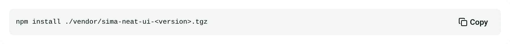
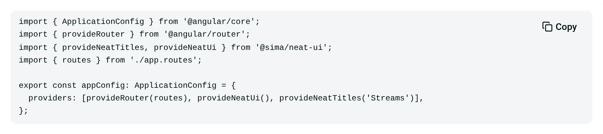

<!-- Written by `npm run docs:pages` from the kit and its examples. Do not edit. -->

# Code block

_Components › Data_ · [All topics](../README.md)

Code set apart on the muted fill, as written, with an optional Copy button at its end.

```html
<neat-code-block [code]="command" copy="install command" />
```

<picture>
<source media="(prefers-color-scheme: dark)" srcset="../images/code-block/install-command.dark.webp">

</picture>

```ts
import { NeatCodeBlock, NeatCopyButton } from '@sima/neat-ui/code-block';
```

## Examples

### Install command

A command to run, with a Copy button named "Copy install command". A long command wraps.

Press Copy, then paste the command somewhere.

<picture>
<source media="(prefers-color-scheme: dark)" srcset="../images/code-block/install-command.dark.webp">

</picture>

<details>
<summary>Code</summary>

`1-install-command.example.ts`

```ts
import { ChangeDetectionStrategy, Component } from '@angular/core';
import { NeatCodeBlock } from '@sima/neat-ui/code-block';

@Component({
  selector: 'app-install-command',
  imports: [NeatCodeBlock],
  changeDetection: ChangeDetectionStrategy.OnPush,
  templateUrl: './1-install-command.example.html',
})
export class InstallCommand {
  protected readonly command = 'npm install ./vendor/sima-neat-ui-<version>.tgz';
}
```

`1-install-command.example.html`

```html
<neat-code-block [code]="command" copy="install command" />
```

</details>

### Whole file

A whole file, its lines and indents as written. With `overflow="scroll"` a long line keeps its shape, and the block scrolls sideways.

Make the window narrow and scroll the code.

<picture>
<source media="(prefers-color-scheme: dark)" srcset="../images/code-block/whole-file.dark.webp">

</picture>

<details>
<summary>Code</summary>

`2-whole-file.example.ts`

```ts
import { ChangeDetectionStrategy, Component } from '@angular/core';
import { NeatCodeBlock } from '@sima/neat-ui/code-block';

const APP_CONFIG = `import { ApplicationConfig } from '@angular/core';
import { provideRouter } from '@angular/router';
import { provideNeatTitles, provideNeatUi } from '@sima/neat-ui';
import { routes } from './app.routes';

export const appConfig: ApplicationConfig = {
  providers: [provideRouter(routes), provideNeatUi(), provideNeatTitles('Streams')],
};
`;

@Component({
  selector: 'app-whole-file',
  imports: [NeatCodeBlock],
  changeDetection: ChangeDetectionStrategy.OnPush,
  templateUrl: './2-whole-file.example.html',
})
export class WholeFile {
  protected readonly file = APP_CONFIG;
}
```

`2-whole-file.example.html`

```html
<neat-code-block [code]="file" copy="app.config.ts" overflow="scroll" />
```

</details>

### Colored by the app

Code the app colored itself, as spans inside the block. They are shown in place of `code`, which spells the same text and stays what Copy copies. The kit has no syntax colors of its own.

<picture>
<source media="(prefers-color-scheme: dark)" srcset="../images/code-block/colored-by-the-app.dark.webp">

</picture>

<details>
<summary>Code</summary>

`3-colored-by-the-app.example.ts`

```ts
import { ChangeDetectionStrategy, Component } from '@angular/core';
import { NeatCodeBlock } from '@sima/neat-ui/code-block';

/** A stretch of code and the kind of text it is, as a highlighter gives them. */
interface Run {
  readonly kind: 'keyword' | 'string' | 'text';
  readonly text: string;
}

const RUNS: readonly Run[] = [
  { kind: 'keyword', text: 'const' },
  { kind: 'text', text: ' source = ' },
  { kind: 'string', text: "'rtsp://neat.local:8554/src3'" },
  { kind: 'text', text: ';' },
];

@Component({
  selector: 'app-colored-by-the-app',
  imports: [NeatCodeBlock],
  changeDetection: ChangeDetectionStrategy.OnPush,
  templateUrl: './3-colored-by-the-app.example.html',
  styleUrl: './colored-by-the-app.example.css',
})
export class ColoredByTheApp {
  protected readonly runs = RUNS;
  protected readonly code = RUNS.map((run) => run.text).join('');
}
```

`3-colored-by-the-app.example.html`

```html
<neat-code-block [code]="code" copy="line">
  @for (run of runs; track $index) {
    <span [class]="run.kind">{{ run.text }}</span>
  }
</neat-code-block>
```

`colored-by-the-app.example.css`

```css
/* Theme colors that keep 4.5:1 on the block's --muted fill in both schemes. */
.keyword {
  color: var(--highlight);
}

.string {
  color: var(--success);
}
```

</details>

### Stream URL

The Copy button on its own, beside a URL in running text. Its name is "Copy stream URL".

Press Copy, then paste the URL into a player.

<picture>
<source media="(prefers-color-scheme: dark)" srcset="../images/code-block/stream-url.dark.webp">

</picture>

<details>
<summary>Code</summary>

`4-stream-url.example.ts`

```ts
import { ChangeDetectionStrategy, Component } from '@angular/core';
import { NeatCode } from '@sima/neat-ui';
import { NeatCopyButton } from '@sima/neat-ui/code-block';

@Component({
  selector: 'app-stream-url',
  imports: [NeatCode, NeatCopyButton],
  changeDetection: ChangeDetectionStrategy.OnPush,
  templateUrl: './4-stream-url.example.html',
  styleUrl: './stream-url.example.css',
})
export class StreamURL {
  protected readonly url = 'rtsp://neat.local:8554/src3';
}
```

`4-stream-url.example.html`

```html
<p class="url">
  The stream plays at <code neatCode>{{ url }}</code>
  <neat-copy-button [text]="url" what="stream URL" />
</p>
```

`stream-url.example.css`

```css
/* The sentence and its Copy button on one line, wrapping as one. */
.url {
  display: flex;
  flex-wrap: wrap;
  align-items: center;
  gap: var(--neat-space-2);
  margin: 0;
}
```

</details>

## API

### `NeatCodeBlock`

Component from `@sima/neat-ui/code-block`, selector `neat-code-block`.

For a command to run, a file to paste or a URL to copy. For a name or a path in running text, use `code[neatCode]` instead.

`copy` names what the code is and adds a [`NeatCopyButton`](../components/code-block.md#neatcopybutton) beside the code. "install command" names the button "Copy install command". Without `copy` the block has no button.

`overflow` is `wrap` by default, for short code such as a command, which then breaks anywhere. Use `scroll` for a whole file, whose lines keep their shape and scroll sideways.

The code is plain text in the kit's monospace font, with no syntax colors. An app that colors its code (spans from a highlighter run at build time) puts them inside the element. They are shown in place of `code`, which stays what Copy copies, so they must spell the same text:

```html
<neat-code-block [code]="source" copy="app.ts">
  @for (run of runs; track $index) {
    <span [class]="run.kind">{{ run.text }}</span>
  }
</neat-code-block>
```

Angular leaves out the line breaks between a template's elements, so only the spans' own text shows, as written.

**Inputs**

- **`code`** `string`, required

  The code, as text: shown, and copied by the Copy button.

- **`copy`** `string`

  What the code is, which adds a Copy button named after it ("Copy install command").

- **`overflow`** `NeatCodeOverflow`, default `'wrap'`

  Whether a long line wraps or scrolls sideways (a [`NeatCodeOverflow`](../components/code-block.md#neatcodeoverflow)).

### `NeatCodeOverflow`

Type from `@sima/neat-ui/code-block`.

What a code block does with a line wider than itself: `wrap` breaks it, `scroll` keeps it whole and scrolls the block sideways.

```ts
type NeatCodeOverflow = 'wrap' | 'scroll'
```

### `NeatCopyButton`

Component from `@sima/neat-ui/code-block`, selector `neat-copy-button`.

A small Copy button that puts `text` on the clipboard and says whether it did.

```html
<code neatCode>{{ url }}</code>
<neat-copy-button [text]="url" what="stream URL" />
```

[`NeatCodeBlock`](../components/code-block.md#neatcodeblock) shows one beside its code. Use this part on its own for text shown some other way: a URL in running text, or code whose Copy button sits outside it (above a set of tabs).

After a click the button says "Copied", with a check, or "Could not copy". It says the same in a polite live region, and offers to copy again after 2.5 s.

Its accessible name is "Copy" and `what`: "Copy stream URL", so a page with several buttons does not read as a list of "Copy". The name starts with the visible caption, so a voice user can say what they see.

It needs a secure context. A browser gives the clipboard to pages served over https and from localhost only, so on a page served over plain http the button says it could not copy. It has no fallback.

**Inputs**

- **`text`** `string`, required

  The text the button copies.

- **`what`** `string`, required

  What the text is, for the button's name: `install command` names it "Copy install command".
