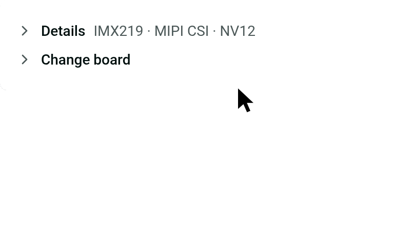
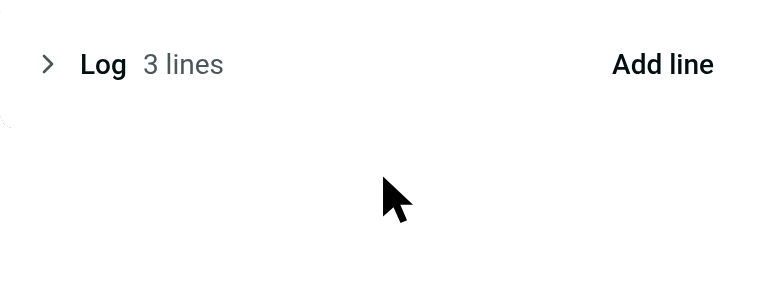

<!-- Written by `npm run docs:pages` from the kit and its examples. Do not edit. -->

# Collapsible

_Components › Data_ · [All topics](../README.md)

A section that a full-width button opens and closes, such as a panel's "Details":

```html
<neat-collapsible label="Details" [summary]="mode()" [(open)]="detailsOpen">…</neat-collapsible>
```

<picture>
<source media="(prefers-reduced-motion: reduce) and (prefers-color-scheme: dark)" srcset="../images/collapsible/summary-and-save.dark.webp">
<source media="(prefers-reduced-motion: reduce)" srcset="../images/collapsible/summary-and-save.light.webp">
<source media="(prefers-color-scheme: dark)" srcset="../images/collapsible/summary-and-save.dark.animated.webp">

</picture>

```ts
import { NeatCollapsible } from '@sima/neat-ui/collapsible';
```

## Examples

### Summary and save

Two sections. Details says what it holds while it is closed. Open Change board and press Save: the section closes and the focus is on its button, not lost to the page.

<picture>
<source media="(prefers-reduced-motion: reduce) and (prefers-color-scheme: dark)" srcset="../images/collapsible/summary-and-save.dark.webp">
<source media="(prefers-reduced-motion: reduce)" srcset="../images/collapsible/summary-and-save.light.webp">
<source media="(prefers-color-scheme: dark)" srcset="../images/collapsible/summary-and-save.dark.animated.webp">

</picture>

<details>
<summary>Code</summary>

`1-summary-and-save.example.ts`

```ts
import { ChangeDetectionStrategy, Component, signal } from '@angular/core';
import { NeatButton } from '@sima/neat-ui';
import { NeatCollapsible } from '@sima/neat-ui/collapsible';
import { NeatDetails } from '@sima/neat-ui/details';
import { NeatInput } from '@sima/neat-ui/input';

@Component({
  selector: 'app-summary-and-save',
  imports: [NeatButton, NeatCollapsible, NeatDetails, NeatInput],
  changeDetection: ChangeDetectionStrategy.OnPush,
  templateUrl: './1-summary-and-save.example.html',
  styleUrl: './panel.css',
})
export class SummaryAndSave {
  protected readonly boardOpen = signal(false);
}
```

`1-summary-and-save.example.html`

```html
<div class="panel">
  <neat-collapsible label="Details" summary="IMX219 · MIPI CSI · NV12">
    <dl neatDetails>
      <dt>Model</dt>
      <dd>IMX219</dd>
      <dt>Receiver</dt>
      <dd><code>imx219 1-0010</code></dd>
    </dl>
  </neat-collapsible>
  <neat-collapsible label="Change board" [(open)]="boardOpen">
    <div class="showcase-row">
      <input neatInput type="text" value="192.168.1.20" aria-label="Board address" />
      <button neatButton type="button" (click)="boardOpen.set(false)">Save</button>
    </div>
  </neat-collapsible>
</div>
```

`panel.css`

```css
/* A collapsible's habitat is an aside, so the examples give it a panel's width. */
.panel {
  max-width: 22rem;
}
```

</details>

### End controls

A log with two controls at the end of its row, outside its button. The summary counts the lines.

Try Add line, which works open or closed. Clear is there only while the log is open.

<picture>
<source media="(prefers-reduced-motion: reduce) and (prefers-color-scheme: dark)" srcset="../images/collapsible/end-controls.dark.webp">
<source media="(prefers-reduced-motion: reduce)" srcset="../images/collapsible/end-controls.light.webp">
<source media="(prefers-color-scheme: dark)" srcset="../images/collapsible/end-controls.dark.animated.webp">

</picture>

<details>
<summary>Code</summary>

`2-end-controls.example.ts`

```ts
import { ChangeDetectionStrategy, Component, signal } from '@angular/core';
import { NeatButton, NeatNote } from '@sima/neat-ui';
import { NeatCollapsible } from '@sima/neat-ui/collapsible';

@Component({
  selector: 'app-end-controls',
  imports: [NeatButton, NeatCollapsible, NeatNote],
  changeDetection: ChangeDetectionStrategy.OnPush,
  templateUrl: './2-end-controls.example.html',
  styleUrl: './panel.css',
})
export class EndControls {
  protected readonly open = signal(false);
  protected readonly lines = signal(['Pipeline started', 'Frame 1 decoded', 'Frame 2 decoded']);

  protected add(): void {
    this.lines.update((lines) => [...lines, `Frame ${lines.length} decoded`]);
  }
}
```

`2-end-controls.example.html`

```html
<div class="panel">
  <neat-collapsible label="Log" [summary]="lines().length + ' lines'" [(open)]="open">
    <button neatCollapsibleEnd neatButton type="button" variant="text" size="small" (click)="add()">
      Add line
    </button>
    @if (open()) {
      <button
        neatCollapsibleEnd
        neatButton
        type="button"
        variant="text"
        size="small"
        (click)="lines.set([])"
      >
        Clear
      </button>
    }
    @for (line of lines(); track $index) {
      <p neatNote>{{ line }}</p>
    } @empty {
      <p neatNote>No lines.</p>
    }
  </neat-collapsible>
</div>
```

`panel.css`

```css
/* A collapsible's habitat is an aside, so the examples give it a panel's width. */
.panel {
  max-width: 22rem;
}
```

</details>

## API

### `NeatCollapsible`

Component from `@sima/neat-ui/collapsible`, selector `neat-collapsible`.

The trigger shows the `next` chevron, turned a quarter while open, and `label`. Only while closed, it also shows `summary` in muted text that truncates, for what the section holds at a glance.

The trigger is a native button. It names the content in `aria-controls`, and says whether it is open in `aria-expanded`. Enter and Space work as on any button. `open` is two-way bound.

With `headingLevel`, the button sits in a heading of that level, as in the WAI-ARIA disclosure and accordion patterns. So the section's title is in the page's outline.

The content stays instantiated while closed, hidden and `inert`, so its state survives a close. Gate expensive content, such as a live preview, on `open` with an `@if` of your own.

When the section closes with the focus inside it, the focus moves to the trigger. Inert content would otherwise drop it to the page. That happens on a Save that closes the section, say, or when the app sets `open` to false. It happens too when the focus was on an end control that the close removed, one shown only while open. An end control that stays keeps the focus.

Elements marked `neatCollapsibleEnd` sit at the end of the trigger's row, outside the trigger and its heading. They are the section's own controls, which act without opening or closing it: a copy button over a code sample, a file choice.

The trigger takes the rest of the row. The controls drop to a second line where they would leave the label and summary no room. The trigger's width is both in full, so a long summary wraps the controls before it truncates.

The end controls show whether the section is open or closed. An app shows them only while open with an `@if`.

**Inputs**

- **`label`** `string`, required

  The trigger's text, which names the section.

- **`summary`** `string`, default `''`

  What the section holds, shown beside the label while it is closed; none if empty.

- **`headingLevel`** `2 | 3 | 4 | 5 | 6 | null`, default `null`

  The level of the heading the trigger sits in, for a section that is part of an outline.

  System Info's sections have one. Leave it unset, the default, for a disclosure such as a panel's "Details".

**Models (two-way)**

- **`open`** `boolean`

  Whether the section is open; closed by default. Bind it two-way, `[(open)]`, to keep the state in the page or to open or close the section from code.
