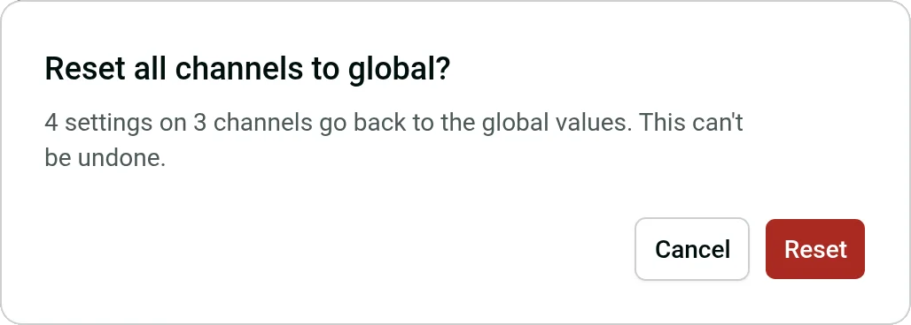

<!-- Written by `npm run docs:pages` from the kit and its examples. Do not edit. -->

# Confirm

_Components › Actions_ · [All topics](../README.md)

Asks the user to confirm an action before the app takes it:

```ts
if (await this.confirm.ask({ title: 'Reset all channels to global?', message: '…',
    confirmLabel: 'Reset', tone: 'danger' })) {
  this.store.resetAllChannels();
}
```

<picture>
<source media="(prefers-color-scheme: dark)" srcset="../images/confirm/asking.dark.webp">

</picture>

```ts
import { NeatConfirm } from '@sima/neat-ui/confirm';
```

## Examples

### Asking

Two questions and what `ask` resolved. The first is `tone: 'danger'`, for an action that cannot be undone, so its confirm button is the danger one; the second keeps the default tone and words its cancel button with `cancelLabel`. Try Cancel, Escape and a click on the backdrop: the first two answer `false`, the backdrop does nothing.

<picture>
<source media="(prefers-color-scheme: dark)" srcset="../images/confirm/asking.dark.webp">

</picture>

<details>
<summary>Code</summary>

`1-asking.example.ts`

```ts
import { ChangeDetectionStrategy, Component, inject, signal } from '@angular/core';
import { NeatButton } from '@sima/neat-ui';
import { NeatConfirm } from '@sima/neat-ui/confirm';

@Component({
  selector: 'app-asking',
  imports: [NeatButton],
  changeDetection: ChangeDetectionStrategy.OnPush,
  template: `
    <div class="showcase-row">
      <button neatButton type="button" variant="outlined" (click)="askResetAll()">
        Reset all channels to global…
      </button>
      <button neatButton type="button" variant="outlined" (click)="askApplyToAll()">
        Apply to all channels…
      </button>
    </div>
    <p class="showcase-code showcase-muted" aria-live="polite">{{ answer() }}</p>
  `,
})
export class Asking {
  private readonly confirm = inject(NeatConfirm);
  protected readonly answer = signal('Not asked yet');

  protected async askResetAll(): Promise<void> {
    const reset = await this.confirm.ask({
      title: 'Reset all channels to global?',
      message: "4 settings on 3 channels go back to the global values. This can't be undone.",
      confirmLabel: 'Reset',
      tone: 'danger',
    });
    this.answer.set(`Reset all: ${reset ? 'confirmed' : 'canceled'}`);
  }

  protected async askApplyToAll(): Promise<void> {
    const apply = await this.confirm.ask({
      title: 'Apply to all channels?',
      message: 'Every channel takes the global overlay settings.',
      confirmLabel: 'Apply',
      cancelLabel: 'Not now',
    });
    this.answer.set(`Apply to all: ${apply ? 'confirmed' : 'canceled'}`);
  }
}
```

</details>

## API

### `NeatConfirm`

Service from `@sima/neat-ui/confirm`.

`ask` shows a modal alert dialog, named by the title and described by the message, with a cancel and a confirm button. It resolves `true` when the confirm button is pressed, and `false` on cancel or Escape. It does so once the dialog has closed and focus is back on the element that had it.

A click on the backdrop does nothing: the question needs an answer. Focus starts on cancel, the choice that changes nothing, and stays inside the dialog. A `tone: 'danger'` confirm button is the danger `neatButton`, otherwise the primary one.

It asks one question at a time. An `ask` while a dialog is open resolves that one `false` and closes it at once. Then it shows the new one, which gives focus back where the first came from. A dialog still closing after a button press keeps that answer.

**Methods**

- **`ask`**

  ```ts
  ask(options: NeatConfirmOptions): Promise<boolean>
  ```

### `NeatConfirmOptions`

Interface from `@sima/neat-ui/confirm`.

What [`NeatConfirm.ask`](../components/confirm.md#neatconfirm) asks: the copy of the dialog and the weight of its confirm button.

**Members**

- **`title`** `string`

  The question, which names the dialog: "Reset all channels to global?".

- **`message`** `string`

  What confirming does, which describes the dialog.

- **`confirmLabel`** `string`

  The confirm button's label, a verb for the action: "Reset".

- **`cancelLabel`** `string`, optional

  The cancel button's label; `'Cancel'` by default.

- **`tone`** `'default' | 'danger'`, optional

  `'danger'` for an action that destroys or cannot be undone; `'default'` by default.
