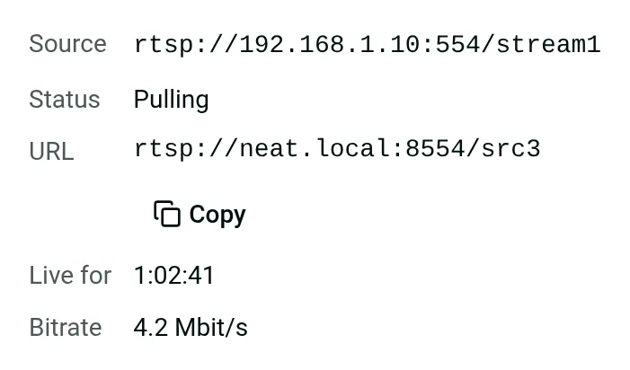
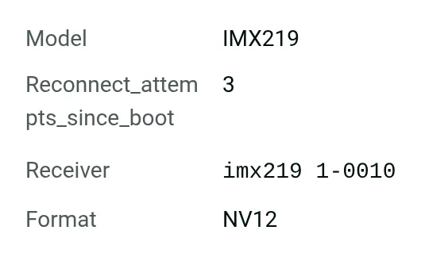

<!-- Written by `npm run docs:pages` from the kit and its examples. Do not edit. -->

# Details

_Components › Data_ · [All topics](../README.md)

Facts about the selected thing, as an aside shows them, on a native description list.

```html
<dl neatDetails>
  <dt>Stream</dt><dd>{{ status.stream }}</dd>
  @if (source(); as source) {
    <dt>Source</dt><dd><code>{{ source }}</code></dd>
  }
</dl>
```

<picture>
<source media="(prefers-color-scheme: dark)" srcset="../images/details/source-facts.dark.webp">

</picture>

```ts
import { NeatDetails } from '@sima/neat-ui/details';
```

## Examples

### Source facts

The facts of a source in a panel's width. The URL's value holds a code span and an inline button.

<picture>
<source media="(prefers-color-scheme: dark)" srcset="../images/details/source-facts.dark.webp">

</picture>

<details>
<summary>Code</summary>

`1-source-facts.example.ts`

```ts
import { ChangeDetectionStrategy, Component } from '@angular/core';
import { NeatInlineButton } from '@sima/neat-ui';
import { NeatDetails } from '@sima/neat-ui/details';

@Component({
  selector: 'app-source-facts',
  imports: [NeatDetails, NeatInlineButton],
  changeDetection: ChangeDetectionStrategy.OnPush,
  template: `
    <dl neatDetails class="panel">
      <dt>Source</dt>
      <dd><code>rtsp://192.168.1.10:554/stream1</code></dd>
      <dt>Status</dt>
      <dd>Pulling</dd>
      <dt>URL</dt>
      <dd class="url">
        <code>rtsp://neat.local:8554/src3</code>
        <button neatInlineButton type="button">Copy</button>
      </dd>
      <dt>Live for</dt>
      <dd>1:02:41</dd>
      <dt>Bitrate</dt>
      <dd>4.2 Mbit/s</dd>
    </dl>
  `,
  styleUrls: ['./panel.css', './source-facts.example.css'],
})
export class SourceFacts {}
```

`panel.css`

```css
/* A list's habitat is an aside, so the examples give it a panel's width. */
.panel {
  max-width: 22rem;
}
```

`source-facts.example.css`

```css
/* The value's own layout: the URL and its Copy button, wrapping as one. */
.url {
  display: flex;
  flex-wrap: wrap;
  align-items: baseline;
  gap: var(--neat-space-2);
}
```

</details>

### Aligned lists

Two lists on one term column: `--neat-details-term-width` is set on their common ancestor. The first list's longest term is wider than the column, so it breaks inside the word.

<picture>
<source media="(prefers-color-scheme: dark)" srcset="../images/details/aligned-lists.dark.webp">

</picture>

<details>
<summary>Code</summary>

`2-aligned-lists.example.ts`

```ts
import { ChangeDetectionStrategy, Component } from '@angular/core';
import { NeatDetails } from '@sima/neat-ui/details';

@Component({
  selector: 'app-aligned-lists',
  imports: [NeatDetails],
  changeDetection: ChangeDetectionStrategy.OnPush,
  template: `
    <div class="panel lists">
      <dl neatDetails>
        <dt>Model</dt>
        <dd>IMX219</dd>
        <dt>Reconnect_attempts_since_boot</dt>
        <dd>3</dd>
      </dl>
      <dl neatDetails>
        <dt>Receiver</dt>
        <dd><code>imx219 1-0010</code></dd>
        <dt>Format</dt>
        <dd>NV12</dd>
      </dl>
    </div>
  `,
  styleUrls: ['./panel.css', './aligned-lists.example.css'],
})
export class AlignedLists {}
```

`panel.css`

```css
/* A list's habitat is an aside, so the examples give it a panel's width. */
.panel {
  max-width: 22rem;
}
```

`aligned-lists.example.css`

```css
/* The kit's knob, set on the lists' common ancestor. */
.lists {
  --neat-details-term-width: 7rem;
  display: flex;
  flex-direction: column;
  gap: var(--neat-space-3);
}
```

</details>

## API

### `NeatDetails`

Directive from `@sima/neat-ui/details`, selector `dl[neatDetails]`.

It sets the look only. The pairs, their words and what a value holds are the app's, such as a code span, or an inline button beside a URL. Write each `dt` and `dd` as a direct child of the list, one value per term: the two columns are the list's grid.

The terms are muted, and as wide as the widest. The values sit beside them and take the rest of the width. They wrap anywhere when long, and keep their figures aligned.

Several lists line up on one term column when an ancestor sets `--neat-details-term-width`, a length such as `7rem`. A term wider than that column breaks inside the word.
