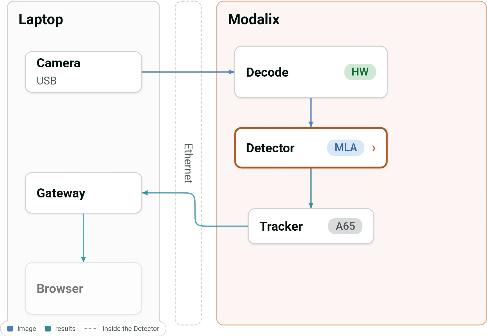
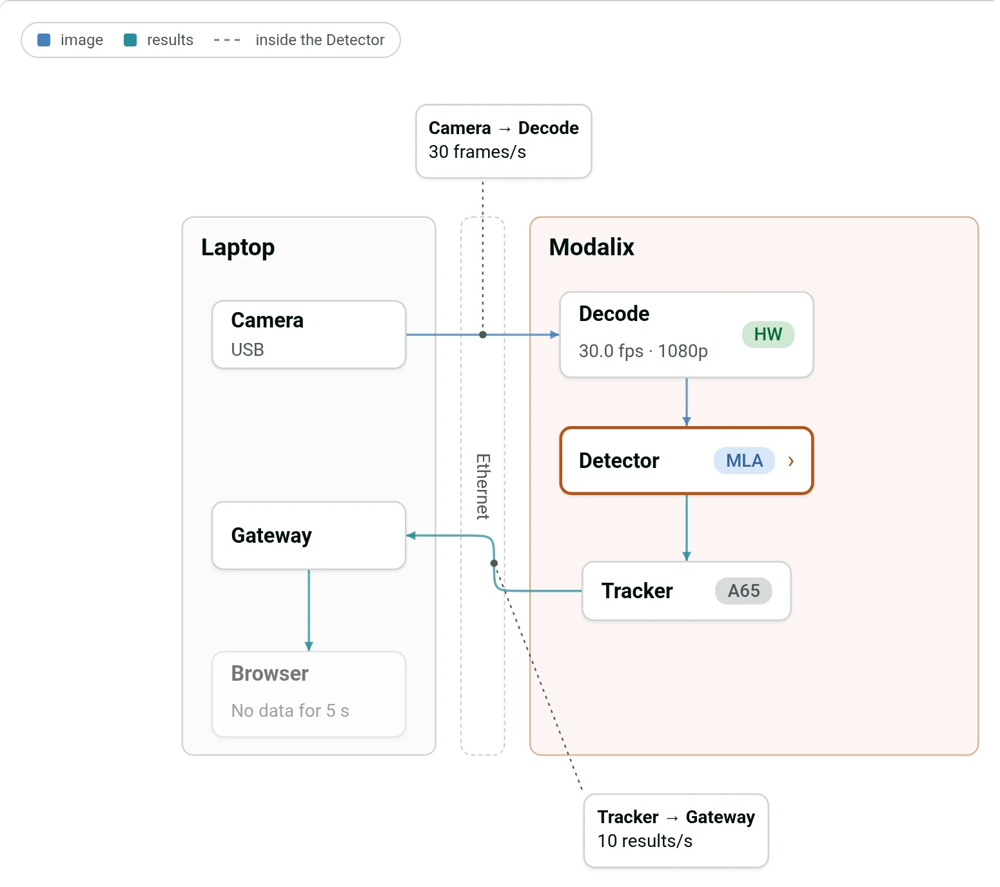
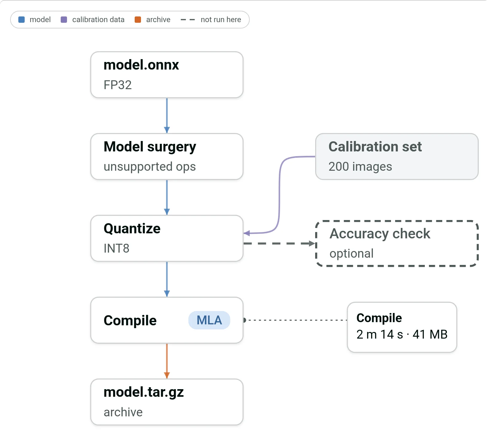
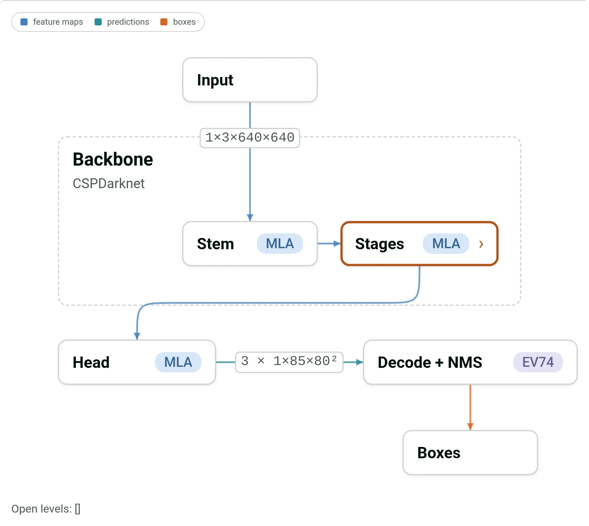
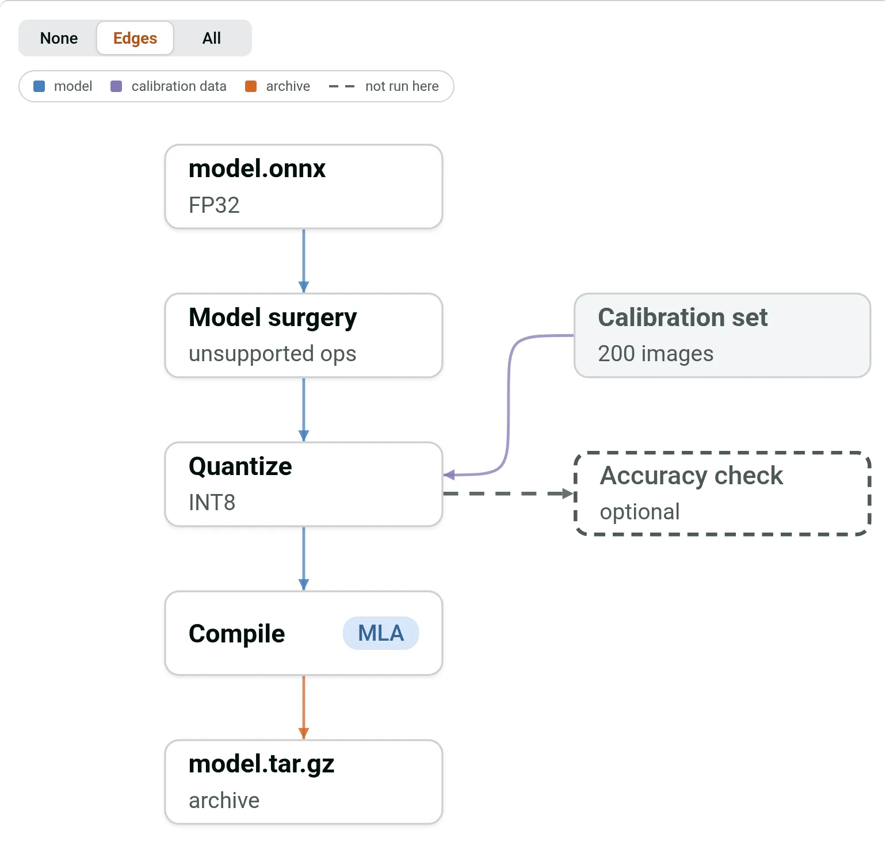
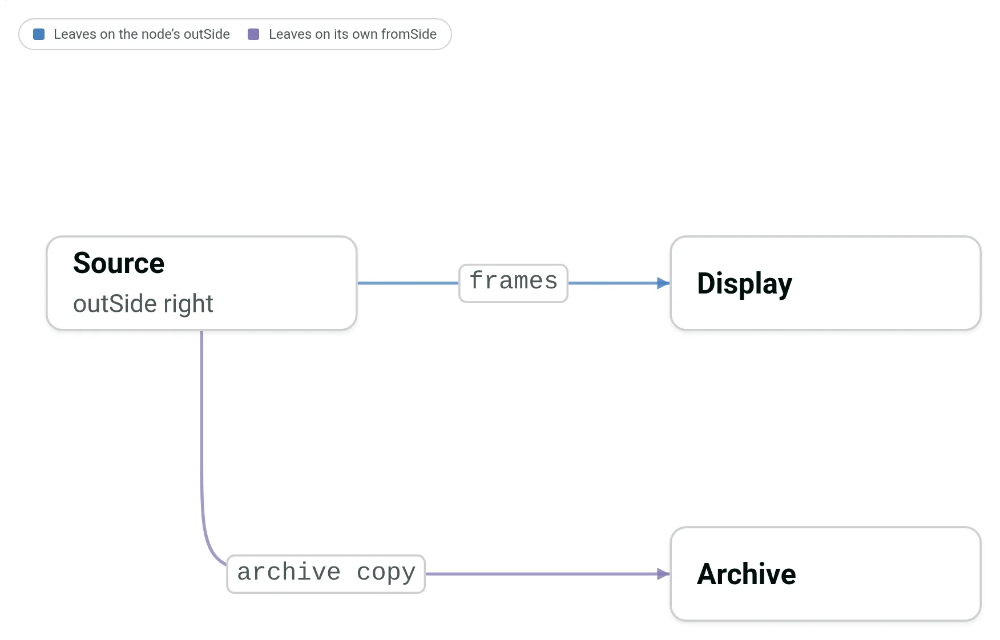
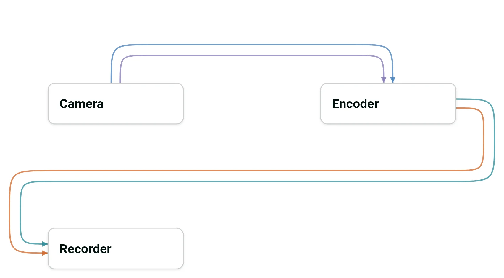
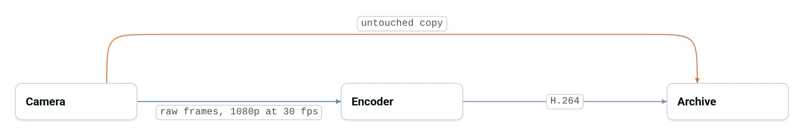
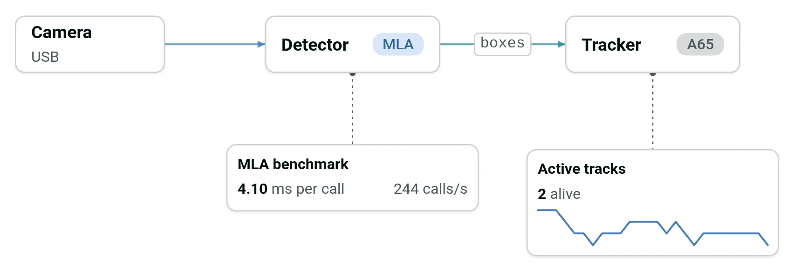

<!-- Written by `npm run docs:pages` from the kit and its examples. Do not edit. -->

# Diagram

_Components › Diagram_ · [All topics](../README.md)

A hand-placed diagram in the kit's look:

```html
<neat-diagram [diagram]="system" label="The demo's system" [(level)]="level">
  <ng-template neatDiagramNote let-note>…</ng-template>
</neat-diagram>
```

<picture>
<source media="(prefers-color-scheme: dark)" srcset="../images/diagram/filling-its-card.dark.webp">

</picture>

```ts
import { NeatDiagramView, NeatDiagramBlockTemplate, NeatDiagramNoteTemplate, NeatDiagramEdgeTooltipTemplate, NeatDiagramEdgeTipTemplate, NeatDiagramFigureCard } from '@sima/neat-ui/diagram';
```

## Examples

### Messaging pipeline

A pipeline over two machines: groups for the machines, a band for the cable, and a figure line in Decode from the app's [`NeatDiagramBlockTemplate`](../components/diagram.md#neatdiagramblocktemplate). Every chip says where its part runs, in the kit's tones.

The Detector opens a level that [`neatDrillDownLevel`](../components/drill-down.md#neatdrilldownlevel) placed: its steps inside, what feeds it on the left, and what it feeds on the right.

The Browser has stopped reporting. Its node is `stale`, so the whole card is grayed out, and the same template says why in words, since gray alone tells no one what happened.

The notes are the app's [`NeatDiagramNoteTemplate`](../components/diagram.md#neatdiagramnotetemplate). Here they hold fixed text, where a live pipeline would draw [`NeatDiagramRateCard`](../components/messaging.md#neatdiagramratecard)s of its edges' rates.

The top bar's Fit calls [`NeatDiagramView.fit`](../components/diagram.md#neatdiagramview) on each diagram of the page. It fits the diagram to its box again after it was panned or zoomed.

<picture>
<source media="(prefers-color-scheme: dark)" srcset="../images/diagram/messaging-pipeline.dark.webp">

</picture>

<details>
<summary>Code</summary>

`1-messaging-pipeline.example.ts`

```ts
import { ChangeDetectionStrategy, Component, viewChild } from '@angular/core';
import {
  NeatDiagramBlockTemplate,
  NeatDiagramLegend,
  NeatDiagramNoteTemplate,
  NeatDiagramView,
} from '@sima/neat-ui/diagram';
import { PIPELINE, PIPELINE_LEGEND } from './pipeline-data';

@Component({
  selector: 'app-messaging-pipeline',
  imports: [NeatDiagramBlockTemplate, NeatDiagramLegend, NeatDiagramNoteTemplate, NeatDiagramView],
  changeDetection: ChangeDetectionStrategy.OnPush,
  templateUrl: './1-messaging-pipeline.example.html',
  styleUrls: ['./diagram-box.css', './messaging-pipeline.example.css'],
})
export class MessagingPipeline {
  protected readonly pipeline = PIPELINE;
  protected readonly legend = PIPELINE_LEGEND;
  private readonly diagram = viewChild.required(NeatDiagramView);

  /** Fits the drawing to its box again, as a toolbar's Fit button does. */
  fit(): void {
    this.diagram().fit();
  }
}
```

`1-messaging-pipeline.example.html`

```html
<neat-diagram-legend [items]="legend" />
<neat-diagram class="diagram" [diagram]="pipeline" label="A messaging pipeline">
  <ng-template neatDiagramBlock let-node>
    @if (node.id === 'decode') {
      <span class="figure">30.0 fps · 1080p</span>
    }
    @if (node.id === 'browser') {
      <span class="figure">No data for 5 s</span>
    }
  </ng-template>
  <ng-template neatDiagramNote let-note>
    @switch (note.id) {
      @case ('camera-rate') {
        <b>Camera → Decode</b><br />30 frames/s
      }
      @case ('tracker-rate') {
        <b>Tracker → Gateway</b><br />10 results/s
      }
      @case ('yolox-rate') {
        <b>YOLOX → NMS</b><br />14.8 ms
      }
    }
  </ng-template>
</neat-diagram>
```

`pipeline-data.ts`

```ts
import {
  type NeatDiagram,
  type NeatDiagramChip,
  type NeatDiagramEdge,
  type NeatDiagramLegendItem,
  type NeatDiagramNode,
  type NeatDiagramSet,
  neatDrillDownLevel,
} from '@sima/neat-ui/diagram';
import { A65, EV74, HW, MLA } from './chips';

/*
 * The reference sheet's messaging pipeline (a design drawing kept outside the repo):
 * laptop, cable, board, placed after the sheet with room for the kit's type and edge labels. The
 * diagram fits each level to its box, so where a level starts does not matter.
 */

const PIPELINE_NODES: readonly NeatDiagramNode[] = [
  { id: 'laptop', role: 'group', label: 'Laptop', x: 0, y: 0, w: 170, h: 360 },
  {
    id: 'camera',
    role: 'block',
    label: 'Camera',
    detail: 'USB',
    parent: 'laptop',
    x: 20,
    y: 56,
    w: 130,
    h: 46,
  },
  {
    id: 'gateway',
    role: 'block',
    label: 'Gateway',
    inSide: 'right',
    outSide: 'bottom',
    parent: 'laptop',
    x: 20,
    y: 190,
    w: 130,
    h: 46,
  },
  {
    id: 'browser',
    role: 'block',
    label: 'Browser',
    // Its stats stopped: the whole card is grayed out, and the block template says why.
    stale: true,
    inSide: 'top',
    parent: 'laptop',
    x: 20,
    y: 290,
    w: 130,
    h: 58,
  },
  { id: 'ethernet', role: 'band', label: 'Ethernet', x: 186, y: 0, w: 30, h: 360 },
  { id: 'modalix', role: 'group', look: 'accent', label: 'Modalix', x: 232, y: 0, w: 300, h: 360 },
  {
    id: 'decode',
    role: 'block',
    label: 'Decode',
    chips: [HW],
    outSide: 'bottom',
    parent: 'modalix',
    // Sized for its body below the label too: the page's figure line (neatDiagramBlock).
    x: 20,
    y: 50,
    w: 170,
    h: 58,
  },
  {
    id: 'detector',
    role: 'block',
    label: 'Detector',
    chips: [MLA],
    opens: 'detector',
    inSide: 'top',
    outSide: 'bottom',
    parent: 'modalix',
    x: 20,
    y: 140,
    w: 170,
    h: 46,
  },
  {
    id: 'tracker',
    role: 'block',
    label: 'Tracker',
    chips: [A65],
    inSide: 'top',
    outSide: 'left',
    parent: 'modalix',
    x: 35,
    y: 230,
    w: 140,
    h: 40,
  },
];

const PIPELINE_EDGES: readonly NeatDiagramEdge[] = [
  { id: 'camera-decode', from: 'camera', to: 'decode', series: 1 },
  { id: 'tracker-gateway', from: 'tracker', to: 'gateway', series: 4 },
  { id: 'gateway-browser', from: 'gateway', to: 'browser', series: 4 },
];

/** A step of the Detector, in a row inside it below the level group's title. */
const step = (id: string, label: string, chip: NeatDiagramChip, i: number): NeatDiagramNode => ({
  id,
  role: 'block',
  label,
  chips: [chip],
  parent: 'detector',
  x: 20 + i * 170,
  y: 72,
  w: 130,
  h: 40,
});

/**
 * The pipeline with the Detector's steps inside it, which the overview leaves out (its card is
 * too small to hold them): what `neatDrillDownLevel` places the Detector's level from.
 */
const PIPELINE_STEPS: NeatDiagram = {
  nodes: [
    ...PIPELINE_NODES,
    step('resize', 'Resize', EV74, 0),
    step('yolox', 'YOLOX', MLA, 1),
    step('nms', 'NMS', A65, 2),
  ],
  edges: [
    ...PIPELINE_EDGES,
    { id: 'decode-resize', from: 'decode', to: 'resize', series: 1 },
    // The steps hand frames on inside the process: dashed and muted, as the demo draws them.
    { id: 'resize-yolox', from: 'resize', to: 'yolox', line: 'dashed' },
    { id: 'yolox-nms', from: 'yolox', to: 'nms', line: 'dashed' },
    { id: 'nms-tracker', from: 'nms', to: 'tracker', series: 4 },
  ],
};

export const PIPELINE: NeatDiagramSet = {
  overview: {
    nodes: PIPELINE_NODES,
    edges: [
      ...PIPELINE_EDGES,
      { id: 'decode-detector', from: 'decode', to: 'detector', series: 1 },
      { id: 'detector-tracker', from: 'detector', to: 'tracker', series: 4 },
    ],
    notes: [
      // Above the groups (they start at y 0; the card is about 85 high), clear of the Camera.
      { id: 'camera-rate', edges: ['camera-decode'], x: 215, y: -50 },
      // A note's x and y are its center: below the Modalix group (which ends at y 360), so the card
      // straddles no border, and its leader runs clear of it.
      { id: 'tracker-rate', edges: ['tracker-gateway'], x: 330, y: 410 },
    ],
  },
  levels: {
    detector: {
      ...neatDrillDownLevel(PIPELINE_STEPS, 'detector'),
      // The card of a step: its stage time in place of the megabytes. Below the level's group
      // (which ends at y 152), under the edge it is about.
      notes: [{ id: 'yolox-rate', edges: ['yolox-nms'], x: 340, y: 235 }],
    },
  },
};

export const PIPELINE_LEGEND: readonly NeatDiagramLegendItem[] = [
  { series: 1, label: 'image' },
  { series: 4, label: 'results' },
  { line: 'dashed', label: 'inside the Detector' },
];
```

`chips.ts`

```ts
import type { NeatDiagramChip } from '@sima/neat-ui/diagram';

/*
 * The chips follow the kit's convention for where a part runs: HW (the hardware decoder) success,
 * EV74 highlight, MLA info, A65 neutral.
 */
export const HW: NeatDiagramChip = { label: 'HW', tone: 'success' };
export const EV74: NeatDiagramChip = { label: 'EV74', tone: 'highlight' };
export const MLA: NeatDiagramChip = { label: 'MLA', tone: 'info' };
export const A65: NeatDiagramChip = { label: 'A65', tone: 'neutral' };
```

`diagram-box.css`

```css
:host {
  display: flex;
  flex-direction: column;
  gap: var(--neat-space-3);
}

/*
 * A diagram has no height of its own: the app gives it a bounded box, here 4:3 up to 40rem, so a
 * phone's narrow box does not stand tall and empty around a drawing its width shrinks.
 */
.diagram {
  /* The card's whole width: in this flex column the ratio would otherwise size the width from the
     capped height, and the drawing would cut off partway across the card when panned. */
  width: 100%;
  aspect-ratio: 4 / 3;
  max-height: 40rem;
}

/* A figure the app puts after a bracket's label: small, quiet, steady digits. */
.bracket-figure {
  font-size: var(--neat-text-xs);
  color: var(--muted-foreground);
  font-variant-numeric: tabular-nums;
}
```

`messaging-pipeline.example.css`

```css
/* A block's live figure (Decode's), below its label: small, quiet, steady digits. */
.figure {
  font-size: var(--neat-text-xs);
  color: var(--muted-foreground);
  font-variant-numeric: tabular-nums;
  white-space: nowrap;
}
```

</details>

### Compile flow

A column of steps, with a muted input beside it and a ghost for the step that is not run. A note is anchored to a block's side rather than to an edge.

<picture>
<source media="(prefers-color-scheme: dark)" srcset="../images/diagram/compile-flow.dark.webp">

</picture>

<details>
<summary>Code</summary>

`2-compile-flow.example.ts`

```ts
import { ChangeDetectionStrategy, Component, viewChild } from '@angular/core';
import { NeatDiagramLegend, NeatDiagramNoteTemplate, NeatDiagramView } from '@sima/neat-ui/diagram';
import { COMPILE_FLOW, COMPILE_LEGEND } from './compile-flow-data';

@Component({
  selector: 'app-compile-flow',
  imports: [NeatDiagramLegend, NeatDiagramNoteTemplate, NeatDiagramView],
  changeDetection: ChangeDetectionStrategy.OnPush,
  templateUrl: './2-compile-flow.example.html',
  styleUrl: './diagram-box.css',
})
export class CompileFlow {
  protected readonly flow = COMPILE_FLOW;
  protected readonly legend = COMPILE_LEGEND;
  private readonly diagram = viewChild.required(NeatDiagramView);

  /** Fits the drawing to its box again, as a toolbar's Fit button does. */
  fit(): void {
    this.diagram().fit();
  }
}
```

`2-compile-flow.example.html`

```html
<neat-diagram-legend [items]="legend" />
<neat-diagram class="diagram" [diagram]="flow" label="A compile flow">
  <ng-template neatDiagramNote let-note>
    @if (note.id === 'compile-result') {
      <b>Compile</b><br />2 m 14 s · 41 MB
    }
  </ng-template>
</neat-diagram>
```

`compile-flow-data.ts`

```ts
import type { NeatDiagramLegendItem, NeatDiagramSet } from '@sima/neat-ui/diagram';
import { MLA } from './chips';

/*
 * A compile flow, placed after the reference sheet: a column of steps, with an input beside it and
 * an optional step.
 */

export const COMPILE_FLOW: NeatDiagramSet = {
  overview: {
    nodes: [
      { id: 'onnx', role: 'block', label: 'model.onnx', detail: 'FP32', x: 0, y: 0, w: 150, h: 46 },
      {
        id: 'surgery',
        role: 'block',
        label: 'Model surgery',
        detail: 'unsupported ops',
        x: 0,
        y: 80,
        w: 150,
        h: 46,
      },
      {
        id: 'quantize',
        role: 'block',
        label: 'Quantize',
        detail: 'INT8',
        x: 0,
        y: 160,
        w: 150,
        h: 46,
      },
      { id: 'compile', role: 'block', label: 'Compile', chips: [MLA], x: 0, y: 240, w: 150, h: 46 },
      {
        id: 'archive',
        role: 'block',
        label: 'model.tar.gz',
        detail: 'archive',
        x: 0,
        y: 320,
        w: 150,
        h: 46,
      },
      {
        id: 'calibration',
        role: 'block',
        look: 'muted',
        label: 'Calibration set',
        detail: '200 images',
        x: 220,
        y: 80,
        w: 160,
        h: 46,
      },
      {
        id: 'accuracy',
        role: 'block',
        look: 'ghost',
        label: 'Accuracy check',
        detail: 'optional',
        // Level with the lower of Quantize's two right-hand ports (they sit 10 apart about its
        // middle, 183), so the ghost edge runs straight.
        x: 220,
        y: 165,
        w: 160,
        h: 46,
      },
    ],
    edges: [
      { id: 'onnx-surgery', from: 'onnx', to: 'surgery', series: 1 },
      { id: 'surgery-quantize', from: 'surgery', to: 'quantize', series: 1 },
      { id: 'calibration-quantize', from: 'calibration', to: 'quantize', series: 2 },
      { id: 'quantize-compile', from: 'quantize', to: 'compile', series: 1 },
      { id: 'quantize-accuracy', from: 'quantize', to: 'accuracy', line: 'ghost' },
      { id: 'compile-archive', from: 'compile', to: 'archive', series: 3 },
    ],
    // About the Compile step, so anchored to its right side rather than to an edge.
    notes: [{ id: 'compile-result', anchor: { x: 150, y: 263 }, x: 305, y: 270 }],
  },
};

export const COMPILE_LEGEND: readonly NeatDiagramLegendItem[] = [
  { series: 1, label: 'model' },
  { series: 2, label: 'calibration data' },
  { series: 3, label: 'archive' },
  { line: 'ghost', label: 'not run here' },
];
```

`chips.ts`

```ts
import type { NeatDiagramChip } from '@sima/neat-ui/diagram';

/*
 * The chips follow the kit's convention for where a part runs: HW (the hardware decoder) success,
 * EV74 highlight, MLA info, A65 neutral.
 */
export const HW: NeatDiagramChip = { label: 'HW', tone: 'success' };
export const EV74: NeatDiagramChip = { label: 'EV74', tone: 'highlight' };
export const MLA: NeatDiagramChip = { label: 'MLA', tone: 'info' };
export const A65: NeatDiagramChip = { label: 'A65', tone: 'neutral' };
```

`diagram-box.css`

```css
:host {
  display: flex;
  flex-direction: column;
  gap: var(--neat-space-3);
}

/*
 * A diagram has no height of its own: the app gives it a bounded box, here 4:3 up to 40rem, so a
 * phone's narrow box does not stand tall and empty around a drawing its width shrinks.
 */
.diagram {
  /* The card's whole width: in this flex column the ratio would otherwise size the width from the
     capped height, and the drawing would cut off partway across the card when panned. */
  width: 100%;
  aspect-ratio: 4 / 3;
  max-height: 40rem;
}

/* A figure the app puts after a bracket's label: small, quiet, steady digits. */
.bracket-figure {
  font-size: var(--neat-text-xs);
  color: var(--muted-foreground);
  font-variant-numeric: tabular-nums;
}
```

</details>

### Model graph

A model's graph, with tensor shapes as edge labels.

A figure follows a brace's label, from the app's [`NeatDiagramBlockTemplate`](../components/diagram.md#neatdiagramblocktemplate), where `node.role` tells a bracket from a block. The tooltip of an edge comes from the app's [`NeatDiagramEdgeTooltipTemplate`](../components/diagram.md#neatdiagramedgetooltiptemplate).

Levels go two deep: Stages opens its stages, and Dark5 opens its layers. [`NeatDiagramView.level`](../components/diagram.md#neatdiagramview) is the path of open levels, shown below the drawing.

<picture>
<source media="(prefers-color-scheme: dark)" srcset="../images/diagram/model-graph.dark.webp">

</picture>

<details>
<summary>Code</summary>

`3-model-graph.example.ts`

```ts
import { ChangeDetectionStrategy, Component, computed, signal, viewChild } from '@angular/core';
import {
  NeatDiagramBlockTemplate,
  NeatDiagramEdgeTooltipTemplate,
  NeatDiagramLegend,
  NeatDiagramView,
} from '@sima/neat-ui/diagram';
import { MODEL_EDGE_TOOLTIPS, MODEL_GRAPH, MODEL_LEGEND } from './model-graph-data';

@Component({
  selector: 'app-model-graph',
  imports: [
    NeatDiagramBlockTemplate,
    NeatDiagramEdgeTooltipTemplate,
    NeatDiagramLegend,
    NeatDiagramView,
  ],
  changeDetection: ChangeDetectionStrategy.OnPush,
  templateUrl: './3-model-graph.example.html',
  styleUrl: './diagram-box.css',
})
export class ModelGraph {
  protected readonly graph = MODEL_GRAPH;
  protected readonly legend = MODEL_LEGEND;
  protected readonly tooltips = MODEL_EDGE_TOOLTIPS;
  protected readonly level = signal<string[]>([]);
  protected readonly levelText = computed(() => JSON.stringify(this.level()));
  private readonly diagram = viewChild.required(NeatDiagramView);

  /** Fits the drawing to its box again, as a toolbar's Fit button does. */
  fit(): void {
    this.diagram().fit();
  }
}
```

`3-model-graph.example.html`

```html
<neat-diagram-legend [items]="legend" />
<neat-diagram class="diagram" [diagram]="graph" label="A detector’s model graph" [(level)]="level">
  <ng-template neatDiagramBlock let-node>
    @if (node.role === 'bracket') {
      <span class="bracket-figure">3 tensors</span>
    }
  </ng-template>
  <ng-template neatDiagramEdgeTooltip let-edge>
    @if (tooltips[edge.id]; as tooltip) {
      {{ tooltip }}
    }
  </ng-template>
</neat-diagram>
<span class="showcase-muted">Open levels: {{ levelText() }}</span>
```

`model-graph-data.ts`

```ts
import type { NeatDiagramLegendItem, NeatDiagramNode, NeatDiagramSet } from '@sima/neat-ui/diagram';
import { EV74, MLA } from './chips';

/*
 * A model graph, placed after the reference sheet: tensor shapes on the edges, a backbone, and
 * levels two deep.
 */

const dark = (label: string, i: number, more: Partial<NeatDiagramNode> = {}): NeatDiagramNode => ({
  id: label.toLowerCase(),
  role: 'block',
  label,
  chips: [MLA],
  parent: 'stages',
  x: 20 + i * 260,
  y: 72,
  w: 140,
  h: 40,
  ...more,
});

const layer = (id: string, label: string, detail: string, i: number): NeatDiagramNode => ({
  id,
  role: 'block',
  label,
  detail,
  chips: [MLA],
  parent: 'dark5',
  x: 20 + i * 280,
  y: 72,
  w: 150,
  h: 46,
});

export const MODEL_GRAPH: NeatDiagramSet = {
  overview: {
    nodes: [
      // Straight above the Stem, so its edge runs down clear of the Backbone's title.
      {
        id: 'input',
        role: 'block',
        label: 'Input',
        outSide: 'bottom',
        x: 110,
        y: 0,
        w: 120,
        h: 40,
      },
      {
        id: 'backbone',
        role: 'group',
        look: 'dashed',
        label: 'Backbone',
        detail: 'CSPDarknet',
        x: 0,
        y: 70,
        w: 410,
        h: 150,
      },
      {
        id: 'stem',
        role: 'block',
        label: 'Stem',
        chips: [MLA],
        inSide: 'top',
        parent: 'backbone',
        x: 110,
        y: 75,
        w: 120,
        h: 40,
      },
      {
        id: 'stages',
        role: 'block',
        label: 'Stages',
        chips: [MLA],
        opens: 'stages',
        outSide: 'bottom',
        parent: 'backbone',
        x: 250,
        y: 75,
        w: 140,
        h: 40,
      },
      {
        id: 'head',
        role: 'block',
        label: 'Head',
        chips: [MLA],
        inSide: 'top',
        x: 0,
        y: 250,
        w: 140,
        h: 40,
      },
      {
        id: 'nms',
        role: 'block',
        label: 'Decode + NMS',
        chips: [EV74],
        outSide: 'bottom',
        x: 270,
        y: 250,
        w: 190,
        h: 40,
      },
      { id: 'boxes', role: 'block', label: 'Boxes', inSide: 'top', x: 305, y: 330, w: 120, h: 40 },
    ],
    edges: [
      {
        id: 'input-stem',
        from: 'input',
        to: 'stem',
        series: 1,
        label: '1×3×640×640',
        labelAt: 0.3,
      },
      { id: 'stem-stages', from: 'stem', to: 'stages', series: 1 },
      { id: 'stages-head', from: 'stages', to: 'head', series: 1 },
      { id: 'head-nms', from: 'head', to: 'nms', series: 4, label: '3 × 1×85×80²' },
      { id: 'nms-boxes', from: 'nms', to: 'boxes', series: 3 },
    ],
  },
  levels: {
    stages: {
      nodes: [
        {
          id: 'stages',
          role: 'group',
          look: 'dashed',
          label: 'Stages',
          detail: 'CSPDarknet, four stages',
          x: 0,
          y: 0,
          w: 960,
          h: 176,
        },
        dark('Dark2', 0),
        dark('Dark3', 1),
        dark('Dark4', 2),
        dark('Dark5', 3, { opens: 'dark5' }),
        {
          id: 'outputs',
          role: 'bracket',
          label: 'To the head',
          detail: 'strides 8, 16, 32',
          parent: 'stages',
          x: 280,
          y: 120,
          w: 660,
          h: 40,
        },
      ],
      edges: [
        { id: 'dark2-dark3', from: 'dark2', to: 'dark3', series: 1, label: '1×128×160²' },
        { id: 'dark3-dark4', from: 'dark3', to: 'dark4', series: 1, label: '1×256×80²' },
        { id: 'dark4-dark5', from: 'dark4', to: 'dark5', series: 1, label: '1×512×40²' },
      ],
    },
    dark5: {
      nodes: [
        {
          id: 'dark5',
          role: 'group',
          look: 'dashed',
          label: 'Dark5',
          detail: 'stride 32',
          x: 0,
          y: 0,
          w: 750,
          h: 140,
        },
        layer('dark5-conv', 'Conv 3×3', 'stride 2', 0),
        layer('dark5-spp', 'SPP', 'pools 5, 9, 13', 1),
        layer('dark5-csp', 'CSP layer', '1 bottleneck', 2),
      ],
      edges: [
        { id: 'conv-spp', from: 'dark5-conv', to: 'dark5-spp', series: 1, label: '1×1024×20²' },
        { id: 'spp-csp', from: 'dark5-spp', to: 'dark5-csp', series: 1, label: '1×1024×20²' },
      ],
    },
  },
};

export const MODEL_LEGEND: readonly NeatDiagramLegendItem[] = [
  { series: 1, label: 'feature maps' },
  { series: 4, label: 'predictions' },
  { series: 3, label: 'boxes' },
];

/** What the tooltip of an edge of the model graph says, by its id; an edge without one shows none. */
export const MODEL_EDGE_TOOLTIPS: Readonly<Record<string, string>> = {
  'input-stem': 'The camera frame, letterboxed to 640 × 640',
  'stages-head': 'Three feature maps, at strides 8, 16 and 32',
  'head-nms': 'Boxes, objectness and 80 class scores per cell',
  'dark4-dark5': 'The deepest stage: the coarsest map, the widest view',
};
```

`chips.ts`

```ts
import type { NeatDiagramChip } from '@sima/neat-ui/diagram';

/*
 * The chips follow the kit's convention for where a part runs: HW (the hardware decoder) success,
 * EV74 highlight, MLA info, A65 neutral.
 */
export const HW: NeatDiagramChip = { label: 'HW', tone: 'success' };
export const EV74: NeatDiagramChip = { label: 'EV74', tone: 'highlight' };
export const MLA: NeatDiagramChip = { label: 'MLA', tone: 'info' };
export const A65: NeatDiagramChip = { label: 'A65', tone: 'neutral' };
```

`diagram-box.css`

```css
:host {
  display: flex;
  flex-direction: column;
  gap: var(--neat-space-3);
}

/*
 * A diagram has no height of its own: the app gives it a bounded box, here 4:3 up to 40rem, so a
 * phone's narrow box does not stand tall and empty around a drawing its width shrinks.
 */
.diagram {
  /* The card's whole width: in this flex column the ratio would otherwise size the width from the
     capped height, and the drawing would cut off partway across the card when panned. */
  width: 100%;
  aspect-ratio: 4 / 3;
  max-height: 40rem;
}

/* A figure the app puts after a bracket's label: small, quiet, steady digits. */
.bracket-figure {
  font-size: var(--neat-text-xs);
  color: var(--muted-foreground);
  font-variant-numeric: tabular-nums;
}
```

</details>

### Highlight

What dims the rest of the drawing while the pointer is on a part, set by [`NeatDiagramView.highlight`](../components/diagram.md#neatdiagramview).

- `none`, the default: dimming without a reason to look is noise every time the pointer crosses the drawing.
- `edges` suits a drawing read by its links, where hovering one shows which blocks it joins.
- `all` also traces a block's links, for a dense drawing in which they are hard to follow by eye.

An edge's tooltip shows in every mode.

<picture>
<source media="(prefers-color-scheme: dark)" srcset="../images/diagram/highlight.dark.webp">

</picture>

<details>
<summary>Code</summary>

`4-highlight.example.ts`

```ts
import { ChangeDetectionStrategy, Component, signal, viewChild } from '@angular/core';
import {
  NeatDiagramLegend,
  NeatDiagramView,
  type NeatDiagramHighlight,
} from '@sima/neat-ui/diagram';
import { NeatSegmented, type NeatSegmentedOption } from '@sima/neat-ui/segmented';
import { COMPILE_FLOW, COMPILE_LEGEND } from './compile-flow-data';

const MODES: NeatSegmentedOption<NeatDiagramHighlight>[] = [
  { value: 'none', label: 'None' },
  { value: 'edges', label: 'Edges' },
  { value: 'all', label: 'All' },
];

@Component({
  selector: 'app-highlight',
  imports: [NeatDiagramLegend, NeatDiagramView, NeatSegmented],
  changeDetection: ChangeDetectionStrategy.OnPush,
  templateUrl: './4-highlight.example.html',
  styleUrl: './diagram-box.css',
})
export class Highlight {
  protected readonly modes = MODES;
  protected readonly mode = signal<NeatDiagramHighlight>('edges');
  protected readonly flow = COMPILE_FLOW;
  protected readonly legend = COMPILE_LEGEND;
  private readonly diagram = viewChild.required(NeatDiagramView);

  /** Fits the drawing to its box again, as a toolbar's Fit button does. */
  fit(): void {
    this.diagram().fit();
  }
}
```

`4-highlight.example.html`

```html
<neat-segmented label="Highlight" [options]="modes" [(value)]="mode" />
<neat-diagram-legend [items]="legend" />
<neat-diagram
  class="diagram"
  [diagram]="flow"
  label="A compile flow to hover"
  [highlight]="mode()"
/>
```

`compile-flow-data.ts`

```ts
import type { NeatDiagramLegendItem, NeatDiagramSet } from '@sima/neat-ui/diagram';
import { MLA } from './chips';

/*
 * A compile flow, placed after the reference sheet: a column of steps, with an input beside it and
 * an optional step.
 */

export const COMPILE_FLOW: NeatDiagramSet = {
  overview: {
    nodes: [
      { id: 'onnx', role: 'block', label: 'model.onnx', detail: 'FP32', x: 0, y: 0, w: 150, h: 46 },
      {
        id: 'surgery',
        role: 'block',
        label: 'Model surgery',
        detail: 'unsupported ops',
        x: 0,
        y: 80,
        w: 150,
        h: 46,
      },
      {
        id: 'quantize',
        role: 'block',
        label: 'Quantize',
        detail: 'INT8',
        x: 0,
        y: 160,
        w: 150,
        h: 46,
      },
      { id: 'compile', role: 'block', label: 'Compile', chips: [MLA], x: 0, y: 240, w: 150, h: 46 },
      {
        id: 'archive',
        role: 'block',
        label: 'model.tar.gz',
        detail: 'archive',
        x: 0,
        y: 320,
        w: 150,
        h: 46,
      },
      {
        id: 'calibration',
        role: 'block',
        look: 'muted',
        label: 'Calibration set',
        detail: '200 images',
        x: 220,
        y: 80,
        w: 160,
        h: 46,
      },
      {
        id: 'accuracy',
        role: 'block',
        look: 'ghost',
        label: 'Accuracy check',
        detail: 'optional',
        // Level with the lower of Quantize's two right-hand ports (they sit 10 apart about its
        // middle, 183), so the ghost edge runs straight.
        x: 220,
        y: 165,
        w: 160,
        h: 46,
      },
    ],
    edges: [
      { id: 'onnx-surgery', from: 'onnx', to: 'surgery', series: 1 },
      { id: 'surgery-quantize', from: 'surgery', to: 'quantize', series: 1 },
      { id: 'calibration-quantize', from: 'calibration', to: 'quantize', series: 2 },
      { id: 'quantize-compile', from: 'quantize', to: 'compile', series: 1 },
      { id: 'quantize-accuracy', from: 'quantize', to: 'accuracy', line: 'ghost' },
      { id: 'compile-archive', from: 'compile', to: 'archive', series: 3 },
    ],
    // About the Compile step, so anchored to its right side rather than to an edge.
    notes: [{ id: 'compile-result', anchor: { x: 150, y: 263 }, x: 305, y: 270 }],
  },
};

export const COMPILE_LEGEND: readonly NeatDiagramLegendItem[] = [
  { series: 1, label: 'model' },
  { series: 2, label: 'calibration data' },
  { series: 3, label: 'archive' },
  { line: 'ghost', label: 'not run here' },
];
```

`chips.ts`

```ts
import type { NeatDiagramChip } from '@sima/neat-ui/diagram';

/*
 * The chips follow the kit's convention for where a part runs: HW (the hardware decoder) success,
 * EV74 highlight, MLA info, A65 neutral.
 */
export const HW: NeatDiagramChip = { label: 'HW', tone: 'success' };
export const EV74: NeatDiagramChip = { label: 'EV74', tone: 'highlight' };
export const MLA: NeatDiagramChip = { label: 'MLA', tone: 'info' };
export const A65: NeatDiagramChip = { label: 'A65', tone: 'neutral' };
```

`diagram-box.css`

```css
:host {
  display: flex;
  flex-direction: column;
  gap: var(--neat-space-3);
}

/*
 * A diagram has no height of its own: the app gives it a bounded box, here 4:3 up to 40rem, so a
 * phone's narrow box does not stand tall and empty around a drawing its width shrinks.
 */
.diagram {
  /* The card's whole width: in this flex column the ratio would otherwise size the width from the
     capped height, and the drawing would cut off partway across the card when panned. */
  width: 100%;
  aspect-ratio: 4 / 3;
  max-height: 40rem;
}

/* A figure the app puts after a bracket's label: small, quiet, steady digits. */
.bracket-figure {
  font-size: var(--neat-text-xs);
  color: var(--muted-foreground);
  font-variant-numeric: tabular-nums;
}
```

</details>

### Filling its card

The pipeline filling its card to the edges, as a page like the demo's System page shows it.

The box rule is the other examples', so the drawing takes the card's whole width. The app lays [`NeatDiagramLegend`](../components/legend.md#neatdiagramlegend) over the drawing's bottom left corner instead of above it. There it gives up no height, and stays clear of the bar a level opens in the top left.

The card clips the drawing to its rounded corners. The top bar's Fit still fits it ([`NeatDiagramView.fit`](../components/diagram.md#neatdiagramview)).

<picture>
<source media="(prefers-color-scheme: dark)" srcset="../images/diagram/filling-its-card.dark.webp">

</picture>

<details>
<summary>Code</summary>

`5-filling-its-card.example.ts`

```ts
import { ChangeDetectionStrategy, Component, viewChild } from '@angular/core';
import { NeatDiagramLegend, NeatDiagramView } from '@sima/neat-ui/diagram';
import { PIPELINE, PIPELINE_LEGEND } from './pipeline-data';

@Component({
  selector: 'app-filling-its-card',
  imports: [NeatDiagramLegend, NeatDiagramView],
  changeDetection: ChangeDetectionStrategy.OnPush,
  templateUrl: './5-filling-its-card.example.html',
  styleUrls: ['./diagram-box.css', './filling-its-card.example.css'],
})
export class FillingItsCard {
  protected readonly pipeline = PIPELINE;
  protected readonly legend = PIPELINE_LEGEND;
  private readonly diagram = viewChild.required(NeatDiagramView);

  /** Fits the drawing to its box again, as a toolbar's Fit button does. */
  fit(): void {
    this.diagram().fit();
  }
}
```

`5-filling-its-card.example.html`

```html
<neat-diagram class="diagram" [diagram]="pipeline" label="A messaging pipeline, edge to edge" />
<neat-diagram-legend class="legend" [items]="legend" />
```

`pipeline-data.ts`

```ts
import {
  type NeatDiagram,
  type NeatDiagramChip,
  type NeatDiagramEdge,
  type NeatDiagramLegendItem,
  type NeatDiagramNode,
  type NeatDiagramSet,
  neatDrillDownLevel,
} from '@sima/neat-ui/diagram';
import { A65, EV74, HW, MLA } from './chips';

/*
 * The reference sheet's messaging pipeline (a design drawing kept outside the repo):
 * laptop, cable, board, placed after the sheet with room for the kit's type and edge labels. The
 * diagram fits each level to its box, so where a level starts does not matter.
 */

const PIPELINE_NODES: readonly NeatDiagramNode[] = [
  { id: 'laptop', role: 'group', label: 'Laptop', x: 0, y: 0, w: 170, h: 360 },
  {
    id: 'camera',
    role: 'block',
    label: 'Camera',
    detail: 'USB',
    parent: 'laptop',
    x: 20,
    y: 56,
    w: 130,
    h: 46,
  },
  {
    id: 'gateway',
    role: 'block',
    label: 'Gateway',
    inSide: 'right',
    outSide: 'bottom',
    parent: 'laptop',
    x: 20,
    y: 190,
    w: 130,
    h: 46,
  },
  {
    id: 'browser',
    role: 'block',
    label: 'Browser',
    // Its stats stopped: the whole card is grayed out, and the block template says why.
    stale: true,
    inSide: 'top',
    parent: 'laptop',
    x: 20,
    y: 290,
    w: 130,
    h: 58,
  },
  { id: 'ethernet', role: 'band', label: 'Ethernet', x: 186, y: 0, w: 30, h: 360 },
  { id: 'modalix', role: 'group', look: 'accent', label: 'Modalix', x: 232, y: 0, w: 300, h: 360 },
  {
    id: 'decode',
    role: 'block',
    label: 'Decode',
    chips: [HW],
    outSide: 'bottom',
    parent: 'modalix',
    // Sized for its body below the label too: the page's figure line (neatDiagramBlock).
    x: 20,
    y: 50,
    w: 170,
    h: 58,
  },
  {
    id: 'detector',
    role: 'block',
    label: 'Detector',
    chips: [MLA],
    opens: 'detector',
    inSide: 'top',
    outSide: 'bottom',
    parent: 'modalix',
    x: 20,
    y: 140,
    w: 170,
    h: 46,
  },
  {
    id: 'tracker',
    role: 'block',
    label: 'Tracker',
    chips: [A65],
    inSide: 'top',
    outSide: 'left',
    parent: 'modalix',
    x: 35,
    y: 230,
    w: 140,
    h: 40,
  },
];

const PIPELINE_EDGES: readonly NeatDiagramEdge[] = [
  { id: 'camera-decode', from: 'camera', to: 'decode', series: 1 },
  { id: 'tracker-gateway', from: 'tracker', to: 'gateway', series: 4 },
  { id: 'gateway-browser', from: 'gateway', to: 'browser', series: 4 },
];

/** A step of the Detector, in a row inside it below the level group's title. */
const step = (id: string, label: string, chip: NeatDiagramChip, i: number): NeatDiagramNode => ({
  id,
  role: 'block',
  label,
  chips: [chip],
  parent: 'detector',
  x: 20 + i * 170,
  y: 72,
  w: 130,
  h: 40,
});

/**
 * The pipeline with the Detector's steps inside it, which the overview leaves out (its card is
 * too small to hold them): what `neatDrillDownLevel` places the Detector's level from.
 */
const PIPELINE_STEPS: NeatDiagram = {
  nodes: [
    ...PIPELINE_NODES,
    step('resize', 'Resize', EV74, 0),
    step('yolox', 'YOLOX', MLA, 1),
    step('nms', 'NMS', A65, 2),
  ],
  edges: [
    ...PIPELINE_EDGES,
    { id: 'decode-resize', from: 'decode', to: 'resize', series: 1 },
    // The steps hand frames on inside the process: dashed and muted, as the demo draws them.
    { id: 'resize-yolox', from: 'resize', to: 'yolox', line: 'dashed' },
    { id: 'yolox-nms', from: 'yolox', to: 'nms', line: 'dashed' },
    { id: 'nms-tracker', from: 'nms', to: 'tracker', series: 4 },
  ],
};

export const PIPELINE: NeatDiagramSet = {
  overview: {
    nodes: PIPELINE_NODES,
    edges: [
      ...PIPELINE_EDGES,
      { id: 'decode-detector', from: 'decode', to: 'detector', series: 1 },
      { id: 'detector-tracker', from: 'detector', to: 'tracker', series: 4 },
    ],
    notes: [
      // Above the groups (they start at y 0; the card is about 85 high), clear of the Camera.
      { id: 'camera-rate', edges: ['camera-decode'], x: 215, y: -50 },
      // A note's x and y are its center: below the Modalix group (which ends at y 360), so the card
      // straddles no border, and its leader runs clear of it.
      { id: 'tracker-rate', edges: ['tracker-gateway'], x: 330, y: 410 },
    ],
  },
  levels: {
    detector: {
      ...neatDrillDownLevel(PIPELINE_STEPS, 'detector'),
      // The card of a step: its stage time in place of the megabytes. Below the level's group
      // (which ends at y 152), under the edge it is about.
      notes: [{ id: 'yolox-rate', edges: ['yolox-nms'], x: 340, y: 235 }],
    },
  },
};

export const PIPELINE_LEGEND: readonly NeatDiagramLegendItem[] = [
  { series: 1, label: 'image' },
  { series: 4, label: 'results' },
  { line: 'dashed', label: 'inside the Detector' },
];
```

`chips.ts`

```ts
import type { NeatDiagramChip } from '@sima/neat-ui/diagram';

/*
 * The chips follow the kit's convention for where a part runs: HW (the hardware decoder) success,
 * EV74 highlight, MLA info, A65 neutral.
 */
export const HW: NeatDiagramChip = { label: 'HW', tone: 'success' };
export const EV74: NeatDiagramChip = { label: 'EV74', tone: 'highlight' };
export const MLA: NeatDiagramChip = { label: 'MLA', tone: 'info' };
export const A65: NeatDiagramChip = { label: 'A65', tone: 'neutral' };
```

`diagram-box.css`

```css
:host {
  display: flex;
  flex-direction: column;
  gap: var(--neat-space-3);
}

/*
 * A diagram has no height of its own: the app gives it a bounded box, here 4:3 up to 40rem, so a
 * phone's narrow box does not stand tall and empty around a drawing its width shrinks.
 */
.diagram {
  /* The card's whole width: in this flex column the ratio would otherwise size the width from the
     capped height, and the drawing would cut off partway across the card when panned. */
  width: 100%;
  aspect-ratio: 4 / 3;
  max-height: 40rem;
}

/* A figure the app puts after a bracket's label: small, quiet, steady digits. */
.bracket-figure {
  font-size: var(--neat-text-xs);
  color: var(--muted-foreground);
  font-variant-numeric: tabular-nums;
}
```

`filling-its-card.example.css`

```css
/* The containing block of the legend, which lies over the drawing instead of above it. */
:host {
  position: relative;
}

/*
 * After the drawing, so it paints over it, and under the diagram's own layers above the drawing
 * (the tip of the edge under the pointer). Bottom left: the bar a level opens is top left.
 */
.legend {
  position: absolute;
  bottom: var(--neat-space-3);
  left: var(--neat-space-3);
}
```

</details>

### Edge sides

A node's `outSide` and `inSide` say where all of its outgoing and incoming edges meet it. An edge's own `fromSide` and `toSide` override them, for that edge alone.

Here both edges leave the Source on its right, as its `outSide` says, except the archive copy, which leaves on the bottom (`fromSide`). The route and the label follow the side the edge chose.

<picture>
<source media="(prefers-color-scheme: dark)" srcset="../images/diagram/edge-sides.dark.webp">

</picture>

<details>
<summary>Code</summary>

`6-edge-sides.example.ts`

```ts
import { ChangeDetectionStrategy, Component, viewChild } from '@angular/core';
import { NeatDiagramLegend, NeatDiagramView } from '@sima/neat-ui/diagram';
import { EDGE_SIDES, EDGE_SIDES_LEGEND } from './edge-sides-data';

@Component({
  selector: 'app-edge-sides',
  imports: [NeatDiagramLegend, NeatDiagramView],
  changeDetection: ChangeDetectionStrategy.OnPush,
  templateUrl: './6-edge-sides.example.html',
  styleUrl: './diagram-box.css',
})
export class EdgeSides {
  protected readonly sides = EDGE_SIDES;
  protected readonly legend = EDGE_SIDES_LEGEND;
  private readonly diagram = viewChild.required(NeatDiagramView);

  /** Fits the drawing to its box again, as a toolbar's Fit button does. */
  fit(): void {
    this.diagram().fit();
  }
}
```

`6-edge-sides.example.html`

```html
<neat-diagram-legend [items]="legend" />
<neat-diagram class="diagram" [diagram]="sides" label="A source with a side chosen by an edge" />
```

`edge-sides-data.ts`

```ts
import type { NeatDiagramLegendItem, NeatDiagramSet } from '@sima/neat-ui/diagram';

/*
 * A source that sends to a display and to an archive. Both edges leave the source on its `outSide`
 * (right) unless an edge says otherwise: the archive copy leaves on the source's bottom and enters
 * the archive on its left, with `fromSide` and `toSide` on that one edge.
 */

export const EDGE_SIDES: NeatDiagramSet = {
  overview: {
    nodes: [
      {
        id: 'source',
        role: 'block',
        label: 'Source',
        detail: 'outSide right',
        outSide: 'right',
        x: 0,
        y: 0,
        w: 150,
        h: 46,
      },
      { id: 'display', role: 'block', label: 'Display', x: 300, y: 0, w: 150, h: 46 },
      { id: 'archive', role: 'block', label: 'Archive', x: 300, y: 140, w: 150, h: 46 },
    ],
    edges: [
      { id: 'source-display', from: 'source', to: 'display', series: 1, label: 'frames' },
      {
        id: 'source-archive',
        from: 'source',
        to: 'archive',
        series: 2,
        label: 'archive copy',
        fromSide: 'bottom',
      },
    ],
  },
};

export const EDGE_SIDES_LEGEND: readonly NeatDiagramLegendItem[] = [
  { series: 1, label: 'Leaves on the node’s outSide' },
  { series: 2, label: 'Leaves on its own fromSide' },
];
```

`diagram-box.css`

```css
:host {
  display: flex;
  flex-direction: column;
  gap: var(--neat-space-3);
}

/*
 * A diagram has no height of its own: the app gives it a bounded box, here 4:3 up to 40rem, so a
 * phone's narrow box does not stand tall and empty around a drawing its width shrinks.
 */
.diagram {
  /* The card's whole width: in this flex column the ratio would otherwise size the width from the
     capped height, and the drawing would cut off partway across the card when panned. */
  width: 100%;
  aspect-ratio: 4 / 3;
  max-height: 40rem;
}

/* A figure the app puts after a bracket's label: small, quiet, steady digits. */
.bracket-figure {
  font-size: var(--neat-text-xs);
  color: var(--muted-foreground);
  font-variant-numeric: tabular-nums;
}
```

</details>

### Diagram from the app

The app reads the diagram and sets it.

- `hovered` is the part in focus: the pointer's block or edge, the keyboard's block, or one the app sets.
- `activated` reports a click on a block or an edge. The card says the last part clicked.

The list beside the drawing is bound to `hovered` both ways. Try pointing at a row, or tabbing to it: its block is in focus in the drawing, with what it is joined to. Point at a block, and its row is marked.

<details>
<summary>Code</summary>

`7-from-the-app.example.ts`

```ts
import { ChangeDetectionStrategy, Component, computed, signal } from '@angular/core';
import { type NeatDiagramPart, type NeatDiagramPick, NeatDiagramView } from '@sima/neat-ui/diagram';
import { COMPILE_FLOW } from './compile-flow-data';

/** The overview's blocks, for the list beside the drawing. */
const BLOCKS = COMPILE_FLOW.overview.nodes
  .filter((node) => node.role === 'block')
  .map((node) => ({ id: node.id, label: node.label }));

@Component({
  selector: 'app-diagram-from-the-app',
  imports: [NeatDiagramView],
  changeDetection: ChangeDetectionStrategy.OnPush,
  templateUrl: './7-from-the-app.example.html',
  styleUrls: ['./diagram-box.css', './from-the-app.example.css'],
})
export class DiagramFromTheApp {
  protected readonly flow = COMPILE_FLOW;
  protected readonly blocks = BLOCKS;
  protected readonly hovered = signal<NeatDiagramPart | null>(null);
  protected readonly picked = signal<NeatDiagramPick | null>(null);

  protected isHovered(id: string): boolean {
    const part = this.hovered();
    return part?.kind === 'block' && part.id === id;
  }

  /** Puts a block in focus in the drawing, as the pointer on it would. */
  protected show(id: string): void {
    this.hovered.set({ kind: 'block', id });
  }

  protected readonly hoveredText = computed(() => {
    const part = this.hovered();
    return part ? `${part.kind} ${part.id}` : 'Nothing';
  });

  protected readonly pickedText = computed(() => {
    const pick = this.picked();
    return pick ? `${pick.kind} ${pick.id}` : 'None yet';
  });
}
```

`7-from-the-app.example.html`

```html
<div class="beside">
  <neat-diagram
    class="diagram"
    [diagram]="flow"
    label="A compile flow, read from the app"
    highlight="all"
    [(hovered)]="hovered"
    (activated)="picked.set($event)"
  />
  <div class="report">
    <ul class="blocks" aria-label="Blocks">
      @for (block of blocks; track block.id) {
        <li>
          <button
            type="button"
            [attr.data-current]="isHovered(block.id) ? '' : null"
            (pointerenter)="show(block.id)"
            (pointerleave)="hovered.set(null)"
            (focus)="show(block.id)"
            (blur)="hovered.set(null)"
          >
            {{ block.label }}
          </button>
        </li>
      }
    </ul>
    <dl>
      <dt>Hovered</dt>
      <dd>{{ hoveredText() }}</dd>
      <dt>Last click</dt>
      <dd>{{ pickedText() }}</dd>
    </dl>
  </div>
</div>
```

`compile-flow-data.ts`

```ts
import type { NeatDiagramLegendItem, NeatDiagramSet } from '@sima/neat-ui/diagram';
import { MLA } from './chips';

/*
 * A compile flow, placed after the reference sheet: a column of steps, with an input beside it and
 * an optional step.
 */

export const COMPILE_FLOW: NeatDiagramSet = {
  overview: {
    nodes: [
      { id: 'onnx', role: 'block', label: 'model.onnx', detail: 'FP32', x: 0, y: 0, w: 150, h: 46 },
      {
        id: 'surgery',
        role: 'block',
        label: 'Model surgery',
        detail: 'unsupported ops',
        x: 0,
        y: 80,
        w: 150,
        h: 46,
      },
      {
        id: 'quantize',
        role: 'block',
        label: 'Quantize',
        detail: 'INT8',
        x: 0,
        y: 160,
        w: 150,
        h: 46,
      },
      { id: 'compile', role: 'block', label: 'Compile', chips: [MLA], x: 0, y: 240, w: 150, h: 46 },
      {
        id: 'archive',
        role: 'block',
        label: 'model.tar.gz',
        detail: 'archive',
        x: 0,
        y: 320,
        w: 150,
        h: 46,
      },
      {
        id: 'calibration',
        role: 'block',
        look: 'muted',
        label: 'Calibration set',
        detail: '200 images',
        x: 220,
        y: 80,
        w: 160,
        h: 46,
      },
      {
        id: 'accuracy',
        role: 'block',
        look: 'ghost',
        label: 'Accuracy check',
        detail: 'optional',
        // Level with the lower of Quantize's two right-hand ports (they sit 10 apart about its
        // middle, 183), so the ghost edge runs straight.
        x: 220,
        y: 165,
        w: 160,
        h: 46,
      },
    ],
    edges: [
      { id: 'onnx-surgery', from: 'onnx', to: 'surgery', series: 1 },
      { id: 'surgery-quantize', from: 'surgery', to: 'quantize', series: 1 },
      { id: 'calibration-quantize', from: 'calibration', to: 'quantize', series: 2 },
      { id: 'quantize-compile', from: 'quantize', to: 'compile', series: 1 },
      { id: 'quantize-accuracy', from: 'quantize', to: 'accuracy', line: 'ghost' },
      { id: 'compile-archive', from: 'compile', to: 'archive', series: 3 },
    ],
    // About the Compile step, so anchored to its right side rather than to an edge.
    notes: [{ id: 'compile-result', anchor: { x: 150, y: 263 }, x: 305, y: 270 }],
  },
};

export const COMPILE_LEGEND: readonly NeatDiagramLegendItem[] = [
  { series: 1, label: 'model' },
  { series: 2, label: 'calibration data' },
  { series: 3, label: 'archive' },
  { line: 'ghost', label: 'not run here' },
];
```

`chips.ts`

```ts
import type { NeatDiagramChip } from '@sima/neat-ui/diagram';

/*
 * The chips follow the kit's convention for where a part runs: HW (the hardware decoder) success,
 * EV74 highlight, MLA info, A65 neutral.
 */
export const HW: NeatDiagramChip = { label: 'HW', tone: 'success' };
export const EV74: NeatDiagramChip = { label: 'EV74', tone: 'highlight' };
export const MLA: NeatDiagramChip = { label: 'MLA', tone: 'info' };
export const A65: NeatDiagramChip = { label: 'A65', tone: 'neutral' };
```

`diagram-box.css`

```css
:host {
  display: flex;
  flex-direction: column;
  gap: var(--neat-space-3);
}

/*
 * A diagram has no height of its own: the app gives it a bounded box, here 4:3 up to 40rem, so a
 * phone's narrow box does not stand tall and empty around a drawing its width shrinks.
 */
.diagram {
  /* The card's whole width: in this flex column the ratio would otherwise size the width from the
     capped height, and the drawing would cut off partway across the card when panned. */
  width: 100%;
  aspect-ratio: 4 / 3;
  max-height: 40rem;
}

/* A figure the app puts after a bracket's label: small, quiet, steady digits. */
.bracket-figure {
  font-size: var(--neat-text-xs);
  color: var(--muted-foreground);
  font-variant-numeric: tabular-nums;
}
```

`from-the-app.example.css`

```css
/* The drawing beside a card that reports on it; one above the other where there is no room. */
.beside {
  display: grid;
  grid-template-columns: minmax(0, 2fr) minmax(12rem, 1fr);
  gap: var(--neat-space-4);
  align-items: start;
}

@media (width < 48rem) {
  .beside {
    grid-template-columns: minmax(0, 1fr);
  }
}

.report {
  padding: var(--neat-space-4);
  border: 1px solid var(--border);
  border-radius: var(--radius);
  background: var(--card);
  color: var(--card-foreground);
  font-size: var(--neat-text-sm);
}

.blocks {
  margin: 0 0 var(--neat-space-4);
  padding: 0;
  list-style: none;
}

.blocks button {
  display: block;
  width: 100%;
  padding: var(--neat-space-2) var(--neat-space-3);
  border: 0;
  border-radius: var(--radius);
  background: none;
  color: inherit;
  font: inherit;
  text-align: start;
}

.blocks button[data-current] {
  background: var(--accent);
  color: var(--accent-foreground);
}

.blocks button:focus-visible {
  outline: 2px solid var(--ring);
  outline-offset: -2px;
}

.report dl {
  display: grid;
  grid-template-columns: auto 1fr;
  gap: var(--neat-space-2) var(--neat-space-4);
  margin: 0;
}

.report dt {
  color: var(--muted-foreground);
}

.report dd {
  margin: 0;
}
```

</details>

### Parallel loops

Edges that share a loop are drawn as parallel offsets of one another. So their runs never lie on one another, and none crosses another.

Above, two edges leave the Camera's top and enter the Encoder's top. Their ports nest, and the outer one turns higher.

Below, two edges leave the Encoder's right side for the Recorder's left, which lies behind it. Each takes the longer stub at one end and the shorter at the other, and their runs back across lie apart.

<picture>
<source media="(prefers-color-scheme: dark)" srcset="../images/diagram/parallel-loops.dark.webp">

</picture>

<details>
<summary>Code</summary>

`8-parallel-loops.example.ts`

```ts
import { ChangeDetectionStrategy, Component } from '@angular/core';
import { NeatDiagramView, type NeatDiagramSet } from '@sima/neat-ui/diagram';

/** Two blocks on a row, joined twice over their tops, and twice back behind the first. */
const LOOPS: NeatDiagramSet = {
  overview: {
    nodes: [
      { id: 'camera', role: 'block', label: 'Camera', x: 0, y: 80, w: 150, h: 46 },
      { id: 'encoder', role: 'block', label: 'Encoder', x: 300, y: 80, w: 150, h: 46 },
      { id: 'recorder', role: 'block', label: 'Recorder', x: 0, y: 240, w: 150, h: 46 },
    ],
    edges: [
      { id: 'frames', from: 'camera', to: 'encoder', series: 1, fromSide: 'top', toSide: 'top' },
      { id: 'stats', from: 'camera', to: 'encoder', series: 2, fromSide: 'top', toSide: 'top' },
      {
        id: 'video',
        from: 'encoder',
        to: 'recorder',
        series: 3,
        fromSide: 'right',
        toSide: 'left',
      },
      {
        id: 'index',
        from: 'encoder',
        to: 'recorder',
        series: 4,
        fromSide: 'right',
        toSide: 'left',
      },
    ],
  },
};

@Component({
  selector: 'app-parallel-loops',
  imports: [NeatDiagramView],
  changeDetection: ChangeDetectionStrategy.OnPush,
  templateUrl: './8-parallel-loops.example.html',
  styleUrl: './diagram-box.css',
})
export class ParallelLoops {
  protected readonly loops = LOOPS;
}
```

`8-parallel-loops.example.html`

```html
<neat-diagram class="diagram" [diagram]="loops" label="Edges that share a loop" />
```

`diagram-box.css`

```css
:host {
  display: flex;
  flex-direction: column;
  gap: var(--neat-space-3);
}

/*
 * A diagram has no height of its own: the app gives it a bounded box, here 4:3 up to 40rem, so a
 * phone's narrow box does not stand tall and empty around a drawing its width shrinks.
 */
.diagram {
  /* The card's whole width: in this flex column the ratio would otherwise size the width from the
     capped height, and the drawing would cut off partway across the card when panned. */
  width: 100%;
  aspect-ratio: 4 / 3;
  max-height: 40rem;
}

/* A figure the app puts after a bracket's label: small, quiet, steady digits. */
.bracket-figure {
  font-size: var(--neat-text-xs);
  color: var(--muted-foreground);
  font-variant-numeric: tabular-nums;
}
```

</details>

### Placed by the app

What an app places itself, where the kit's routing is not what it wants: - an edge's label beside its line (`labelSide`), here below a long one, so it keeps the line's height free; - an end pinned along its side (`fromAt`, `toAt`); - a route through corners of the app's (`via`), here over the Encoder, from the Camera's top to the Archive's.

Labels, the end markers, hover and the messages follow the route, as they do the kit's own.

<picture>
<source media="(prefers-color-scheme: dark)" srcset="../images/diagram/placed-by-the-app.dark.webp">

</picture>

<details>
<summary>Code</summary>

`9-placed-by-the-app.example.ts`

```ts
import { ChangeDetectionStrategy, Component } from '@angular/core';
import { NeatDiagramView, type NeatDiagramSet } from '@sima/neat-ui/diagram';

/** A camera feeding an encoder, and a copy routed by hand round the encoder to the archive. */
const PLACED: NeatDiagramSet = {
  overview: {
    nodes: [
      { id: 'camera', role: 'block', label: 'Camera', x: 0, y: 60, w: 150, h: 46 },
      { id: 'encoder', role: 'block', label: 'Encoder', x: 400, y: 60, w: 150, h: 46 },
      { id: 'archive', role: 'block', label: 'Archive', x: 800, y: 60, w: 150, h: 46 },
    ],
    edges: [
      {
        id: 'frames',
        from: 'camera',
        to: 'encoder',
        series: 1,
        label: 'raw frames, 1080p at 30 fps',
        labelSide: 'below',
      },
      { id: 'stream', from: 'encoder', to: 'archive', series: 2, label: 'H.264' },
      {
        id: 'copy',
        from: 'camera',
        to: 'archive',
        series: 3,
        label: 'untouched copy',
        labelSide: 'above',
        fromSide: 'top',
        toSide: 'top',
        fromAt: 0.75,
        toAt: 0.25,
        via: [
          { x: 112.5, y: 0 },
          { x: 837.5, y: 0 },
        ],
      },
    ],
  },
};

@Component({
  selector: 'app-placed-by-the-app',
  imports: [NeatDiagramView],
  changeDetection: ChangeDetectionStrategy.OnPush,
  templateUrl: './9-placed-by-the-app.example.html',
  styleUrl: './diagram-box.css',
})
export class PlacedByTheApp {
  protected readonly placed = PLACED;
}
```

`9-placed-by-the-app.example.html`

```html
<neat-diagram
  class="diagram"
  [diagram]="placed"
  label="Edges placed by the app"
  highlight="edges"
/>
```

`diagram-box.css`

```css
:host {
  display: flex;
  flex-direction: column;
  gap: var(--neat-space-3);
}

/*
 * A diagram has no height of its own: the app gives it a bounded box, here 4:3 up to 40rem, so a
 * phone's narrow box does not stand tall and empty around a drawing its width shrinks.
 */
.diagram {
  /* The card's whole width: in this flex column the ratio would otherwise size the width from the
     capped height, and the drawing would cut off partway across the card when panned. */
  width: 100%;
  aspect-ratio: 4 / 3;
  max-height: 40rem;
}

/* A figure the app puts after a bracket's label: small, quiet, steady digits. */
.bracket-figure {
  font-size: var(--neat-text-xs);
  color: var(--muted-foreground);
  font-variant-numeric: tabular-nums;
}
```

</details>

### Counts and times

A note shows a count or a time with [`NeatDiagramFigureCard`](../components/diagram.md#neatdiagramfigurecard): here the Tracker's active tracks, with their recent counts, and the Detector's MLA benchmark, with a caption.

A timer sends new figures twice a second. Each value eases to the next in tabular digits, so it reads as moving rather than flickering.

An edge's messages per second go in a [`NeatDiagramRateCard`](../components/messaging.md#neatdiagramratecard) instead, which looks the same.

<picture>
<source media="(prefers-color-scheme: dark)" srcset="../images/diagram/counts-and-times.dark.webp">

</picture>

<details>
<summary>Code</summary>

`10-counts-and-times.example.ts`

```ts
import {
  ChangeDetectionStrategy,
  Component,
  DestroyRef,
  inject,
  signal,
  viewChild,
} from '@angular/core';
import {
  NeatDiagramFigureCard,
  NeatDiagramNoteTemplate,
  type NeatDiagramSet,
  NeatDiagramView,
} from '@sima/neat-ui/diagram';
import { A65, MLA } from './chips';

/** A camera feeding a detector and a tracker, with a note under each of the two. */
const TRACKING: NeatDiagramSet = {
  overview: {
    nodes: [
      { id: 'camera', role: 'block', label: 'Camera', detail: 'USB', x: 0, y: 0, w: 120, h: 46 },
      {
        id: 'detector',
        role: 'block',
        label: 'Detector',
        chips: [MLA],
        x: 200,
        y: 0,
        w: 140,
        h: 46,
      },
      { id: 'tracker', role: 'block', label: 'Tracker', chips: [A65], x: 440, y: 0, w: 140, h: 46 },
    ],
    edges: [
      { id: 'camera-detector', from: 'camera', to: 'detector', series: 1 },
      { id: 'detector-tracker', from: 'detector', to: 'tracker', series: 4, label: 'boxes' },
    ],
    notes: [
      // A note's x and y are its center: each hangs below its block, its leader to the block's bottom.
      { id: 'benchmark', anchor: { x: 270, y: 46 }, x: 270, y: 130 },
      { id: 'tracks', anchor: { x: 510, y: 46 }, x: 510, y: 150 },
    ],
  },
};

/** How often the made-up feed sends new figures, in ms. */
const FEED_MS = 500;
/** How many of the recent counts the sparkline shows. */
const HISTORY = 30;

@Component({
  selector: 'app-counts-and-times',
  imports: [NeatDiagramFigureCard, NeatDiagramNoteTemplate, NeatDiagramView],
  changeDetection: ChangeDetectionStrategy.OnPush,
  templateUrl: './10-counts-and-times.example.html',
  styleUrl: './counts-and-times.example.css',
})
export class CountsAndTimes {
  protected readonly tracking = TRACKING;
  /** The Tracker's active tracks. */
  protected readonly tracks = signal(5);
  /** The Tracker's recent counts, oldest first. */
  protected readonly trackHistory = signal<readonly number[]>([5]);
  /** The Detector's time per call on the MLA, in ms. */
  protected readonly benchmarkMs = signal(4.21);
  private readonly diagram = viewChild.required(NeatDiagramView);

  constructor() {
    const feed = setInterval(() => {
      // Now and then a track starts or ends, with between 2 and 9 alive.
      const tracks = Math.min(9, Math.max(2, this.tracks() + Math.round(Math.random() * 2 - 1)));
      this.tracks.set(tracks);
      this.trackHistory.update((counts) => [...counts, tracks].slice(-HISTORY));
      this.benchmarkMs.set(4.1 + Math.random() * 0.3);
    }, FEED_MS);
    inject(DestroyRef).onDestroy(() => clearInterval(feed));
  }

  /** The calls per second that a time per call allows, as the caption says them. */
  protected callsPerSecond(ms: number): string {
    return `${Math.round(1000 / ms)} calls/s`;
  }

  /** Fits the drawing to its box again, as a toolbar's Fit button does. */
  fit(): void {
    this.diagram().fit();
  }
}
```

`10-counts-and-times.example.html`

```html
<neat-diagram class="diagram" [diagram]="tracking" label="Counts and times in notes">
  <ng-template neatDiagramNote let-note>
    @switch (note.id) {
      @case ('benchmark') {
        <neat-diagram-figure-card
          label="MLA benchmark"
          unit="ms per call"
          [value]="benchmarkMs()"
          [digits]="2"
          [caption]="callsPerSecond(benchmarkMs())"
        />
      }
      @case ('tracks') {
        <neat-diagram-figure-card
          label="Active tracks"
          unit="alive"
          [value]="tracks()"
          [history]="trackHistory()"
        />
      }
    }
  </ng-template>
</neat-diagram>
```

`chips.ts`

```ts
import type { NeatDiagramChip } from '@sima/neat-ui/diagram';

/*
 * The chips follow the kit's convention for where a part runs: HW (the hardware decoder) success,
 * EV74 highlight, MLA info, A65 neutral.
 */
export const HW: NeatDiagramChip = { label: 'HW', tone: 'success' };
export const EV74: NeatDiagramChip = { label: 'EV74', tone: 'highlight' };
export const MLA: NeatDiagramChip = { label: 'MLA', tone: 'info' };
export const A65: NeatDiagramChip = { label: 'A65', tone: 'neutral' };
```

`counts-and-times.example.css`

```css
:host {
  display: block;
}

/*
 * A diagram has no height of its own: the app gives it a bounded box, here 2:1 up to 30rem, wide
 * for the row of blocks and their notes, so a phone's narrow box does not stand tall and empty
 * around a drawing its width shrinks.
 */
.diagram {
  /* The card's whole width: the ratio would otherwise size the width from the capped height, and
     the drawing would cut off partway across the card when panned. */
  width: 100%;
  aspect-ratio: 2 / 1;
  max-height: 30rem;
}
```

</details>

## API

### `NeatDiagramView`

Component from `@sima/neat-ui/diagram`, selector `neat-diagram`.

The app places every node. The kit routes the edges between them, and draws the whole.

Groups and bands are drawn behind one SVG of edges. Blocks, brackets, edge labels and notes are drawn in front of it. All of them sit in one container, which is what pan and zoom move.

Every part is keyed by its id. So a new diagram object with the same content, from an app that recomputes it on every poll, changes nothing in the DOM. A moved node is the same element, moved. A part whose ids name nothing is left out and named once in dev mode. The rest is drawn.

The host is a `figure` named by `label`. It fills the box the app gives it, and clips what lies outside. Give it a bounded box: without a height it shows nothing.

Chips are the kit's status chips. A block's body, the notes' content and the tooltip of the edge under the pointer are the app's templates: `neatDiagramBlock`, `neatDiagramNote` and `neatDiagramEdgeTooltip`. A visually hidden list after the drawing says the level's nodes and edges in words.

With `highlight` set, a part in focus stays as it is with what it is joined to, and the rest is dimmed. The part is a block or an edge under the pointer, or a block whose open button has the focus.

`hovered` is that part, both ways, as the kit's rule for widget interaction has it. The diagram sets it while the pointer or the keyboard is on a part, and null once they leave. The app may set it, so a list beside the diagram can put a block in focus, shown as `highlight` allows.

`activated` reports a click on a block or an edge. A block that opens a level is a button that opens it, and the click opens it too.

`level` is the path of open levels, which an app can bind to its route. The bar over the drawing goes back and shows the path. A path that leads nowhere, such as a stale route, is cut to the part that does, and the model is set to it. So render the diagram once its data is there: a routed path is checked against the diagram given, a placeholder too.

The user pans and zooms it by drag, wheel, pinch and double-click. With the box focused, the arrow keys, `+`, `-` and `0` do too. It fits its level to the box by itself until the user pans or zooms, and `fit()` fits it again.

It takes the wheel and touch over its box (`touch-action: none`). So give it a bounded box, not a long stretch of a scrolling page.

A `neat-diagram-messages` projected into it draws the messages moving along its edges, over the drawing. The diagram gives it the level, its edges, and the pan and zoom it draws by.

**Inputs**

- **`diagram`** `NeatDiagramSet`, required

  The overview and its drill-down levels.

- **`label`** `string`, required

  The figure's accessible name: what the diagram shows.

- **`highlight`** `NeatDiagramHighlight`, default `'none'`

  What dims the rest while something is under the pointer: `none`, `edges` or `all`.

  - `none`, the default, dims nothing. Dimming without a reason to look is noise that every pass of the pointer over the drawing makes.
  - `edges` is for a drawing whose links are what the reader follows. The dim then says which blocks a link joins.
  - `all` is for when a block's links are worth tracing too.

  An edge's tooltip shows whatever this is.

**Models (two-way)**

- **`level`** `string[]`, default `[]`

  The path of open levels, ids of `diagram().levels`, each opened by a block of the level before it; `[]` for the overview. Set by the open buttons, the back button and the breadcrumbs.

- **`hovered`** `NeatDiagramPart | null`, default `null`

  The part in focus.

  It is the pointer's block or edge, or the keyboard's block, while they are on one, and null once they leave. While they are on none, it is one the app sets.

**Outputs**

- **`activated`** `NeatDiagramPick`

  A click on a block or an edge (not a drag of the view): which part.

**Methods**

- **`fit`**

  ```ts
  fit(): void
  ```

  Fits the level to the box, animated unless reduced motion; it then fits by itself again.

### `NeatDiagramBlockTemplate`

Template directive from `@sima/neat-ui/diagram`, selector `ng-template[neatDiagramBlock]`.

The body of the diagram's blocks, below each block's label (the demo's live figures):

```html
<ng-template neatDiagramBlock let-node>
  @if (node.id === 'decode') { <span>{{ fps() }} fps</span> }
</ng-template>
```

The card keeps the node's size, so the app sizes the node's `h`, and `w`, for the body. A block it renders nothing for keeps its card as it is.

A bracket renders it too, after its label and detail, for the stage's live time over a row of blocks, say. `node.role` tells the two apart, and a template that matches by id never meets the other.

**Template context**

- **`$implicit`** `NeatDiagramNode`

### `NeatDiagramNoteTemplate`

Template directive from `@sima/neat-ui/diagram`, selector `ng-template[neatDiagramNote]`.

The content of the diagram's notes, in a box joined to its anchor by a dotted leader:

```html
<ng-template neatDiagramNote let-note>
  @if (note.id === 'rate') { <b>Camera → Decode</b> {{ rate() }} msg/s }
</ng-template>
```

A note it renders nothing for is not drawn, nor its leader; without the template no note is. A note anchored by `anchor` alone belongs to no edge, so it dims whenever anything is in focus.

**Template context**

- **`$implicit`** `NeatDiagramNote`

### `NeatDiagramEdgeTooltipTemplate`

Template directive from `@sima/neat-ui/diagram`, selector `ng-template[neatDiagramEdgeTooltip], ng-template[neatDiagramEdgeTip]`.

The tooltip of the edge under the pointer, shown by the pointer.

```html
<ng-template neatDiagramEdgeTooltip let-edge>
  <b>{{ edge.label }}</b> {{ rate(edge.id) }} msg/s
</ng-template>
```

It is in the popover's colors, and kept inside the diagram's box. It follows a mouse or a pen, never touch, which has no hover. An edge it renders nothing for shows no tooltip.

It is hidden from assistive technology: the diagram's hidden list says each edge in words. So a tooltip must not hold anything a reader needs that the list or a note does not say.

**Template context**

- **`$implicit`** `NeatDiagramEdge`

### `NeatDiagramEdgeTipTemplate`

Constant from `@sima/neat-ui/diagram`.

**Deprecated.** Use [`NeatDiagramEdgeTooltipTemplate`](../components/diagram.md#neatdiagramedgetooltiptemplate); this name goes in a later release.

The old name of [`NeatDiagramEdgeTooltipTemplate`](../components/diagram.md#neatdiagramedgetooltiptemplate), kept so apps that import it keep working.

```ts
const NeatDiagramEdgeTipTemplate: typeof NeatDiagramEdgeTooltipTemplate
```

### `NeatDiagramFigureCard`

Component from `@sima/neat-ui/diagram`, selector `neat-diagram-figure-card`.

A labeled figure for a note of the diagram, such as a count or a time:

```html
<ng-template neatDiagramNote let-note>
  <neat-diagram-figure-card label="Active tracks" unit="alive" [value]="tracks()"
    [history]="trackHistory()" />
</ng-template>
```

It shows:

- the label;
- the value with its unit, and the caption at the end of that line;
- the history, as a sparkline, when it has one.

Use it for a figure that is not an edge's rate. An edge's messages per second go in a [`NeatDiagramRateCard`](../components/messaging.md#neatdiagramratecard), which looks the same, so a diagram's notes read as one set.

The value eases to each new one as [`NeatEasedNumber`](../components/motion.md#neateasednumber) does, in tabular digits, and "–" stands in while there is none. The caption is words the app has already worded: "237 per second".

The sparkline is named by the label and words its samples with the value's digits and unit: "Active tracks: 30 recent samples, 2 alive to 8 alive". An empty history still draws its box, so the card does not jump when the first samples arrive.

The note supplies the card's box, with its border, fill and padding, so the card has none. Its content is 11.5 rem wide.

**Inputs**

- **`label`** `string`, required

  What the figure is: "Active tracks", "MLA benchmark".

- **`value`** `number | null | undefined`, required

  The figure; null or undefined while there is none, which shows as "–".

- **`digits`** `number`, default `0`

  Digits after the decimal point, for the value and the sparkline's words.

- **`unit`** `string`, default `''`

  The value's unit, after it: "alive", "ms per call". None by default.

- **`caption`** `string`, default `''`

  Words at the end of the value's line, muted: "237 per second". None by default.

- **`history`** `readonly (number | null)[] | null | undefined`, default `undefined`

  The figure's recent values, oldest first, for a sparkline under the value; `null` for one that was not taken. Without a history the card has no sparkline.

### `NeatDiagramSet`

Interface from `@sima/neat-ui/diagram`.

A diagram with its drill-down levels, each placed by hand.

A block whose `opens` names a level opens it, and a level may open further levels.

**Members**

- **`overview`** `NeatDiagram`

- **`levels`** `Readonly<Record<string, NeatDiagram>>`, optional

### `NeatDiagram`

Interface from `@sima/neat-ui/diagram`.

One level: nodes, the edges between them and the notes on them.

**Members**

- **`nodes`** `readonly NeatDiagramNode[]`

- **`edges`** `readonly NeatDiagramEdge[]`

- **`notes`** `readonly NeatDiagramNote[]`, optional

### `NeatDiagramNode`

Interface from `@sima/neat-ui/diagram`.

One node of a diagram level: a group, block, band or bracket, as its `role` says.

It is placed by hand at `x`, `y`, with the size `w` by `h`, in diagram units. A node with a `parent` sits inside it, and is placed relative to it. A block with `opens` is a button that opens that level. The kit never reads `data`: it is the app's, handed back to the app's templates.

**Members**

- **`id`** `string`

- **`label`** `string`

- **`detail`** `string`, optional

  A second line: what it is or where it runs.

- **`parent`** `string`, optional

  The node it sits in; `x` and `y` are relative to it.

- **`x`** `number`

- **`y`** `number`

- **`w`** `number`

- **`h`** `number`

- **`role`** `NeatDiagramRole`

- **`look`** `NeatDiagramLook`, optional

  Unset: `default`.

- **`chips`** `readonly NeatDiagramChip[]`, optional

- **`stale`** `boolean`, optional

  Whether what the card shows is stale, because the node's diagnostics stopped, say.

  The whole card, with its label, chips and the app's content, takes the look of `[neatStale]`: faded and gray, with no transition. The hidden list says "stale". The app says in words why, in the card's content. Blocks and brackets only.

- **`opens`** `string`, optional

  The id of the level ([`NeatDiagramSet.levels`](../components/diagram.md#neatdiagramset)) this block opens.

- **`inSide`** `NeatDiagramSide`, optional

  The side its incoming (`inSide`) or outgoing (`outSide`) edges meet it on; unset, each edge end goes on the side that faces the other end.

- **`outSide`** `NeatDiagramSide`, optional

- **`data`** `unknown`, optional

  The app's, never read by the kit.

### `NeatDiagramEdge`

Interface from `@sima/neat-ui/diagram`.

A line between two nodes of a level, which the kit routes.

The app does not place it, and only names the nodes it joins. Its color is a charts series (`series`), its look `line`, and its ends `start` and `end`. It has an optional `label` on it. The kit never reads `data`: it is the app's.

**Members**

- **`id`** `string`

- **`from`** `string`

  The node it leaves.

- **`to`** `string`

  The node it enters.

- **`series`** `number`, optional

  Its color, the charts' series color 1 to 8; unset, or on a `ghost` line, muted.

- **`line`** `NeatDiagramLine`, optional

  Unset: `solid`.

- **`start`** `NeatDiagramMarker`, optional

  Its marker at `from`; unset, `none`.

- **`end`** `NeatDiagramMarker`, optional

  Its marker at `to`; unset, `arrow`.

- **`label`** `string`, optional

  A short label on the edge, at `labelAt`.

- **`labelAt`** `number`, optional

  Where the label sits along the edge, 0 at `from` to 1 at `to`; unset, 0.5.

- **`fromSide`** `NeatDiagramSide`, optional

  The side of `from` this edge leaves on, over the node's `outSide`, for this edge only.

  Unset, it is the node's `outSide`, else the side facing the other end. The route and the label follow it. An end inside a group stays on the group's border nearest the node, as the node's sides do.

- **`toSide`** `NeatDiagramSide`, optional

  The side of `to` this edge enters on, as `fromSide` is for the leaving end (`inSide`).

- **`fromAt`** `number`, optional

  Where along its side the edge leaves `from`: 0 at the side's start, its top or left, to 1 at its end.

  Unset, the kit spreads the side's ports itself. The other ports on the side keep their places, so two edges pinned to one place meet there.

- **`toAt`** `number`, optional

  Where along its side the edge enters `to`, as `fromAt` is for the leaving end.

- **`via`** `readonly { readonly x: number; readonly y: number }[]`, optional

  The corners the edge runs through between its ports, in order.

  They are in the level's coordinates, as the level's top nodes are placed. The edge is drawn straight from one to the next, with the kit's rounded turns. So corners in line with each other give an axis-parallel route.

  Unset, the kit routes the edge itself. An edge with `via` is the app's: the kit spreads no corridor or loop for it.

- **`labelSide`** `NeatDiagramLabelSide`, optional

  Where the label sits at its point (`labelAt`): `on` the line, or beside it.

  `on`, the default, has the line passing under the label. `above`, `below`, `left` and `right` place it a small gap away, with the line showing past it.

- **`labelOffset`** `{ readonly x: number; readonly y: number }`, optional

  Moves the label further, in diagram units, after `labelSide` has placed it.

- **`data`** `unknown`, optional

  The app's, never read by the kit.

### `NeatDiagramNote`

Interface from `@sima/neat-ui/diagram`.

A box of the app's content, joined by a dotted leader to its anchor.

Its content is a template, matched by the note's id or `data`. Its anchor is a point along its edges, or a point of its own.

A note anchored by `anchor` alone belongs to no edge, so it is never in focus with one. It dims whenever anything is in focus.

**Members**

- **`id`** `string`

- **`edges`** `readonly string[]`, optional

  The edges it is about; the anchor is the mean of their points at `along`.

- **`along`** `number`, optional

  Where along its edges the anchor lies, 0 at their start to 1 at their end; unset, 0.5.

- **`anchor`** `{ readonly x?: number; readonly y: number }`, optional

  The anchor as a point instead, such as a node's side, for a note about the node.

  Without `x`, it takes the edges' mean x, for a leader into the middle of a bundle of parallel edges.

- **`x`** `number`, optional

  The box's center, per axis; unset, the anchor moved by `dx` and `dy`.

- **`y`** `number`, optional

- **`dx`** `number`, optional

- **`dy`** `number`, optional

- **`leaderTo`** `'center'`, optional

  Where the leader meets the box: its nearest point, or its center.

  Unset, it meets the box's nearest point, level or upright where it can be. With `center`, it meets the center, under the box, so a slanted leader meets no rounded corner.

- **`data`** `unknown`, optional

  The app's, never read by the kit.

### `NeatDiagramChip`

Interface from `@sima/neat-ui/diagram`.

A short fact on a block, drawn as the kit's status chip in its tone.

Where a part runs is said in one convention, so every diagram reads alike:

- `HW`, the hardware decoder, in `success`;
- `EV74` in `highlight`;
- `MLA` in `info`;
- `A65` in `neutral`.

**Members**

- **`label`** `string`

- **`tone`** `NeatTone`

### `NeatDiagramRole`

Type from `@sima/neat-ui/diagram`.

What a node is in the drawing: `group`, `block`, `band` or `bracket`.

- `group` holds other nodes. It is drawn behind the edges, with its title and detail top left.
- `block` is a card, with a label, a detail and chips.
- `band` is a strip such as a cable or a bus, with its label along it.
- `bracket` spans a row of siblings below them, as a curly line and a label.

`frame` is the old name of `group`, still drawn as one. It is deprecated: use `group`.

```ts
type NeatDiagramRole = 'group' | 'block' | 'band' | 'bracket' | 'frame'
```

### `NeatDiagramSide`

Type from `@sima/neat-ui/diagram`.

A side of a node, where edges meet it.

```ts
type NeatDiagramSide = 'left' | 'right' | 'top' | 'bottom'
```

### `NeatDiagramLine`

Type from `@sima/neat-ui/diagram`.

How an edge's line is drawn.

```ts
type NeatDiagramLine = 'solid' | 'dashed' | 'ghost'
```

### `NeatDiagramLook`

Type from `@sima/neat-ui/diagram`.

How a node is drawn within its role: `default`, `accent`, `dashed`, `ghost` or `muted`.

- `accent` is the primary tint, such as for the main device.
- `dashed` is a dashed group.
- `ghost` is dashed, transparent and quiet, for a part that is not running.
- `muted` is filled with `--muted`.

```ts
type NeatDiagramLook = 'default' | 'accent' | 'dashed' | 'ghost' | 'muted'
```

### `NeatDiagramMarker`

Type from `@sima/neat-ui/diagram`.

How an edge ends: plain, with an arrowhead, or with a dot.

```ts
type NeatDiagramMarker = 'none' | 'arrow' | 'dot'
```

### `NeatDiagramTip`

Type from `@sima/neat-ui/diagram`.

**Deprecated.** Use [`NeatDiagramMarker`](../components/diagram.md#neatdiagrammarker); this name goes in a later release.

The old name of [`NeatDiagramMarker`](../components/diagram.md#neatdiagrammarker), kept so apps that use it keep working.

```ts
type NeatDiagramTip = NeatDiagramMarker
```

### `NeatDiagramHighlight`

Type from `@sima/neat-ui/diagram`.

What dims the rest of a diagram while the pointer or the keyboard is on a part.

- `none` dims nothing.
- `edges`: an edge, its two blocks and its notes stay, and the rest dims.
- `all`: the same, and for a block too, with the edges that join it.

```ts
type NeatDiagramHighlight = 'none' | 'edges' | 'all'
```

### `NeatDiagramLabelSide`

Type from `@sima/neat-ui/diagram`.

Where an edge's label sits at its point: on the line, or beside it.

```ts
type NeatDiagramLabelSide = 'on' | 'above' | 'below' | 'left' | 'right'
```

### `NeatDiagramPart`

Interface from `@sima/neat-ui/diagram`.

A part of a diagram as `hovered` and `activated` name it: a block or an edge, by its id.

**Members**

- **`kind`** `'block' | 'edge'`

- **`id`** `string`

### `NeatDiagramPick`

Interface from `@sima/neat-ui/diagram`.

A click on a part of a diagram: which part, and the click itself, for its modifier keys.

**Members**

- **`event`** `MouseEvent`
