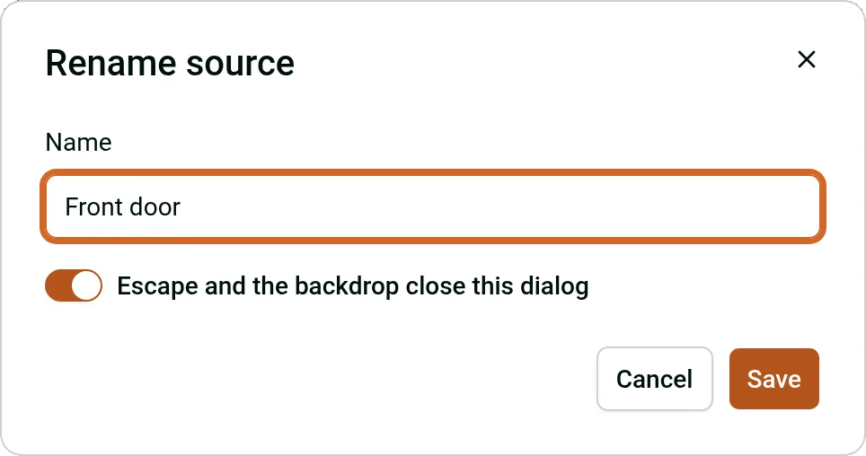
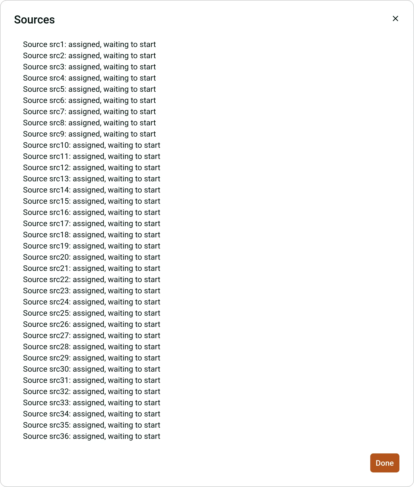
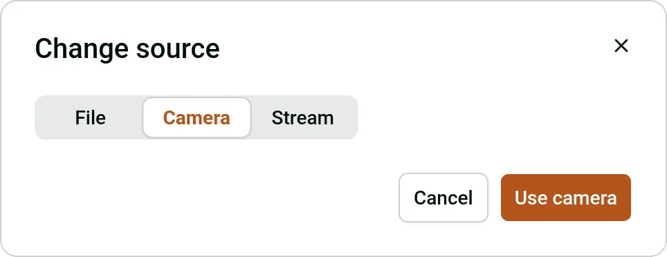

<!-- Written by `npm run docs:pages` from the kit and its examples. Do not edit. -->

# Dialog

_Components › Actions_ · [All topics](../README.md)

Opens modal dialogs whose content is the app's own:

```ts
const dialog = this.dialogs.open<string>(this.renameForm, { title: 'Rename source' });
const name = await dialog.closed; // undefined if it was dismissed
```

<picture>
<source media="(prefers-color-scheme: dark)" srcset="../images/dialog/rename-a-source.dark.webp">

</picture>

```ts
import { NeatDialog, NeatDialogBody, NeatDialogActions, NeatDialogRef } from '@sima/neat-ui/dialog';
```

## Examples

### Rename a source

A dialog around a template, named by `title`. The template gets the [`NeatDialogRef`](../components/dialog.md#neatdialogref) as its implicit context (`let-dialog`) and closes the dialog with a result: `open` returns the ref, and its `closed` settles with the name, or `undefined` when the dialog was dismissed. While saving, `setDismissible(false)` blocks Escape, the backdrop and the close button, and the buttons are `aria-disabled` rather than `disabled`: the button that was pressed has focus, and a disabled control loses it, which would leave the keyboard outside the dialog. The switch turns the dismissing off and on by hand.

<picture>
<source media="(prefers-color-scheme: dark)" srcset="../images/dialog/rename-a-source.dark.webp">

</picture>

<details>
<summary>Code</summary>

`1-rename-a-source.example.ts`

```ts
import {
  ChangeDetectionStrategy,
  Component,
  inject,
  signal,
  type TemplateRef,
} from '@angular/core';
import { NeatButton } from '@sima/neat-ui';
import {
  NeatDialog,
  NeatDialogActions,
  NeatDialogBody,
  type NeatDialogRef,
} from '@sima/neat-ui/dialog';
import { NeatInput } from '@sima/neat-ui/input';
import { NeatSwitch } from '@sima/neat-ui/switch';

@Component({
  selector: 'app-rename-a-source',
  imports: [NeatButton, NeatDialogActions, NeatDialogBody, NeatInput, NeatSwitch],
  changeDetection: ChangeDetectionStrategy.OnPush,
  template: `
    <div class="showcase-row">
      <button neatButton type="button" variant="outlined" (click)="open(renameDialog)">
        Rename source…
      </button>
    </div>
    <p class="showcase-code showcase-muted" aria-live="polite">{{ result() }}</p>

    <ng-template #renameDialog let-dialog>
      <neat-dialog-body>
        <div class="dialog-form">
          <label class="dialog-field">
            <span>Name</span>
            <input neatInput #name value="Front door" [readOnly]="saving()" />
          </label>
          <button
            neatSwitch
            [disabled]="saving()"
            [checked]="dialog.dismissible()"
            (checkedChange)="dialog.setDismissible($event)"
          >
            Escape and the backdrop close this dialog
          </button>
        </div>
      </neat-dialog-body>
      <neat-dialog-actions>
        <button
          neatButton
          type="button"
          variant="outlined"
          [attr.aria-disabled]="saving() || null"
          (click)="saving() || dialog.close()"
        >
          Cancel
        </button>
        <button
          neatButton
          type="button"
          [attr.aria-disabled]="saving() || null"
          (click)="saving() || save(dialog, name.value)"
        >
          {{ saving() ? 'Saving…' : 'Save' }}
        </button>
      </neat-dialog-actions>
    </ng-template>
  `,
  styleUrl: './rename-a-source.example.css',
})
export class RenameASource {
  private readonly dialogs = inject(NeatDialog);
  protected readonly result = signal('Not opened yet');
  protected readonly saving = signal(false);

  protected async open(content: TemplateRef<unknown>): Promise<void> {
    const name = await this.dialogs.open<string>(content, { title: 'Rename source' }).closed;
    this.result.set(name === undefined ? 'Rename: dismissed' : `Rename: saved "${name}"`);
  }

  /** Saving takes a moment, during which the dialog may not be dismissed. */
  protected save(dialog: NeatDialogRef<string>, name: string): void {
    this.saving.set(true);
    dialog.setDismissible(false);
    setTimeout(() => {
      this.saving.set(false);
      dialog.close(name);
    }, 1500);
  }
}
```

`rename-a-source.example.css`

```css
/* A dialog's content is the app's to lay out: here a field above a switch. */
.dialog-form {
  display: flex;
  flex-direction: column;
  align-items: flex-start;
  gap: var(--neat-space-4);
}

.dialog-field {
  display: flex;
  flex-direction: column;
  gap: var(--neat-space-2);
  align-self: stretch;
  font-size: var(--neat-text-sm);
}
```

</details>

### Long content

A `large` dialog whose content is taller than the screen allows: the body scrolls, and the title and the actions stay in view.

<picture>
<source media="(prefers-color-scheme: dark)" srcset="../images/dialog/long-content.dark.webp">

</picture>

<details>
<summary>Code</summary>

`2-long-content.example.ts`

```ts
import {
  ChangeDetectionStrategy,
  Component,
  inject,
  signal,
  type TemplateRef,
} from '@angular/core';
import { NeatButton } from '@sima/neat-ui';
import { NeatDialog, NeatDialogActions, NeatDialogBody } from '@sima/neat-ui/dialog';

@Component({
  selector: 'app-long-content',
  imports: [NeatButton, NeatDialogActions, NeatDialogBody],
  changeDetection: ChangeDetectionStrategy.OnPush,
  template: `
    <div class="showcase-row">
      <button neatButton type="button" variant="outlined" (click)="open(longDialog)">
        Large dialog with long content…
      </button>
    </div>
    <p class="showcase-code showcase-muted" aria-live="polite">{{ result() }}</p>

    <ng-template #longDialog let-dialog>
      <neat-dialog-body>
        <ul class="dialog-list">
          @for (line of lines; track line) {
            <li>{{ line }}</li>
          }
        </ul>
      </neat-dialog-body>
      <neat-dialog-actions>
        <button neatButton type="button" (click)="dialog.close()">Done</button>
      </neat-dialog-actions>
    </ng-template>
  `,
  styleUrl: './long-content.example.css',
})
export class LongContent {
  private readonly dialogs = inject(NeatDialog);
  protected readonly result = signal('Not opened yet');
  protected readonly lines = Array.from(
    { length: 40 },
    (_, index) => `Source src${index + 1}: assigned, waiting to start`,
  );

  protected async open(content: TemplateRef<unknown>): Promise<void> {
    await this.dialogs.open(content, { title: 'Sources', size: 'large' }).closed;
    this.result.set('Sources: closed');
  }
}
```

`long-content.example.css`

```css
.dialog-list {
  margin: 0;
  padding-inline-start: var(--neat-space-4);
  font-size: var(--neat-text-sm);
}
```

</details>

### Component with inputs

A component as the dialog's content, which takes values for its inputs from the opener (`inputs`, typed by the component): here the slot it is for and the kind it starts on, Camera. The component asks for its [`NeatDialogRef`](../components/dialog.md#neatdialogref) by injection and closes the dialog with the choice.

<picture>
<source media="(prefers-color-scheme: dark)" srcset="../images/dialog/component-with-inputs.dark.webp">

</picture>

<details>
<summary>Code</summary>

`3-component-with-inputs.example.ts`

```ts
import { ChangeDetectionStrategy, Component, inject, signal } from '@angular/core';
import { NeatButton } from '@sima/neat-ui';
import { NeatDialog } from '@sima/neat-ui/dialog';
import { SourceDialog, type SourceKind } from './source-dialog';

@Component({
  selector: 'app-component-with-inputs',
  imports: [NeatButton],
  changeDetection: ChangeDetectionStrategy.OnPush,
  template: `
    <div class="showcase-row">
      <button neatButton type="button" variant="outlined" (click)="open()">
        Change source of src3…
      </button>
    </div>
    <p class="showcase-code showcase-muted" aria-live="polite">{{ result() }}</p>
  `,
})
export class ComponentWithInputs {
  private readonly dialogs = inject(NeatDialog);
  protected readonly result = signal('Not opened yet');

  protected async open(): Promise<void> {
    const kind = await this.dialogs.open<SourceDialog, SourceKind>(SourceDialog, {
      title: 'Change source',
      inputs: { slot: 3, startOn: 'camera' },
    }).closed;
    this.result.set(kind === undefined ? 'Source: dismissed' : `Source: ${kind}`);
  }
}
```

`source-dialog.ts`

```ts
import { ChangeDetectionStrategy, Component, inject, input, linkedSignal } from '@angular/core';
import { NeatButton } from '@sima/neat-ui';
import { NeatDialogActions, NeatDialogBody, NeatDialogRef } from '@sima/neat-ui/dialog';
import { NeatSegmented, type NeatSegmentedOption } from '@sima/neat-ui/segmented';

/** Where a slot's video comes from, as the dialog offers it. */
export type SourceKind = 'file' | 'camera' | 'stream';

const KINDS: NeatSegmentedOption<SourceKind>[] = [
  { value: 'file', label: 'File' },
  { value: 'camera', label: 'Camera' },
  { value: 'stream', label: 'Stream' },
];

/**
 * The dialog-inputs demo: a component opened by `NeatDialog.open` with `inputs`. The slot it is
 * for and the kind it starts on come from the opener; the choice starts at that kind and is the
 * dialog's own from then on.
 */
@Component({
  selector: 'app-source-dialog',
  imports: [NeatButton, NeatDialogActions, NeatDialogBody, NeatSegmented],
  changeDetection: ChangeDetectionStrategy.OnPush,
  template: `
    <neat-dialog-body>
      <neat-segmented [label]="'Source for src' + slot()" [options]="kinds" [(value)]="kind" />
    </neat-dialog-body>
    <neat-dialog-actions>
      <button neatButton type="button" variant="outlined" (click)="dialog.close()">Cancel</button>
      <button neatButton type="button" (click)="dialog.close(kind())">Use {{ kind() }}</button>
    </neat-dialog-actions>
  `,
})
export class SourceDialog {
  readonly slot = input.required<number>();
  readonly startOn = input<SourceKind>('file');

  protected readonly dialog = inject<NeatDialogRef<SourceKind>>(NeatDialogRef);
  protected readonly kinds = KINDS;
  /** Starts on the opener's kind; read through a linked signal, as inputs arrive after creation. */
  protected readonly kind = linkedSignal(() => this.startOn());
}
```

</details>

## API

### `NeatDialog`

Service from `@sima/neat-ui/dialog`.

The content is a template or a component. It is rendered under the title the options name the dialog by, and is built from `<neat-dialog-body>` (the part that scrolls) and `<neat-dialog-actions>` (the buttons). It gets the [`NeatDialogRef`](../components/dialog.md#neatdialogref), to close the dialog with a result or to block dismissing it while it is busy: a template as its implicit context (`<ng-template let-dialog>`), a component by injection.

A component can take inputs from the opener, typed by the component (a template needs none: it sees the opener's own fields):

```ts
const dialog = this.dialogs.open<ImportDialog, string | null>(ImportDialog, {
  title: 'Import media',
  inputs: { openingTab: 'youtube' },
});
```

With `inputs` the type arguments are the component's, then the result's; both are inferred when none is given, the result as `unknown`.

The dialog is modal: focus moves into it and stays inside, the page behind is hidden from assistive technology, and Escape or a click on the backdrop close it while it is dismissible. On closing, focus goes back to the element that had it on opening. Dialogs can stack; Escape closes the topmost, and a handled Escape stops there: it never reaches `document` or `window` listeners. Navigation (the browser's Back button, a route change) closes a dialog even when it is not dismissible, and `closed` then settles with `undefined`. For a yes/no question use [`NeatConfirm`](../components/confirm.md#neatconfirm), which this does not replace.

In kiosk mode a dialog does not hold the floating toolbar (as `neat-popover` does): the dialog covers the page, and the toolbar behind it fading is as it should be. Closing returns focus to the button in the toolbar, which shows the toolbar again.

**Methods**

- **`open`**

  ```ts
  open<R = unknown>(content: TemplateRef<unknown> | Type<unknown>, options: NeatDialogOptions): NeatDialogRef<R>
  open<C, R = unknown>(content: Type<C>, options: NeatDialogComponentOptions<C>): NeatDialogRef<R>
  ```

### `NeatDialogBody`

Component from `@sima/neat-ui/dialog`, selector `neat-dialog-body`.

The dialog's content between the title and the actions: `<neat-dialog-body>`. It is the part that scrolls when the content is taller than the screen allows, so the title and the actions stay in view. The negative margin and equal padding keep the focus ring of a control at its edge from being clipped by that scrolling.

### `NeatDialogActions`

Component from `@sima/neat-ui/dialog`, selector `neat-dialog-actions`.

The dialog's buttons: `<neat-dialog-actions>` under the body, the canceling button first and the confirming one last. Helm's footer: a row at the end on wide screens; stacked on narrow ones, with the confirming button on top.

### `NeatDialogRef`

Class from `@sima/neat-ui/dialog`.

An open dialog, as the code that opened it and the dialog's own content see it. [`NeatDialog.open`](../components/dialog.md#neatdialog) returns it, and a component used as dialog content gets the same ref by injection: `inject<NeatDialogRef<Result>>(NeatDialogRef)`. A template used as content gets it as the template's implicit context: `<ng-template let-dialog>`.

Only [`NeatDialog`](../components/dialog.md#neatdialog) creates one.

**Properties**

- **`closed`** `Promise<R | undefined>`

  Settles once the dialog has closed and focus is back on the element that had it: with the result given to `close`, or `undefined` when it was dismissed (Escape, the backdrop, the close button) or closed by navigation. Navigating (the browser's Back button, a route change) closes every dialog, dismissible or not; code that must not lose work to it has to guard the navigation itself.

- **`dismissible`** `Signal<boolean>`

  Whether Escape, the backdrop and the close button close the dialog right now.

**Methods**

- **`close`**

  ```ts
  close(result?: R): void
  ```

  Closes the dialog; `closed` settles with the result. Closing a dialog that is already closing changes nothing, so the first result stands.

- **`setDismissible`**

  ```ts
  setDismissible(dismissible: boolean): void
  ```

  Allows or blocks closing from outside the dialog's own controls: while `false`, Escape and a click on the backdrop do nothing and the close button is dimmed (`aria-disabled`) and does nothing. For a dialog that is busy and would lose work if it closed; `close()` still works, since the code that is busy calls it. Navigation still closes it (see `closed`).

### `NeatDialogOptions`

Interface from `@sima/neat-ui/dialog`.

What [`NeatDialog.open`](../components/dialog.md#neatdialog) takes besides the content.

**Members**

- **`title`** `string`

  Names the dialog: "Assign source". Shown as its heading.

- **`size`** `NeatDialogSize`, optional

  The dialog's width on screens wider than a phone; `'medium'` by default.

- **`dismissible`** `boolean`, optional

  Whether Escape, a click on the backdrop and the close button close the dialog; `true` by default. [`NeatDialogRef.setDismissible`](../components/dialog.md#neatdialogref) changes it while the dialog is open.

### `NeatDialogComponentOptions`

Interface from `@sima/neat-ui/dialog`.

What [`NeatDialog.open`](../components/dialog.md#neatdialog) takes for a component whose inputs the opener sets.

**Members**

- **`inputs`** `NeatDialogInputs<C>`

  Values for the component's inputs, set as it is created, before its first change detection, as a template's bindings would be: the component sees them in its template, in `computed` and `linkedSignal`, and from `ngOnInit` on, but not in a field initializer or its constructor. They are set once; the dialog does not follow later changes.

### `NeatDialogInputs`

Type from `@sima/neat-ui/dialog`.

The inputs of a component `C` that [`NeatDialog.open`](../components/dialog.md#neatdialog) can set: each signal input (`input()`, `input.required()`, and `model()`, which is one too) by its property name, with the type it takes. All are optional here, since the type cannot tell a required input from one with a default; a required one left out fails when the component reads it, as it would in a template.

Do not alias an input of a dialog component (`input(…, { alias })`): the type names inputs by property, Angular binds them by alias, and an aliased one passed here throws as the dialog opens. The alias lives in the component's metadata, out of the type's reach.

```ts
type NeatDialogInputs<C> = {
  readonly [K in keyof C as [InputValue<C[K]>] extends [never] ? never : K]?: InputValue<C[K]>;
}
```

### `NeatDialogSize`

Type from `@sima/neat-ui/dialog`.

How wide the dialog is on screens wider than a phone: 24, 32 and 48 rem.

```ts
type NeatDialogSize = 'small' | 'medium' | 'large'
```
