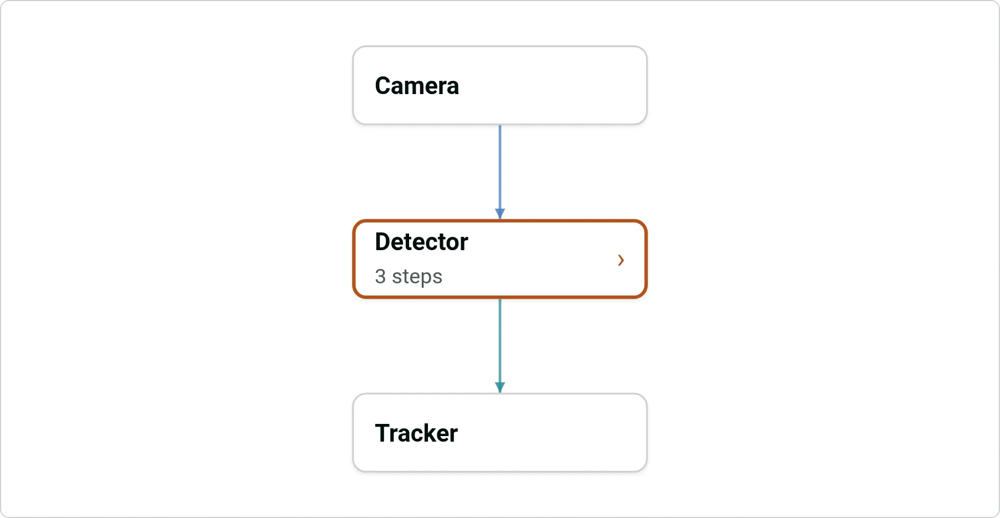

<!-- Written by `npm run docs:pages` from the kit and its examples. Do not edit. -->

# Drill-down

_Components › Diagram_ · [All topics](../README.md)

The level that opens on `blockId`: the block as its group at the origin, sized to its children with a padding, and everything inside the block, however deep, as placed (positions are relative to the parent, so nothing moves); the nodes the edges from inside reach, in a column left of the group (senders) and right of it (receivers), vertically centered on it; and the edges with an end inside. A node that both sends and receives goes in the senders' column only, so it is on the level once. The outside nodes and the group get their sides afresh (an overview's `inSide` and `outSide` suit its placement, not this one), and the group opens nothing (it is the level). The diagram's notes are left behind: they are placed for it. A block that is not on the diagram or holds nothing gives an empty level, named once.

<picture>
<source media="(prefers-color-scheme: dark)" srcset="../images/drill-down/detector-level.dark.webp">

</picture>

```ts
import { neatDrillDownLevel } from '@sima/neat-ui/diagram';
```

## Examples

### Detector level

A three-block pipeline whose Detector opens a level that [`neatDrillDownLevel`](../components/drill-down.md#neatdrilldownlevel) placed: its steps inside, the Camera that feeds it in a column on the left and the Tracker it feeds in one on the right. Open the Detector to see it.

<picture>
<source media="(prefers-color-scheme: dark)" srcset="../images/drill-down/detector-level.dark.webp">

</picture>

<details>
<summary>Code</summary>

`1-detector-level.example.ts`

```ts
import { ChangeDetectionStrategy, Component } from '@angular/core';
import { type NeatDiagramSet, neatDrillDownLevel, NeatDiagramView } from '@sima/neat-ui/diagram';
import { OVERVIEW, WITH_STEPS } from './pipeline-data';

@Component({
  selector: 'app-detector-level',
  imports: [NeatDiagramView],
  changeDetection: ChangeDetectionStrategy.OnPush,
  template: `<neat-diagram class="diagram" [diagram]="pipeline" label="A pipeline" />`,
  styleUrl: './detector-level.example.css',
})
export class DetectorLevel {
  /** The level the Detector opens is placed from the diagram that holds its steps. */
  protected readonly pipeline: NeatDiagramSet = {
    overview: OVERVIEW,
    levels: { detector: neatDrillDownLevel(WITH_STEPS, 'detector') },
  };
}
```

`pipeline-data.ts`

```ts
import type { NeatDiagram, NeatDiagramNode } from '@sima/neat-ui/diagram';

/** The overview's blocks: the Detector's card is too small to hold its steps. */
const OVERVIEW_NODES: readonly NeatDiagramNode[] = [
  { id: 'camera', role: 'block', label: 'Camera', x: 0, y: 0, w: 170, h: 46, outSide: 'bottom' },
  {
    id: 'detector',
    role: 'block',
    label: 'Detector',
    detail: '3 steps',
    opens: 'detector',
    inSide: 'top',
    outSide: 'bottom',
    x: 0,
    y: 100,
    w: 170,
    h: 46,
  },
  { id: 'tracker', role: 'block', label: 'Tracker', inSide: 'top', x: 0, y: 200, w: 170, h: 46 },
];

/** A step of the Detector, in a row inside it below the level group's title. */
const step = (id: string, label: string, i: number): NeatDiagramNode => ({
  id,
  role: 'block',
  label,
  parent: 'detector',
  x: 20 + i * 170,
  y: 72,
  w: 130,
  h: 40,
});

/**
 * The same pipeline with the Detector's steps inside it: the diagram a level is placed from. The
 * Camera and the Tracker are the Detector's neighbors, and the edges that end in a step are the
 * ones the level draws.
 */
export const WITH_STEPS: NeatDiagram = {
  nodes: [
    ...OVERVIEW_NODES,
    step('resize', 'Resize', 0),
    step('yolox', 'YOLOX', 1),
    step('nms', 'NMS', 2),
  ],
  edges: [
    { id: 'camera-resize', from: 'camera', to: 'resize', series: 1 },
    { id: 'resize-yolox', from: 'resize', to: 'yolox', line: 'dashed' },
    { id: 'yolox-nms', from: 'yolox', to: 'nms', line: 'dashed' },
    { id: 'nms-tracker', from: 'nms', to: 'tracker', series: 4 },
  ],
};

/** The overview: the Camera, the Detector, which opens a level, and the Tracker. */
export const OVERVIEW: NeatDiagram = {
  nodes: OVERVIEW_NODES,
  edges: [
    { id: 'camera-detector', from: 'camera', to: 'detector', series: 1 },
    { id: 'detector-tracker', from: 'detector', to: 'tracker', series: 4 },
  ],
};
```

`detector-level.example.css`

```css
:host {
  display: block;
}

/*
 * A diagram has no height of its own: the app gives it a bounded box, here 2:1 up to 30rem, wide
 * for the level's row of columns, so a phone's narrow box does not stand tall and empty around a
 * drawing its width shrinks.
 */
.diagram {
  /* The card's whole width: the ratio would otherwise size the width from the capped height, and
     the drawing would cut off partway across the card when panned. */
  width: 100%;
  aspect-ratio: 2 / 1;
  max-height: 30rem;
}
```

</details>

## API

### `neatDrillDownLevel`

Function from `@sima/neat-ui/diagram`.

```ts
neatDrillDownLevel(diagram: NeatDiagram, blockId: string): NeatDiagram
```
