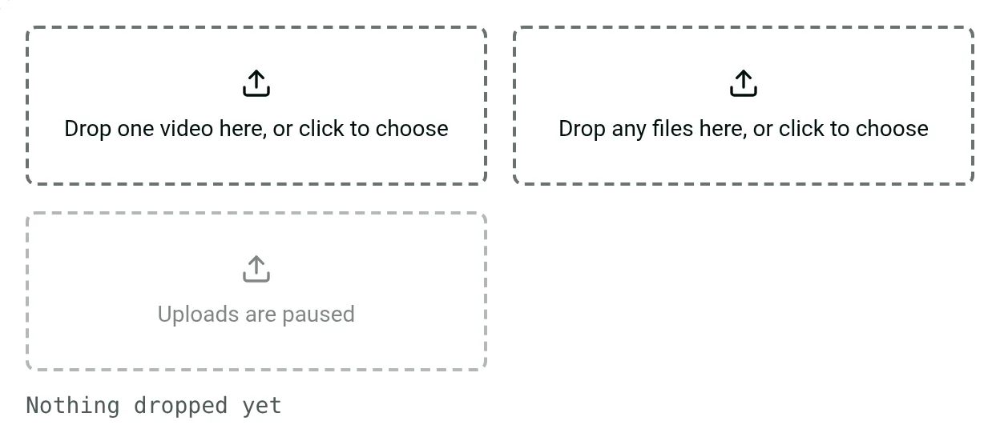

<!-- Written by `npm run docs:pages` from the kit and its examples. Do not edit. -->

# Drop zone

_Components › Forms_ · [All topics](../README.md)

A place to drop files, or to click for the system's file chooser:

```html
<neat-drop-zone label="Drop videos here or click to choose" accept="video/*" multiple
  (files)="upload($event)" />
```

<picture>
<source media="(prefers-color-scheme: dark)" srcset="../images/drop-zone/accepted-files.dark.webp">

</picture>

```ts
import { NeatDropZone } from '@sima/neat-ui/drop-zone';
```

## Examples

### Accepted files

Three zones: the first takes one video, so drop a text file on it and the log says it was not accepted; the second takes any files; the third is disabled. The log is newest first.

<picture>
<source media="(prefers-color-scheme: dark)" srcset="../images/drop-zone/accepted-files.dark.webp">

</picture>

<details>
<summary>Code</summary>

`1-accepted-files.example.ts`

```ts
import { ChangeDetectionStrategy, Component, signal } from '@angular/core';
import { NeatDropZone } from '@sima/neat-ui/drop-zone';

@Component({
  selector: 'app-accepted-files',
  imports: [NeatDropZone],
  changeDetection: ChangeDetectionStrategy.OnPush,
  template: `
    <div class="zones">
      <neat-drop-zone
        label="Drop one video here, or click to choose"
        accept="video/*,.mkv"
        (rejected)="log('Not accepted', $event)"
        (files)="log('Received', $event)"
      />
      <neat-drop-zone
        label="Drop any files here, or click to choose"
        multiple
        (files)="log('Received', $event)"
      />
      <neat-drop-zone label="Uploads are paused" disabled />
    </div>
    <p class="showcase-code showcase-muted" aria-live="polite">
      @for (line of lines(); track $index) {
        {{ line }}<br />
      } @empty {
        Nothing dropped yet
      }
    </p>
  `,
  styleUrl: './accepted-files.example.css',
})
export class AcceptedFiles {
  protected readonly lines = signal<readonly string[]>([]);

  protected log(what: 'Received' | 'Not accepted', files: File[]): void {
    const names = files.map((file) => file.name).join(', ');
    this.lines.update((lines) => [`${what}: ${names}`, ...lines].slice(0, 4));
  }
}
```

`accepted-files.example.css`

```css
/* The zones and the log one gap apart. */
:host {
  display: flex;
  flex-direction: column;
  gap: var(--neat-space-3);
}

/* A drop zone fills its container's width, so the columns give each one. */
.zones {
  display: grid;
  grid-template-columns: repeat(auto-fill, minmax(14rem, 18rem));
  gap: var(--neat-space-4);
}
```

</details>

## API

### `NeatDropZone`

Component from `@sima/neat-ui/drop-zone`, selector `neat-drop-zone`.

`label` is the visible text and the accessible name. The zone is a native button: Tab focuses it, Enter and Space (like a click) open the chooser. `files` emits the files that were dropped or chosen, as one array per drop or choice. `multiple` allows several; without it, only the first file is taken. `accept` is the native attribute's list (`video/*,.mkv`); the chooser applies it itself, and the zone applies it to what is dropped, which the browser leaves unfiltered. `rejected` emits the dropped files that were not taken (not allowed by `accept`, or beyond the first without `multiple`), before `files` and even when `files` has nothing to emit, so the app can say what it did not take. While `disabled` it does not react to clicks, drags or drops.

Files dragged over the zone light it up (`--primary` outline on an `--accent` tint). Only drags that carry files do; text or a link dragged over it is ignored and the browser treats it as anywhere else. The zone fills its container's width.

The hidden file input is the chooser and stays out of the tab order and the accessibility tree: the button is the control. Its value is cleared after each choice so that choosing the same file again is a change.

**Inputs**

- **`label`** `string`, required

  The visible text, and the accessible name.

- **`multiple`** `boolean`, default `false`, transform `booleanAttribute`

  Whether several files may be dropped or chosen at once.

- **`accept`** `string`

  The kinds of file to take, as the native `accept` attribute has it.

- **`disabled`** `boolean`, default `false`, transform `booleanAttribute`

  Turns the zone off: it takes neither a drop nor a click to choose files.

**Outputs**

- **`files`** `File[]`

  The files that were dropped or chosen and taken, once per drop or choice.

- **`rejected`** `File[]`

  The dropped files that were left out, once per drop that left any out and before `files`: those `accept` does not allow, and the ones after the first when `multiple` is off. An app says why nothing (or not everything) was taken from this. Emitted even when `files` is not.
