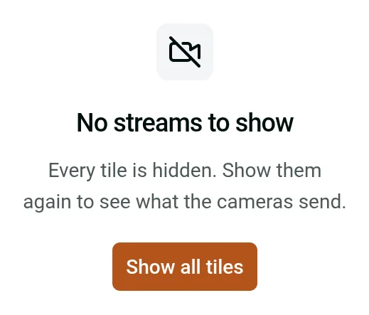

<!-- Written by `npm run docs:pages` from the kit and its examples. Do not edit. -->

# Empty state

_Components › Status_ · [All topics](../README.md)

What a large area shows when it has nothing to show, and no part of the app is on it:

```html
<neat-empty icon="video-off" heading="No streams to show">
  Every tile is hidden.
  <button neatButton neatEmptyActions type="button">Show all tiles</button>
</neat-empty>
```

<picture>
<source media="(prefers-color-scheme: dark)" srcset="../images/empty/hidden-tiles.dark.webp">

</picture>

```ts
import { NeatEmpty } from '@sima/neat-ui/empty';
```

## Examples

### Hidden tiles

A tile grid with every tile hidden. Nothing of the app is on the area, so it shows an empty state with the way back: a heading, a sentence and the action that shows the tiles again.

<picture>
<source media="(prefers-color-scheme: dark)" srcset="../images/empty/hidden-tiles.dark.webp">

</picture>

<details>
<summary>Code</summary>

`1-hidden-tiles.example.ts`

```ts
import { ChangeDetectionStrategy, Component, signal } from '@angular/core';
import { NeatButton } from '@sima/neat-ui';
import { NeatEmpty } from '@sima/neat-ui/empty';

@Component({
  selector: 'app-hidden-tiles',
  imports: [NeatButton, NeatEmpty],
  changeDetection: ChangeDetectionStrategy.OnPush,
  templateUrl: './1-hidden-tiles.example.html',
  styleUrl: './hidden-tiles.example.css',
})
export class HiddenTiles {
  protected readonly tiles = ['Front door', 'Garage', 'Loading dock', 'Parking'];
  protected readonly shown = signal(false);
}
```

`1-hidden-tiles.example.html`

```html
@if (shown()) {
  <div class="grid">
    @for (tile of tiles; track tile) {
      <div class="tile">{{ tile }}</div>
    }
  </div>
  <button neatButton variant="outlined" size="small" type="button" (click)="shown.set(false)">
    Hide all tiles
  </button>
} @else {
  <neat-empty icon="video-off" heading="No streams to show">
    Every tile is hidden. Show them again to see what the cameras send.
    <button neatButton neatEmptyActions type="button" (click)="shown.set(true)">
      Show all tiles
    </button>
  </neat-empty>
}
```

`hidden-tiles.example.css`

```css
/* The area the empty state fills: a bounded box, as a page's tile grid has. */
:host {
  display: flex;
  flex-direction: column;
  gap: var(--neat-space-3);
  min-height: 18rem;
}

.grid {
  display: grid;
  flex: 1;
  grid-template-columns: repeat(auto-fit, minmax(8rem, 1fr));
  gap: var(--neat-space-3);
}

.tile {
  display: flex;
  align-items: center;
  justify-content: center;
  min-height: 6rem;
  border-radius: var(--radius);
  background: var(--neat-video-surface);
  font-size: var(--neat-text-sm);
}
```

</details>

## API

### `NeatEmpty`

Component from `@sima/neat-ui/empty`, selector `neat-empty`.

For an area that would otherwise be blank: a tile grid when every tile is hidden, a page with no results yet. It is Spartan's empty state, taken as it is: a dashed, centered column with an optional icon on a rounded square, a heading, a short description and a row of actions. It fills the area it is in, so give that a size.

Not for a control or a part that has nothing to say. A video tile's "No signal" is the tile's own note (`notice`), a list that is empty shows a line in the list, and neither is an empty state.

The heading is a real heading (`role="heading"`), at `headingLevel`, 3 by default: pick the level that fits where the area stands in the page's outline. The content is the description; elements marked `neatEmptyActions` go to a row under it.

**Inputs**

- **`icon`** `NeatIconName | NeatIconGlyph`

  The icon on the square above the heading: a name of the kit's set first, and only where none fits a glyph imported from `@sima/neat-ui/lucide`. None shows no square.

- **`heading`** `string`, required

  What the area is missing, in a few words.

- **`headingLevel`** `2 | 3 | 4 | 5 | 6`, default `3`

  The heading's level in the page's outline.
