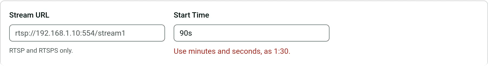
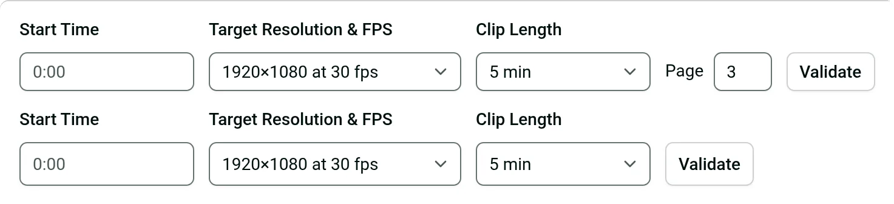
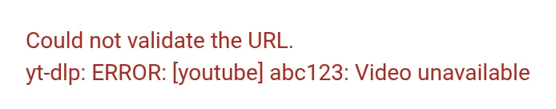

<!-- Written by `npm run docs:pages` from the kit and its examples. Do not edit. -->

# Field

_Components › Forms_ · [All topics](../README.md)

A form control under its visible name, with an optional hint and error under it:

```html
<neat-field label="Stream URL" hint="RTSP and RTSPS only." [error]="urlError()">
  <input neatInput size="small" type="url" />
</neat-field>
```

<picture>
<source media="(prefers-color-scheme: dark)" srcset="../images/field/hint-and-error.dark.webp">

</picture>

```ts
import { NeatField, NeatErrorNote } from '@sima/neat-ui/field';
```

## Examples

### Hint and error

A hint under the first field and an error under the second, whose control is drawn invalid. Each control is named by its field's label, and described by the note under it.

<picture>
<source media="(prefers-color-scheme: dark)" srcset="../images/field/hint-and-error.dark.webp">

</picture>

<details>
<summary>Code</summary>

`1-hint-and-error.example.ts`

```ts
import { ChangeDetectionStrategy, Component } from '@angular/core';
import { NeatField } from '@sima/neat-ui/field';
import { NeatInput } from '@sima/neat-ui/input';

@Component({
  selector: 'app-hint-and-error',
  imports: [NeatField, NeatInput],
  changeDetection: ChangeDetectionStrategy.OnPush,
  template: `
    <neat-field label="Stream URL" hint="RTSP and RTSPS only.">
      <input neatInput size="small" type="url" placeholder="rtsp://192.168.1.10:554/stream1" />
    </neat-field>
    <neat-field label="Start Time" error="Use minutes and seconds, as 1:30.">
      <input neatInput size="small" value="90s" />
    </neat-field>
  `,
  styleUrl: './hint-and-error.example.css',
})
export class HintAndError {}
```

`hint-and-error.example.css`

```css
/* A field fills its container's width, so the columns give each one. */
:host {
  display: grid;
  grid-template-columns: repeat(auto-fill, minmax(14rem, 18rem));
  align-items: start;
  gap: var(--neat-space-4);
}
```

</details>

### A row of controls

A field, two selects, a button and, in the small row only (it has no other size), a number field, aligned at their bottom edge: in each row the names share a baseline and the controls their edges.

<picture>
<source media="(prefers-color-scheme: dark)" srcset="../images/field/a-row-of-controls.dark.webp">

</picture>

<details>
<summary>Code</summary>

`2-a-row-of-controls.example.ts`

```ts
import { ChangeDetectionStrategy, Component, signal } from '@angular/core';
import { NeatButton } from '@sima/neat-ui';
import { NeatField } from '@sima/neat-ui/field';
import { NeatInput } from '@sima/neat-ui/input';
import { NeatNumberField } from '@sima/neat-ui/number-field';
import { NeatSelect, type NeatSelectOption } from '@sima/neat-ui/select';

const SIZES = ['small', 'medium'] as const;

const RESOLUTIONS: NeatSelectOption<string>[] = [
  { value: '1080p30', label: '1920×1080 at 30 fps' },
  { value: '720p30', label: '1280×720 at 30 fps' },
  { value: '480p15', label: '640×480 at 15 fps' },
];
const CLIP_LENGTHS: NeatSelectOption<number>[] = [
  { value: 60, label: '1 min' },
  { value: 300, label: '5 min' },
  { value: 600, label: '10 min' },
];

@Component({
  selector: 'app-a-row-of-controls',
  imports: [NeatButton, NeatField, NeatInput, NeatNumberField, NeatSelect],
  changeDetection: ChangeDetectionStrategy.OnPush,
  template: `
    @for (size of sizes; track size) {
      <div class="row">
        <neat-field class="narrow" label="Start Time">
          <input neatInput [size]="size" placeholder="0:00" />
        </neat-field>
        <neat-select
          class="wide"
          label="Target Resolution & FPS"
          showLabel
          [size]="size"
          [options]="resolutions"
          [(value)]="resolution"
        />
        <neat-select
          class="narrow"
          label="Clip Length"
          showLabel
          [size]="size"
          [options]="clipLengths"
          [value]="300"
        />
        @if (size === 'small') {
          <neat-number-field label="Page" [value]="page()" (commit)="page.set($event)" />
        }
        <button neatButton type="button" variant="outlined" [size]="size">Validate</button>
      </div>
    }
  `,
  styleUrl: './a-row-of-controls.example.css',
})
export class ARowOfControls {
  protected readonly sizes = SIZES;
  protected readonly resolutions = RESOLUTIONS;
  protected readonly clipLengths = CLIP_LENGTHS;
  protected readonly resolution = signal<string | null>('1080p30');
  protected readonly page = signal(3);
}
```

`a-row-of-controls.example.css`

```css
:host {
  display: flex;
  flex-direction: column;
  gap: var(--neat-space-4);
}

/* Fields, selects, a number field and a button in a row, level at their bottom edge. */
.row {
  display: flex;
  flex-wrap: wrap;
  align-items: flex-end;
  gap: var(--neat-space-3);
}

/* A field and a select fill their container's width, so the row gives each one. */
.narrow {
  width: 9rem;
}

.wide {
  width: 13rem;
}
```

</details>

### Error note

A failure from a server, said in place on two lines.

<picture>
<source media="(prefers-color-scheme: dark)" srcset="../images/field/error-note.dark.webp">

</picture>

<details>
<summary>Code</summary>

`3-error-note.example.ts`

```ts
import { ChangeDetectionStrategy, Component } from '@angular/core';
import { NeatErrorNote } from '@sima/neat-ui/field';

@Component({
  selector: 'app-error-note',
  imports: [NeatErrorNote],
  changeDetection: ChangeDetectionStrategy.OnPush,
  template: `<neat-error-note>{{ message }}</neat-error-note>`,
})
export class ErrorNote {
  protected readonly message =
    'Could not validate the URL.\nyt-dlp: ERROR: [youtube] abc123: Video unavailable';
}
```

</details>

## API

### `NeatField`

Component from `@sima/neat-ui/field`, selector `neat-field`.

The control is the content, one `input neatInput` inside a `label` whose text is `label`: the label names it, and a click on the name focuses it. The app may swap it (an `@if` in the content); the field follows the control it has. `neat-select` shows its own name with `showLabel` instead, drawn the same way.

`hint` is a note under the control and `error` a `neat-error-note` under that, both outside the label so that they are not part of the control's name. The field describes the control by them (`aria-describedby`) and marks it `aria-invalid` while there is an error, so it owns those two attributes of its control: do not bind them yourself.

Lining up in a row: the name's text and the gap under it are `neat-select`'s, and the control's height is its own `size` (`neatInput`, `neat-select` and `neatButton` share `small` and `medium`; `neat-number-field` is `small`). A row of fields and a button of one size aligned at their bottom edge (`align-items: end`) has its names on one baseline and its controls' edges level. A hint or an error makes its field taller, so a row that must stay level shows them under the row instead.

**Inputs**

- **`label`** `string`, required

  The control's visible name.

- **`hint`** `string`, default `''`

  A note under the control about what it takes; none while empty.

- **`error`** `string`, default `''`

  What is wrong with the control's value; none while empty.

### `NeatErrorNote`

Component from `@sima/neat-ui/field`, selector `neat-error-note`.

A failure said in place, under the form or the work it belongs to: `<neat-error-note>{{ message }}</neat-error-note>`. It is an `alert`, so a screen reader reads it as it appears: render it when there is a failure (`@if`), not as an empty note waiting for one. A message of several lines (a server's diagnostics) keeps its line breaks, and a long unbroken string (a URL) wraps rather than widen the form. The words are the app's.

`neat-field` shows one under its control for its `error`.
