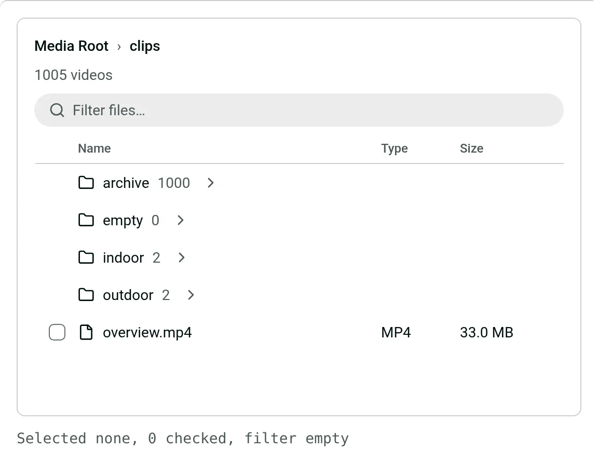
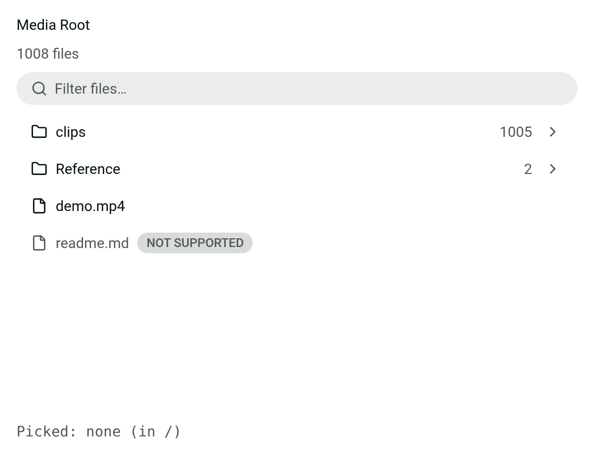

<!-- Written by `npm run docs:pages` from the kit and its examples. Do not edit. -->

# File browser

_Components › Data_ · [All topics](../README.md)

A browser for a tree of folders and files:

```html
<neat-file-browser rootLabel="Media Root" [root]="tree()" [(folder)]="folder"
  [(selected)]="file" mode="manage" [(checked)]="checkedFiles" filterPlaceholder="Filter files…">
  <ng-template neatColumn="size" header="Size" width="6rem" let-file>…</ng-template>
</neat-file-browser>
```

<picture>
<source media="(prefers-color-scheme: dark)" srcset="../images/file-browser/managing.dark.webp">

</picture>

```ts
import { NeatFileBrowser } from '@sima/neat-ui/file-browser';
```

## Examples

### Picking

Picking one file from a media tree. The `archive` folder has a thousand files, and `readme.md` is tagged and grayed but can still be selected. A click on a folder only highlights it: open it with a double click, its chevron or Enter. Move over a folder with the arrow keys or a click and the selection stays on the file it was on.

<picture>
<source media="(prefers-color-scheme: dark)" srcset="../images/file-browser/picking.dark.webp">

</picture>

<details>
<summary>Code</summary>

`1-picking.example.ts`

```ts
import { ChangeDetectionStrategy, Component, signal } from '@angular/core';
import { NeatFileBrowser } from '@sima/neat-ui/file-browser';
import { DEMO_TREE } from './demo-tree';

@Component({
  selector: 'app-picking',
  imports: [NeatFileBrowser],
  changeDetection: ChangeDetectionStrategy.OnPush,
  template: `
    <div class="box">
      <neat-file-browser
        rootLabel="Media Root"
        filterPlaceholder="Filter files…"
        [root]="tree"
        [(folder)]="folder"
        [(selected)]="selected"
      />
    </div>
    <p class="showcase-code showcase-muted" aria-live="polite">
      Picked: {{ selected() ?? 'none' }} (in /{{ folder() }})
    </p>
  `,
  styleUrls: ['./browser-box.css', './stack.css'],
})
export class Picking {
  protected readonly tree = DEMO_TREE;
  protected readonly folder = signal('');
  protected readonly selected = signal<string | null>(null);
}
```

`demo-tree.ts`

```ts
import type { NeatFileNode } from '@sima/neat-ui/file-browser';

const file = (path: string, extra: Partial<NeatFileNode> = {}): NeatFileNode => ({
  name: path.split('/').pop()!,
  path,
  type: 'file',
  ...extra,
});
const folder = (path: string, children: NeatFileNode[]): NeatFileNode => ({
  name: path.split('/').pop()!,
  path,
  type: 'folder',
  children,
});
const unsupported = { unavailable: true, tag: 'NOT SUPPORTED' };

/** A folder with a thousand files, to see the list scroll and stay quick. */
const ARCHIVE_SIZE = 1000;
const archive = Array.from({ length: ARCHIVE_SIZE }, (_, index) =>
  file(`clips/archive/take-${String(index + 1).padStart(4, '0')}.mp4`),
);

/** A made-up media tree: nested folders, a thousand files in one, and files the app cannot use. */
export const DEMO_TREE: readonly NeatFileNode[] = [
  folder('clips', [
    folder('clips/indoor', [
      folder('clips/indoor/lobby', [file('clips/indoor/lobby/entrance.mp4')]),
      file('clips/indoor/warehouse.mp4'),
      file('clips/indoor/notes.txt', unsupported),
    ]),
    folder('clips/outdoor', [file('clips/outdoor/highway.mp4'), file('clips/outdoor/Harbor.mkv')]),
    folder('clips/archive', archive),
    folder('clips/empty', []),
    file('clips/overview.mp4'),
  ]),
  folder('Reference', [file('Reference/checkerboard.png'), file('Reference/calibration.avi')]),
  file('readme.md', unsupported),
  file('demo.mp4'),
];

/** A stable made-up size for the demo's size column. */
export function demoSize(path: string): string {
  let hash = 0;
  for (const char of path) hash = (hash * 31 + char.charCodeAt(0)) % 9973;
  return `${(hash / 100 + 1).toFixed(1)} MB`;
}
```

`browser-box.css`

```css
/* A browser fills its container, so the examples give it a size. */
.box {
  width: 34rem;
  height: 24rem;
}
```

`stack.css`

```css
/* The example's parts, a browser and what reports on it, one gap apart. */
:host {
  display: flex;
  flex-direction: column;
  gap: var(--neat-space-3);
}
```

</details>

### Managing

A browser in `manage` mode on a card, with a Type and a Size column after the name; the folders' counts say "videos" and follow their names. A double click or the chevron opens a folder. Check files in several folders and filter: the checked ones stay checked, and the line under the browser counts them.

<picture>
<source media="(prefers-color-scheme: dark)" srcset="../images/file-browser/managing.dark.webp">

</picture>

<details>
<summary>Code</summary>

`2-managing.example.ts`

```ts
import { ChangeDetectionStrategy, Component, signal } from '@angular/core';
import { NeatColumn } from '@sima/neat-ui/select-list';
import { NeatFileBrowser } from '@sima/neat-ui/file-browser';
import { DEMO_TREE, demoSize } from './demo-tree';

@Component({
  selector: 'app-managing',
  imports: [NeatColumn, NeatFileBrowser],
  changeDetection: ChangeDetectionStrategy.OnPush,
  template: `
    <div class="box card">
      <neat-file-browser
        rootLabel="Media Root"
        mode="manage"
        filterPlaceholder="Filter files…"
        [root]="tree"
        [countLabel]="videoCount"
        [(folder)]="folder"
        [(selected)]="selected"
        [(checked)]="checked"
        [(filter)]="filter"
      >
        <ng-template neatColumn="type" header="Type" width="4rem" let-file>{{
          typeOf(file.name)
        }}</ng-template>
        <ng-template neatColumn="size" header="Size" width="5.5rem" let-file>{{
          sizeOf(file.path)
        }}</ng-template>
      </neat-file-browser>
    </div>
    <p class="showcase-code showcase-muted" aria-live="polite">
      Selected {{ selected() ?? 'none' }}, {{ checked().length }} checked, filter
      {{ filter() ? '“' + filter() + '”' : 'empty' }}
    </p>
  `,
  styleUrls: ['./browser-box.css', './managing.example.css', './stack.css'],
})
export class Managing {
  protected readonly tree = DEMO_TREE;
  protected readonly folder = signal('clips');
  protected readonly selected = signal<string | null>(null);
  protected readonly checked = signal<readonly string[]>([]);
  protected readonly filter = signal('');
  protected readonly videoCount = (_folder: string, count: number) =>
    `${count} ${count === 1 ? 'video' : 'videos'}`;
  protected readonly typeOf = (name: string) => name.split('.').pop()!.toUpperCase();
  protected readonly sizeOf = demoSize;
}
```

`demo-tree.ts`

```ts
import type { NeatFileNode } from '@sima/neat-ui/file-browser';

const file = (path: string, extra: Partial<NeatFileNode> = {}): NeatFileNode => ({
  name: path.split('/').pop()!,
  path,
  type: 'file',
  ...extra,
});
const folder = (path: string, children: NeatFileNode[]): NeatFileNode => ({
  name: path.split('/').pop()!,
  path,
  type: 'folder',
  children,
});
const unsupported = { unavailable: true, tag: 'NOT SUPPORTED' };

/** A folder with a thousand files, to see the list scroll and stay quick. */
const ARCHIVE_SIZE = 1000;
const archive = Array.from({ length: ARCHIVE_SIZE }, (_, index) =>
  file(`clips/archive/take-${String(index + 1).padStart(4, '0')}.mp4`),
);

/** A made-up media tree: nested folders, a thousand files in one, and files the app cannot use. */
export const DEMO_TREE: readonly NeatFileNode[] = [
  folder('clips', [
    folder('clips/indoor', [
      folder('clips/indoor/lobby', [file('clips/indoor/lobby/entrance.mp4')]),
      file('clips/indoor/warehouse.mp4'),
      file('clips/indoor/notes.txt', unsupported),
    ]),
    folder('clips/outdoor', [file('clips/outdoor/highway.mp4'), file('clips/outdoor/Harbor.mkv')]),
    folder('clips/archive', archive),
    folder('clips/empty', []),
    file('clips/overview.mp4'),
  ]),
  folder('Reference', [file('Reference/checkerboard.png'), file('Reference/calibration.avi')]),
  file('readme.md', unsupported),
  file('demo.mp4'),
];

/** A stable made-up size for the demo's size column. */
export function demoSize(path: string): string {
  let hash = 0;
  for (const char of path) hash = (hash * 31 + char.charCodeAt(0)) % 9973;
  return `${(hash / 100 + 1).toFixed(1)} MB`;
}
```

`browser-box.css`

```css
/* A browser fills its container, so the examples give it a size. */
.box {
  width: 34rem;
  height: 24rem;
}
```

`managing.example.css`

```css
/* A card as an app draws one: its own surface, and a box that counts its padding in its size. */
.card {
  --neat-surface: var(--card);

  box-sizing: border-box;
  padding: var(--neat-space-4);
  border: 1px solid var(--border);
  border-radius: var(--radius);
  background: var(--card);
  color: var(--card-foreground);
}
```

`stack.css`

```css
/* The example's parts, a browser and what reports on it, one gap apart. */
:host {
  display: flex;
  flex-direction: column;
  gap: var(--neat-space-3);
}
```

</details>

## API

### `NeatFileBrowser`

Component from `@sima/neat-ui/file-browser`, selector `neat-file-browser`.

It shows the breadcrumb of the current `folder` (a path; '' is the root, named `rootLabel`), a count, a filter field and the folder's rows in a `neat-select-list`: folders first, then files, each by name ignoring case. A folder row shows the number of available files in it and below.

- **Filter.** Typing lists every file below the current folder whose path, relative to it, contains the text, ignoring case; the rows show those relative paths, and the count says how many matched. Navigating, by any means, empties the filter. `filter` is a model, so the app can read it (a note under the list about what the folder leaves out should show only while it is empty) and set it.
- **Navigating.** A double click on a folder row, a click on the chevron that ends it, or Enter on the row the keyboard is on, opens the folder; a single click only highlights it, and a double click on a file opens nothing. A click on a breadcrumb, or Backspace in the list, goes up. When the folder is gone from `root` (after a reload), `folder` becomes its nearest ancestor that exists. The list takes the focus after any navigation, and going up highlights the folder just left; every listing starts at the top. Pass `root` once it is loaded: an empty tree has no folders, so the browser goes back to the root.
- **Selecting.** `selected` is a file's path. A click on a file, or moving the list's selection with the arrow keys onto it, selects it; a click on a folder, or an arrow key onto it, leaves `selected` as it is (the preview of a file stays while the keyboard or the pointer passes folders) and highlights the folder. A selected file in another folder stays selected. The list's keys are `neat-select-list`'s.
- **`manage`**** mode** is the list's checked mode: a box on each file (not on folders), for the paths in `checked`, which hold files of other folders too. A click on the box toggles it and nothing else. From the keyboard, Space toggles the file the list is on; the boxes are not tab stops, so the arrow keys keep moving the selection. Ctrl-click or Cmd-click, Shift-click and Ctrl+A or Cmd+A check as they do in the list, without opening a folder. A click on the selected file again checks or unchecks it, as Space does; the first click on a file only selects it, a double click on a file not yet selected checks nothing, and a double click opens no file (on the already selected file it checks it once, with its first click). The listbox is multi-selectable and a file `aria-selected` while checked, which says what checking is; the browser adds no hint of its own. Paths that are no longer in `root` leave `checked`; `selected` is not pruned, since an app may select a file before the tree that holds it has loaded.
- **Unavailable and tagged nodes**: an `unavailable` node is grayed, and a `tag` shows after the name as a neutral `neat-status-chip`; such nodes can still be selected, opened and checked.
- **Columns.** `neatColumn` templates (from `@sima/neat-ui/select-list`) add columns after the name, filled for files only; the template gets the [`NeatFileNode`](../components/file-browser.md#neatfilenode), and `align` and `hideBelow` work as on the list. Setting any adds a header row, the name's heading being `labels.name`, and moves a folder's count from the end of the name cell to just after the name, so that it reads as the folder's rather than as a value in the next column.

Everything the browser says is a default in `labels` (a partial, merged over them) except `rootLabel`, which is required, and `filterPlaceholder`. `countLabel` words the count under the breadcrumb from the name of the current folder (`rootLabel` at the root) and the number of available files in it and below.

It fills its container, whose height it needs, and scrolls its rows inside. A folder of a thousand files is one pass over the folder's nodes when the folder, filter or tree changes; a selection or a check changes only the rows concerned.

**Inputs**

- **`root`** `readonly NeatFileNode[]`, required

  The tree. Pass it once loaded.

- **`rootLabel`** `string`, required

  The name of the root folder, at the start of the breadcrumb.

- **`mode`** `NeatFileBrowserMode`, default `'pick'`

  `pick` chooses one file (`selected`); `manage` adds a checkbox on each file, for the paths in `checked`.

- **`filterPlaceholder`** `string`, default `''`

  The hint inside the empty filter field; none by default. Its name is `labels.filter`.

- **`countLabel`** `(folder: string, count: number) => string`, default `defaultCountLabel`

  Words the count under the breadcrumb: the current folder's name, and its available files.

- **`labels`** `Partial<NeatFileBrowserLabels>`, default `{}`

  The words the browser says itself (names for assistive technology, the empty and no-match messages, the count texts), as far as you replace them, e.g. to translate: any you leave out keep the English default.

**Models (two-way)**

- **`folder`** `string`, default `''`

  The current folder's path; '' is the root.

- **`selected`** `string | null`, default `null`

  The selected file's path.

- **`checked`** `readonly string[]`, default `[]`

  The checked files' paths, in `manage` mode.

- **`filter`** `string`, default `''`

  The filter field's text. Two-way, so an app can tell whether a filter is active (a note about the current folder, such as how many files it left out, belongs to the unfiltered listing) or clear it. It is emptied whenever the folder changes; matching ignores surrounding spaces.

### `NeatFileNode`

Interface from `@sima/neat-ui/file-browser`.

One entry of the tree a `neat-file-browser` shows: a folder with its children, or a file.

**Members**

- **`name`** `string`

  What the row shows.

- **`path`** `string`

  Unique in the tree: relative, with `/` between segments, so a folder's path leads to it.

- **`type`** `'folder' | 'file'`

- **`children`** `readonly NeatFileNode[]`, optional

  A folder's entries.

- **`unavailable`** `boolean`, optional

  Grays the row without hiding it: a file the app cannot use for its main purpose (one the streamer does not accept), shown so the user knows it is there. It does not stop the row from being selected, opened or checked, so it is not `disabled`; an unavailable file does not count towards a folder's count. An app that must not offer a file leaves it out of the tree.

- **`tag`** `string`, optional

  A short text after the name, such as the reason the row is grayed.

### `NeatFileBrowserMode`

Type from `@sima/neat-ui/file-browser`.

`pick` chooses one file; `manage` also has a checkbox on each file, for acting on several.

```ts
type NeatFileBrowserMode = 'pick' | 'manage'
```

### `NeatFileBrowserLabels`

Interface from `@sima/neat-ui/file-browser`.

The words the browser says itself; `labels` replaces any of them.

**Members**

- **`breadcrumb`** `string`

  The breadcrumb's accessible name.

- **`files`** `string`

  The list's accessible name.

- **`name`** `string`

  The heading of the name column; shown only when the app adds columns.

- **`filter`** `string`

  The filter field's accessible name.

- **`empty`** `string`

  What a folder with nothing in it says.

- **`noMatches`** `string`

  What a filter with no match says.

- **`open`** `(folder: string) => string`

  The chevron button's accessible name on a folder row, from the folder's name.

- **`folder`** `string`

  Read before a folder's name, which an icon alone tells apart from a file.

- **`folderCount`** `(folder: string, count: number) => string`

  What a folder's count means, read after the folder's name and shown as its tooltip.

- **`matches`** `(folder: string, count: number) => string`

  The count while a filter is active: its matches, below the named folder.
