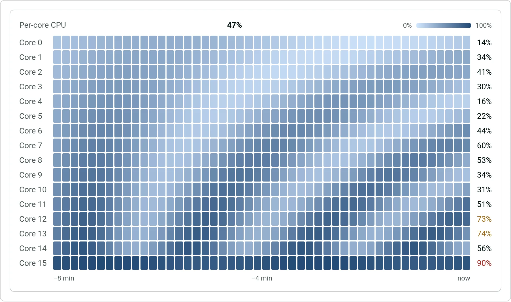
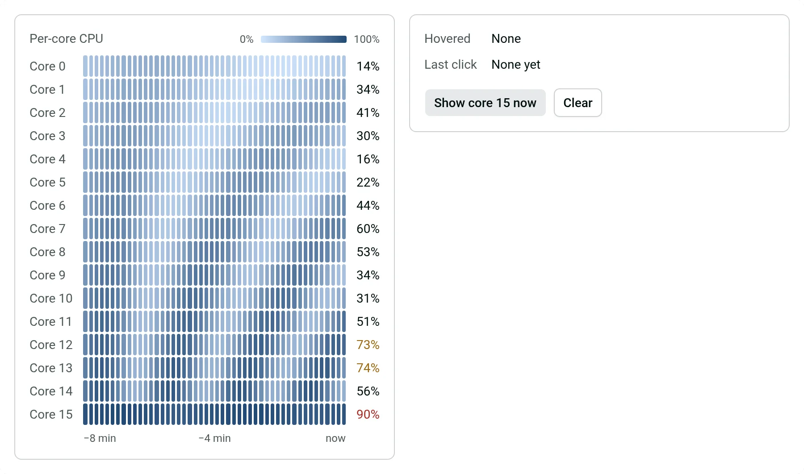

<!-- Written by `npm run docs:pages` from the kit and its examples. Do not edit. -->

# Heatmap

_Components › Charts_ · [All topics](../README.md)

Several metrics over time as rows of colored cells, such as the load of each core:

```html
<neat-heatmap
  label="Per-core CPU"
  headline="34%"
  [rows]="cores"
  [times]="times"
  [format]="percent"
/>
```

<picture>
<source media="(prefers-color-scheme: dark)" srcset="../images/heatmap/core-load.dark.webp">

</picture>

```ts
import { NeatHeatmap } from '@sima/neat-ui/charts';
```

## Examples

### Core load

The load of sixteen cores over eight minutes. The busiest cores' figures at the ends of their rows are in the warning and danger colors. The card sets `--neat-surface` to its fill, for the labels' halos.

<picture>
<source media="(prefers-color-scheme: dark)" srcset="../images/heatmap/core-load.dark.webp">

</picture>

<details>
<summary>Code</summary>

`1-core-load.example.ts`

```ts
import { ChangeDetectionStrategy, Component } from '@angular/core';
import { NeatHeatmap } from '@sima/neat-ui/charts';
import { CORES, percent, TIMES } from './data';

@Component({
  selector: 'app-core-load',
  imports: [NeatHeatmap],
  changeDetection: ChangeDetectionStrategy.OnPush,
  template: `
    <div class="card">
      <neat-heatmap
        label="Per-core CPU"
        headline="47%"
        [rows]="rows"
        [times]="times"
        [format]="percent"
      />
    </div>
  `,
  styleUrl: './core-load.example.css',
})
export class CoreLoad {
  protected readonly rows = CORES;
  protected readonly times = TIMES;
  protected readonly percent = percent;
}
```

`data.ts`

```ts
import type { NeatChartFormat, NeatHeatmapRow } from '@sima/neat-ui/charts';

/** A sine wave of `count` samples: a plausible, smooth metric. */
function sine(count: number, cycles: number, low: number, high: number): number[] {
  return Array.from({ length: count }, (_, index) => {
    const wave = (Math.sin((index / count) * cycles * 2 * Math.PI) + 1) / 2;
    return Number((low + wave * (high - low)).toFixed(2));
  });
}

/**
 * Eight minutes of samples four seconds apart, ending at a fixed instant so the demo stands
 * still.
 */
const SAMPLES = 120;
/** The samples of the last minute, which the figure at a row's end averages. */
const LAST_MINUTE = 15;
export const TIMES: readonly number[] = Array.from(
  { length: SAMPLES },
  (_, index) => Date.UTC(2026, 9, 24, 12, 0, 0) + index * 4000,
);

export const percent: NeatChartFormat = (value) => `${value.toFixed(0)}%`;

/**
 * Sixteen cores: some idle, some busy, the last one saturated. The figure at a row's end is the
 * last minute's mean, in the warning color from 70% and the danger color from 85%.
 */
export const CORES: readonly NeatHeatmapRow[] = Array.from({ length: 16 }, (_, index) => {
  const values =
    index === 15
      ? sine(SAMPLES, 2, 88, 99)
      : sine(SAMPLES, 1 + index / 5, 5 + index * 2, 35 + index * 4);
  const recent = values.slice(-LAST_MINUTE).reduce((sum, value) => sum + value, 0) / LAST_MINUTE;
  return {
    key: `core${index}`,
    label: `Core ${index}`,
    values,
    end: percent(recent),
    endTone: recent >= 85 ? 'danger' : recent >= 70 ? 'warning' : 'default',
  };
});
```

`core-load.example.css`

```css
:host {
  display: block;
}

/* The chart draws on the card's fill, so the card says which: for its labels' halos. */
.card {
  --neat-surface: var(--card);

  padding: var(--neat-space-4);
  border: 1px solid var(--border);
  border-radius: var(--radius);
  background: var(--card);
  color: var(--card-foreground);
}
```

</details>

### Heatmap from the app

The app reads the heatmap and sets it: `hovered` is the cell the readout is on, by its row's key and its column's time (the pointer's or the keys' cell, or one the app sets), and `activated` reports a click or Enter with the cell's row, time and mean. The card shows both, and its button points the heatmap at the saturated core's newest cell.

<picture>
<source media="(prefers-color-scheme: dark)" srcset="../images/heatmap/from-the-app.dark.webp">

</picture>

<details>
<summary>Code</summary>

`2-from-the-app.example.ts`

```ts
import { ChangeDetectionStrategy, Component, computed, signal } from '@angular/core';
import { NeatButton } from '@sima/neat-ui';
import { type NeatHeatmapCell, type NeatHeatmapPick, NeatHeatmap } from '@sima/neat-ui/charts';
import { CORES, percent, TIMES } from './data';

/** A moment as the card says it: the time of day, in UTC like the demo's data. */
const clock = (time: number) => new Date(time).toISOString().slice(11, 19);

@Component({
  selector: 'app-heatmap-from-the-app',
  imports: [NeatButton, NeatHeatmap],
  changeDetection: ChangeDetectionStrategy.OnPush,
  template: `
    <div class="beside">
      <div class="card">
        <neat-heatmap
          label="Per-core CPU"
          [rows]="rows"
          [times]="times"
          [format]="percent"
          [(hovered)]="cell"
          (activated)="picked.set($event)"
        />
      </div>
      <div class="report">
        <dl>
          <dt>Hovered</dt>
          <dd>{{ cellText() }}</dd>
          <dt>Last click</dt>
          <dd>{{ pickedText() }}</dd>
        </dl>
        <div class="actions">
          <button neatButton type="button" size="small" variant="secondary" (click)="showBusiest()">
            Show core 15 now
          </button>
          <button neatButton type="button" size="small" variant="outlined" (click)="cell.set(null)">
            Clear
          </button>
        </div>
      </div>
    </div>
  `,
  styleUrls: ['./core-load.example.css', './report.example.css'],
})
export class HeatmapFromTheApp {
  protected readonly rows = CORES;
  protected readonly times = TIMES;
  protected readonly percent = percent;
  protected readonly cell = signal<NeatHeatmapCell | null>(null);
  protected readonly picked = signal<NeatHeatmapPick | null>(null);

  protected readonly cellText = computed(() => {
    const cell = this.cell();
    return cell ? `${cell.row} at ${clock(cell.time)}` : 'None';
  });

  protected readonly pickedText = computed(() => {
    const pick = this.picked();
    if (!pick) return 'None yet';
    const value = pick.value === null ? 'no data' : percent(pick.value);
    return `${pick.row}${pick.time === null ? '' : ` at ${clock(pick.time)}`}: ${value}`;
  });

  protected showBusiest(): void {
    this.cell.set({ row: 'core15', time: TIMES[TIMES.length - 1] });
  }
}
```

`data.ts`

```ts
import type { NeatChartFormat, NeatHeatmapRow } from '@sima/neat-ui/charts';

/** A sine wave of `count` samples: a plausible, smooth metric. */
function sine(count: number, cycles: number, low: number, high: number): number[] {
  return Array.from({ length: count }, (_, index) => {
    const wave = (Math.sin((index / count) * cycles * 2 * Math.PI) + 1) / 2;
    return Number((low + wave * (high - low)).toFixed(2));
  });
}

/**
 * Eight minutes of samples four seconds apart, ending at a fixed instant so the demo stands
 * still.
 */
const SAMPLES = 120;
/** The samples of the last minute, which the figure at a row's end averages. */
const LAST_MINUTE = 15;
export const TIMES: readonly number[] = Array.from(
  { length: SAMPLES },
  (_, index) => Date.UTC(2026, 9, 24, 12, 0, 0) + index * 4000,
);

export const percent: NeatChartFormat = (value) => `${value.toFixed(0)}%`;

/**
 * Sixteen cores: some idle, some busy, the last one saturated. The figure at a row's end is the
 * last minute's mean, in the warning color from 70% and the danger color from 85%.
 */
export const CORES: readonly NeatHeatmapRow[] = Array.from({ length: 16 }, (_, index) => {
  const values =
    index === 15
      ? sine(SAMPLES, 2, 88, 99)
      : sine(SAMPLES, 1 + index / 5, 5 + index * 2, 35 + index * 4);
  const recent = values.slice(-LAST_MINUTE).reduce((sum, value) => sum + value, 0) / LAST_MINUTE;
  return {
    key: `core${index}`,
    label: `Core ${index}`,
    values,
    end: percent(recent),
    endTone: recent >= 85 ? 'danger' : recent >= 70 ? 'warning' : 'default',
  };
});
```

`core-load.example.css`

```css
:host {
  display: block;
}

/* The chart draws on the card's fill, so the card says which: for its labels' halos. */
.card {
  --neat-surface: var(--card);

  padding: var(--neat-space-4);
  border: 1px solid var(--border);
  border-radius: var(--radius);
  background: var(--card);
  color: var(--card-foreground);
}
```

`report.example.css`

```css
/* The chart beside a card that reports on it; one above the other where there is no room. */
.beside {
  display: grid;
  grid-template-columns: repeat(auto-fit, minmax(min(100%, 18rem), 1fr));
  gap: var(--neat-space-4);
  align-items: start;
}

.report {
  padding: var(--neat-space-4);
  border: 1px solid var(--border);
  border-radius: var(--radius);
  background: var(--card);
  color: var(--card-foreground);
}

.report dl {
  display: grid;
  grid-template-columns: auto 1fr;
  gap: var(--neat-space-2) var(--neat-space-4);
  margin: 0 0 var(--neat-space-4);
  font-size: var(--neat-text-sm);
}

.report dt {
  color: var(--muted-foreground);
}

.report dd {
  margin: 0;
  font-variant-numeric: tabular-nums;
}

.actions {
  display: flex;
  flex-wrap: wrap;
  gap: var(--neat-space-2);
}
```

</details>

## API

### `NeatHeatmap`

Component from `@sima/neat-ui/charts`, selector `neat-heatmap`.

A row's samples are split into at most 48 columns of time, each cell the mean of its samples; `times` (ms, oldest first) place them, so a pause in the polling stays an empty stretch, and a history shorter than the columns gets one column per sampling interval. A cell mixes `--neat-heat-low` and `--neat-heat-high` by where its value lies in `domain` (0 to 100 by default, clamped); an empty cell is transparent. A ramp in the head shows the domain's two ends, worded by `format`. A row is 1.5 rem tall, with its label before the cells and `end`, in the color of its tone, after them.

The grid is one tab stop named "&lt;label>: &lt;headline>, over the last &lt;window>". Its readout, which the pointer shows over a cell and the keys over the cursor's, reads "&lt;row label> · &lt;how long ago the column's newest sample was>: &lt;mean> average". The arrow keys move the cursor (Left and Right by column, Up and Down by row), Home and End go to the ends of its row, and Escape hides the readout. Like the time chart's, each key press, and only a key press, is repeated in a polite live region.

`hovered` is the cell the readout is on, both ways ([`NeatHeatmapCell`](../components/heatmap.md#neatheatmapcell): its row's key and its column's time, so it needs `times`): the heatmap sets it while the pointer or the keys hold a cell, and the app may set it. `activated` reports a click (or Enter): the cell and its mean.

**Inputs**

- **`label`** `string`, required

  The heatmap's title, which also names it for assistive technology.

- **`headline`** `string`, default `''`

  The overall value as the app words it, beside the title and in the accessible name.

- **`rows`** `readonly NeatHeatmapRow[]`, required

  The rows, top first.

- **`times`** `readonly (number | null)[]`, default `[]`

  When each sample was taken, in ms, oldest first; `null` for one without a time.

- **`domain`** `readonly [number, number]`, default `[0, 100]`

  The values the color ramp spans, lowest and highest: fixed by the app, so a color keeps its meaning.

- **`format`** `NeatChartFormat`, default `String`

  Words a value with its unit, for the ramp's ends and the readout.

**Models (two-way)**

- **`hovered`** `NeatHeatmapCell | null`, default `null`

  The cell the readout is on: the pointer's or the keys' while they hold one (null once they let go), or one the app sets, by its row's key and a time its column covers. Needs `times`.

**Outputs**

- **`activated`** `NeatHeatmapPick`

  A click on a cell, or Enter with focus: its row, its time and its mean.

### `NeatHeatmapRow`

Interface from `@sima/neat-ui/charts`.

One row of a heatmap: its samples become the cells, and `end` is the figure beside them.

**Members**

- **`key`** `string`

- **`label`** `string`

  Names the row on screen and in the readout.

- **`values`** `readonly (number | null)[]`

  The row's samples, oldest first, each as long as `times`; `null` for one that was not taken.

- **`end`** `string`

  The figure at the row's end as the app words it, such as a one-minute average.

- **`endTone`** `NeatChartTone`

  The color of `end`: the foreground, or the warning or danger line color (text strength in both).

### `NeatHeatmapCell`

Interface from `@sima/neat-ui/charts`.

A heatmap cell as `hovered` names it: its row's `key`, and the time of the newest sample its column shows (ms, as `times` has it).

**Members**

- **`row`** `string`

- **`time`** `number`

### `NeatHeatmapPick`

Interface from `@sima/neat-ui/charts`.

A heatmap cell a click (or Enter) chose: its row, its time when `times` give one, and its mean.

**Members**

- **`row`** `string`

- **`time`** `number | null`

- **`value`** `number | null`
