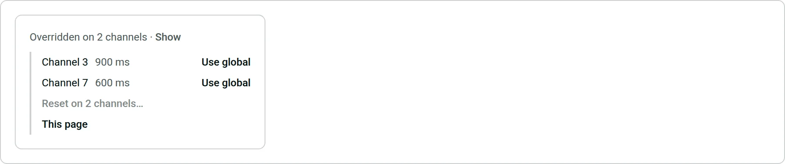

<!-- Written by `npm run docs:pages` from the kit and its examples. Do not edit. -->

# Inline button

_Components › Actions_ · [All topics](../README.md)

A text action set into a line of text, such as "Use global" at the end of a list line.

```html
<button neatInlineButton type="button" (click)="useGlobal()">Use global</button>
```

<picture>
<source media="(prefers-color-scheme: dark)" srcset="../images/inline-button/in-a-line.dark.webp">

</picture>

```ts
import { NeatInlineButton } from '@sima/neat-ui';
```

## Examples

### In a line

Inline buttons set into a note and into the lines of a list, each taking the size and color of its line. The actions do nothing; the third list line's is disabled, and the link leads back to this page.

<picture>
<source media="(prefers-color-scheme: dark)" srcset="../images/inline-button/in-a-line.dark.webp">

</picture>

<details>
<summary>Code</summary>

`1-in-a-line.example.ts`

```ts
import { ChangeDetectionStrategy, Component } from '@angular/core';
import { RouterLink } from '@angular/router';
import { NeatInlineButton, NeatNote } from '@sima/neat-ui';
import { NeatLine, NeatLineEnd, NeatLineList } from '@sima/neat-ui/line-list';

@Component({
  selector: 'app-in-a-line',
  imports: [NeatInlineButton, NeatLine, NeatLineEnd, NeatLineList, NeatNote, RouterLink],
  changeDetection: ChangeDetectionStrategy.OnPush,
  templateUrl: './1-in-a-line.example.html',
  styleUrl: './in-a-line.example.css',
})
export class InALine {}
```

`1-in-a-line.example.html`

```html
<div class="card">
  <p neatNote>
    Overridden on 2 channels ·
    <button neatInlineButton type="button">Show</button>
  </p>
  <ul neatLineList>
    <li neatLine>
      Channel 3 <span class="showcase-muted">900 ms</span>
      <button neatInlineButton neatLineEnd type="button">Use global</button>
    </li>
    <li neatLine>
      Channel 7 <span class="showcase-muted">600 ms</span>
      <button neatInlineButton neatLineEnd type="button">Use global</button>
    </li>
    <li neatLine>
      <button neatInlineButton type="button" disabled>Reset on 2 channels…</button>
    </li>
    <li neatLine>
      <a neatInlineButton routerLink="/components/actions/inline-button">This page</a>
    </li>
  </ul>
</div>
```

`in-a-line.example.css`

```css
/*
 * Inline buttons take their line's size and color, so the card sets a small one and a width a
 * list line fits.
 */
.card {
  --neat-surface: var(--card);

  display: flex;
  flex-direction: column;
  gap: var(--neat-space-2);
  width: 18rem;
  padding: var(--neat-space-4);
  border: 1px solid var(--border);
  border-radius: var(--radius);
  background: var(--card);
  color: var(--card-foreground);
  font-size: var(--neat-text-xs);
}
```

</details>

## API

### `NeatInlineButton`

Directive from `@sima/neat-ui`, selector `button[neatInlineButton], a[neatInlineButton]`.

It is medium weight and underlined on hover, as tall as its text, in the font size and color of its parent. Its label does not wrap, so keep it to a few words.

Use `neatButton` for actions that stand on their own. This one is for dense lines, where a `neatButton`'s 2rem height would set the line height. When several lines sit in a column, keep each at least 1.5rem high (`min-block-size`), so the targets stay apart (WCAG 2.5.8).

**Inputs**

- **`disabled`** `string | boolean | null | undefined`

  Turns the action off: dimmed, out of the Tab order and not clickable (a link gets no `disabled` attribute but the same look and `tabindex="-1"`).
