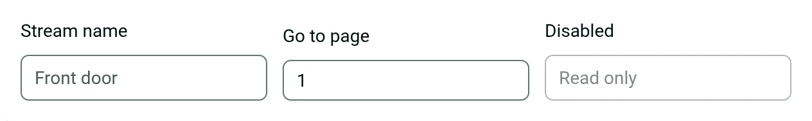
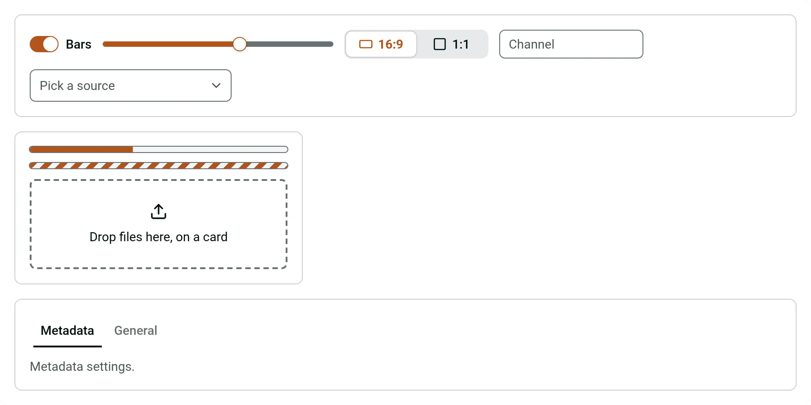

<!-- Written by `npm run docs:pages` from the kit and its examples. Do not edit. -->

# Input

_Components › Forms_ · [All topics](../README.md)

A text or number field.

```html
<input neatInput type="number" inputmode="numeric" min="1" aria-label="Copies" />
```

<picture>
<source media="(prefers-color-scheme: dark)" srcset="../images/input/sizes-and-states.dark.webp">

</picture>

```ts
import { NeatInput } from '@sima/neat-ui/input';
```

## Examples

### Sizes and states

A text field, a small number field and a disabled one, each named by the label around it. The number field keeps the native `type`, `inputmode` and `min`. The fields sit level at their bottom edge.

<picture>
<source media="(prefers-color-scheme: dark)" srcset="../images/input/sizes-and-states.dark.webp">

</picture>

<details>
<summary>Code</summary>

`1-sizes-and-states.example.ts`

```ts
import { ChangeDetectionStrategy, Component } from '@angular/core';
import { NeatInput } from '@sima/neat-ui/input';

@Component({
  selector: 'app-sizes-and-states',
  imports: [NeatInput],
  changeDetection: ChangeDetectionStrategy.OnPush,
  templateUrl: './1-sizes-and-states.example.html',
  styleUrl: './sizes-and-states.example.css',
})
export class SizesAndStates {}
```

`1-sizes-and-states.example.html`

```html
<div class="fields">
  <label>
    <span>Stream name</span>
    <input neatInput placeholder="Front door" />
  </label>
  <label>
    <span>Go to page</span>
    <input neatInput size="small" type="number" inputmode="numeric" min="1" value="1" />
  </label>
  <label>
    <span>Disabled</span>
    <input neatInput disabled value="Read only" />
  </label>
</div>
```

`sizes-and-states.example.css`

```css
/* Fields of both sizes side by side, aligned on their bottom edge so the names line up. */
.fields {
  display: flex;
  flex-wrap: wrap;
  align-items: flex-end;
  gap: var(--neat-space-3);
}

/* An input fills its container's width, so the label around it is given one. */
label {
  display: flex;
  flex-direction: column;
  gap: var(--neat-space-2);
  width: 12rem;
  font-size: var(--neat-text-sm);
}
```

</details>

### Controls on a card

The form controls on the card surface, which differs from the page's background in dark mode. Look at each one's edge, track and fill there.

A switch, a slider, a segmented control, an input and a select sit in a row. Two progress bars and a drop zone sit in a column, then tabs.

<picture>
<source media="(prefers-color-scheme: dark)" srcset="../images/input/controls-on-a-card.dark.webp">

</picture>

<details>
<summary>Code</summary>

`2-controls-on-a-card.example.ts`

```ts
import { ChangeDetectionStrategy, Component, signal } from '@angular/core';
import { NeatDropZone } from '@sima/neat-ui/drop-zone';
import { NeatInput } from '@sima/neat-ui/input';
import { NeatProgress } from '@sima/neat-ui/progress';
import { NeatSegmented, type NeatSegmentedOption } from '@sima/neat-ui/segmented';
import { NeatSelect, type NeatSelectOption } from '@sima/neat-ui/select';
import { NeatSlider } from '@sima/neat-ui/slider';
import { NeatSwitch } from '@sima/neat-ui/switch';
import { NeatTab, NeatTabs } from '@sima/neat-ui/tabs';

type Shape = '16:9' | '1:1';

const SHAPES: NeatSegmentedOption<Shape>[] = [
  { value: '16:9', label: '16:9', icon: 'aspect-wide' },
  { value: '1:1', label: '1:1', icon: 'aspect-square' },
];
const SOURCES: NeatSelectOption<string>[] = [
  { value: 'camera', label: 'Front camera' },
  { value: 'clip', label: 'Warehouse clip' },
  { value: 'rtsp', label: 'RTSP stream' },
];

@Component({
  selector: 'app-controls-on-a-card',
  imports: [
    NeatDropZone,
    NeatInput,
    NeatProgress,
    NeatSegmented,
    NeatSelect,
    NeatSlider,
    NeatSwitch,
    NeatTab,
    NeatTabs,
  ],
  changeDetection: ChangeDetectionStrategy.OnPush,
  templateUrl: './2-controls-on-a-card.example.html',
  styleUrl: './controls-on-a-card.example.css',
})
export class ControlsOnACard {
  protected readonly shapes = SHAPES;
  protected readonly sources = SOURCES;
  protected readonly bars = signal(true);
  protected readonly opacity = signal(60);
  protected readonly shape = signal<Shape>('16:9');
  protected readonly source = signal<string | null>(null);
  protected readonly tab = signal('metadata');
}
```

`2-controls-on-a-card.example.html`

```html
<div class="card row">
  <button neatSwitch [(checked)]="bars">Bars</button>
  <neat-slider
    class="slider"
    label="Opacity"
    [min]="0"
    [max]="100"
    [step]="5"
    [(value)]="opacity"
  />
  <neat-segmented label="Tile shape" [options]="shapes" [(value)]="shape" />
  <input class="input" neatInput size="small" aria-label="Jump to channel" placeholder="Channel" />
  <neat-select
    class="select"
    label="Source, on a card"
    placeholder="Pick a source"
    [options]="sources"
    [(value)]="source"
  />
</div>
<div class="card stack">
  <neat-progress label="Upload, on a card" [value]="40" />
  <neat-progress label="Preparing, on a card" [value]="null" />
  <neat-drop-zone label="Drop files here, on a card" multiple />
</div>
<div class="card">
  <neat-tabs label="Channel settings, on a card" [(value)]="tab">
    <neat-tab label="Metadata" value="metadata">
      <ng-template><p class="showcase-muted">Metadata settings.</p></ng-template>
    </neat-tab>
    <neat-tab label="General" value="general">
      <ng-template><p class="showcase-muted">General settings.</p></ng-template>
    </neat-tab>
  </neat-tabs>
</div>
```

`controls-on-a-card.example.css`

```css
/*
 * A card as an app draws one: its own surface, which differs from the page's in dark mode, so what
 * is visible on the page is checked on it too. Controls that fill their container's width are
 * given one.
 */
:host {
  display: flex;
  flex-direction: column;
  gap: var(--neat-space-4);
}

.card {
  --neat-surface: var(--card);

  padding: var(--neat-space-4);
  border: 1px solid var(--border);
  border-radius: var(--radius);
  background: var(--card);
  color: var(--card-foreground);
}

.row {
  display: flex;
  flex-wrap: wrap;
  align-items: center;
  gap: var(--neat-space-3);
}

.stack {
  display: flex;
  flex-direction: column;
  gap: var(--neat-space-3);
  max-width: 20rem;
}

.slider {
  width: 16rem;
}

.input {
  width: 10rem;
}

.select {
  width: 14rem;
}
```

</details>

## API

### `NeatInput`

Directive from `@sima/neat-ui/input`, selector `input[neatInput]`.

Every native attribute (type, inputmode, min, max, placeholder, id, disabled) keeps its meaning. The kit only styles the field. Name it with a `<label for>` or an `aria-label`.

`size` is the kit's height, not the native character width. Bind it (`[size]="'small'"`) or set it as an attribute: the browser ignores it as a width, since it is not a number.

An `id` the app sets stays on the element, so a label can point at it.

**Inputs**

- **`size`** `NeatInputSize`, default `'medium'`

  The field's height, the kit's `medium` (2.25rem) or `small` (2rem); not a character width.

- **`id`** `string | undefined`

  The field's `id`, for a `<label for>` to point at; without one the field gets an id of its own.

### `NeatInputSize`

Type from `@sima/neat-ui/input`.

`medium` matches the kit's medium button (2.25rem), `small` its small one (2rem).

```ts
type NeatInputSize = 'small' | 'medium'
```
