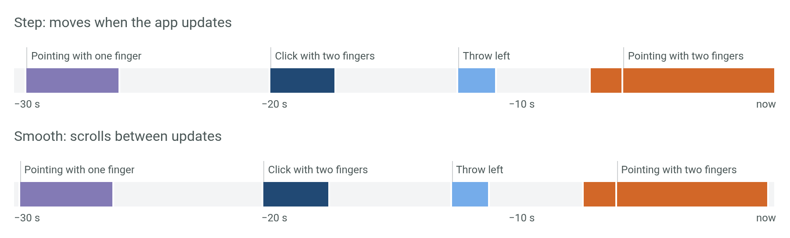
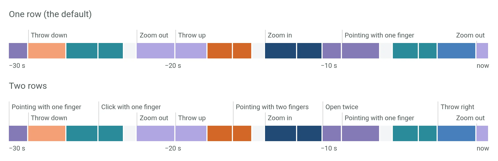

<!-- Written by `npm run docs:pages` from the kit and its examples. Do not edit. -->

# Label timeline

_Components › Charts_ · [All topics](../README.md)

A classifier's recent results as a strip of colored runs, newest at the right:

```html
<neat-label-timeline
  label="Last 30 s"
  [runs]="runs"
  [nowMs]="nowMs"
  [labels]="classes"
  [quiet]="['No gesture']"
/>
```

<picture>
<source media="(prefers-reduced-motion: reduce) and (prefers-color-scheme: dark)" srcset="../images/label-timeline/label-timeline.dark.webp">
<source media="(prefers-reduced-motion: reduce)" srcset="../images/label-timeline/label-timeline.light.webp">
<source media="(prefers-color-scheme: dark)" srcset="../images/label-timeline/label-timeline.dark.animated.webp">

</picture>

```ts
import { NeatLabelTimeline } from '@sima/neat-ui/charts';
```

## Examples

### Gesture timeline

The last 30 s of a gesture classifier, shown twice with the same runs. The top strip is `motion="step"`, and the bottom one `motion="smooth"`.

The window advances once a second, the rate at which `step` jumps and `smooth` scrolls in between. A new run opens when the class changes, and grows until the next one.

It opens with "Pointing with two fingers" held for the last 5 s. The name is wider than its run, so it stands above the strip, held back from its right end. "No gesture" is `quiet`, so it is drawn muted and never named. The names share one row, so a name that would run into a newer one's is left out.

Try pointing at a run, a quiet one too, or focus a strip and use the arrow keys. The readout says its label and when it was.

Runs that have left the window are dropped here. The timeline clips what it is given, but the app is what knows it will not need them again.

<picture>
<source media="(prefers-reduced-motion: reduce) and (prefers-color-scheme: dark)" srcset="../images/label-timeline/label-timeline.dark.webp">
<source media="(prefers-reduced-motion: reduce)" srcset="../images/label-timeline/label-timeline.light.webp">
<source media="(prefers-color-scheme: dark)" srcset="../images/label-timeline/label-timeline.dark.animated.webp">

</picture>

<details>
<summary>Code</summary>

`1-label-timeline.example.ts`

```ts
import { ChangeDetectionStrategy, Component, DestroyRef, inject, signal } from '@angular/core';
import { NeatLabelRun, NeatLabelTimeline, NeatTimelineMotion } from '@sima/neat-ui/charts';
import { CLASSES, classAt, durationAt, NO_GESTURE } from './data';

const WINDOW_MS = 30_000;
const TICK_MS = 1000;
/** The gesture held when the example opens, and how much of the window it already fills. */
const HELD = CLASSES[2];
const HELD_MS = 5000;

@Component({
  selector: 'app-gesture-timeline',
  imports: [NeatLabelTimeline],
  changeDetection: ChangeDetectionStrategy.OnPush,
  template: `
    <div class="showcase-section">
      @for (motion of motions; track motion) {
        <p class="showcase-muted">
          {{
            motion === 'step'
              ? 'Step: moves when the app updates'
              : 'Smooth: scrolls between updates'
          }}
        </p>
        <neat-label-timeline
          [label]="'Last 30 s, ' + motion"
          [runs]="runs()"
          [nowMs]="nowMs()"
          [windowMs]="windowMs"
          [labels]="labels"
          [quiet]="quiet"
          [motion]="motion"
        />
      }
    </div>
  `,
})
export class GestureTimeline {
  protected readonly motions: readonly NeatTimelineMotion[] = ['step', 'smooth'];
  protected readonly windowMs = WINDOW_MS;
  protected readonly labels = CLASSES;
  protected readonly quiet = [NO_GESTURE];
  protected readonly nowMs = signal(Date.now());
  protected readonly runs = signal<readonly NeatLabelRun[]>([]);

  constructor() {
    let step = 0;
    // Fill the window with history, so the example starts full rather than empty.
    let start = this.nowMs() - WINDOW_MS;
    const heldFrom = this.nowMs() - HELD_MS;
    const history: NeatLabelRun[] = [];
    while (start < heldFrom) {
      const end = Math.min(start + durationAt(step), heldFrom);
      history.push({ label: classAt(step), startMs: start, endMs: end });
      start = end;
      step++;
    }
    // The held gesture reaches "now" and goes on a little, so it is still the latest result.
    let runEnd = this.nowMs() + 1000;
    history.push({ label: HELD, startMs: start, endMs: runEnd });
    this.runs.set(history);

    const timer = setInterval(() => {
      const now = Date.now();
      this.nowMs.set(now);
      // The newest run reaches `now` while it is the latest result; a new one opens after it.
      if (now >= runEnd) {
        const next = { label: classAt(step), startMs: runEnd, endMs: runEnd + durationAt(step) };
        step++;
        runEnd = next.endMs;
        this.runs.update((runs) => [...runs, next].filter((run) => run.endMs > now - WINDOW_MS));
      }
    }, TICK_MS);
    inject(DestroyRef).onDestroy(() => clearInterval(timer));
  }
}
```

`data.ts`

```ts
/**
 * IPN Hand's 14 classes; the first is the quiet one. The same list, in the same order, as the
 * score bars example's, so a label has the same color in both (its spec holds them equal): the
 * docs let an example import only files of its own topic folder, so the list is repeated here.
 */
export const CLASSES: readonly string[] = [
  'No gesture',
  'Pointing with one finger',
  'Pointing with two fingers',
  'Click with one finger',
  'Click with two fingers',
  'Throw up',
  'Throw down',
  'Throw left',
  'Throw right',
  'Open twice',
  'Double click with one finger',
  'Double click with two fingers',
  'Zoom in',
  'Zoom out',
];

export const NO_GESTURE = CLASSES[0];

/** How long the demo's classifier keeps one result, in milliseconds, at a step. */
export function durationAt(step: number): number {
  return 1500 + ((step * 7) % 5) * 1100;
}

/** The class at a step: a gesture, then "No gesture" between two gestures. */
export function classAt(step: number): string {
  return step % 2 === 0 ? NO_GESTURE : CLASSES[1 + (((step >> 1) * 3) % (CLASSES.length - 1))];
}
```

</details>

### Name rows

A busy classifier, a gesture every one to two seconds, with its names in one row and in two.

The names stand above the strip, each from its run's start. From the newest run back, a name goes into the first row where it keeps clear of the newer names. So the latest gesture is always named.

`labelRows` of 2 names about twice as many. A name that fits in no row is left out, and the readout and the screen reader's list still say it.

<picture>
<source media="(prefers-color-scheme: dark)" srcset="../images/label-timeline/name-rows.dark.webp">

</picture>

<details>
<summary>Code</summary>

`2-name-rows.example.ts`

```ts
import { ChangeDetectionStrategy, Component } from '@angular/core';
import { NeatLabelRun, NeatLabelTimeline } from '@sima/neat-ui/charts';
import { CLASSES, NO_GESTURE } from './data';

const WINDOW_MS = 30_000;

@Component({
  selector: 'app-name-rows',
  imports: [NeatLabelTimeline],
  changeDetection: ChangeDetectionStrategy.OnPush,
  template: `
    <div class="showcase-section">
      @for (rows of rowCounts; track rows) {
        <p class="showcase-muted">{{ rows === 1 ? 'One row (the default)' : 'Two rows' }}</p>
        <neat-label-timeline
          [label]="'Last 30 s, ' + (rows === 1 ? 'one row' : 'two rows') + ' of names'"
          [runs]="runs"
          [nowMs]="nowMs"
          [windowMs]="windowMs"
          [labels]="labels"
          [quiet]="quiet"
          [labelRows]="rows"
        />
      }
    </div>
  `,
})
export class NameRows {
  protected readonly rowCounts = [1, 2];
  protected readonly windowMs = WINDOW_MS;
  protected readonly labels = CLASSES;
  protected readonly quiet = [NO_GESTURE];
  protected readonly nowMs = Date.now();
  /** Gestures back to back, 1.2 to 2.4 s each, with a short "No gesture" now and then. */
  protected readonly runs: readonly NeatLabelRun[] = denseRuns(this.nowMs);
}

function denseRuns(now: number): NeatLabelRun[] {
  const runs: NeatLabelRun[] = [];
  let start = now - WINDOW_MS;
  for (let step = 0; start < now; step++) {
    const quiet = step % 5 === 4;
    const length = quiet ? 800 : 1200 + ((step * 7) % 4) * 400;
    const label = quiet ? NO_GESTURE : CLASSES[1 + ((step * 5) % (CLASSES.length - 1))];
    runs.push({ label, startMs: start, endMs: Math.min(start + length, now) });
    start += length;
  }
  return runs;
}
```

`data.ts`

```ts
/**
 * IPN Hand's 14 classes; the first is the quiet one. The same list, in the same order, as the
 * score bars example's, so a label has the same color in both (its spec holds them equal): the
 * docs let an example import only files of its own topic folder, so the list is repeated here.
 */
export const CLASSES: readonly string[] = [
  'No gesture',
  'Pointing with one finger',
  'Pointing with two fingers',
  'Click with one finger',
  'Click with two fingers',
  'Throw up',
  'Throw down',
  'Throw left',
  'Throw right',
  'Open twice',
  'Double click with one finger',
  'Double click with two fingers',
  'Zoom in',
  'Zoom out',
];

export const NO_GESTURE = CLASSES[0];

/** How long the demo's classifier keeps one result, in milliseconds, at a step. */
export function durationAt(step: number): number {
  return 1500 + ((step * 7) % 5) * 1100;
}

/** The class at a step: a gesture, then "No gesture" between two gestures. */
export function classAt(step: number): string {
  return step % 2 === 0 ? NO_GESTURE : CLASSES[1 + (((step >> 1) * 3) % (CLASSES.length - 1))];
}
```

</details>

### Timeline from the app

The app reads the strip and sets it.

- `hovered` is a moment: the one under the pointer, a run's middle while the keys hold it, or one the app sets, which reads out the run covering it.
- `activated` reports a click or Enter, with the run under it and the moment.

The card shows both. Its buttons set the moment from outside, as a time chart bound to the same signal would.

<details>
<summary>Code</summary>

`3-from-the-app.example.ts`

```ts
import { ChangeDetectionStrategy, Component, computed, signal } from '@angular/core';
import { NeatButton } from '@sima/neat-ui';
import { type NeatLabelRun, NeatLabelTimeline, type NeatRunPick } from '@sima/neat-ui/charts';
import { CLASSES, NO_GESTURE } from './data';

/** A fixed moment the strip ends at, so the example stands still. */
const NOW = Date.UTC(2026, 9, 24, 12, 0, 30);
const WINDOW_MS = 30_000;

/** Thirty seconds of results, fixed. */
const RUNS: readonly NeatLabelRun[] = [
  { label: NO_GESTURE, startMs: NOW - 30_000, endMs: NOW - 24_000 },
  { label: CLASSES[5], startMs: NOW - 24_000, endMs: NOW - 19_000 },
  { label: NO_GESTURE, startMs: NOW - 19_000, endMs: NOW - 15_000 },
  { label: CLASSES[1], startMs: NOW - 15_000, endMs: NOW - 8_000 },
  { label: NO_GESTURE, startMs: NOW - 8_000, endMs: NOW - 4_000 },
  { label: CLASSES[12], startMs: NOW - 4_000, endMs: NOW },
];

@Component({
  selector: 'app-timeline-from-the-app',
  imports: [NeatButton, NeatLabelTimeline],
  changeDetection: ChangeDetectionStrategy.OnPush,
  template: `
    <div class="beside">
      <neat-label-timeline
        label="Last 30 s"
        [runs]="runs"
        [nowMs]="now"
        [windowMs]="windowMs"
        [labels]="labels"
        [quiet]="quiet"
        [(hovered)]="moment"
        (activated)="picked.set($event)"
      />
      <div class="report">
        <dl>
          <dt>Hovered</dt>
          <dd>{{ momentText() }}</dd>
          <dt>Last click</dt>
          <dd>{{ pickedText() }}</dd>
        </dl>
        <div class="actions">
          <button
            neatButton
            type="button"
            size="small"
            variant="secondary"
            (click)="moment.set(now - 20_000)"
          >
            Show 20 s ago
          </button>
          <button
            neatButton
            type="button"
            size="small"
            variant="outlined"
            (click)="moment.set(null)"
          >
            Clear
          </button>
        </div>
      </div>
    </div>
  `,
  styleUrl: './report.example.css',
})
export class TimelineFromTheApp {
  protected readonly runs = RUNS;
  protected readonly now = NOW;
  protected readonly windowMs = WINDOW_MS;
  protected readonly labels = CLASSES;
  protected readonly quiet = [NO_GESTURE];
  protected readonly moment = signal<number | null>(null);
  protected readonly picked = signal<NeatRunPick | null>(null);

  protected readonly momentText = computed(() => {
    const time = this.moment();
    return time === null ? 'None' : `${((NOW - time) / 1000).toFixed(1)} s ago`;
  });

  protected readonly pickedText = computed(() => {
    const pick = this.picked();
    if (!pick) return 'None yet';
    const ago = `${((NOW - pick.time) / 1000).toFixed(1)} s ago`;
    return `${pick.run?.label ?? 'Nothing'}, ${ago}`;
  });
}
```

`data.ts`

```ts
/**
 * IPN Hand's 14 classes; the first is the quiet one. The same list, in the same order, as the
 * score bars example's, so a label has the same color in both (its spec holds them equal): the
 * docs let an example import only files of its own topic folder, so the list is repeated here.
 */
export const CLASSES: readonly string[] = [
  'No gesture',
  'Pointing with one finger',
  'Pointing with two fingers',
  'Click with one finger',
  'Click with two fingers',
  'Throw up',
  'Throw down',
  'Throw left',
  'Throw right',
  'Open twice',
  'Double click with one finger',
  'Double click with two fingers',
  'Zoom in',
  'Zoom out',
];

export const NO_GESTURE = CLASSES[0];

/** How long the demo's classifier keeps one result, in milliseconds, at a step. */
export function durationAt(step: number): number {
  return 1500 + ((step * 7) % 5) * 1100;
}

/** The class at a step: a gesture, then "No gesture" between two gestures. */
export function classAt(step: number): string {
  return step % 2 === 0 ? NO_GESTURE : CLASSES[1 + (((step >> 1) * 3) % (CLASSES.length - 1))];
}
```

`report.example.css`

```css
/* The chart beside a card that reports on it; one above the other where there is no room. */
.beside {
  display: grid;
  grid-template-columns: repeat(auto-fit, minmax(min(100%, 18rem), 1fr));
  gap: var(--neat-space-4);
  align-items: start;
}

.report {
  padding: var(--neat-space-4);
  border: 1px solid var(--border);
  border-radius: var(--radius);
  background: var(--card);
  color: var(--card-foreground);
}

.report dl {
  display: grid;
  grid-template-columns: auto 1fr;
  gap: var(--neat-space-2) var(--neat-space-4);
  margin: 0 0 var(--neat-space-4);
  font-size: var(--neat-text-sm);
}

.report dt {
  color: var(--muted-foreground);
}

.report dd {
  margin: 0;
  font-variant-numeric: tabular-nums;
}

.actions {
  display: flex;
  flex-wrap: wrap;
  gap: var(--neat-space-2);
}
```

</details>

## API

### `NeatLabelTimeline`

Component from `@sima/neat-ui/charts`, selector `neat-label-timeline`.

It draws the window from `nowMs - windowMs` to `nowMs`, left to right. The axis under it has four ticks: −30 s, −20 s, −10 s and now for the default window. The app moves the window by passing a later `nowMs`, so a test or a replay sets the time.

With the default `motion="step"`, that is all there is: the strip jumps at the app's update rate. With `motion="smooth"`, it also scrolls between two updates, on animation frames at real time. So an app that updates once a second still reads as moving. A reduced-motion setting forces `step`.

A smooth strip never runs more than a second past the last `nowMs`, so a stalled stream stops it. It never moves backwards: a `nowMs` behind what is drawn holds the strip until real time catches up.

A run is placed by its times and clipped to the window. A run is not drawn when it ends before it starts, lies outside the window, or has a time that is not a number. Runs that overlap are drawn in the order of `runs`, the later on top, so the app decides which wins.

The runs' names stand above the strip, outside the runs. Each starts from a rule at its run's start, held back from the strip's right end, and is as wide as it needs. So a gesture of a second still has its name.

- The names are laid out in `labelRows` rows, 1 by default, the first next to the strip.
- From the newest run back, each name goes into the first row where it keeps a gap from the newer names. So the latest result is the one named.
- A name that fits in no row is not drawn. The readout and the hidden list still say it.
- A `quiet` label is never named.
- While the strip scrolls, a name keeps its row as long as it fits there, so names do not hop between rows from frame to frame.
- A name held back from the right end keeps its rule at its run's start, below its text, so it still points at its own run.

The names are measured as drawn, and laid out again when the strip's width changes.

Colors come from [`neatLabelColor`](../components/score-bars.md#neatlabelcolor), by the label's place in `labels`, as in [`NeatScoreBars`](../components/score-bars.md#neatscorebars). An empty `labels` means the order in which labels first appear in `runs`. The one difference is a `quiet` label. Its run is filled with `--muted`, not the `--muted-foreground` that [`neatLabelColor`](../components/score-bars.md#neatlabelcolor) returns for text and the score bars use. A quiet class fills most of the window, and must not be its heaviest mark.

The host is a group named by `label`. It holds a list with one item per drawn run, named by its label and its span in seconds, as visually hidden text in the item. So a screen reader gets the runs the label text leaves out.

The pointer over a run, quiet ones included, shows a readout beside its middle with its label, as the other charts read out what lies under the pointer. The readout follows the run while the strip scrolls. The pointer on a run's name shows the same.

The strip is one tab stop:

- Focus reads out the newest run.
- Left and Right step to the run before or after it in time.
- Home and End go to the oldest and the newest.
- Escape hides the readout.

Each key press, and only a key press, is repeated in a polite live region.

`hovered` is a moment (ms), both ways, as on the time charts. The strip sets it to the moment under the pointer, or to a run's middle while the keys hold one. The app may set it, which reads out the run covering that moment. So a timeline shares a crosshair with time charts bound to the same signal. `activated` reports a click, or Enter, with the run under it, if any, and the moment.

**Inputs**

- **`runs`** `readonly NeatLabelRun[]`, required

  The runs to draw, in the order that decides which of two overlapping ones is on top.

- **`nowMs`** `number`, required

  The right edge of the window, epoch milliseconds.

- **`windowMs`** `number`, default `30_000`

  How much time the strip shows, in milliseconds.

- **`labels`** `readonly string[]`, default `[]`

  The color order of the labels; empty means the order of first appearance in `runs`.

- **`quiet`** `readonly string[]`, default `[]`

  Labels drawn in the muted color and never named, such as "No gesture".

- **`label`** `string`, required

  Names the strip.

- **`motion`** `NeatTimelineMotion`, default `'step'`

  Whether the strip scrolls between updates (`smooth`) or only at them.

- **`labelRows`** `number`, default `1`

  How many rows of names stand above the strip, a positive whole number.

  More rows name more of a busy strip. A name that fits in none is left out, and the readout and the hidden list still say it.

**Models (two-way)**

- **`hovered`** `number | null`, default `null`

  The moment the readout is on, in ms.

  It is the moment under the pointer, or a run's middle while the keys hold one, and null once they let go. Otherwise it is one the app sets, which reads out the run covering it.

**Outputs**

- **`activated`** `NeatRunPick`

  A click on the strip, or Enter with focus: the run under it, if any, and the moment.

### `NeatLabelRun`

Interface from `@sima/neat-ui/charts`.

A stretch of time in which a classifier kept giving one label.

**Members**

- **`label`** `string`

- **`startMs`** `number`

  Epoch milliseconds.

- **`endMs`** `number`

  Epoch milliseconds; a run that ends before it starts is not drawn.

### `NeatTimelineMotion`

Type from `@sima/neat-ui/charts`.

How the strip moves: `step` jumps when the app passes a later `nowMs`; `smooth` also scrolls between two updates, at real time.

```ts
type NeatTimelineMotion = 'step' | 'smooth'
```

### `NeatRunPick`

Interface from `@sima/neat-ui/charts`.

A click (or Enter) on a label timeline: the run under it, if any, and the moment (ms).

**Members**

- **`run`** `{ readonly label: string; readonly startMs: number; readonly endMs: number } | null`

- **`time`** `number`
