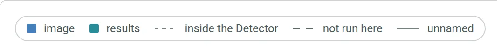

<!-- Written by `npm run docs:pages` from the kit and its examples. Do not edit. -->

# Legend

_Components › Diagram_ · [All topics](../README.md)

What a diagram's colors and lines stand for, as the Autoware demo's legend chip.

```html
<neat-diagram-legend [items]="[
  { series: 1, label: 'image' },
  { series: 4, label: 'results' },
  { line: 'ghost', label: 'not run here' },
]" />
```

<picture>
<source media="(prefers-color-scheme: dark)" srcset="../images/legend/edge-colors.dark.webp">

</picture>

```ts
import { NeatDiagramLegend } from '@sima/neat-ui/diagram';
```

## Examples

### Edge colors

One item of each kind: two series colors, a dashed and a ghost line, and an item with neither a series nor a line.

<picture>
<source media="(prefers-color-scheme: dark)" srcset="../images/legend/edge-colors.dark.webp">

</picture>

<details>
<summary>Code</summary>

`1-edge-colors.example.ts`

```ts
import { ChangeDetectionStrategy, Component } from '@angular/core';
import { NeatDiagramLegend, type NeatDiagramLegendItem } from '@sima/neat-ui/diagram';

@Component({
  selector: 'app-edge-colors',
  imports: [NeatDiagramLegend],
  changeDetection: ChangeDetectionStrategy.OnPush,
  template: `<neat-diagram-legend [items]="items" />`,
})
export class EdgeColors {
  protected readonly items: readonly NeatDiagramLegendItem[] = [
    { series: 1, label: 'image' },
    { series: 4, label: 'results' },
    { line: 'dashed', label: 'inside the Detector' },
    { line: 'ghost', label: 'not run here' },
    { label: 'unnamed' },
  ];
}
```

</details>

## API

### `NeatDiagramLegend`

Component from `@sima/neat-ui/diagram`, selector `neat-diagram-legend`.

A series without a `line` shows the kit's [`NeatSeriesSwatch`](../components/series-swatch.md#neatseriesswatch) for it, as the charts' legends do. Any other item shows a short sample of its line, solid when unset. The sample is drawn by the edges' own rules, in the color its edges take. It is muted for a ghost, without a series, or for a series that is not 1 to 8.

Samples and swatches are `aria-hidden`: the label names what they stand for, and a color alone is not a name.

**Inputs**

- **`items`** `readonly NeatDiagramLegendItem[]`, required

  The entries, in the order shown.

### `NeatDiagramLegendItem`

Interface from `@sima/neat-ui/diagram`.

One entry of a diagram's legend: what a series color or a line look stands for.

**Members**

- **`series`** `number`, optional

  The series (1 to 8) whose color it names, as an edge's `series`; unset, muted.

- **`line`** `NeatDiagramLine`, optional

  The line look it names, as an edge's `line`; unset, the series' swatch instead.

- **`label`** `string`
