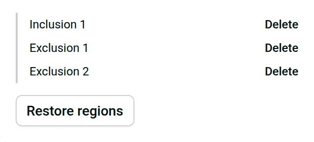

<!-- Written by `npm run docs:pages` from the kit and its examples. Do not edit. -->

# Line list

_Components › Data_ · [All topics](../README.md)

A short list of small lines under a thin rule, such as the channels that override a setting: `<ul neatLineList><li neatLine>Channel 3 <button neatInlineButton neatLineEnd>Use global</button></li></ul>`. It sets the look only (the rule, the inset, the text size); a line's content, and the roles of the list, are the app's. The text color is the parent's.

<picture>
<source media="(prefers-color-scheme: dark)" srcset="../images/line-list/regions.dark.webp">

</picture>

```ts
import { NeatLineList, NeatLine, NeatLineEnd } from '@sima/neat-ui/line-list';
```

## Examples

### Regions

The regions of a channel, each with a Delete at the end of its line. Delete one to see the list shrink; with none left a note takes its place, and Restore regions brings them back.

<picture>
<source media="(prefers-color-scheme: dark)" srcset="../images/line-list/regions.dark.webp">

</picture>

<details>
<summary>Code</summary>

`1-regions.example.ts`

```ts
import { ChangeDetectionStrategy, Component, signal } from '@angular/core';
import { NeatButton, NeatInlineButton, NeatNote } from '@sima/neat-ui';
import { NeatLine, NeatLineEnd, NeatLineList } from '@sima/neat-ui/line-list';

const REGIONS = ['Inclusion 1', 'Exclusion 1', 'Exclusion 2'];

@Component({
  selector: 'app-regions',
  imports: [NeatButton, NeatInlineButton, NeatLine, NeatLineEnd, NeatLineList, NeatNote],
  changeDetection: ChangeDetectionStrategy.OnPush,
  template: `
    @if (regions().length === 0) {
      <p neatNote>No regions.</p>
    } @else {
      <ul neatLineList>
        @for (region of regions(); track region) {
          <li neatLine>
            <span>{{ region }}</span>
            <button
              neatInlineButton
              neatLineEnd
              type="button"
              [attr.aria-label]="'Delete ' + region"
              (click)="remove(region)"
            >
              Delete
            </button>
          </li>
        }
      </ul>
    }
    <div class="showcase-row">
      <button neatButton type="button" variant="outlined" size="small" (click)="regions.set(all)">
        Restore regions
      </button>
    </div>
  `,
  styleUrl: './regions.example.css',
})
export class Regions {
  protected readonly all = REGIONS;
  protected readonly regions = signal(REGIONS);

  protected remove(region: string): void {
    this.regions.update((regions) => regions.filter((name) => name !== region));
  }
}
```

`regions.example.css`

```css
/* The example's parts one gap apart, in a column the width of an aside's list. */
:host {
  display: flex;
  flex-direction: column;
  gap: var(--neat-space-3);
  width: 18rem;
}
```

</details>

## API

### `NeatLineList`

Directive from `@sima/neat-ui/line-list`, selector `ul[neatLineList], ol[neatLineList]`.

### `NeatLine`

Directive from `@sima/neat-ui/line-list`, selector `li[neatLine]`.

One line of a `neatLineList`: a flex row, so its parts sit side by side, at least 1.5rem high so that the buttons of neighboring lines keep their distance.

### `NeatLineEnd`

Directive from `@sima/neat-ui/line-list`, selector `[neatLineEnd]`.

Marks the element of a `neatLine` that sits at the line's end, such as its action (usually a `neatInlineButton`): it is pushed there, whatever the text before it takes.
