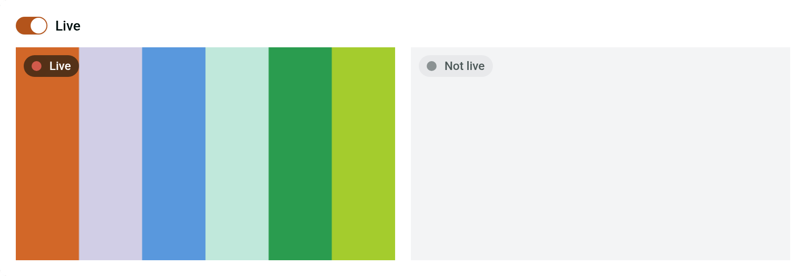

<!-- Written by `npm run docs:pages` from the kit and its examples. Do not edit. -->

# Live badge

_Components › Status_ · [All topics](../README.md)

A pill that says what a picture is: "Live", with the pulsing live dot, or what shows instead ("File preview", "Not live"), with a still gray dot of the same size, so the pill keeps its size as the state changes.

```html
<neat-live-badge live onPicture>Live</neat-live-badge>
```

<picture>
<source media="(prefers-reduced-motion: reduce) and (prefers-color-scheme: dark)" srcset="../images/live-badge/on-a-picture.dark.webp">
<source media="(prefers-reduced-motion: reduce)" srcset="../images/live-badge/on-a-picture.light.webp">
<source media="(prefers-color-scheme: dark)" srcset="../images/live-badge/on-a-picture.dark.animated.webp">

</picture>

```ts
import { NeatLiveBadge } from '@sima/neat-ui';
```

## Examples

### On a picture

A badge in the top-left corner of each picture, in the tile's `neatTileOverlay` layer. The first tile plays a file: turn on Live and its badge says so with the pulsing live dot, at the same size. The second has no picture yet, so its badge is the muted pill.

<picture>
<source media="(prefers-reduced-motion: reduce) and (prefers-color-scheme: dark)" srcset="../images/live-badge/on-a-picture.dark.webp">
<source media="(prefers-reduced-motion: reduce)" srcset="../images/live-badge/on-a-picture.light.webp">
<source media="(prefers-color-scheme: dark)" srcset="../images/live-badge/on-a-picture.dark.animated.webp">

</picture>

<details>
<summary>Code</summary>

`1-on-a-picture.example.ts`

```ts
import {
  afterNextRender,
  ChangeDetectionStrategy,
  Component,
  DestroyRef,
  DOCUMENT,
  inject,
  signal,
} from '@angular/core';
import { NeatLiveBadge } from '@sima/neat-ui';
import { NeatSwitch } from '@sima/neat-ui/switch';
import { NeatVideoTile } from '@sima/neat-ui/video';
import { ColorBarsSource } from './color-bars-source';

@Component({
  selector: 'app-on-a-picture',
  imports: [NeatLiveBadge, NeatSwitch, NeatVideoTile],
  changeDetection: ChangeDetectionStrategy.OnPush,
  templateUrl: './1-on-a-picture.example.html',
  styleUrl: './on-a-picture.example.css',
})
export class OnAPicture {
  protected readonly colorBars = new ColorBarsSource();
  protected readonly live = signal(true);

  constructor() {
    const document = inject(DOCUMENT);
    afterNextRender(() => this.colorBars.start(document));
    inject(DestroyRef).onDestroy(() => this.colorBars.stop());
  }
}
```

`1-on-a-picture.example.html`

```html
<button neatSwitch [(checked)]="live">Live</button>
<div class="tiles">
  <div class="cell">
    <neat-video-tile [source]="colorBars" [bars]="false">
      <neat-live-badge neatTileOverlay [live]="live()" onPicture>
        {{ live() ? 'Live' : 'File preview' }}
      </neat-live-badge>
    </neat-video-tile>
  </div>
  <div class="cell">
    <neat-video-tile [bars]="false">
      <neat-live-badge neatTileOverlay>Not live</neat-live-badge>
    </neat-video-tile>
  </div>
</div>
```

`color-bars-source.ts`

```ts
import { signal } from '@angular/core';
import { SIMA_PALETTE } from '@sima/neat-ui';
import type { NeatTileSource } from '@sima/neat-ui/video';

const WIDTH = 640;
const HEIGHT = 360;
const FRAMES_PER_SECOND = 30;
const BAR_COLORS = [
  SIMA_PALETTE.orange,
  SIMA_PALETTE.purple,
  SIMA_PALETTE.blue,
  SIMA_PALETTE.mint,
  SIMA_PALETTE.green,
  SIMA_PALETTE.lime,
];

/**
 * Color bars for a tile to play without a server: a canvas streamed with `captureStream()`, with
 * no metadata. It paints every frame, since a stream that presents none is one the tile shows as
 * stopped.
 */
export class ColorBarsSource implements NeatTileSource {
  readonly stream = signal<MediaStream | null>(null);

  private animation = 0;

  onMetadata(): () => void {
    return () => undefined;
  }

  /** Starts the stream; does nothing where canvases cannot be streamed (as in unit tests). */
  start(document: Document): void {
    const canvas = document.createElement('canvas');
    if (typeof canvas.captureStream !== 'function') return;
    canvas.width = WIDTH;
    canvas.height = HEIGHT;
    const context = canvas.getContext('2d');
    if (context === null) return;
    this.stream.set(canvas.captureStream(FRAMES_PER_SECOND));
    const barWidth = WIDTH / BAR_COLORS.length;
    const paint = () => {
      this.animation = requestAnimationFrame(paint);
      BAR_COLORS.forEach((color, i) => {
        context.fillStyle = color;
        context.fillRect(i * barWidth, 0, barWidth, HEIGHT);
      });
    };
    this.animation = requestAnimationFrame(paint);
  }

  stop(): void {
    cancelAnimationFrame(this.animation);
    for (const track of this.stream()?.getTracks() ?? []) track.stop();
    this.stream.set(null);
  }
}
```

`on-a-picture.example.css`

```css
:host {
  display: flex;
  flex-direction: column;
  align-items: flex-start;
  gap: var(--neat-space-3);
}

.tiles {
  display: grid;
  grid-template-columns: repeat(auto-fill, minmax(16rem, 24rem));
  gap: var(--neat-space-4);
  align-self: stretch;
}

/* A tile fills its cell, so the cell gives it a size: a 16:9 box as wide as the grid column. */
.cell {
  aspect-ratio: 16 / 9;
}

/* The picture's top-left corner: the layer covers the tile, and this video fills it. */
neat-live-badge {
  position: absolute;
  inset-block-start: var(--neat-space-2);
  inset-inline-start: var(--neat-space-2);
}
```

</details>

## API

### `NeatLiveBadge`

Component from `@sima/neat-ui`, selector `neat-live-badge`.

`onPicture` puts it on the video scrim, which reads over any frame; without it the pill is muted, for an empty frame. The app says which, since only it knows whether a picture shows yet. The app places it too, usually in the picture's top-left corner (the video tile's `neatTileOverlay` layer). Its shape, text size and weight are the badge's; its colors are its own, since they must read over any video. The text is the badge's meaning; the dots are hidden from assistive technology.

**Inputs**

- **`live`** `boolean`, default `false`, transform `booleanAttribute`

  The picture is live: the pulsing live dot leads the text, instead of a still gray one.

- **`onPicture`** `boolean`, default `false`, transform `booleanAttribute`

  It sits on a picture: on the video scrim, instead of the muted pill of an empty frame.
