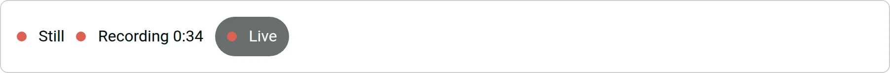

<!-- Written by `npm run docs:pages` from the kit and its examples. Do not edit. -->

# Live dot

_Components › Status_ · [All topics](../README.md)

A small red dot that says something is live or recording, as `<neat-live-dot pulse />` before the words "Recording 0:34". Hidden from assistive technology: the text beside it carries the meaning, so give it text. With `pulse` the dot beats and a ring grows out of it and fades, once in 1.6 s; without it, or under a reduced-motion setting, it is a still dot. The ring is drawn outside the dot's 0.625rem box and does not move the layout, but an ancestor that clips its overflow clips the ring too. The color is the theme's `--neat-live`, a red that reads at 3:1 on the page and on the video scrim (over black to mid-gray video), so a badge over video can use it.

<picture>
<source media="(prefers-color-scheme: dark)" srcset="../images/live-dot/badges.dark.webp">

</picture>

```ts
import { NeatLiveDot } from '@sima/neat-ui';
```

## Examples

### Badges

A still dot, a pulsing one before "Recording 0:34", and a pulsing one in a badge on the video scrim.

<picture>
<source media="(prefers-color-scheme: dark)" srcset="../images/live-dot/badges.dark.webp">

</picture>

<details>
<summary>Code</summary>

`1-badges.example.ts`

```ts
import { ChangeDetectionStrategy, Component } from '@angular/core';
import { NeatLiveDot } from '@sima/neat-ui';

@Component({
  selector: 'app-badges',
  imports: [NeatLiveDot],
  changeDetection: ChangeDetectionStrategy.OnPush,
  template: `
    <div class="showcase-row">
      <span class="showcase-row"><neat-live-dot /> Still</span>
      <span class="showcase-row"><neat-live-dot pulse /> Recording 0:34</span>
      <span class="showcase-row badge"><neat-live-dot pulse /> Live</span>
    </div>
  `,
  styleUrl: './badges.example.css',
})
export class Badges {}
```

`badges.example.css`

```css
/* A badge over video, as an app draws one: the live dot on the video scrim. */
.badge {
  padding: var(--neat-space-2) var(--neat-space-3);
  border-radius: 999px;
  background: var(--neat-video-scrim);
  color: var(--neat-video-scrim-foreground);
}
```

</details>

## API

### `NeatLiveDot`

Component from `@sima/neat-ui`, selector `neat-live-dot`.

**Inputs**

- **`pulse`** `boolean`, default `false`, transform `booleanAttribute`

  Beat and send out a ring, for a state that is running now.
