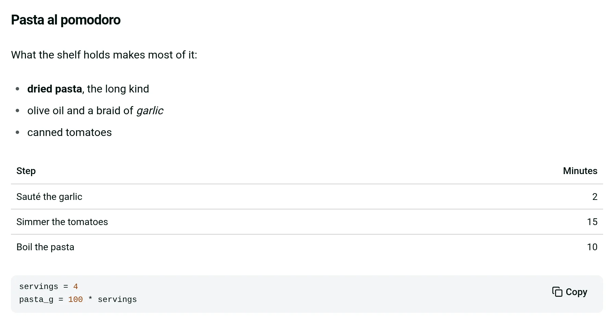
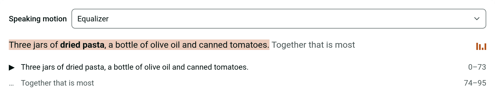

<!-- Written by `npm run docs:pages` from the kit and its examples. Do not edit. -->

# Markdown

_Components › Chat_ · [All topics](../README.md)

Markdown, as a model writes its replies, drawn in the kit's prose: headings, paragraphs, lists (task items with ☐ and ☑), quotes, rules, tables in the kit's table look and fenced code as the kit's code block, colored by its language.

```html
<neat-markdown [text]="reply.text" [streaming]="reply.state === 'streaming'" />
```

<picture>
<source media="(prefers-color-scheme: dark)" srcset="../images/markdown/reply.dark.webp">

</picture>

```ts
import { NeatMarkdown, NEAT_TEXT_MOTIONS, neatSpeakable, NEAT_SPEAKING_MOTIONS } from '@sima/neat-ui/markdown';
```

## Examples

### Reply

A model's reply in Markdown: a heading, a list, a table and code, drawn in the kit's prose, its table look and its code block.

<picture>
<source media="(prefers-color-scheme: dark)" srcset="../images/markdown/reply.dark.webp">

</picture>

<details>
<summary>Code</summary>

`1-reply.example.ts`

```ts
import { ChangeDetectionStrategy, Component } from '@angular/core';
import { NeatMarkdown } from '@sima/neat-ui/markdown';

@Component({
  selector: 'app-reply',
  imports: [NeatMarkdown],
  changeDetection: ChangeDetectionStrategy.OnPush,
  templateUrl: './1-reply.example.html',
})
export class Reply {
  protected readonly reply = `## Pasta al pomodoro

What the shelf holds makes most of it:

- **dried pasta**, the long kind
- olive oil and a braid of *garlic*
- canned tomatoes

| Step | Minutes |
| --- | --: |
| Sauté the garlic | 2 |
| Simmer the tomatoes | 15 |
| Boil the pasta | 10 |

\`\`\`python
servings = 4
pasta_g = 100 * servings
\`\`\``;
}
```

`1-reply.example.html`

```html
<neat-markdown [text]="reply" />
```

</details>

### Streaming

A reply streaming in at 25 pieces a second, as a model writes it: half-written marks show as they will end, so `**dried` is bold at once and the code block grows, and a caret ends the text until the reply is done. It starts again after a pause.

<picture>
<source media="(prefers-reduced-motion: reduce) and (prefers-color-scheme: dark)" srcset="../images/markdown/streaming.dark.webp">
<source media="(prefers-reduced-motion: reduce)" srcset="../images/markdown/streaming.light.webp">
<source media="(prefers-color-scheme: dark)" srcset="../images/markdown/streaming.dark.animated.webp">

</picture>

<details>
<summary>Code</summary>

`2-streaming.example.ts`

```ts
import { ChangeDetectionStrategy, Component, DestroyRef, inject, signal } from '@angular/core';
import { NeatMarkdown } from '@sima/neat-ui/markdown';

/** The reply this example streams, a piece at a time. */
const REPLY = `Three jars of **dried pasta**, a bottle of olive oil and canned tomatoes. Together that is
most of a *pasta al pomodoro*:

1. Sauté the garlic in the oil.
2. Add the tomatoes and let them simmer.

\`\`\`python
minutes = 15
\`\`\``;

/** The reply's pieces: each word and each run of spaces, as a model's tokens arrive. */
const PIECES = REPLY.match(/\s+|\S+/g) ?? [];

@Component({
  selector: 'app-streaming',
  imports: [NeatMarkdown],
  changeDetection: ChangeDetectionStrategy.OnPush,
  templateUrl: './2-streaming.example.html',
  styleUrl: './streaming.example.css',
})
export class Streaming {
  protected readonly text = signal('');
  protected readonly streaming = signal(true);

  constructor() {
    let shown = 0;
    let pause = 0;
    const timer = setInterval(() => {
      if (shown < PIECES.length) {
        this.text.update((text) => text + PIECES[shown++]);
        if (shown === PIECES.length) this.streaming.set(false);
      } else if (++pause > 50) {
        shown = 0;
        pause = 0;
        this.text.set('');
        this.streaming.set(true);
      }
    }, 40);
    inject(DestroyRef).onDestroy(() => clearInterval(timer));
  }
}
```

`2-streaming.example.html`

```html
<neat-markdown [text]="text()" [streaming]="streaming()" />
```

`streaming.example.css`

```css
/* The reply's full height from the start, so the page does not grow as it streams. */
:host {
  display: block;
  min-height: 15rem;
}
```

</details>

### Text motion

A reply streaming in each of the kit's text motions: pick one, and the pieces per second the model writes. Each piece moves for a moment, then settles into plain text; under reduced motion every motion is plain. It starts again after a pause.

<picture>
<source media="(prefers-reduced-motion: reduce) and (prefers-color-scheme: dark)" srcset="../images/markdown/text-motion.dark.webp">
<source media="(prefers-reduced-motion: reduce)" srcset="../images/markdown/text-motion.light.webp">
<source media="(prefers-color-scheme: dark)" srcset="../images/markdown/text-motion.dark.animated.webp">

</picture>

<details>
<summary>Code</summary>

`3-text-motion.example.ts`

```ts
import { ChangeDetectionStrategy, Component, DestroyRef, inject, signal } from '@angular/core';
import { NEAT_TEXT_MOTIONS, NeatMarkdown, type NeatTextMotion } from '@sima/neat-ui/markdown';
import { NeatSelect, type NeatSelectOption } from '@sima/neat-ui/select';
import { NeatSlider } from '@sima/neat-ui/slider';

/** The reply this example streams, a piece at a time. */
const REPLY = `Three jars of **dried pasta**, a bottle of olive oil and canned tomatoes. Together that is
most of a *pasta al pomodoro*: sauté the garlic in the oil, add the tomatoes, and let them simmer
while the pasta boils.`;

/** The reply's pieces: each word and each run of spaces, as a model's tokens arrive. */
const PIECES = REPLY.match(/\s+|\S+/g) ?? [];

/** Each motion's name in words, for the picker. */
const NAMES: Record<NeatTextMotion, string> = {
  plain: 'Plain',
  focus: 'Focus',
  decrypt: 'Decrypt',
  'reverse-explosion': 'Reverse explosion',
  'token-flash': 'Token flash',
  'drop-in': 'Drop-in',
  'word-cloud': 'Word cloud',
};

@Component({
  selector: 'app-text-motion',
  imports: [NeatMarkdown, NeatSelect, NeatSlider],
  changeDetection: ChangeDetectionStrategy.OnPush,
  templateUrl: './3-text-motion.example.html',
  styleUrl: './text-motion.example.css',
})
export class TextMotion {
  protected readonly motions: NeatSelectOption<NeatTextMotion>[] = NEAT_TEXT_MOTIONS.map(
    (motion) => ({ value: motion, label: NAMES[motion] }),
  );
  protected readonly motion = signal<NeatTextMotion | null>('focus');
  protected readonly piecesPerSecond = signal(18);
  protected readonly text = signal('');
  protected readonly streaming = signal(true);

  constructor() {
    let shown = 0;
    let timer: ReturnType<typeof setTimeout>;
    const next = () => {
      if (shown < PIECES.length) {
        this.text.update((text) => text + PIECES[shown++]);
        if (shown === PIECES.length) this.streaming.set(false);
        timer = setTimeout(next, 1000 / this.piecesPerSecond());
      } else {
        // A pause after the reply, then it starts again.
        timer = setTimeout(() => {
          shown = 0;
          this.text.set('');
          this.streaming.set(true);
          next();
        }, 2000);
      }
    };
    timer = setTimeout(next, 0);
    inject(DestroyRef).onDestroy(() => clearTimeout(timer));
  }
}
```

`3-text-motion.example.html`

```html
<div class="controls">
  <neat-select
    label="Text motion"
    showLabel
    labelPosition="inline"
    width="content"
    [options]="motions"
    [(value)]="motion"
  />
  <div class="pace">
    <span aria-hidden="true">Pieces per second: {{ piecesPerSecond() }}</span>
    <neat-slider
      class="slider"
      label="Pieces per second"
      [min]="1"
      [max]="80"
      [step]="1"
      [(value)]="piecesPerSecond"
    />
  </div>
</div>
<neat-markdown [text]="text()" [streaming]="streaming()" [motion]="motion() ?? 'plain'" />
```

`text-motion.example.css`

```css
/* The reply's full height from the start, so the page does not grow as it streams. */
:host {
  display: flex;
  flex-direction: column;
  gap: var(--neat-space-4);
  min-height: 15rem;
}

.controls {
  display: flex;
  flex-wrap: wrap;
  align-items: center;
  gap: var(--neat-space-4);
}

.pace {
  display: flex;
  align-items: center;
  gap: var(--neat-space-3);
  font-size: var(--neat-text-sm);
}

.slider {
  width: 10rem;
}
```

</details>

### Read aloud

The sentences read aloud would speak ([`neatSpeakable`](../components/markdown.md#neatspeakable)) while a reply streams: each sentence's words without the Markdown, and its range in the text. A sentence is complete (✓) once whitespace or another block follows it, so an app can speak it then; the code is never read. The example "speaks" each complete sentence in turn, in silence at the pace of a voice, and the reply shows it in the chosen speaking motion (`speech`, `speakingMotion`).

<picture>
<source media="(prefers-reduced-motion: reduce) and (prefers-color-scheme: dark)" srcset="../images/markdown/read-aloud.dark.webp">
<source media="(prefers-reduced-motion: reduce)" srcset="../images/markdown/read-aloud.light.webp">
<source media="(prefers-color-scheme: dark)" srcset="../images/markdown/read-aloud.dark.animated.webp">

</picture>

<details>
<summary>Code</summary>

`4-read-aloud.example.ts`

```ts
import {
  ChangeDetectionStrategy,
  Component,
  computed,
  DestroyRef,
  inject,
  signal,
} from '@angular/core';
import {
  NEAT_SPEAKING_MOTIONS,
  NeatMarkdown,
  neatSpeakable,
  type NeatSpeakableSentence,
  type NeatSpeakingMotion,
  type NeatSpeech,
} from '@sima/neat-ui/markdown';
import { NeatSelect, type NeatSelectOption } from '@sima/neat-ui/select';

/** The reply this example streams, a piece at a time. */
const REPLY = `Three jars of **dried pasta**, a bottle of olive oil and canned tomatoes. Together that is
most of a *pasta al pomodoro*:

1. Sauté the garlic in the oil.
2. Add the tomatoes and let them simmer.

\`\`\`python
minutes = 15
\`\`\``;

/** The reply's pieces: each word and each run of spaces, as a model's tokens arrive. */
const PIECES = REPLY.match(/\s+|\S+/g) ?? [];

/** How long a sentence takes to say: 55 ms a character, the mockup's pace. */
const MS_PER_CHARACTER = 55;
/** The pretend voice's sample rate. */
const SAMPLE_RATE = 16_000;

const NAMES: Record<NeatSpeakingMotion, string> = {
  sentence: 'Sentence',
  equalizer: 'Equalizer',
  waveform: 'Waveform',
};

@Component({
  selector: 'app-read-aloud',
  imports: [NeatMarkdown, NeatSelect],
  changeDetection: ChangeDetectionStrategy.OnPush,
  templateUrl: './4-read-aloud.example.html',
  styleUrl: './read-aloud.example.css',
})
export class ReadAloud {
  protected readonly text = signal('');
  protected readonly streaming = signal(true);
  protected readonly sentences = computed(() =>
    neatSpeakable(this.text(), { final: !this.streaming() }),
  );
  protected readonly motions: readonly NeatSelectOption<NeatSpeakingMotion>[] =
    NEAT_SPEAKING_MOTIONS.map((motion) => ({ value: motion, label: NAMES[motion] }));
  protected readonly motion = signal<NeatSpeakingMotion | null>('equalizer');
  /** The sentence being said, as an app's read aloud sets it while its audio plays. */
  protected readonly speech = signal<NeatSpeech | null>(null);
  /** Where the sentences said so far end in the text. */
  private spokenTo = 0;
  private speaking: ReturnType<typeof setTimeout> | undefined;

  constructor() {
    let shown = 0;
    let pause = 0;
    const timer = setInterval(() => {
      if (shown < PIECES.length) {
        this.text.update((text) => text + PIECES[shown++]);
        if (shown === PIECES.length) this.streaming.set(false);
      } else if (++pause > 200) {
        shown = 0;
        pause = 0;
        this.text.set('');
        this.streaming.set(true);
        this.stop();
      }
      this.speakNext();
    }, 40);
    inject(DestroyRef).onDestroy(() => {
      clearInterval(timer);
      this.stop();
    });
  }

  /** Whether this sentence is the one being said. */
  protected saying(sentence: NeatSpeakableSentence): boolean {
    return this.speech()?.from === sentence.from;
  }

  /** Says the next complete sentence once the one before has been said. */
  private speakNext(): void {
    if (this.speech()) return;
    const next = this.sentences().find((s) => s.complete && s.from >= this.spokenTo);
    if (!next) return;
    const ms = next.text.length * MS_PER_CHARACTER;
    this.spokenTo = next.to;
    this.speech.set({
      from: next.from,
      to: next.to,
      startedAt: performance.now(),
      audio: { samples: new Float32Array((ms / 1000) * SAMPLE_RATE), sampleRate: SAMPLE_RATE },
    });
    this.speaking = setTimeout(() => {
      this.speech.set(null);
      this.speakNext();
    }, ms);
  }

  private stop(): void {
    clearTimeout(this.speaking);
    this.speech.set(null);
    this.spokenTo = 0;
  }
}
```

`4-read-aloud.example.html`

```html
<neat-select
  label="Speaking motion"
  showLabel
  labelPosition="inline"
  [options]="motions"
  [(value)]="motion"
/>
<neat-markdown
  [text]="text()"
  [streaming]="streaming()"
  [speech]="speech()"
  [speakingMotion]="motion() ?? 'sentence'"
/>
<ol class="sentences" aria-label="Sentences to speak">
  @for (sentence of sentences(); track sentence.from) {
    <li
      [attr.data-complete]="sentence.complete ? '' : null"
      [attr.data-speaking]="saying(sentence) ? '' : null"
    >
      <span class="mark">{{ saying(sentence) ? '▶' : sentence.complete ? '✓' : '…' }}</span>
      <span class="words">{{ sentence.text }}</span>
      <span class="range">{{ sentence.from }}–{{ sentence.to }}</span>
    </li>
  }
</ol>
```

`read-aloud.example.css`

```css
/* The reply's full height from the start, then its sentences, so nothing jumps as it streams. */
:host {
  display: flex;
  flex-direction: column;
  gap: var(--neat-space-4);
  min-height: 24rem;
}

.sentences {
  display: flex;
  flex-direction: column;
  gap: var(--neat-space-2);
  font-size: var(--neat-text-sm);
}

.sentences li {
  display: flex;
  gap: var(--neat-space-2);
  color: var(--muted-foreground);
}

.sentences li[data-complete] {
  color: var(--foreground);
}

.mark {
  width: 1em;
}

.range {
  margin-inline-start: auto;
  font-variant-numeric: tabular-nums;
  color: var(--muted-foreground);
}
```

</details>

### A band under the reply

The word cloud as a band as wide as the reply: `cloudBox` gives a box of a width, a height and an offset from the newest piece, and `width: 'full'` spans the reply and stands still sideways while the box steps down with the text. Here the band is 48 px high, 40 px below each line. The default box is a 240 by 64 px patch that follows the newest piece along its line, which `NEAT_CLOUD_BOX` holds. Under reduced motion the reply is plain. It starts again after a pause.

<details>
<summary>Code</summary>

`5-a-band-under-the-reply.example.ts`

```ts
import { ChangeDetectionStrategy, Component, DestroyRef, inject, signal } from '@angular/core';
import { NeatMarkdown, type NeatCloudBox } from '@sima/neat-ui/markdown';

/** The reply this example streams, a piece at a time. */
const REPLY = `Three jars of **dried pasta**, a bottle of olive oil and canned tomatoes. Together that is
most of a *pasta al pomodoro*: sauté the garlic in the oil, add the tomatoes, and let them simmer
while the pasta boils.`;

/** The reply's pieces: each word and each run of spaces, as a model's tokens arrive. */
const PIECES = REPLY.match(/\s+|\S+/g) ?? [];

@Component({
  selector: 'app-a-band-under-the-reply',
  imports: [NeatMarkdown],
  changeDetection: ChangeDetectionStrategy.OnPush,
  templateUrl: './5-a-band-under-the-reply.example.html',
  styleUrl: './a-band-under-the-reply.example.css',
})
export class ABandUnderTheReply {
  protected readonly box: NeatCloudBox = { width: 'full', height: 48, x: 0, y: 40 };
  protected readonly text = signal('');
  protected readonly streaming = signal(true);

  constructor() {
    let shown = 0;
    let pause = 0;
    const timer = setInterval(() => {
      if (shown < PIECES.length) {
        this.text.update((text) => text + PIECES[shown++]);
        if (shown === PIECES.length) this.streaming.set(false);
      } else if (++pause > 50) {
        shown = 0;
        pause = 0;
        this.text.set('');
        this.streaming.set(true);
      }
    }, 55);
    inject(DestroyRef).onDestroy(() => clearInterval(timer));
  }
}
```

`5-a-band-under-the-reply.example.html`

```html
<neat-markdown [text]="text()" [streaming]="streaming()" motion="word-cloud" [cloudBox]="box" />
```

`a-band-under-the-reply.example.css`

```css
/* The reply's full height from the start, so the page does not grow as it streams. */
:host {
  display: block;
  min-height: 12rem;
}
```

</details>

## API

### `NeatMarkdown`

Component from `@sima/neat-ui/markdown`, selector `neat-markdown`.

It draws the Markdown with its own templates, never as HTML: raw HTML in the text shows as text, an image as its alt text in brackets, and a link is a link only to an `http:` or `https:` address (opened in a new tab), else its text. So text from a model can be shown as it comes.

**While ****`streaming`****,** the text may grow with every update. Finished blocks keep their elements, and only the last two blocks are read again, so the cost of an update grows with them, not with the text. Marks the model has opened but not yet closed are closed ahead: `**bold` is bold at once and an open code fence is already a code block, so nothing reflows when the closing mark arrives. Some Markdown only resolves later (a table's header row before its separator line): it shows as what it is so far, a paragraph, and changes once.

While streaming, a caret (a bar in `--primary`, blinking unless reduced motion is on) ends the last paragraph, heading or list item; a code block or a table that is still growing shows that it grows by itself.

**Its ****`motion`** is how the newest text appears while it streams ([`NeatTextMotion`](../components/markdown.md#neattextmotion)): `plain` by default, or one of the kit's text motions. Each write's new characters in the prose are a piece that moves for a moment and then settles into plain text; code blocks, tables and inline code grow plainly. A text that is no continuation of the one before shows whole and plain at once, and a motion changed while the text streams moves only what comes after the change. Under reduced motion every motion shows plain.

**Read aloud:** `speech` is the sentence being said ([`NeatSpeech`](../components/markdown.md#neatspeech), a range [`neatSpeakable`](../components/markdown.md#neatspeakable) gave, its audio and when it began), and `speakingMotion` how it shows ([`NeatSpeakingMotion`](../components/markdown.md#neatspeakingmotion)): the reply after the sentence is muted, and the sentence is tinted (with `equalizer` an equalizer beats beside its first line, in a gutter at the line's end, which the host keeps whether or not there is speech). It is drawn with the CSS Custom Highlight API, so no element changes and nothing reflows; a browser without it shows the text as it is. The range is in the Markdown text, so the same characters stay lit as the reply grows, and a range with no readable text lights nothing. Under reduced motion every speaking motion is `sentence`.

The host is prose ([`NeatProse`](../layout/prose.md#neatprose)) and a block; the app sets its width.

**Inputs**

- **`text`** `string`, required

  The Markdown to show.

- **`streaming`** `boolean`, default `false`, transform `booleanAttribute`

  True while the text still grows: unclosed marks are closed ahead (see the class).

- **`headingOffset`** `number`, default `2`

  How many levels a heading moves down: with 2, the default, `#` is an `h3`, since a page's own title and sections take `h1` and `h2`. Headings stop at `h6`.

- **`motion`** `NeatTextMotion`, default `'plain'`

  How the newest text appears while it streams: `plain`, the default, or one of the kit's text motions ([`NEAT_TEXT_MOTIONS`](../components/markdown.md#neat_text_motions)). Under reduced motion every motion shows plain.

- **`cloudWords`** `number`, default `12`, transform `cloudWordCount`

  How many words float in the word cloud (the `word-cloud` motion): a whole number from 1 to 40, 12 by default.

- **`cloudBox`** `NeatCloudBox`, default `NEAT_CLOUD_BOX`

  Where the word cloud floats (`NeatCloudBox`): a box of a width, a height and an offset from the newest piece, `NEAT_CLOUD_BOX` by default. The words orbit inside it, it stays inside the reply, steps down with the text, and with `width: 'full'` it spans the reply and stays still sideways. While the text streams the reply keeps room below it for the box.

- **`speech`** `NeatSpeech | null`, default `null`

  The sentence being read aloud ([`NeatSpeech`](../components/markdown.md#neatspeech)): its range in the text, as [`neatSpeakable`](../components/markdown.md#neatspeakable) gave it, its audio and when it began; null, the default, while nothing is said.

- **`speakingMotion`** `NeatSpeakingMotion`, default `'sentence'`

  How the sentence being said shows ([`NeatSpeakingMotion`](../components/markdown.md#neatspeakingmotion)): `sentence`, the default and the still form, or `equalizer`; `waveform` is `sentence` here (the transcript draws its strip). Under reduced motion every motion is `sentence`.

### `NeatTextMotion`

Type from `@sima/neat-ui/markdown`.

How a streaming reply's newest text appears in `neat-markdown` (its `motion`), in prose only: code blocks, tables and inline code grow plainly.

- `plain`: the text as it comes, with a thin caret at its end.
- `focus`: each piece comes into focus from a blur in the primary color.
- `decrypt`: pieces show as glyph noise and resolve from the start, with a tail of noise to the end of the next line.
- `reverse-explosion`: particles condense from around each piece into its place.
- `token-flash`: each piece flashes on a chip in one of four hues, then fades.
- `drop-in`: the letters of each word drop in one after another.
- `word-cloud`: words float under the reply's end; one flies into place with each piece.

Under reduced motion every motion shows as `plain`.

```ts
type NeatTextMotion = 'plain' | 'focus' | 'decrypt' | 'reverse-explosion' | 'token-flash' | 'drop-in' | 'word-cloud'
```

### `NEAT_TEXT_MOTIONS`

Constant from `@sima/neat-ui/markdown`.

Every [`NeatTextMotion`](../components/markdown.md#neattextmotion), in the order a picker lists them.

```ts
const NEAT_TEXT_MOTIONS: readonly NeatTextMotion[]
```

### `neatSpeakable`

Function from `@sima/neat-ui/markdown`.

The sentences a reply is read aloud in, from its Markdown text: each one's words without the Markdown and its range in the text, so what an app speaks and what `neat-markdown`'s `speech` lights are the same characters.

```ts
for (const sentence of neatSpeakable(reply.text, { final: false })) {
  if (sentence.complete && sentence.from >= spokenTo) speak(sentence);
}
```

It reads what `neat-markdown` shows as prose, inline code included, and never code blocks, tables, pictures or raw HTML. A heading, a paragraph, a list item and a quote's text each end their sentence. Sentences end at `.`, `!`, `?` or `…` followed by a space (closing quotes and brackets kept with them; not after a decimal point, an initial or an abbreviation such as "e.g." or "z.B."), and at the CJK `。！？` with no space needed, so Japanese reads sentence by sentence.

While a reply streams, pass `final: false`: the text is read as `neat-markdown` shows it then (half-finished Markdown closed ahead), and its last sentence is not `complete` until whitespace or another block follows it, so a paragraph before a streaming code block is complete. A complete sentence keeps its range and words as the text grows, and a text read again as it grows costs only its newest blocks. Ranges count a line end as one character, as Markdown reads `\r\n`.

```ts
neatSpeakable(text: string, options: NeatSpeakableOptions = {}): readonly NeatSpeakableSentence[]
```

### `NeatSpeakableSentence`

Interface from `@sima/neat-ui/markdown`.

A sentence of a reply as read aloud speaks it.

**Members**

- **`text`** `string`

  What to speak: the sentence's words without Markdown, line breaks as spaces, trimmed.

- **`from`** `number`

  Its range in the Markdown text, as `text.slice(from, to)` for a text whose line ends are `\n`; a `\r\n` counts as one character, as Markdown reads it. Stable while the text grows.

- **`to`** `number`

- **`complete`** `boolean`

  Whether nothing written later can change it; a streaming text's last sentence may not be.

### `NeatSpeakableOptions`

Interface from `@sima/neat-ui/markdown`.

How [`neatSpeakable`](../components/markdown.md#neatspeakable) reads a text.

**Members**

- **`final`** `boolean`, optional

  The text is complete; `true` by default. Pass false while it streams.

- **`maxLength`** `number`, optional

  The longest sentence, in characters; longer ones are cut at a comma, else a space. Unlimited by default.

### `NeatSpeech`

Interface from `@sima/neat-ui/markdown`.

The sentence of a reply being said now, as read aloud plays it.

**Members**

- **`from`** `number`

  The sentence being played: its range in the text, as [`neatSpeakable`](../components/markdown.md#neatspeakable) gave it.

- **`to`** `number`

- **`startedAt`** `number`

  When it began to play, on the `performance.now()` clock.

- **`audio`** `AudioBuffer | NeatSpeechSamples`

  What plays, one channel: how long the sentence lasts, and the transcript's waveform.

### `NeatSpeechSamples`

Interface from `@sima/neat-ui/markdown`.

The audio of a sentence as samples, one channel.

**Members**

- **`samples`** `Float32Array`

- **`sampleRate`** `number`

### `NeatSpeakingMotion`

Type from `@sima/neat-ui/markdown`.

How a reply being read aloud shows how far the voice got, on the sentence being said:

- `sentence`, the default and the still form: the sentence on a soft tint, the reply after it muted;
- `equalizer`: the sentence as `sentence`, and an equalizer beating beside its first line while it is said;
- `waveform`: the sentence as `sentence`, and in the transcript a strip of the sentence's audio with a playhead.

Under reduced motion every motion is `sentence`.

```ts
type NeatSpeakingMotion = 'sentence' | 'equalizer' | 'waveform'
```

### `NEAT_SPEAKING_MOTIONS`

Constant from `@sima/neat-ui/markdown`.

Every speaking motion, the still form first, for a picker.

```ts
const NEAT_SPEAKING_MOTIONS: readonly NeatSpeakingMotion[]
```
