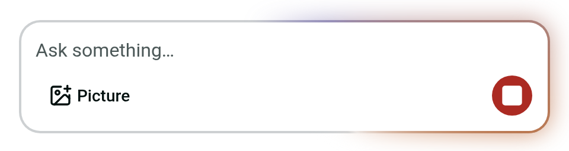

<!-- Written by `npm run docs:pages` from the kit and its examples. Do not edit. -->

# Message box

_Components › Chat_ · [All topics](../README.md)

Where the visitor writes a question, adds pictures to it, sends it, or stops the reply.

```html
<neat-message-box
  [activity]="conversation.activity()"
  (send)="conversation.ask($event)"
  (stop)="conversation.stop()"
/>
```

<picture>
<source media="(prefers-reduced-motion: reduce) and (prefers-color-scheme: dark)" srcset="../images/message-box/message-box.dark.webp">
<source media="(prefers-reduced-motion: reduce)" srcset="../images/message-box/message-box.light.webp">
<source media="(prefers-color-scheme: dark)" srcset="../images/message-box/message-box.dark.animated.webp">

</picture>

```ts
import { NeatMessageBox, NEAT_MESSAGE_BOX_GLOWS, pictureFromFile } from '@sima/neat-ui/chat';
```

## Examples

### Message box

The message box while a pretend board works through a question again and again: the comet breathes round its edge until the first word and runs while the reply arrives, and Send turns into Stop meanwhile. Type a question and press Enter, or drop a picture on the box.

<picture>
<source media="(prefers-reduced-motion: reduce) and (prefers-color-scheme: dark)" srcset="../images/message-box/message-box.dark.webp">
<source media="(prefers-reduced-motion: reduce)" srcset="../images/message-box/message-box.light.webp">
<source media="(prefers-color-scheme: dark)" srcset="../images/message-box/message-box.dark.animated.webp">

</picture>

<details>
<summary>Code</summary>

`1-message-box.example.ts`

```ts
import { ChangeDetectionStrategy, Component, DestroyRef, inject, signal } from '@angular/core';
import {
  NeatMessageBox,
  type NeatChatDraft,
  type NeatMessageBoxActivity,
} from '@sima/neat-ui/chat';

/** How long the example's pretend board spends on each activity, in ms. */
const PHASES: readonly (readonly [NeatMessageBoxActivity, number])[] = [
  ['idle', 800],
  ['waiting', 1200],
  ['streaming', 2000],
];

@Component({
  selector: 'app-message-box',
  imports: [NeatMessageBox],
  changeDetection: ChangeDetectionStrategy.OnPush,
  templateUrl: './1-message-box.example.html',
  styleUrl: './message-box.example.css',
})
export class MessageBox {
  protected readonly activity = signal<NeatMessageBoxActivity>('idle');
  protected readonly sent = signal<NeatChatDraft[]>([]);

  constructor() {
    let phase = 0;
    let timer: ReturnType<typeof setTimeout>;
    const next = () => {
      this.activity.set(PHASES[phase][0]);
      timer = setTimeout(next, PHASES[phase][1]);
      phase = (phase + 1) % PHASES.length;
    };
    next();
    inject(DestroyRef).onDestroy(() => clearTimeout(timer));
  }

  protected onSend(draft: NeatChatDraft): void {
    this.sent.update((sent) => [...sent, draft]);
  }
}
```

`1-message-box.example.html`

```html
<neat-message-box [activity]="activity()" (send)="onSend($event)" (stop)="activity.set('idle')" />
@if (sent().length) {
  <ul class="sent" aria-label="Sent">
    @for (draft of sent(); track $index) {
      <li>Sent: {{ draft.text || '(no text)' }} · {{ draft.pictures.length }} pictures</li>
    }
  </ul>
}
```

`message-box.example.css`

```css
/* A message box a little narrower than a conversation's column, to keep its animation small. */
:host {
  display: flex;
  flex-direction: column;
  gap: var(--neat-space-3);
  max-width: 30rem;
  padding: var(--neat-space-4);
}

.sent {
  font-size: var(--neat-text-sm);
  color: var(--muted-foreground);
}
```

</details>

### Restoring a draft

A draft the app hands the box: its text and a picture made with [`pictureFromFile`](../components/message-box.md#picturefromfile) from an image file (here one fetched from the page's own files), at most two pictures. Remove the picture with its button, or add another by choosing or dropping one.

<picture>
<source media="(prefers-color-scheme: dark)" srcset="../images/message-box/restoring-a-draft.dark.webp">

</picture>

<details>
<summary>Code</summary>

`2-restoring-a-draft.example.ts`

```ts
import { ChangeDetectionStrategy, Component, signal } from '@angular/core';
import { NeatMessageBox, pictureFromFile, type NeatChatPicture } from '@sima/neat-ui/chat';

@Component({
  selector: 'app-restoring-a-draft',
  imports: [NeatMessageBox],
  changeDetection: ChangeDetectionStrategy.OnPush,
  templateUrl: './2-restoring-a-draft.example.html',
  styleUrl: './restoring-a-draft.example.css',
})
export class RestoringADraft {
  protected readonly text = signal('What could I cook with this?');
  protected readonly pictures = signal<readonly NeatChatPicture[]>([]);

  constructor() {
    void this.restore();
  }

  private async restore(): Promise<void> {
    try {
      const answer = await fetch('examples/shelf.webp');
      const file = new File([await answer.blob()], 'shelf.webp', { type: 'image/webp' });
      this.pictures.set([pictureFromFile(file)]);
    } catch {
      // Without the picture the draft is its text alone.
    }
  }
}
```

`2-restoring-a-draft.example.html`

```html
<neat-message-box [maxPictures]="2" [(text)]="text" [(pictures)]="pictures" />
```

`restoring-a-draft.example.css`

```css
/* A message box as wide as a conversation's column. */
:host {
  display: block;
  max-width: 40rem;
  padding: var(--neat-space-4);
}
```

</details>

## API

### `NeatMessageBox`

Component from `@sima/neat-ui/chat`, selector `neat-message-box`.

The text area grows with what is written, up to eight lines, then scrolls. Enter sends, Shift+Enter starts a new line, and Enter while an input method composes (Japanese, say) only composes. A draft is its text and its pictures; one with neither cannot be sent, and Send says so (`aria-disabled`). Sent, the box is empty again.

**While the board works** (`activity` other than `idle`) Send is Stop, which emits `stop`, and Enter sends nothing. The `glow` shows it too ([`NeatMessageBoxGlow`](../components/message-box.md#neatmessageboxglow)): the comet runs round the edge while the board reads the question (`waiting`) and once every `glowTurnMs` × 0.6 while the reply arrives (`streaming`); the ring, the aurora and the sheen breathe while it waits and turn, drift or sweep once every `glowTurnMs` while it streams, each the look and pace of the mockup it was chosen from.

**Pictures** come from the Picture button (the system's file chooser) or a drop of image files on the box, up to `maxPictures`, each a thumbnail with a button that removes it. Files that are no images are left out. The pictures' object URLs are the box's until it sends them; then they are the app's (see [`pictureFromFile`](../components/message-box.md#picturefromfile)).

`text` and `pictures` are models, so an app can keep or restore a draft.

**Inputs**

- **`activity`** `NeatMessageBoxActivity`, default `'idle'`

  What the board is doing with the last question; Send is Stop while it is not `idle`.

- **`glow`** `NeatMessageBoxGlow`, default `'comet'`

  The glow round the box while the board works ([`NeatMessageBoxGlow`](../components/message-box.md#neatmessageboxglow)): `comet`, the default, `ring`, `aurora`, `sheen` or `none`. It moves until the first word and faster while the reply arrives, at its own pace, not the reply's. Still under reduced motion.

- **`glowTurnMs`** `number`, default `2400`

  How long the glow takes once round the box while the reply arrives, in ms.

- **`placeholder`** `string`, default `'Ask something…'`

  The text area's hint while it is empty.

- **`label`** `string`, default `'Message'`

  The text area's name for assistive technology.

- **`disabled`** `boolean`, default `false`, transform `booleanAttribute`

  No writing, no pictures and no sending.

- **`maxPictures`** `number`, default `4`

  How many pictures a draft may hold.

**Models (two-way)**

- **`text`** `string`, default `''`

  The draft's text.

- **`pictures`** `readonly NeatChatPicture[]`, default `[]`

  The draft's pictures.

**Outputs**

- **`send`** `NeatChatDraft`

  A draft was sent: its text (trimmed) and its pictures, which are the app's from now on.

- **`stop`** `void`

  Stop was pressed while the board worked.

### `NeatMessageBoxActivity`

Type from `@sima/neat-ui/chat`.

What the board is doing with the last question: `idle` (nothing), `waiting` (sent, no word yet) or `streaming` (the reply arrives).

```ts
type NeatMessageBoxActivity = 'idle' | 'waiting' | 'streaming'
```

### `NeatMessageBoxGlow`

Type from `@sima/neat-ui/chat`.

How the box shows that the board works on a reply:

- `comet`, the default: a bright head with a colored tail running round its edge;
- `ring`: the series colors turning round the whole edge in a soft halo;
- `aurora`: the series colors along the edge, with their light drifting below the box;
- `sheen`: the series colors along the edge, and a band of light crossing the box;
- `none`: no glow.

Each breathes or turns while the board reads the question and runs faster while the reply arrives; under reduced motion it shows its colors still.

```ts
type NeatMessageBoxGlow = 'comet' | 'ring' | 'aurora' | 'sheen' | 'none'
```

### `NEAT_MESSAGE_BOX_GLOWS`

Constant from `@sima/neat-ui/chat`.

Every glow of the message box, the default first, for a picker.

```ts
const NEAT_MESSAGE_BOX_GLOWS: readonly NeatMessageBoxGlow[]
```

### `NeatChatDraft`

Interface from `@sima/neat-ui/chat`.

What the message box sends: the question's text and its pictures.

**Members**

- **`text`** `string`

- **`pictures`** `readonly NeatChatPicture[]`

### `NeatChatPicture`

Interface from `@sima/neat-ui/chat`.

A picture attached to a question: shown as a thumbnail in the message box and in the message. `src` is what an `img` shows (an object URL from [`pictureFromFile`](../components/message-box.md#picturefromfile), or any address), `name` its alternative text, and `file` the picture itself, for the app to send.

**Members**

- **`id`** `string`

  Unique among the pictures shown together.

- **`src`** `string`

- **`name`** `string`

- **`file`** `File`, optional

### `pictureFromFile`

Function from `@sima/neat-ui/chat`.

A picture for the message box or a message, from an image file: an object URL to show it, its file name as its alternative text, and the file itself, for the app to send. The object URL lives until it is revoked: the message box revokes a picture removed from it, and once a draft is sent its pictures are the app's, to revoke when they are no longer shown.

```ts
pictureFromFile(file: File): NeatChatPicture
```
