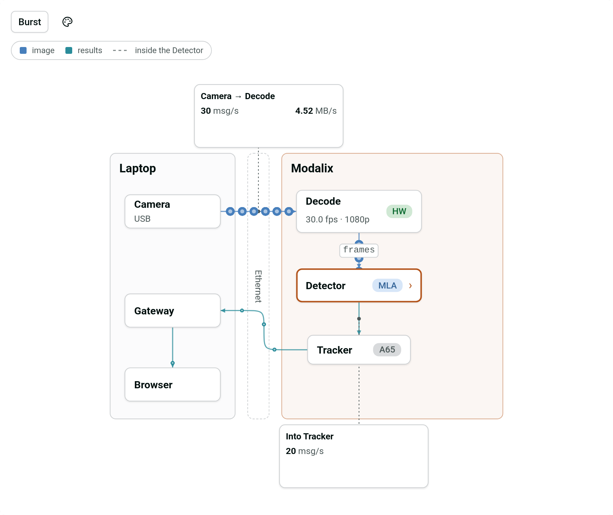

<!-- Written by `npm run docs:pages` from the kit and its examples. Do not edit. -->

# Messaging

_Components › Diagram_ · [All topics](../README.md)

The messages moving through a diagram, projected into it:

```html
<neat-diagram [diagram]="system" label="The demo's system">
  <neat-diagram-messages [steps]="steps" [settings]="settings()" />
</neat-diagram>
```

<picture>
<source media="(prefers-reduced-motion: reduce) and (prefers-color-scheme: dark)" srcset="../images/messaging/live-pipeline.dark.webp">
<source media="(prefers-reduced-motion: reduce)" srcset="../images/messaging/live-pipeline.light.webp">
<source media="(prefers-color-scheme: dark)" srcset="../images/messaging/live-pipeline.dark.animated.webp">

</picture>

```ts
import { NeatDiagramMessages, NeatDiagramRateCard, NeatDiagramAnimationSettings, NEAT_DIAGRAM_MESSAGE_DEFAULTS, neatParseMessageSettings, neatBatchTimes } from '@sima/neat-ui/diagram';
```

## Examples

### Live pipeline

A timer feeds camera frames at 30 Hz and results at 10 Hz, in batches of three frames that [`neatBatchTimes`](../components/messaging.md#neatbatchtimes) spreads. Decode's figure line comes from the example's [`NeatDiagramBlockTemplate`](../components/diagram.md#neatdiagramblocktemplate).

Try opening the Detector: inside it, the dots wait out its stage times.

The notes are rate cards of an edge's `rate()`: - the Tracker's sums the two edges into it, with `rate(['detector-tracker', 'nms-tracker'])`, and has `showBytes` off, since results are a few kilobytes and not worth a megabyte figure; - the Detector's shows its stage time in place of the megabytes.

The Animation panel tunes the dots, its choice kept per browser with [`neatStoredSignal`](../components/stored-signal.md#neatstoredsignal). The dots start calmer than the kit's defaults, and the panel's `defaults` makes its reset return there. Burst pushes 400 messages in one tick, about three seconds of this traffic, as a tab returning from a few seconds in the background would.

The top bar's Fit calls [`NeatDiagramView.fit`](../components/diagram.md#neatdiagramview), which fits the drawing to its box again after it was panned or zoomed.

<picture>
<source media="(prefers-reduced-motion: reduce) and (prefers-color-scheme: dark)" srcset="../images/messaging/live-pipeline.dark.webp">
<source media="(prefers-reduced-motion: reduce)" srcset="../images/messaging/live-pipeline.light.webp">
<source media="(prefers-color-scheme: dark)" srcset="../images/messaging/live-pipeline.dark.animated.webp">

</picture>

<details>
<summary>Code</summary>

`1-live-pipeline.example.ts`

```ts
import {
  afterNextRender,
  ChangeDetectionStrategy,
  Component,
  DestroyRef,
  inject,
  signal,
  viewChild,
} from '@angular/core';
import { NeatButton, neatStoredSignal } from '@sima/neat-ui';
import {
  NEAT_DIAGRAM_MESSAGE_DEFAULTS,
  neatBatchTimes,
  NeatDiagramAnimationSettings,
  NeatDiagramBlockTemplate,
  NeatDiagramLegend,
  type NeatDiagramMessageSettings,
  NeatDiagramMessages,
  NeatDiagramNoteTemplate,
  NeatDiagramRateCard,
  NeatDiagramView,
  neatParseMessageSettings,
} from '@sima/neat-ui/diagram';
import { PIPELINE_MESSAGE_STEPS } from './message-steps';
import { PIPELINE, PIPELINE_LEGEND } from './pipeline-data';

/**
 * The pipeline's feed: a camera frame every 33 ms (30 Hz) and a result for every third (10 Hz),
 * delivered as a transport would, in a batch of three frames every 99 ms.
 */
const FRAME_MS = 33;
const BATCH_FRAMES = 3;
/** When each frame of a batch was made, relative to the first: what `neatBatchTimes` spreads by. */
const FRAME_OFFSETS_MS = Array.from({ length: BATCH_FRAMES }, (_, i) => i * FRAME_MS);
/** The Detector's stage time shown on its card, refreshed once a second so it reads. */
const STAGE_SHOWN_EVERY = 10;
/** The edges each kind of message travels, on the overview and in the Detector's level. */
const FRAME_EDGES = ['camera-decode', 'decode-detector', 'decode-resize'];
const RESULT_EDGES = ['detector-tracker', 'nms-tracker', 'tracker-gateway', 'gateway-browser'];
/**
 * The Burst button's messages, in one tick: about three seconds of this example's traffic (some 130
 * pushes a second over its seven edges), as a tab back from a few seconds in the background
 * delivers it.
 */
const BURST_MESSAGES = 400;
/**
 * Where the dots start, and what the Animation panel's reset returns to: calmer than the kit's
 * defaults, slower and a dot for every third message, so the pipeline reads at a glance.
 */
const CALM_DOTS: NeatDiagramMessageSettings = {
  ...NEAT_DIAGRAM_MESSAGE_DEFAULTS,
  speed: 140,
  every: 3,
};

@Component({
  selector: 'app-live-pipeline',
  imports: [
    NeatButton,
    NeatDiagramAnimationSettings,
    NeatDiagramBlockTemplate,
    NeatDiagramLegend,
    NeatDiagramMessages,
    NeatDiagramNoteTemplate,
    NeatDiagramRateCard,
    NeatDiagramView,
  ],
  changeDetection: ChangeDetectionStrategy.OnPush,
  templateUrl: './1-live-pipeline.example.html',
  styleUrl: './live-pipeline.example.css',
})
export class LivePipeline {
  protected readonly pipeline = PIPELINE;
  protected readonly legend = PIPELINE_LEGEND;
  protected readonly steps = PIPELINE_MESSAGE_STEPS;
  protected readonly calmDots = CALM_DOTS;
  /**
   * The dots' tuning, kept per browser: what `neatParseMessageSettings` reads back clamped, with
   * the example's own defaults for what it lacks.
   */
  protected readonly dots = neatStoredSignal('showcase.diagram.dots', CALM_DOTS, (raw) =>
    neatParseMessageSettings(raw, CALM_DOTS),
  );
  /** The YOLOX stage time the Detector's card shows, in ms. */
  protected readonly yoloxMs = signal<number | undefined>(undefined);
  private readonly diagram = viewChild.required(NeatDiagramView);
  private readonly messages = viewChild.required(NeatDiagramMessages);

  constructor() {
    const destroyRef = inject(DestroyRef);
    // The feed needs the browser's clock, so it starts once the page has rendered.
    afterNextRender(() => {
      let batch = 0;
      const feed = setInterval(() => {
        const messages = this.messages();
        // The batch arrives now; its frames start as far apart as they were made.
        const starts = neatBatchTimes(FRAME_OFFSETS_MS, performance.now());
        for (const atMs of starts) {
          // A frame of about 150 kB, a result of about 2 kB, give or take, as a real feed varies.
          for (const edge of FRAME_EDGES) {
            messages.push(edge, 140_000 + Math.random() * 20_000, atMs);
          }
        }
        for (const edge of RESULT_EDGES) messages.push(edge, 1_500 + Math.random() * 1_000);
        const yolox = 14 + 2 * Math.random();
        messages.stageMs('detector', 'resize', 3 + Math.random());
        messages.stageMs('detector', 'yolox', yolox);
        if (batch++ % STAGE_SHOWN_EVERY === 0) this.yoloxMs.set(yolox);
      }, FRAME_MS * BATCH_FRAMES);
      destroyRef.onDestroy(() => clearInterval(feed));
    });
  }

  /** Fits the drawing to its box again, as a toolbar's Fit button does. */
  fit(): void {
    this.diagram().fit();
  }

  /** Pushes a burst of messages at once, as a tab returning from the background would. */
  protected burst(): void {
    const messages = this.messages();
    const edges = [...FRAME_EDGES, ...RESULT_EDGES];
    for (let i = 0; i < BURST_MESSAGES; i++) {
      messages.push(edges[i % edges.length], 1_500 + Math.random() * 150_000);
    }
  }
}
```

`1-live-pipeline.example.html`

```html
<div class="controls">
  <button neatButton type="button" variant="outlined" size="small" (click)="burst()">Burst</button>
  <neat-diagram-animation-settings [(settings)]="dots" [defaults]="calmDots" />
</div>
<neat-diagram-legend [items]="legend" />
<neat-diagram class="diagram" [diagram]="pipeline" label="A live messaging pipeline">
  <neat-diagram-messages #messages [steps]="steps" [settings]="dots()" />
  <ng-template neatDiagramBlock let-node>
    @if (node.id === 'decode') {
      <span class="figure">30.0 fps · 1080p</span>
    }
  </ng-template>
  <ng-template neatDiagramNote let-note>
    @switch (note.id) {
      @case ('tracker-rate') {
        <neat-diagram-rate-card
          label="Into Tracker"
          [rate]="messages.rate(['detector-tracker', 'nms-tracker'])()"
          [showBytes]="false"
        />
      }
      @case ('yolox-rate') {
        <neat-diagram-rate-card
          label="YOLOX → NMS"
          [rate]="messages.rate('yolox-nms')()"
          [stageMs]="yoloxMs()"
        />
      }
      @case ('camera-rate') {
        <neat-diagram-rate-card label="Camera → Decode" [rate]="messages.rate('camera-decode')()" />
      }
    }
  </ng-template>
</neat-diagram>
```

`message-steps.ts`

```ts
import type { NeatDiagramMessageStep } from '@sima/neat-ui/diagram';

/**
 * The Detector's steps for the messaging layer: a frame that reaches Resize goes on to YOLOX once
 * Resize's stage time has passed, and on to NMS after YOLOX's.
 */
export const PIPELINE_MESSAGE_STEPS: Readonly<Record<string, NeatDiagramMessageStep>> = {
  'resize-yolox': { from: 'detector', stage: 'resize' },
  'yolox-nms': { from: 'detector', stage: 'yolox' },
};
```

`pipeline-data.ts`

```ts
import {
  type NeatDiagram,
  type NeatDiagramChip,
  type NeatDiagramEdge,
  type NeatDiagramLegendItem,
  type NeatDiagramNode,
  type NeatDiagramSet,
  neatDrillDownLevel,
} from '@sima/neat-ui/diagram';
import { A65, EV74, HW, MLA } from './chips';

/*
 * The reference sheet's messaging pipeline (a design drawing kept outside the repo):
 * laptop, cable, board, placed after the sheet with room for the kit's type and edge labels. The
 * diagram fits each level to its box, so where a level starts does not matter.
 */

const PIPELINE_NODES: readonly NeatDiagramNode[] = [
  { id: 'laptop', role: 'group', label: 'Laptop', x: 0, y: 0, w: 170, h: 360 },
  {
    id: 'camera',
    role: 'block',
    label: 'Camera',
    detail: 'USB',
    parent: 'laptop',
    x: 20,
    y: 56,
    w: 130,
    h: 46,
  },
  {
    id: 'gateway',
    role: 'block',
    label: 'Gateway',
    inSide: 'right',
    outSide: 'bottom',
    parent: 'laptop',
    x: 20,
    y: 190,
    w: 130,
    h: 46,
  },
  {
    id: 'browser',
    role: 'block',
    label: 'Browser',
    inSide: 'top',
    parent: 'laptop',
    x: 20,
    y: 290,
    w: 130,
    h: 46,
  },
  { id: 'ethernet', role: 'band', label: 'Ethernet', x: 186, y: 0, w: 30, h: 360 },
  { id: 'modalix', role: 'group', look: 'accent', label: 'Modalix', x: 232, y: 0, w: 300, h: 360 },
  {
    id: 'decode',
    role: 'block',
    label: 'Decode',
    chips: [HW],
    outSide: 'bottom',
    parent: 'modalix',
    // Sized for its body below the label too: the example's figure line (neatDiagramBlock).
    x: 20,
    y: 50,
    w: 170,
    h: 58,
  },
  {
    id: 'detector',
    role: 'block',
    label: 'Detector',
    chips: [MLA],
    opens: 'detector',
    inSide: 'top',
    outSide: 'bottom',
    parent: 'modalix',
    // Far enough below Decode for the label of the edge between them, with its arrow.
    x: 20,
    y: 156,
    w: 170,
    h: 46,
  },
  {
    id: 'tracker',
    role: 'block',
    label: 'Tracker',
    chips: [A65],
    inSide: 'top',
    outSide: 'left',
    parent: 'modalix',
    x: 35,
    y: 246,
    w: 140,
    h: 40,
  },
];

const PIPELINE_EDGES: readonly NeatDiagramEdge[] = [
  { id: 'camera-decode', from: 'camera', to: 'decode', series: 1 },
  { id: 'tracker-gateway', from: 'tracker', to: 'gateway', series: 4 },
  { id: 'gateway-browser', from: 'gateway', to: 'browser', series: 4 },
];

/** A step of the Detector, in a row inside it below the level group's title. */
const step = (id: string, label: string, chip: NeatDiagramChip, i: number): NeatDiagramNode => ({
  id,
  role: 'block',
  label,
  chips: [chip],
  parent: 'detector',
  x: 20 + i * 170,
  y: 72,
  w: 130,
  h: 40,
});

/**
 * The pipeline with the Detector's steps inside it, which the overview leaves out (its card is
 * too small to hold them): what `neatDrillDownLevel` places the Detector's level from.
 */
const PIPELINE_STEPS: NeatDiagram = {
  nodes: [
    ...PIPELINE_NODES,
    step('resize', 'Resize', EV74, 0),
    step('yolox', 'YOLOX', MLA, 1),
    step('nms', 'NMS', A65, 2),
  ],
  edges: [
    ...PIPELINE_EDGES,
    { id: 'decode-resize', from: 'decode', to: 'resize', series: 1 },
    // The steps hand frames on inside the process: dashed and muted, as the demo draws them.
    { id: 'resize-yolox', from: 'resize', to: 'yolox', line: 'dashed' },
    { id: 'yolox-nms', from: 'yolox', to: 'nms', line: 'dashed' },
    { id: 'nms-tracker', from: 'nms', to: 'tracker', series: 4 },
  ],
};

export const PIPELINE: NeatDiagramSet = {
  overview: {
    nodes: PIPELINE_NODES,
    edges: [
      ...PIPELINE_EDGES,
      // Labeled, so the dots are seen passing behind an edge label.
      { id: 'decode-detector', from: 'decode', to: 'detector', series: 1, label: 'frames' },
      { id: 'detector-tracker', from: 'detector', to: 'tracker', series: 4 },
    ],
    notes: [
      // Above the groups (they start at y 0; the card is about 85 high), clear of the Camera.
      { id: 'camera-rate', edges: ['camera-decode'], x: 215, y: -50 },
      // A note's x and y are its center: below the Modalix group (which ends at y 360), so the card
      // straddles no border, and its leader runs clear of it.
      { id: 'tracker-rate', edges: ['detector-tracker'], x: 330, y: 410 },
    ],
  },
  levels: {
    detector: {
      ...neatDrillDownLevel(PIPELINE_STEPS, 'detector'),
      // The card of a step: its stage time in place of the megabytes. Below the level's group
      // (which ends at y 152), under the edge it is about.
      notes: [{ id: 'yolox-rate', edges: ['yolox-nms'], x: 340, y: 235 }],
    },
  },
};

export const PIPELINE_LEGEND: readonly NeatDiagramLegendItem[] = [
  { series: 1, label: 'image' },
  { series: 4, label: 'results' },
  { line: 'dashed', label: 'inside the Detector' },
];
```

`chips.ts`

```ts
import type { NeatDiagramChip } from '@sima/neat-ui/diagram';

/*
 * The chips follow the kit's convention for where a part runs: HW (the hardware decoder) success,
 * EV74 highlight, MLA info, A65 neutral.
 */
export const HW: NeatDiagramChip = { label: 'HW', tone: 'success' };
export const EV74: NeatDiagramChip = { label: 'EV74', tone: 'highlight' };
export const MLA: NeatDiagramChip = { label: 'MLA', tone: 'info' };
export const A65: NeatDiagramChip = { label: 'A65', tone: 'neutral' };
```

`live-pipeline.example.css`

```css
:host {
  display: flex;
  flex-direction: column;
  gap: var(--neat-space-3);
}

.controls {
  display: flex;
  align-items: center;
  gap: var(--neat-space-3);
}

/*
 * A diagram has no height of its own: the app gives it a bounded box, here 4:3 up to 40rem, so a
 * phone's narrow box does not stand tall and empty around a drawing its width shrinks.
 */
.diagram {
  /* The card's whole width: in this flex column the ratio would otherwise size the width from the
     capped height, and the drawing would cut off partway across the card when panned. */
  width: 100%;
  aspect-ratio: 4 / 3;
  max-height: 40rem;
}

/* A block's live figure (Decode's), below its label: small, quiet, steady digits. */
.figure {
  font-size: var(--neat-text-xs);
  color: var(--muted-foreground);
  font-variant-numeric: tabular-nums;
  white-space: nowrap;
}
```

</details>

## API

### `NeatDiagramMessages`

Component from `@sima/neat-ui/diagram`, selector `neat-diagram-messages`.

The app feeds it by id: `push(edgeId, bytes)` for each message on an edge, and `stageMs(nodeId, stage, ms)` for the stage times its step dots take.

A message on an edge drawn now is a dot along it, sized by its bytes. It takes as long on its way as the edge's length at `speed`. With `every`, only every Nth message gets a dot. Its color is its edge's, and `colors` picks another series.

A step (`steps`, keyed by edge id) is an edge inside a block that no message feeds. A dot arriving at its start goes on along it once the stage's time has passed, and so on along the chain. So the dots inside a block follow its real input and its measured stages. The edges in `passive`, fed edges or steps, end their messages where they enter, and start no steps.

`rate(edgeId)` is the edge's messages and bytes per second, and its history, for the notes an app fills. `rate(['a', 'b'])` is their sum, for a note over several edges. It is refreshed at 12 Hz while something reads it.

A push counts on any edge of any level, drawn or not, so a level opens with its numbers. The step edges are the exception. They count only while their level is drawn and the page is visible, since it is their dots that count them. An id that is no edge of the diagram is ignored, so the rates' memory stays bounded by the diagram's edges.

At most 16 384 dots exist at once, and the oldest are dropped past that. The rates still count every message. A burst, such as 10 000 pushes in one tick, costs the cap's worth of dots, not the burst's. So an app pushes each message as it arrives, and does not sample or drop any to protect the page.

All dots are drawn on one canvas over the drawing, at the device's pixel ratio. The canvas is sized to this element's box, which fills the diagram's. The dots scale with the zoom, and lie behind the cards and the edge labels. Dots of edges out of focus fade with them.

The frames run only while a dot is on its way. They stop while the page is hidden, and its messages then still count, without dots. Under reduced motion no dot travels: each message shows as a brief mark at its edge's end.

**Inputs**

- **`steps`** `Readonly<Record<string, NeatDiagramMessageStep>>`, default `{}`

  The steps, keyed by edge id: whose stage times each and what follows it.

- **`passive`** `readonly string[]`, default `[]`

  Edges whose messages end where they enter, starting no step dots (a side input): fed edges and steps alike.

- **`colors`** `Readonly<Record<string, number>>`, default `{}`

  A series (1 to 8) per edge id for its dots, in place of the edge's own color.

- **`colours`** `Readonly<Record<string, number>>`, default `{}`

  **Deprecated.** Use `colors`; this name goes in a later release.

  The British spelling of `colors`, kept so apps that bind it keep working; `colors` wins for an edge both name.

- **`settings`** `NeatDiagramMessageSettings`, default `NEAT_DIAGRAM_MESSAGE_DEFAULTS`

  How the dots animate: speed, size, messages per dot and whether they follow the steps. The rates and counts do not depend on it. Defaults to [`NEAT_DIAGRAM_MESSAGE_DEFAULTS`](../components/messaging.md#neat_diagram_message_defaults); give the `neat-diagram-animation-settings` panel's model to let the user tune it.

**Methods**

- **`push`**

  ```ts
  push(edgeId: string, bytes: number, atMs: number = performance.now()): void
  ```

  A message of `bytes` on `edgeId`, starting at `atMs`.

  `atMs` is on the `performance.now()` clock: now by default, or a little later to spread a batch received together. The message counts in the edge's rate, and is drawn as a dot while the edge is drawn. A push for a level not drawn only counts.

  A size that is not a number counts as no bytes. An id that is no edge of the diagram is ignored.

- **`stageMs`**

  ```ts
  stageMs(nodeId: string, stage: string, ms: number): void
  ```

  The time `stage` of `nodeId` takes now, in ms: what a step dot timed by it waits before it starts (`steps`). A time that is not a number, or below 0, forgets the stage's time.

- **`rate`**

  ```ts
  rate(edgeIds: string | readonly string[]): Signal<NeatDiagramEdgeRate>
  ```

  `edgeIds`' messages and bytes per second over the last second, and their history.

  It is refreshed at 12 Hz while something reads it, such as a template or an effect. It is the same signal for the same id or list of ids.

  Several ids give the sum: the rates added, and the histories added second by second from the newest. So an edge whose messages began later adds nothing before its first second. An id twice counts once. An id that is no edge counts nothing.

### `NeatDiagramRateCard`

Component from `@sima/neat-ui/diagram`, selector `neat-diagram-rate-card`.

An edge's live numbers, for a note of the diagram:

```html
<ng-template neatDiagramNote let-note>
  <neat-diagram-rate-card label="Tracker → Gateway" [rate]="messages.rate('tracker-gateway')()"
  />
</ng-template>
```

It shows:

- the label;
- the messages per second, whole;
- the megabytes per second, to two decimals, from the bytes in units of 10 kB;
- the history, as a sparkline named for its messages per second.

Give it `rate(['a', 'b'])` for a note over several edges: the card shows their sum.

`showBytes` false leaves the megabytes out, for an app that pushes no sizes. Its messages all count 0 bytes, which would read "0.00 MB/s". The messages and the sparkline stay.

`stageMs`, a block step's stage time, swaps the megabytes and the sparkline for the time in milliseconds, to a tenth. The dots of a step are made up, so they have no sizes. The stage line says "Stage". An app that wants the stage's name in it puts the name in `label`.

Anything an app wants between the label and the numbers goes in the `[neatRateCardThumbnails]` slot, which the app lays out itself. The latest image of a camera is one.

The note supplies the card's box, with its border, fill and padding, so the card has none. Its content is 11.5 rem wide, or as wide as its stage line needs when it shows one.

**Inputs**

- **`label`** `string`, required

  What the numbers are of: the edge's or the step's name.

- **`rate`** `NeatDiagramEdgeRate`, required

  The edge's rate, or the sum over several: `NeatDiagramMessages.rate(edgeIds)`'s value.

- **`stageMs`** `number | undefined`, default `undefined`

  The stage time of a step, in ms: the card then shows it in place of the megabytes and the sparkline. A value that is not a number, or below 0, is no stage time.

- **`showBytes`** `boolean`, default `true`

  Whether the megabytes per second show. False for an app that pushes no sizes, so the card does not say "0.00 MB/s". A step's stage time shows in place of the megabytes either way.

### `NeatDiagramAnimationSettings`

Component from `@sima/neat-ui/diagram`, selector `neat-diagram-animation-settings`.

The Animation panel for `neat-diagram-messages`: sliders for the dots, behind an icon button.

```html
<neat-diagram-animation-settings [(settings)]="dots" />
<neat-diagram-messages [settings]="dots()" />
```

The sliders set the dots' speed, size and messages per dot, and a reset returns them to `defaults`. Dots always go on through the blocks' steps, where a diagram has them.

`settings` is the model both ways, and changes apply as the sliders move. The panel keeps nothing. An app that remembers the choice per browser makes the model a [`neatStoredSignal`](../components/stored-signal.md#neatstoredsignal), parsed by [`neatParseMessageSettings`](../components/messaging.md#neatparsemessagesettings). Place it in a toolbar or beside the diagram.

An app whose dots start otherwise than the kit's gives its starting settings as `defaults`, so a reset returns to them:

```html
<neat-diagram-animation-settings [(settings)]="dots" [defaults]="calm" />
```

**Inputs**

- **`defaults`** `NeatDiagramMessageSettings`, default `NEAT_DIAGRAM_MESSAGE_DEFAULTS`

  What the reset returns to: the app's starting settings, [`NEAT_DIAGRAM_MESSAGE_DEFAULTS`](../components/messaging.md#neat_diagram_message_defaults) unless it gives its own.

**Models (two-way)**

- **`settings`** `NeatDiagramMessageSettings`, default `NEAT_DIAGRAM_MESSAGE_DEFAULTS`

  The dots' tuning; what the sliders write, and the layer's `settings`.

### `NeatDiagramMessageSettings`

Interface from `@sima/neat-ui/diagram`.

How the layer animates its dots: tuning only, the numbers count every message regardless.

**Members**

- **`speed`** `number`

  How fast a dot moves along any edge, in diagram units per second: a long edge takes longer.

- **`size`** `number`

  A factor on each dot's radius (which grows with its message's size).

- **`every`** `number`

  Messages per dot, a whole number.

  Each edge shows a dot for every Nth message on it, and 1 is every message. So a busy edge shows gaps instead of a solid band.

### `NeatDiagramMessageStep`

Interface from `@sima/neat-ui/diagram`.

An edge drawn inside a block's drill-down, whose dots no message feeds.

Its dots follow the dots that enter the step's `from` side, timed by a measured stage. The layer's `steps` input maps an edge id to one of these.

**Members**

- **`from`** `string`

  The node whose stage times this step (the id the app passes to `stageMs`).

- **`stage`** `string`

  The stage of `from` whose time a dot waits before it starts along this step.

- **`shares`** `number`, optional

  How many steps share the stage's time, each taking an even part, when one measured stage spans several steps one after another. Unset: this step takes the whole stage.

### `NeatDiagramEdgeRate`

Interface from `@sima/neat-ui/diagram`.

An edge's messages and bytes per second over the last second, and its messages per second.

**Members**

- **`msgsPerSec`** `number`

- **`bytesPerSec`** `number`

- **`history`** `readonly number[]`

  Messages in each whole second before this one, oldest first, at most the last 60.

### `NEAT_DIAGRAM_MESSAGE_DEFAULTS`

Constant from `@sima/neat-ui/diagram`.

The demo's settings: its median overview edge takes about 1.2 s at this speed.

```ts
const NEAT_DIAGRAM_MESSAGE_DEFAULTS: NeatDiagramMessageSettings
```

### `neatParseMessageSettings`

Function from `@sima/neat-ui/diagram`.

`raw` as message settings, for the parse of an app's [`neatStoredSignal`](../components/stored-signal.md#neatstoredsignal).

```ts
readonly settings = neatStoredSignal('app.dots', NEAT_DIAGRAM_MESSAGE_DEFAULTS,
  neatParseMessageSettings);
```

It keeps the known keys of the right type, and clamps the numbers to the sliders' range, with `every` rounded to a whole number. The rest take `defaults`, the kit's unless the app gives its own. So a stored signal reads whatever an older version wrote.

An app with defaults of its own gives them here too, as it gives them to the panel's `defaults`:

```ts
const DOTS = { ...NEAT_DIAGRAM_MESSAGE_DEFAULTS, speed: 140 };
readonly settings = neatStoredSignal('app.dots', DOTS, (raw) =>
  neatParseMessageSettings(raw, DOTS));
```

```ts
neatParseMessageSettings(raw: unknown, defaults: NeatDiagramMessageSettings = NEAT_DIAGRAM_MESSAGE_DEFAULTS): NeatDiagramMessageSettings
```

### `neatBatchTimes`

Function from `@sima/neat-ui/diagram`.

The start times of a batch's messages, for an app whose transport delivers messages in batches.

Pass each time as the `atMs` of its `push`, with `performance.now()` as the arrival:

```ts
const at = neatBatchTimes(batch.map((m) => m.sourceMs), performance.now());
batch.forEach((m, i) => messages.push(m.edge, m.bytes, at[i]));
```

The earliest message starts at the batch's arrival (`arrivalMs`). The others start after it, as far apart as their own times (`offsetsMs`, on any clock in ms) say, at most 200 ms. A message without a finite time of its own starts at the arrival.

```ts
neatBatchTimes(offsetsMs: readonly number[], arrivalMs: number): number[]
```
