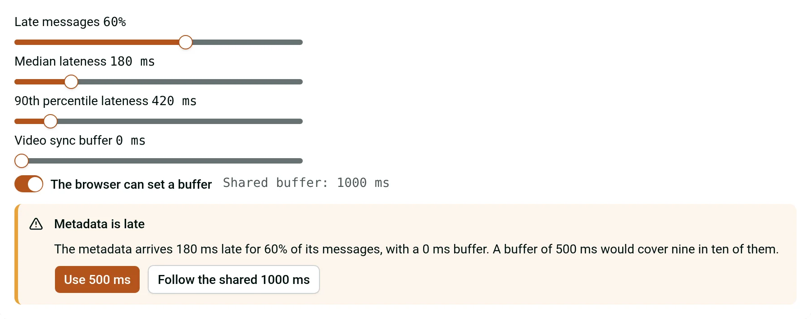

<!-- Written by `npm run docs:pages` from the kit and its examples. Do not edit. -->

# Metadata sync

_Components › Video_ · [All topics](../README.md)

What the "metadata late" notice says and offers, from the lateness figures and the sync buffer.

```ts
const notice = lateNoticeDetails(snapshot, bufferMs, bufferSupported, followedBufferMs);
```

<picture>
<source media="(prefers-color-scheme: dark)" srcset="../images/metadata-sync/late-notice.dark.webp">

</picture>

```ts
import { lateNoticeDetails, nextWarningActive, bufferSettleMs } from '@sima/neat-ui/video';
```

## Examples

### Late notice

The late-metadata notice of a channel, driven by sliders in place of the lateness a tile measures. Move the late share across the thresholds, and the buffer, to see the warning come, go and be held off. The notice's buttons use the suggested buffer here and either raise the shared buffer or follow it.

<picture>
<source media="(prefers-color-scheme: dark)" srcset="../images/metadata-sync/late-notice.dark.webp">

</picture>

<details>
<summary>Code</summary>

`1-late-notice.example.ts`

```ts
import {
  ChangeDetectionStrategy,
  Component,
  computed,
  DestroyRef,
  inject,
  linkedSignal,
  signal,
} from '@angular/core';
import { NeatButton } from '@sima/neat-ui';
import { NeatCallout } from '@sima/neat-ui/callout';
import { NeatSlider } from '@sima/neat-ui/slider';
import { NeatSwitch } from '@sima/neat-ui/switch';
import {
  bufferSettleMs,
  lateNoticeDetails,
  type NeatGlobalBufferAction,
  type NeatLateNoticeBlocker,
  nextWarningActive,
} from '@sima/neat-ui/video';

/** Why a notice has no suggestion to offer, in words. */
const BLOCKED: Record<NeatLateNoticeBlocker, string> = {
  unsupported: 'This browser cannot set a buffer.',
  unmeasured: 'No late message has been measured yet.',
  maximum: 'A buffer that covers it would pass the largest one.',
};

@Component({
  selector: 'app-late-notice',
  imports: [NeatButton, NeatCallout, NeatSlider, NeatSwitch],
  changeDetection: ChangeDetectionStrategy.OnPush,
  templateUrl: './1-late-notice.example.html',
  styleUrl: './late-notice.example.css',
})
export class LateNotice {
  protected readonly blocked = BLOCKED;
  protected readonly share = signal(60);
  protected readonly median = signal(180);
  protected readonly percentile = signal(420);
  protected readonly buffer = signal(0);
  protected readonly followed = signal(1000);
  protected readonly supported = signal(true);
  /** On from half the messages late, off below a tenth, as it was between. */
  protected readonly warning = linkedSignal<number, boolean>({
    source: this.share,
    computation: (share, previous) => nextWarningActive(previous?.value ?? false, share / 100),
  });
  /** How long the warning is held off after the buffer changed, in ms; null when it is not. */
  protected readonly held = signal<number | null>(null);
  protected readonly details = computed(() =>
    lateNoticeDetails(
      {
        recentLateShare: this.share() / 100,
        recentLatenessMedianMs: this.median(),
        recentLatenessP90Ms: this.percentile(),
      },
      this.buffer(),
      this.supported(),
      this.followed(),
    ),
  );

  private release: ReturnType<typeof setTimeout> | undefined;

  constructor() {
    inject(DestroyRef).onDestroy(() => clearTimeout(this.release));
  }

  protected setBuffer(next: number): void {
    const holdMs = bufferSettleMs(this.buffer(), next);
    this.buffer.set(next);
    this.held.set(holdMs);
    clearTimeout(this.release);
    this.release = setTimeout(() => this.held.set(null), holdMs);
  }

  /** Raising lifts the buffer the channels follow, then this channel takes it like the rest. */
  protected applyShared(action: NeatGlobalBufferAction): void {
    if (action.kind === 'raise') this.followed.set(action.valueMs);
    this.setBuffer(action.valueMs);
  }
}
```

`1-late-notice.example.html`

```html
<div class="sliders">
  <span
    >Late messages <span class="showcase-code">{{ share() }}%</span></span
  >
  <neat-slider label="Late messages" [min]="0" [max]="100" [step]="5" [(value)]="share" />
  <span
    >Median lateness <span class="showcase-code">{{ median() }} ms</span></span
  >
  <neat-slider label="Median lateness" [min]="0" [max]="1000" [step]="10" [(value)]="median" />
  <span
    >90th percentile lateness <span class="showcase-code">{{ percentile() }} ms</span></span
  >
  <neat-slider
    label="90th percentile lateness"
    [min]="0"
    [max]="4000"
    [step]="50"
    [(value)]="percentile"
  />
  <span
    >Video sync buffer <span class="showcase-code">{{ buffer() }} ms</span></span
  >
  <neat-slider
    label="Video sync buffer"
    [min]="0"
    [max]="4000"
    [step]="50"
    [value]="buffer()"
    (valueChange)="setBuffer($event)"
  />
</div>
<div class="showcase-row">
  <button neatSwitch [(checked)]="supported">The browser can set a buffer</button>
  <span class="showcase-code showcase-muted">Shared buffer: {{ followed() }} ms</span>
</div>
@if (held() !== null) {
  <p class="showcase-muted">Warning held off for {{ held() }} ms: the buffer changed.</p>
} @else if (warning()) {
  @let notice = details();
  <neat-callout tone="warning" heading="Metadata is late" region>
    The metadata arrives {{ notice.latenessMs }} ms late for {{ notice.latePercent }}% of its
    messages, with a {{ notice.bufferMs }} ms buffer.
    @if (notice.suggestedBufferMs !== null) {
      A buffer of {{ notice.suggestedBufferMs }} ms would cover nine in ten of them.
    }
    @if (notice.blockedBy; as why) {
      {{ blocked[why] }}
    }
    @if (notice.suggestedBufferMs !== null) {
      <button
        neatButton
        neatCalloutActions
        type="button"
        size="small"
        (click)="setBuffer(notice.suggestedBufferMs)"
      >
        Use {{ notice.suggestedBufferMs }} ms
      </button>
    }
    @if (notice.globalAction; as action) {
      <button
        neatButton
        neatCalloutActions
        type="button"
        size="small"
        variant="outlined"
        (click)="applyShared(action)"
      >
        {{ action.kind === 'raise' ? 'Raise the shared buffer to' : 'Follow the shared' }}
        {{ action.valueMs }} ms
      </button>
    }
  </neat-callout>
} @else {
  <p class="showcase-muted">No warning.</p>
}
```

`late-notice.example.css`

```css
:host {
  display: flex;
  flex-direction: column;
  gap: var(--neat-space-3);
}

/* A label with its value over its slider, the sliders a column of 20rem. */
.sliders {
  display: grid;
  gap: var(--neat-space-2);
  width: min(100%, 20rem);
  font-size: var(--neat-text-sm);
}
```

</details>

## API

### `lateNoticeDetails`

Function from `@sima/neat-ui/video`.

`snapshot` is the lateness window, [`NeatMetadataSnapshot`](../components/metadata-sync.md#neatmetadatasnapshot)'s `recent` figures. `currentBufferMs` is the video sync buffer. `bufferSupported` is whether the browser can set a buffer at all.

`followedBufferMs` is the value the app's channels follow, if it has one. It decides whether the second button raises it, or only lets this channel adopt it.

The suggested buffer covers the slowest tenth of the messages (the 90th percentile) plus a margin. It goes in steps of 50 ms, up to the 4000 ms maximum.

```ts
lateNoticeDetails(snapshot: NeatLatenessSnapshot, currentBufferMs: number, bufferSupported: boolean, followedBufferMs?: number | null): NeatLateNoticeDetails
```

### `nextWarningActive`

Function from `@sima/neat-ui/video`.

Whether the late-metadata warning is on after this sample.

It follows from whether the warning was on before, and the recent late share. The share is 0 to 1, or `null` when unknown, which changes nothing.

The warning turns on at half the messages late, and off below a tenth. In between it stays as it was, so a share hovering around one value does not make the chip blink.

```ts
nextWarningActive(active: boolean, recentLateShare: number | null): boolean
```

### `bufferSettleMs`

Function from `@sima/neat-ui/video`.

How long, in ms, to keep the late warning off after the video sync buffer changes.

The buffer changes from `previousBufferMs` to `nextBufferMs`. A browser moves to a raised jitter buffer target gradually, roughly 100 ms per second of video. What is measured until it has arrived still describes the old buffer.

The answer is a second, plus ten times the raise. A lowered buffer gets a second.

```ts
bufferSettleMs(previousBufferMs: number, nextBufferMs: number): number
```

### `NeatMetadataMessage`

Interface from `@sima/neat-ui/video`.

One metadata message from the stream's data channel. `_insight.rtp_timestamp` identifies the video frame the message describes; messages without it can only be matched by arrival order.

**Members**

- **`type`** `string`

- **`timestamp`** `number`, optional

- **`frame_id`** `unknown`, optional

- **`data`** `unknown`, optional

- **`_insight`** `{ rtp_timestamp?: number }`, optional

### `NeatMetadataSnapshot`

Interface from `@sima/neat-ui/video`.

What a tile's metadata queue holds and how late it has been, from [`NeatVideoTile.snapshot`](../components/video-tile.md#neatvideotile).

It holds the cumulative counters and the messages still waiting for a frame. Then it holds the lateness of the last five seconds, which the app's lateness notice reads. The `recent` figures are `null` while the window has too little to say.

**Members**

- **`timestampedPending`** `number`

- **`arrivalPending`** `number`

- **`recentLateShare`** `number | null`

  Null until the window holds enough messages for a share to mean anything.

- **`recentLatenessMedianMs`** `number | null`

  Null while the window holds no late message whose frame is still remembered.

- **`recentLatenessP90Ms`** `number | null`

- **`recentLatenessMaxMs`** `number | null`

### `NeatMetadataQueueStats`

Interface from `@sima/neat-ui/video`.

Cumulative counters; they survive `resetLatenessWindow`.

**Members**

- **`timestampMatches`** `number`

- **`arrivalFallbacks`** `number`

- **`frameMisses`** `number`

- **`expired`** `number`

- **`evicted`** `number`

- **`untimestampedReceived`** `number`

- **`late`** `number`

### `NeatLatenessSnapshot`

Type from `@sima/neat-ui/video`.

The part of a queue snapshot that the late notice reads.

```ts
type NeatLatenessSnapshot = Pick<
  NeatMetadataSnapshot,
  'recentLateShare' | 'recentLatenessMedianMs' | 'recentLatenessP90Ms'
>
```

### `NeatLateNoticeDetails`

Interface from `@sima/neat-ui/video`.

What an app's "metadata late" notice shows and offers, from [`lateNoticeDetails`](../components/metadata-sync.md#latenoticedetails).

It holds:

- how late the metadata is, as the median in ms and the share of messages in percent;
- the video sync buffer in use, and the suggested one;
- why none is suggested, if so;
- the action for the global setting.

**Members**

- **`latenessMs`** `number | null`

- **`latePercent`** `number | null`

- **`bufferMs`** `number`

- **`suggestedBufferMs`** `number | null`

- **`blockedBy`** `NeatLateNoticeBlocker | null`

- **`globalAction`** `NeatGlobalBufferAction | null`

### `NeatLateNoticeBlocker`

Type from `@sima/neat-ui/video`.

Why no buffer is suggested: the browser cannot set one, the window has no lateness sample, or the suggestion would pass the maximum.

```ts
type NeatLateNoticeBlocker = 'unsupported' | 'unmeasured' | 'maximum'
```

### `NeatGlobalBufferAction`

Interface from `@sima/neat-ui/video`.

The notice's second button: `raise` or `follow`.

`raise` lifts the value the channels follow to the suggestion. `follow` only lets this channel adopt the followed value, which already covers it.

**Members**

- **`kind`** `'raise' | 'follow'`

- **`valueMs`** `number`
