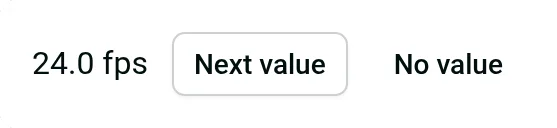
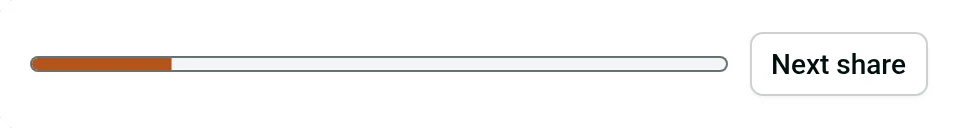
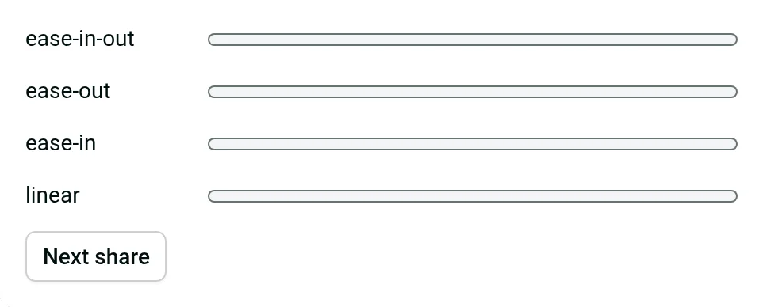

<!-- Written by `npm run docs:pages` from the kit and its examples. Do not edit. -->

# Motion

_Components › Status_ · [All topics](../README.md)

A number signal that eases to each new value of `source` instead of jumping.

```ts
readonly shownFps = neatEased(this.fps);
```

<picture>
<source media="(prefers-color-scheme: dark)" srcset="../images/motion/eased-number.dark.webp">

</picture>

```ts
import { neatEased, NeatEasedNumber, NEAT_EASINGS } from '@sima/neat-ui';
```

## Examples

### Eased number

A frame rate that eases to each value instead of jumping. Press Next value for a step, and No value for the dash: the next value after it appears at once, as the first one did.

<picture>
<source media="(prefers-color-scheme: dark)" srcset="../images/motion/eased-number.dark.webp">

</picture>

<details>
<summary>Code</summary>

`1-eased-number.example.ts`

```ts
import { ChangeDetectionStrategy, Component, signal } from '@angular/core';
import { NeatButton, NeatEasedNumber } from '@sima/neat-ui';

/** The values the number moves through, in turn: steps up and down, small and large. */
const FPS_VALUES = [24, 29.9, 12.4, 18.2];

@Component({
  selector: 'app-eased-number',
  imports: [NeatButton, NeatEasedNumber],
  changeDetection: ChangeDetectionStrategy.OnPush,
  template: `
    <div class="showcase-row">
      <span><neat-eased-number [value]="fps()" [digits]="1" /> fps</span>
      <button neatButton type="button" variant="outlined" size="small" (click)="next()">
        Next value
      </button>
      <button neatButton type="button" variant="text" size="small" (click)="fps.set(null)">
        No value
      </button>
    </div>
  `,
})
export class EasedNumber {
  protected readonly fps = signal<number | null>(FPS_VALUES[0]);
  private index = 0;

  protected next(): void {
    this.index = (this.index + 1) % FPS_VALUES.length;
    this.fps.set(FPS_VALUES[this.index]);
  }
}
```

</details>

### Eased signal

A progress bar whose value is [`neatEased`](../components/motion.md#neateased) of a signal: the signal jumps on every press, the bar eases to it, and nothing else in the component deals with the animation.

<picture>
<source media="(prefers-color-scheme: dark)" srcset="../images/motion/eased-signal.dark.webp">

</picture>

<details>
<summary>Code</summary>

`2-eased-signal.example.ts`

```ts
import { ChangeDetectionStrategy, Component, computed, signal } from '@angular/core';
import { NeatButton, neatEased } from '@sima/neat-ui';
import { NeatProgress } from '@sima/neat-ui/progress';

/** The shares the bar moves through, in turn, in percent. */
const SHARES = [20, 85, 40, 100];

@Component({
  selector: 'app-eased-signal',
  imports: [NeatButton, NeatProgress],
  changeDetection: ChangeDetectionStrategy.OnPush,
  template: `
    <neat-progress label="Share" [value]="value()" />
    <button neatButton type="button" variant="outlined" size="small" (click)="next()">
      Next share
    </button>
  `,
  styleUrl: './eased-signal.example.css',
})
export class EasedSignal {
  private readonly share = signal(SHARES[0]);
  private readonly eased = neatEased(this.share);
  protected readonly value = computed(() => this.eased() ?? 0);
  private index = 0;

  protected next(): void {
    this.index = (this.index + 1) % SHARES.length;
    this.share.set(SHARES[this.index]);
  }
}
```

`eased-signal.example.css`

```css
/* The bar takes the row's width beside its button. */
:host {
  display: grid;
  grid-template-columns: minmax(0, 1fr) auto;
  align-items: center;
  gap: var(--neat-space-3);
  max-width: 28rem;
}
```

</details>

### Curves

One bar per curve of the catalog, each fed [`neatEased`](../components/motion.md#neateased) of the same share with its own `easing`, so a single press moves all four side by side: ease-in-out, the default, starts and settles gently, ease-out starts fast, ease-in starts slow, and linear keeps one pace.

<picture>
<source media="(prefers-color-scheme: dark)" srcset="../images/motion/curves.dark.webp">

</picture>

<details>
<summary>Code</summary>

`3-curves.example.ts`

```ts
import { ChangeDetectionStrategy, Component, computed, signal } from '@angular/core';
import { NEAT_EASINGS, NeatButton, type NeatEasingName, neatEased } from '@sima/neat-ui';
import { NeatProgress } from '@sima/neat-ui/progress';

/** The shares the bars move through, in turn, in percent. */
const SHARES = [0, 100];

/** The catalog's names, in the order the bars stand. */
const CURVES = Object.keys(NEAT_EASINGS) as NeatEasingName[];

@Component({
  selector: 'app-curves',
  imports: [NeatButton, NeatProgress],
  changeDetection: ChangeDetectionStrategy.OnPush,
  template: `
    @for (bar of bars; track bar.curve) {
      <span class="name">{{ bar.curve }}</span>
      <neat-progress [label]="bar.curve" [value]="bar.value()" />
    }
    <button neatButton type="button" variant="outlined" size="small" (click)="next()">
      Next share
    </button>
  `,
  styleUrl: './curves.example.css',
})
export class Curves {
  private readonly share = signal(SHARES[0]);
  protected readonly bars = CURVES.map((curve) => {
    const eased = neatEased(this.share, { easing: curve });
    return { curve, value: computed(() => eased() ?? 0) };
  });
  private index = 0;

  protected next(): void {
    this.index = (this.index + 1) % SHARES.length;
    this.share.set(SHARES[this.index]);
  }
}
```

`curves.example.css`

```css
/* Each bar takes the row's width beside its name; the button stands under them. */
:host {
  display: grid;
  grid-template-columns: 6.5rem minmax(0, 1fr);
  align-items: center;
  gap: var(--neat-space-3);
  max-width: 28rem;
  font-size: var(--neat-text-sm);
}

button {
  grid-column: 1 / -1;
  justify-self: start;
}
```

</details>

## API

### `neatEased`

Function from `@sima/neat-ui`.

A figure that updates twice a second then reads as moving rather than flickering. Call it in an injection context.

It takes 400 ms, or `durationMs`. The curve is `easing`, `'ease-in-out'` unless told otherwise. Take a catalog name first, so apps share one way of moving, and a function only where no name fits. A signal of either may switch the curve while a value is moving, and the next frame follows the new one.

A curve that overshoots shows more than the target on the way. The last frame shows the target exactly.

The first value, and a value that follows none (null or undefined), appears at once. Null and undefined pass through as they are. Under a reduced-motion setting it follows `source` at once.

Frames are asked for only while it moves, and canceled when its injector is destroyed.

```ts
neatEased(source: Signal<number | null | undefined>, options: { durationMs?: number; easing?: NeatEasing | Signal<NeatEasing> } = {}): Signal<number | null | undefined>
```

### `NeatEasedNumber`

Component from `@sima/neat-ui`, selector `neat-eased-number`.

A figure that eases to each new value instead of jumping.

```html
<neat-eased-number [value]="fps()" [digits]="1" /> fps
```

It moves as [`neatEased`](../components/motion.md#neateased) does. Its first value shows at once, and "–" stands in while there is none. Its digits are tabular, so a moving value keeps its width.

It is the number only: the unit and the words around it are the app's.

**Inputs**

- **`value`** `number | null | undefined`

  The value to show; null or undefined while there is none.

- **`digits`** `number`, default `0`

  Digits after the decimal point.

- **`easing`** `NeatEasing`, default `'ease-in-out'`

  The curve it moves by; a catalog name, or a function where none fits.

### `NEAT_EASINGS`

Constant from `@sima/neat-ui`.

The catalog: cubic curves, so they differ in where they hurry and where they settle.

```ts
const NEAT_EASINGS: Readonly<Record<NeatEasingName, (t: number) => number>>
```

### `NeatEasing`

Type from `@sima/neat-ui`.

A curve for [`neatEased`](../components/motion.md#neateased): a catalog name, or a function.

Prefer a name, so every app moves the same way. A function, from `t` to the eased share (0 at 0, 1 at 1), is for the rare motion no name fits.

```ts
type NeatEasing = NeatEasingName | ((t: number) => number)
```

### `NeatEasingName`

Type from `@sima/neat-ui`.

The kit's named easing curves: a progress `t` from 0 to 1 in, the eased share out.

```ts
type NeatEasingName = 'ease-in-out' | 'ease-out' | 'ease-in' | 'linear'
```
