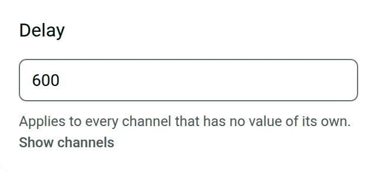

<!-- Written by `npm run docs:pages` from the kit and its examples. Do not edit. -->

# Note

_Components › Status_ · [All topics](../README.md)

A short note under a control or a heading, in small muted text.

```html
<p neatNote>Applies to every channel without its own value.</p>
```

<picture>
<source media="(prefers-color-scheme: dark)" srcset="../images/note/under-a-control.dark.webp">

</picture>

```ts
import { NeatNote } from '@sima/neat-ui';
```

## Examples

### Under a control

A note under the input it describes (`aria-describedby`), with an inline button in its text.

<picture>
<source media="(prefers-color-scheme: dark)" srcset="../images/note/under-a-control.dark.webp">

</picture>

<details>
<summary>Code</summary>

`1-under-a-control.example.ts`

```ts
import { ChangeDetectionStrategy, Component } from '@angular/core';
import { NeatInlineButton, NeatNote } from '@sima/neat-ui';
import { NeatInput } from '@sima/neat-ui/input';

@Component({
  selector: 'app-under-a-control',
  imports: [NeatInlineButton, NeatInput, NeatNote],
  changeDetection: ChangeDetectionStrategy.OnPush,
  templateUrl: './1-under-a-control.example.html',
  styleUrl: './under-a-control.example.css',
})
export class UnderAControl {}
```

`1-under-a-control.example.html`

```html
<label class="showcase-row">
  Delay
  <input neatInput type="text" value="600" aria-describedby="delay-note" />
</label>
<p neatNote id="delay-note">
  Applies to every channel that has no value of its own.
  <button neatInlineButton type="button">Show channels</button>
</p>
```

`under-a-control.example.css`

```css
/* A column the width of an aside's control, so the note wraps as it does under one. */
:host {
  display: flex;
  flex-direction: column;
  gap: var(--neat-space-2);
  width: 18rem;
}
```

</details>

## API

### `NeatNote`

Directive from `@sima/neat-ui`, selector `[neatNote]`.

It has no margin. It sets the look only: the words, and any role, are the app's.

A `neatInlineButton` inside takes the note's size and color. So an action set into the note ("Show", "Use global") reads like the words around it.
