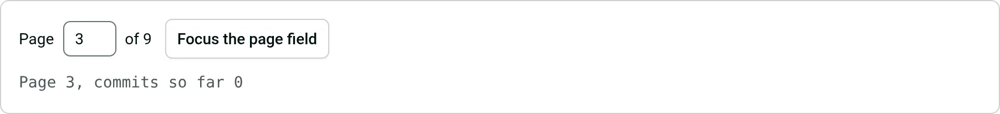

<!-- Written by `npm run docs:pages` from the kit and its examples. Do not edit. -->

# Number field

_Components › Forms_ · [All topics](../README.md)

A small field for one whole number, with its label before it: `<neat-number-field label="Page" [value]="page" [accept]="inRange" (commit)="goTo($event)"><span neatNumberFieldSuffix>of 9</span></neat-number-field>`. It is for jumping to a number, as a page or a channel.

<picture>
<source media="(prefers-color-scheme: dark)" srcset="../images/number-field/page-with-a-limit.dark.webp">

</picture>

```ts
import { NeatNumberField } from '@sima/neat-ui/number-field';
```

## Examples

### Page with a limit

A page field that accepts 1 to 9, with "of 9" after the input. Type 12 or a word and press Enter: the shown number comes back and the count stays. Commit 5, or the shown number again, and the count goes up. The button calls `focus()`.

<picture>
<source media="(prefers-color-scheme: dark)" srcset="../images/number-field/page-with-a-limit.dark.webp">

</picture>

<details>
<summary>Code</summary>

`1-page-with-a-limit.example.ts`

```ts
import { ChangeDetectionStrategy, Component, signal } from '@angular/core';
import { NeatButton } from '@sima/neat-ui';
import { NeatNumberField } from '@sima/neat-ui/number-field';

const PAGE_COUNT = 9;

@Component({
  selector: 'app-page-with-a-limit',
  imports: [NeatButton, NeatNumberField],
  changeDetection: ChangeDetectionStrategy.OnPush,
  template: `
    <div class="showcase-row">
      <neat-number-field
        #pageField
        label="Page"
        [value]="page()"
        [accept]="acceptPage"
        (commit)="commit($event)"
      >
        <span neatNumberFieldSuffix>of {{ pageCount }}</span>
      </neat-number-field>
      <button neatButton type="button" variant="outlined" (click)="pageField.focus()">
        Focus the page field
      </button>
    </div>
    <p class="showcase-code showcase-muted">Page {{ page() }}, commits so far {{ commits() }}</p>
  `,
  styleUrl: './stack.css',
})
export class PageWithALimit {
  protected readonly pageCount = PAGE_COUNT;
  protected readonly page = signal(3);
  protected readonly commits = signal(0);
  protected readonly acceptPage = (n: number) => n >= 1 && n <= PAGE_COUNT;

  protected commit(page: number): void {
    this.page.set(page);
    this.commits.update((count) => count + 1);
  }
}
```

`stack.css`

```css
/* The example's rows one gap apart. */
:host {
  display: flex;
  flex-direction: column;
  gap: var(--neat-space-3);
}
```

</details>

### Any whole number

A field without `accept`: type 0 or 4096 and it commits, as any whole number does.

<picture>
<source media="(prefers-color-scheme: dark)" srcset="../images/number-field/any-whole-number.dark.webp">

</picture>

<details>
<summary>Code</summary>

`2-any-whole-number.example.ts`

```ts
import { ChangeDetectionStrategy, Component, signal } from '@angular/core';
import { NeatNumberField } from '@sima/neat-ui/number-field';

@Component({
  selector: 'app-any-whole-number',
  imports: [NeatNumberField],
  changeDetection: ChangeDetectionStrategy.OnPush,
  template: `
    <neat-number-field label="Draw on channel" [value]="channel()" (commit)="channel.set($event)" />
    <p class="showcase-code showcase-muted">Channel {{ channel() }}</p>
  `,
  styleUrl: './stack.css',
})
export class AnyWholeNumber {
  protected readonly channel = signal(2);
}
```

`stack.css`

```css
/* The example's rows one gap apart. */
:host {
  display: flex;
  flex-direction: column;
  gap: var(--neat-space-3);
}
```

</details>

## API

### `NeatNumberField`

Component from `@sima/neat-ui/number-field`, selector `neat-number-field`.

The field shows `value`. Typing changes nothing outside until the user commits with Enter or by leaving the field; `commit` then carries the number if it is whole digits that `accept` takes, even when it equals `value`, so an owner can treat a number the user typed as a choice. Anything else puts `value` back in the field and emits nothing. Leaving a field that was not typed in emits nothing, so tabbing past it chooses nothing; Enter always commits what is shown.

The owner is expected to take what it accepted: after a commit the field shows that number until `value` changes. Content marked `neatNumberFieldSuffix` follows the input, such as "of 9".

**Inputs**

- **`label`** `string`, required

  Shown before the input, and its accessible name.

- **`value`** `number`, required

  The number the field shows.

- **`accept`** `(n: number) => boolean`, default `() => true`

  Whether the owner takes a whole number; the default takes any.

**Outputs**

- **`commit`** `number`

  A whole number the user committed and `accept` took.

**Methods**

- **`focus`**

  ```ts
  focus(): void
  ```

  Focuses the input with its number selected, so what the user types replaces it: for a shortcut that jumps to the field, such as "g" for the page.
