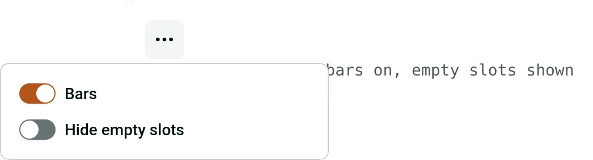
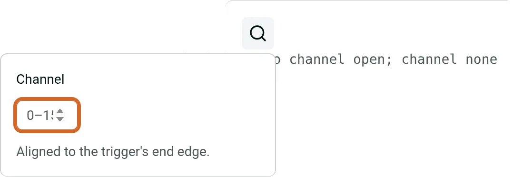

<!-- Written by `npm run docs:pages` from the kit and its examples. Do not edit. -->

# Popover

_Components › Actions_ · [All topics](../README.md)

A panel of controls that opens below a button and stays open while they are used:

```html
<neat-popover label="View options" align="end" [(open)]="viewOptionsOpen">
  <button neatButton neatPopoverTrigger iconOnly aria-label="View options">…</button>
  <ng-template neatPopoverContent>…</ng-template>
</neat-popover>
```

<picture>
<source media="(prefers-color-scheme: dark)" srcset="../images/popover/menu.dark.webp">

</picture>

```ts
import { NeatPopover, NeatPopoverTrigger, NeatPopoverContent, NeatPopoverItem, NeatPopoverDivider } from '@sima/neat-ui/popover';
```

## Examples

### Switches in a panel

A panel of view options below an icon-only trigger. `[(open)]` follows the trigger, Escape and outside clicks.

The switches' values live in the page, since the content is created on opening and destroyed on closing. Try reopening the panel: they are as they were.

<picture>
<source media="(prefers-color-scheme: dark)" srcset="../images/popover/switches-in-a-panel.dark.webp">

</picture>

<details>
<summary>Code</summary>

`1-switches-in-a-panel.example.ts`

```ts
import { ChangeDetectionStrategy, Component, signal } from '@angular/core';
import { NeatButton, NeatIcon, NeatTooltip } from '@sima/neat-ui';
import { NeatPopover, NeatPopoverContent, NeatPopoverTrigger } from '@sima/neat-ui/popover';
import { NeatSwitch } from '@sima/neat-ui/switch';

@Component({
  selector: 'app-switches-in-a-panel',
  imports: [
    NeatButton,
    NeatIcon,
    NeatPopover,
    NeatPopoverContent,
    NeatPopoverTrigger,
    NeatSwitch,
    NeatTooltip,
  ],
  changeDetection: ChangeDetectionStrategy.OnPush,
  templateUrl: './1-switches-in-a-panel.example.html',
  styleUrl: './popover-fields.css',
})
export class SwitchesInAPanel {
  protected readonly open = signal(false);
  protected readonly bars = signal(true);
  protected readonly hideEmpty = signal(false);
}
```

`1-switches-in-a-panel.example.html`

```html
<neat-popover label="View options" [(open)]="open">
  <button
    neatButton
    neatPopoverTrigger
    type="button"
    variant="text"
    iconOnly
    aria-label="View options"
    neatTooltip="View options"
  >
    <neat-icon name="more" />
  </button>
  <ng-template neatPopoverContent>
    <div class="popover-fields">
      <button neatSwitch [(checked)]="bars">Bars</button>
      <button neatSwitch [(checked)]="hideEmpty">Hide empty slots</button>
    </div>
  </ng-template>
</neat-popover>
<p class="showcase-code showcase-muted">
  View options {{ open() ? 'open' : 'closed' }}; bars {{ bars() ? 'on' : 'off' }}, empty slots
  {{ hideEmpty() ? 'hidden' : 'shown' }}
</p>
```

`popover-fields.css`

```css
/* A popover's content is the app's to lay out: here a column of fields. */
.popover-fields {
  display: flex;
  flex-direction: column;
  align-items: flex-start;
  gap: var(--neat-space-3);
}
```

</details>

### Aligned to the end

A number field in a panel with `align="end"`, for a trigger at the right edge of a toolbar. The panel lines up with the trigger's end, and opens inward. Focus moves to the field when the panel opens.

<picture>
<source media="(prefers-color-scheme: dark)" srcset="../images/popover/aligned-to-the-end.dark.webp">

</picture>

<details>
<summary>Code</summary>

`2-aligned-to-the-end.example.ts`

```ts
import { ChangeDetectionStrategy, Component, signal } from '@angular/core';
import { NeatButton, NeatIcon, NeatTooltip } from '@sima/neat-ui';
import { NeatInput } from '@sima/neat-ui/input';
import { NeatPopover, NeatPopoverContent, NeatPopoverTrigger } from '@sima/neat-ui/popover';

@Component({
  selector: 'app-aligned-to-the-end',
  imports: [
    NeatButton,
    NeatIcon,
    NeatInput,
    NeatPopover,
    NeatPopoverContent,
    NeatPopoverTrigger,
    NeatTooltip,
  ],
  changeDetection: ChangeDetectionStrategy.OnPush,
  templateUrl: './2-aligned-to-the-end.example.html',
  styleUrl: './popover-fields.css',
})
export class AlignedToTheEnd {
  protected readonly open = signal(false);
  protected readonly channel = signal('');
}
```

`2-aligned-to-the-end.example.html`

```html
<neat-popover label="Go to channel" align="end" [(open)]="open">
  <button
    neatButton
    neatPopoverTrigger
    type="button"
    variant="text"
    iconOnly
    aria-label="Go to channel"
    neatTooltip="Go to channel"
  >
    <neat-icon name="search" />
  </button>
  <ng-template neatPopoverContent>
    <div class="popover-fields">
      <label class="popover-fields">
        <span>Channel</span>
        <input
          #field
          neatInput
          size="small"
          type="number"
          inputmode="numeric"
          min="0"
          max="15"
          placeholder="0–15"
          aria-describedby="channel-hint"
          [value]="channel()"
          (input)="channel.set(field.value)"
        />
      </label>
      <span id="channel-hint" class="showcase-muted">Aligned to the trigger's end edge.</span>
    </div>
  </ng-template>
</neat-popover>
<p class="showcase-code showcase-muted">
  Go to channel {{ open() ? 'open' : 'closed' }}; channel {{ channel() || 'none' }}
</p>
```

`popover-fields.css`

```css
/* A popover's content is the app's to lay out: here a column of fields. */
.popover-fields {
  display: flex;
  flex-direction: column;
  align-items: flex-start;
  gap: var(--neat-space-3);
}
```

</details>

### Menu

A ⋯ menu: the rows are `neatPopoverItem` buttons, a `neatPopoverDivider` sets the destructive one apart, and a disabled row keeps its place. The first enabled row takes the focus when the menu opens.

<picture>
<source media="(prefers-color-scheme: dark)" srcset="../images/popover/menu.dark.webp">

</picture>

<details>
<summary>Code</summary>

`3-menu.example.ts`

```ts
import { ChangeDetectionStrategy, Component } from '@angular/core';
import { NeatButton, NeatIcon, NeatTooltip } from '@sima/neat-ui';
import {
  NeatPopover,
  NeatPopoverContent,
  NeatPopoverDivider,
  NeatPopoverItem,
  NeatPopoverTrigger,
} from '@sima/neat-ui/popover';

@Component({
  selector: 'app-menu',
  imports: [
    NeatButton,
    NeatIcon,
    NeatPopover,
    NeatPopoverContent,
    NeatPopoverDivider,
    NeatPopoverItem,
    NeatPopoverTrigger,
    NeatTooltip,
  ],
  changeDetection: ChangeDetectionStrategy.OnPush,
  templateUrl: './3-menu.example.html',
})
export class Menu {}
```

`3-menu.example.html`

```html
<neat-popover label="Channel actions" align="end">
  <button
    neatButton
    neatPopoverTrigger
    type="button"
    variant="text"
    iconOnly
    aria-label="Channel actions"
    neatTooltip="Channel actions"
  >
    <neat-icon name="more" />
  </button>
  <ng-template neatPopoverContent>
    <button neatPopoverItem type="button">Rename</button>
    <button neatPopoverItem type="button">Duplicate</button>
    <button neatPopoverItem type="button" disabled>Move…</button>
    <hr neatPopoverDivider />
    <button neatPopoverItem type="button">Delete</button>
  </ng-template>
</neat-popover>
```

</details>

## API

### `NeatPopover`

Component from `@sima/neat-ui/popover`, selector `neat-popover`.

The panel is a non-modal dialog named by `label`, on the popover surface. `align` lines it up with the trigger's start, center or end. It flips above the trigger when there is no room below.

The content template is created on opening and destroyed on closing. So keep its state, such as a typed value or a checked switch, in the page.

On opening, focus moves to the panel's first enabled control. Escape, a click outside, the trigger, or `open` set to false close it. Focus then goes back to the trigger, unless the closing click put it somewhere else. Setting `open` to true opens it as the trigger does, which is how a keyboard shortcut opens it.

The panel is rendered at the end of the document, so the browser's Tab order does not pass through it from the trigger. The kit carries the focus across by hand:

- Tab from the panel's last control closes it and focuses the first tabbable element after the trigger.
- Shift+Tab from its first control closes it and focuses the trigger.
- Focus arriving anywhere else outside the trigger and the panel closes it too, and stays where it went. It arrives there by a click on another control, Tab from the trigger, or a second popover opening.
- Focus arriving in an overlay opened from the panel, such as a [`NeatConfirm`](../components/confirm.md#neatconfirm), does not close it.

In the page toolbar, an open popover keeps the kiosk bar shown ([`KioskService.holdToolbar`](../layout/shell.md#kioskservice)). The panel lies outside the bar, so a pointer resting on it would otherwise fade the bar out.

**Inputs**

- **`label`** `string`, required

  The panel's accessible name.

- **`align`** `'start' | 'center' | 'end'`

  Which edge of the trigger the panel lines up with: `start`, `center` (the default) or `end`. Use `end` for a trigger at the right edge of a toolbar, so the panel opens inward.

**Models (two-way)**

- **`open`** `boolean`, default `false`

  Whether the panel is open; it follows the trigger, Escape and outside clicks.

**Methods**

- **`toggle`**

  ```ts
  toggle(): void
  ```

  Opens or closes the panel, as the trigger does.

### `NeatPopoverTrigger`

Directive from `@sima/neat-ui/popover`, selector `button[neatPopoverTrigger]`.

The button that opens and closes a `neat-popover`.

```html
<neat-popover label="View options">
  <button neatButton neatPopoverTrigger type="button">View</button>
  <ng-template neatPopoverContent>…</ng-template>
</neat-popover>
```

Put it inside the `neat-popover`. It can be a `neatButton` with a tooltip as well. It announces the dialog it opens (`aria-haspopup`, `aria-expanded`), and names the panel in `aria-controls` while it is open.

### `NeatPopoverContent`

Template directive from `@sima/neat-ui/popover`, selector `ng-template[neatPopoverContent]`.

The panel's content: `<ng-template neatPopoverContent>…</ng-template>` inside `neat-popover`.

### `NeatPopoverItem`

Directive from `@sima/neat-ui/popover`, selector `button[neatPopoverItem]`.

A menu row of a `neat-popover`'s panel (the ⋯ menu): `<button neatPopoverItem>` inside the content. It fills the panel's width, text at the start, and touches the next row. Rows are plain buttons in the order they are written, which is their Tab order.

### `NeatPopoverDivider`

Directive from `@sima/neat-ui/popover`, selector `hr[neatPopoverDivider]`.

A line between two groups of menu rows: `<hr neatPopoverDivider />` among the items. It is a horizontal `hr` with Spartan's separator classes and a `separator` role, so it sets groups of rows apart for assistive technology too.

### `NeatPopoverAlign`

Type from `@sima/neat-ui/popover`.

Which edge of the trigger the panel lines up with: its `start`, its `center` or its `end`.

```ts
type NeatPopoverAlign = 'start' | 'center' | 'end'
```
