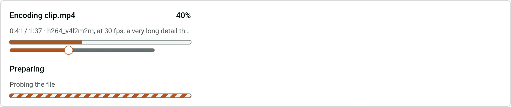
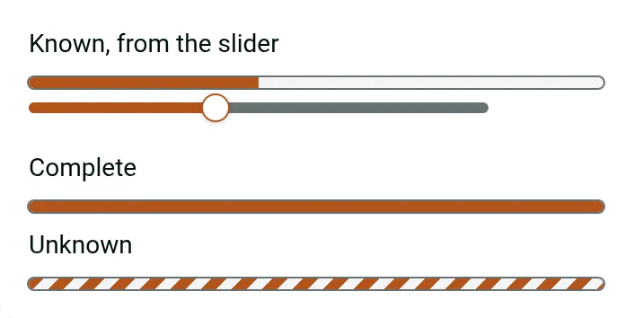

<!-- Written by `npm run docs:pages` from the kit and its examples. Do not edit. -->

# Progress

_Components › Status_ · [All topics](../README.md)

A horizontal progress bar.

```html
<neat-progress label="Uploading clip.mp4" [value]="percent" />
```

<picture>
<source media="(prefers-color-scheme: dark)" srcset="../images/progress/titled-readout.dark.webp">

</picture>

```ts
import { NeatProgress } from '@sima/neat-ui/progress';
```

## Examples

### Known and unknown

Three bars: the first follows the slider under it, the second is complete, and the third has no value, so it moves on its own.

<picture>
<source media="(prefers-color-scheme: dark)" srcset="../images/progress/known-and-unknown.dark.webp">

</picture>

<details>
<summary>Code</summary>

`1-known-and-unknown.example.ts`

```ts
import { ChangeDetectionStrategy, Component, signal } from '@angular/core';
import { NeatProgress } from '@sima/neat-ui/progress';
import { NeatSlider } from '@sima/neat-ui/slider';

@Component({
  selector: 'app-known-and-unknown',
  imports: [NeatProgress, NeatSlider],
  changeDetection: ChangeDetectionStrategy.OnPush,
  template: `
    <span>Known, from the slider</span>
    <neat-progress label="Upload" [value]="progress()" />
    <neat-slider
      class="slider"
      label="Progress value"
      [min]="0"
      [max]="100"
      [step]="5"
      [(value)]="progress"
    />
    <span>Complete</span>
    <neat-progress label="Import" [value]="100" />
    <span>Unknown</span>
    <neat-progress label="Preparing" [value]="null" />
  `,
  styleUrl: './stack.css',
})
export class KnownAndUnknown {
  protected readonly progress = signal(40);
}
```

`stack.css`

```css
/* A bar fills its container's width, so the examples give it a column; the slider has its own. */
:host {
  display: flex;
  flex-direction: column;
  gap: var(--neat-space-2);
  width: 20rem;
  font-size: var(--neat-text-sm);
}

.slider {
  width: 16rem;
  margin-bottom: var(--neat-space-3);
}
```

</details>

### Titled readout

The first readout follows the slider, and its detail is longer than the line: it is cut at the end, and hovering it shows the whole text. The second has no value, so it has no percent.

<picture>
<source media="(prefers-color-scheme: dark)" srcset="../images/progress/titled-readout.dark.webp">

</picture>

<details>
<summary>Code</summary>

`2-titled-readout.example.ts`

```ts
import { ChangeDetectionStrategy, Component, signal } from '@angular/core';
import { NeatProgress } from '@sima/neat-ui/progress';
import { NeatSlider } from '@sima/neat-ui/slider';

@Component({
  selector: 'app-titled-readout',
  imports: [NeatProgress, NeatSlider],
  changeDetection: ChangeDetectionStrategy.OnPush,
  template: `
    <neat-progress
      heading="Encoding clip.mp4"
      detail="0:41 / 1:37 · h264_v4l2m2m, at 30 fps, a very long detail that cuts at the end"
      [value]="progress()"
    />
    <neat-slider
      class="slider"
      label="Encoded share"
      [min]="0"
      [max]="100"
      [step]="5"
      [(value)]="progress"
    />
    <neat-progress heading="Preparing" detail="Probing the file" [value]="null" />
  `,
  styleUrl: './stack.css',
})
export class TitledReadout {
  protected readonly progress = signal(40);
}
```

`stack.css`

```css
/* A bar fills its container's width, so the examples give it a column; the slider has its own. */
:host {
  display: flex;
  flex-direction: column;
  gap: var(--neat-space-2);
  width: 20rem;
  font-size: var(--neat-text-sm);
}

.slider {
  width: 16rem;
  margin-bottom: var(--neat-space-3);
}
```

</details>

## API

### `NeatProgress`

Component from `@sima/neat-ui/progress`, selector `neat-progress`.

`value` is 0 to 100, or `null` while the work cannot say how far along it is. The bar then moves on its own. Under a reduced-motion setting it is a still bar of stripes.

A value outside the range is held to it, and one that is not a number counts as unknown. So a sloppy caller gets a bar, not an error.

With a `heading` it is a titled readout, for work the user watches: an import, an encode, a progress toast. It shows the heading with the whole percent at its line's end, the `detail` under it, then the bar. The detail is one line, cut with its full text as a tooltip, and left out while empty. The progress toast of [`NeatToasts`](../components/toast.md#neattoasts) renders through it:

```html
<neat-progress heading="Uploading 3 files" [detail]="'clip.mp4 · file 1 of 3'" [value]="41" />
```

The heading is a polite `role="status"`. A screen reader hears it when it changes, from "Uploading" to "Preparing" say. It does not hear the percent or the detail, which change too often to be read out. The input is named `heading` rather than `title`, so that a static attribute does not also become the native tooltip of the whole element.

`label` is the bar's accessible name, the heading by default. The bar is `role="progressbar"`, with `aria-valuenow` (left out while unknown), `aria-valuemin` and `aria-valuemax`, and a percent as `aria-valuetext`. A bar alone announces nothing as it changes, which is a progressbar's way. So give a bar without a heading a `label`.

It fills the width its container gives it, from the left: the kit has no right-to-left layout.

**Inputs**

- **`value`** `number | null`, required

  0 to 100, or `null` while unknown.

- **`label`** `string`, default `''`

  The bar's accessible name, announced with the value; the heading by default.

- **`heading`** `string`, default `''`

  Shown over the bar with the percent: a titled readout. None while empty.

- **`detail`** `string`, default `''`

  A line under the heading: what is being worked on now. None while empty.
