<!-- Written by `npm run docs:pages` from the kit and its examples. Do not edit. -->

# Push-to-talk

_Components › Chat_ · [All topics](../README.md)

The button a visitor holds to ask by voice, or taps once to start and again to stop.

```html
<neat-push-to-talk
  [transcribing]="transcribing()"
  (recorded)="transcribe($event)"
/>
```

<picture>
<source media="(prefers-reduced-motion: reduce) and (prefers-color-scheme: dark)" srcset="../images/push-to-talk/push-to-talk.dark.webp">
<source media="(prefers-reduced-motion: reduce)" srcset="../images/push-to-talk/push-to-talk.light.webp">
<source media="(prefers-color-scheme: dark)" srcset="../images/push-to-talk/push-to-talk.dark.animated.webp">

</picture>

```ts
import { NeatPushToTalk, NEAT_LISTENING_MOTIONS } from '@sima/neat-ui/chat';
```

## Examples

### Push to talk

Push-to-talk on its own: hold the button and speak, or tap it to start and tap again to stop. The voice shows as the listening motion says while it records: a ring round the button that swells with it (in the message box, its default, which inside the box also draws a waveform), or radial bars. The example shows the last recording's length and size and plays it back; an app would send it to speech-to-text instead, and show `transcribing` meanwhile, as the example does for a moment. The browser asks for the microphone on the first press.

<picture>
<source media="(prefers-reduced-motion: reduce) and (prefers-color-scheme: dark)" srcset="../images/push-to-talk/push-to-talk.dark.webp">
<source media="(prefers-reduced-motion: reduce)" srcset="../images/push-to-talk/push-to-talk.light.webp">
<source media="(prefers-color-scheme: dark)" srcset="../images/push-to-talk/push-to-talk.dark.animated.webp">

</picture>

<details>
<summary>Code</summary>

`1-push-to-talk.example.ts`

```ts
import { ChangeDetectionStrategy, Component, DestroyRef, inject, signal } from '@angular/core';
import {
  NEAT_LISTENING_MOTIONS,
  NeatPushToTalk,
  type NeatListeningMotion,
} from '@sima/neat-ui/chat';
import { NeatSelect, type NeatSelectOption } from '@sima/neat-ui/select';

/** What the example says about the last recording, and where it plays from. */
interface Recording {
  readonly words: string;
  readonly url: string;
}

const NAMES: Record<NeatListeningMotion, string> = {
  radial: 'Radial',
  'in-message-box': 'In the message box',
};

@Component({
  selector: 'app-push-to-talk',
  imports: [NeatPushToTalk, NeatSelect],
  changeDetection: ChangeDetectionStrategy.OnPush,
  templateUrl: './1-push-to-talk.example.html',
  styleUrl: './push-to-talk.example.css',
})
export class PushToTalk {
  protected readonly motions: readonly NeatSelectOption<NeatListeningMotion>[] =
    NEAT_LISTENING_MOTIONS.map((motion) => ({ value: motion, label: NAMES[motion] }));
  protected readonly motion = signal<NeatListeningMotion | null>('in-message-box');
  protected readonly transcribing = signal(false);
  protected readonly last = signal<Recording | null>(null);
  private timer: ReturnType<typeof setTimeout> | undefined;

  constructor() {
    inject(DestroyRef).onDestroy(() => {
      clearTimeout(this.timer);
      const last = this.last();
      if (last) URL.revokeObjectURL(last.url);
    });
  }

  protected async onRecorded(recording: Blob): Promise<void> {
    // An app sends the recording to speech-to-text here; the example pretends for 0.6 s.
    this.transcribing.set(true);
    clearTimeout(this.timer);
    this.timer = setTimeout(() => this.transcribing.set(false), 600);
    const seconds = await lengthOf(recording);
    const size = `${Math.round(recording.size / 1000)} kB`;
    const previous = this.last();
    if (previous) URL.revokeObjectURL(previous.url);
    this.last.set({
      words: seconds === null ? size : `${seconds.toFixed(1)} s · ${size}`,
      url: URL.createObjectURL(recording),
    });
  }
}

/** How long a recording plays, in seconds, decoded by the browser; null where it cannot. */
async function lengthOf(recording: Blob): Promise<number | null> {
  if (typeof AudioContext === 'undefined') return null;
  const context = new AudioContext();
  try {
    return (await context.decodeAudioData(await recording.arrayBuffer())).duration;
  } catch {
    return null;
  } finally {
    void context.close();
  }
}
```

`1-push-to-talk.example.html`

```html
<neat-select
  label="Listening motion"
  showLabel
  labelPosition="inline"
  [options]="motions"
  [(value)]="motion"
/>
<neat-push-to-talk
  [listeningMotion]="motion() ?? 'in-message-box'"
  [transcribing]="transcribing()"
  (recorded)="onRecorded($event)"
/>
@if (last(); as recording) {
  <p class="last">Last recording: {{ recording.words }}</p>
  <audio controls [src]="recording.url"></audio>
}
```

`push-to-talk.example.css`

```css
:host {
  display: flex;
  flex-direction: column;
  align-items: flex-start;
  gap: var(--neat-space-3);
  padding: var(--neat-space-4);
}

.last {
  font-size: var(--neat-text-sm);
  color: var(--muted-foreground);
}
```

</details>

## API

### `NeatPushToTalk`

Component from `@sima/neat-ui/chat`, selector `neat-push-to-talk`.

**Pressing:** a press starts recording. A release more than 300 ms after the press stops it (a hold); a quicker one leaves it recording until the next press (a tap to start, a tap to stop). Space and Enter work the same as the pointer, and Escape while recording cancels. The pointer is captured, so a release outside the button still counts. A hold released while the browser still asks for the microphone records nothing.

**States**, on the host's `data-state`: `idle` ("Record question"), `asking` and `recording` ("Stop recording"), and `transcribing` ("Transcribing", `aria-busy`), each the button's name and tooltip. While `transcribing` or `disabled` a press does nothing; `disabled` (or the part's end) while recording cancels.

**The recording:** the kit asks for the microphone, records it (WebM/Opus in Chrome) and emits one `recorded` Blob per recording of at least half a second, up to `maxSeconds`. The app turns it into text (speech-to-text on the board) and sets `transcribing` meanwhile. What went wrong is said in place, beside the button: "Microphone blocked", "No microphone", "Microphone in use", "Microphone needs HTTPS", "Recording not supported", "Recording failed" or "Too short", until the next press. The microphone exists only in a secure context (HTTPS or localhost).

**The voice** shows while it records as `listeningMotion` says ([`NeatListeningMotion`](../components/push-to-talk.md#neatlisteningmotion)): a ring round the button by default, with the box's waveform inside `neat-message-box`. Under reduced motion it says "Recording 3 s" beside the button instead.

Inside `neat-message-box` (its `talk`), the box sets `data-in-box` on the host: the visual comes before the button and is the height of the box's row.

**Inputs**

- **`transcribing`** `boolean`, default `false`, transform `booleanAttribute`

  The app's speech-to-text is working on the last recording: a press does nothing meanwhile.

- **`disabled`** `boolean`, default `false`, transform `booleanAttribute`

  No recording; one going on is canceled.

- **`listeningMotion`** `NeatListeningMotion`, default `'in-message-box'`

  How the voice shows while it records ([`NeatListeningMotion`](../components/push-to-talk.md#neatlisteningmotion)): `in-message-box`, the default, a ring round the button (and, inside the message box, the box's waveform), or `radial`.

- **`maxSeconds`** `number`, default `30`

  The longest recording, in seconds; a recording stops by itself then.

**Models (two-way)**

- **`recording`** `boolean`, default `false`

  True while it asks for the microphone or records. Set it true to start and false to stop and emit the recording.

**Outputs**

- **`recorded`** `Blob`

  A finished recording, the browser's audio (WebM/Opus in Chrome).

### `NeatListeningMotion`

Type from `@sima/neat-ui/chat`.

How push-to-talk shows the voice while it records:

- `in-message-box`, the default: a ring round the button that swells with the voice and, inside `neat-message-box`, a waveform where the box's text was (alone, the ring only);
- `radial`: bars round the button, pulsing with the voice.

Under reduced motion none moves: beside the button it says "Recording" and how long, "Recording 3 s".

```ts
type NeatListeningMotion = 'in-message-box' | 'radial'
```

### `NEAT_LISTENING_MOTIONS`

Constant from `@sima/neat-ui/chat`.

Every listening motion, the default first, for a picker.

```ts
const NEAT_LISTENING_MOTIONS: readonly NeatListeningMotion[]
```
