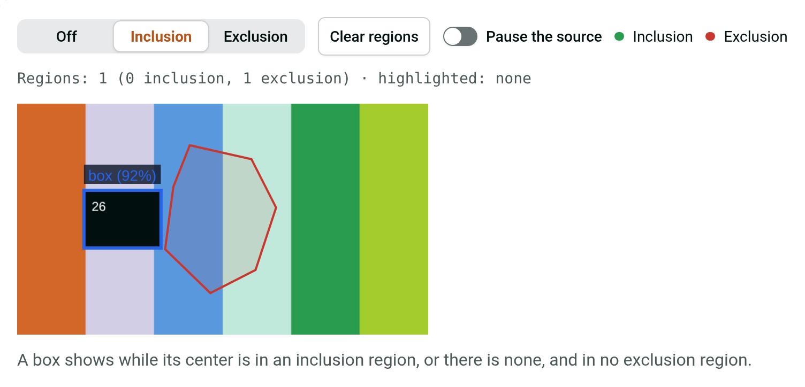

<!-- Written by `npm run docs:pages` from the kit and its examples. Do not edit. -->

# ROI editor

_Components › Video_ · [All topics](../README.md)

Draws regions of interest on a video tile's image, and lets the user add regions by clicking.

<picture>
<source media="(prefers-reduced-motion: reduce) and (prefers-color-scheme: dark)" srcset="../images/roi-editor/drawing-regions.dark.webp">
<source media="(prefers-reduced-motion: reduce)" srcset="../images/roi-editor/drawing-regions.light.webp">
<source media="(prefers-color-scheme: dark)" srcset="../images/roi-editor/drawing-regions.dark.animated.webp">

</picture>

```ts
import { NeatRoiEditor, NeatRoiSwatch, neatRoiNames } from '@sima/neat-ui/video';
```

## Examples

### Drawing regions

An editor on a tile that plays a test pattern, with the page keeping the regions.

Try drawing polygons in either mode. Then hover one to highlight it, and the readout names it, or right-click it to delete it. While drawing, a right-click or Backspace takes back the last point.

The tile gets the same regions to filter with, so a box shows only where the regions let it. Pause the source and the tile stops, and the editor keeps working on the tile's whole box.

<picture>
<source media="(prefers-reduced-motion: reduce) and (prefers-color-scheme: dark)" srcset="../images/roi-editor/drawing-regions.dark.webp">
<source media="(prefers-reduced-motion: reduce)" srcset="../images/roi-editor/drawing-regions.light.webp">
<source media="(prefers-color-scheme: dark)" srcset="../images/roi-editor/drawing-regions.dark.animated.webp">

</picture>

<details>
<summary>Code</summary>

`1-drawing-regions.example.ts`

```ts
import {
  afterNextRender,
  ChangeDetectionStrategy,
  Component,
  computed,
  DestroyRef,
  DOCUMENT,
  inject,
  signal,
} from '@angular/core';
import { NeatButton } from '@sima/neat-ui';
import { NeatSegmented, type NeatSegmentedOption } from '@sima/neat-ui/segmented';
import { NeatSwitch } from '@sima/neat-ui/switch';
import {
  NEAT_OVERLAY_DEFAULTS,
  NeatRoiEditor,
  type NeatOverlaySettings,
  type NeatRoiDrawMode,
  type NeatRoiPolygon,
  neatRoiNames,
  NeatRoiSwatch,
  NeatVideoTile,
} from '@sima/neat-ui/video';
import { TestPatternSource } from './test-pattern-source';

const MODES: NeatSegmentedOption<NeatRoiDrawMode>[] = [
  { value: 'off', label: 'Off' },
  { value: 'inclusion', label: 'Inclusion' },
  { value: 'exclusion', label: 'Exclusion' },
];

/**
 * The box crosses the middle of the image, which is 640 by 360, with its center at mid height; this
 * exclusion region, an uneven heptagon as a hand would draw it, straddles that line, so the box
 * vanishes as its center enters the region and returns as it leaves.
 */
const STARTING_REGIONS: readonly NeatRoiPolygon[] = [
  {
    type: 'exclusion',
    points: [
      { x: 0.42, y: 0.18 },
      { x: 0.57, y: 0.24 },
      { x: 0.63, y: 0.45 },
      { x: 0.58, y: 0.72 },
      { x: 0.47, y: 0.82 },
      { x: 0.36, y: 0.63 },
      { x: 0.38, y: 0.36 },
    ],
  },
];

@Component({
  selector: 'app-drawing-regions',
  imports: [NeatButton, NeatRoiEditor, NeatRoiSwatch, NeatSegmented, NeatSwitch, NeatVideoTile],
  changeDetection: ChangeDetectionStrategy.OnPush,
  template: `
    <div class="showcase-row">
      <neat-segmented label="Drawing mode" [options]="modes" [(value)]="mode" />
      <button neatButton type="button" variant="outlined" (click)="regions.set([])">
        Clear regions
      </button>
      <button neatSwitch (checkedChange)="testPattern.setPaused($event)">Pause the source</button>
      <span class="key"><neat-roi-swatch type="inclusion" />Inclusion</span>
      <span class="key"><neat-roi-swatch type="exclusion" />Exclusion</span>
    </div>
    <p class="showcase-code showcase-muted" aria-live="polite">{{ summary() }}</p>
    <div class="cell">
      <neat-video-tile [source]="testPattern" [settings]="settings()" [bars]="false">
        <neat-roi-editor
          neatTileOverlay
          [regions]="regions()"
          [mode]="mode()"
          [(highlighted)]="highlighted"
          (regionsChange)="regions.set($event)"
        />
      </neat-video-tile>
    </div>
    <p class="rule showcase-muted">
      A box shows while its center is in an inclusion region, or there is none, and in no exclusion
      region.
    </p>
  `,
  styleUrl: './drawing-regions.example.css',
})
export class DrawingRegions {
  protected readonly testPattern = new TestPatternSource();
  protected readonly modes = MODES;
  protected readonly mode = signal<NeatRoiDrawMode>('inclusion');
  protected readonly regions = signal<readonly NeatRoiPolygon[]>(STARTING_REGIONS);
  /**
   * The editor draws the regions, so the tile's own outline is off; the tile filters by them all
   * the same, as `applyRoiFiltering` is on in the defaults.
   */
  protected readonly settings = computed<NeatOverlaySettings>(() => ({
    ...NEAT_OVERLAY_DEFAULTS,
    general: { ...NEAT_OVERLAY_DEFAULTS.general, showRoi: false },
    roi: this.regions(),
  }));
  protected readonly highlighted = signal<number | null>(null);
  protected readonly summary = computed(() => {
    const regions = this.regions();
    const count = (type: NeatRoiPolygon['type']) =>
      regions.filter((region) => region.type === type).length;
    const index = this.highlighted();
    // Named as the editor's Delete and an app's region list name it.
    const highlighted = (index === null ? undefined : neatRoiNames(regions)[index]) ?? 'none';
    return `Regions: ${regions.length} (${count('inclusion')} inclusion, ${count('exclusion')} exclusion) · highlighted: ${highlighted}`;
  });

  constructor() {
    const document = inject(DOCUMENT);
    afterNextRender(() => this.testPattern.start(document));
    inject(DestroyRef).onDestroy(() => this.testPattern.stop());
  }
}
```

`test-pattern-source.ts`

```ts
import { signal } from '@angular/core';
import { SIMA_PALETTE } from '@sima/neat-ui';
import type { NeatMetadataMessage, NeatTileSource } from '@sima/neat-ui/video';

const WIDTH = 640;
const HEIGHT = 360;
const FRAMES_PER_SECOND = 30;
const BAR_COLORS = [
  SIMA_PALETTE.orange,
  SIMA_PALETTE.purple,
  SIMA_PALETTE.blue,
  SIMA_PALETTE.mint,
  SIMA_PALETTE.green,
  SIMA_PALETTE.lime,
];
const BOX = { width: 120, height: 90 };
/** Detections come every other frame, as from a model slower than the video; held between. */
const DETECTION_EVERY = 2;

/**
 * A `NeatTileSource` for the showcase, so the tile plays without vf: a canvas test pattern
 * streamed with `captureStream()`, and object-detection metadata for the box moving across it. A
 * canvas stream has no RTP timestamps, so the tile matches metadata by arrival, which takes only
 * the latest message: hence one type. Pausing stops painting, so the stream presents no frames
 * and the tile goes stopped.
 */
export class TestPatternSource implements NeatTileSource {
  readonly stream = signal<MediaStream | null>(null);

  private readonly listeners = new Set<(text: string, receivedAt: number) => void>();
  private context: CanvasRenderingContext2D | null = null;
  private animation = 0;
  private lastPaintAt = 0;
  private frame = 0;
  private paused = false;

  onMetadata(listener: (text: string, receivedAt: number) => void): () => void {
    this.listeners.add(listener);
    return () => this.listeners.delete(listener);
  }

  /** Starts the pattern; does nothing where canvases cannot be streamed (as in unit tests). */
  start(document: Document): void {
    const canvas = document.createElement('canvas');
    if (typeof canvas.captureStream !== 'function') return;
    canvas.width = WIDTH;
    canvas.height = HEIGHT;
    this.context = canvas.getContext('2d');
    if (this.context === null) return;
    this.stream.set(canvas.captureStream(FRAMES_PER_SECOND));
    const loop = (now: number) => {
      this.animation = requestAnimationFrame(loop);
      if (this.paused || now - this.lastPaintAt < 1000 / FRAMES_PER_SECOND) return;
      this.lastPaintAt = now;
      this.paint();
    };
    this.animation = requestAnimationFrame(loop);
  }

  setPaused(paused: boolean): void {
    this.paused = paused;
  }

  stop(): void {
    cancelAnimationFrame(this.animation);
    for (const track of this.stream()?.getTracks() ?? []) track.stop();
    this.stream.set(null);
    this.listeners.clear();
  }

  private paint(): void {
    const ctx = this.context;
    if (ctx === null) return;
    const barWidth = WIDTH / BAR_COLORS.length;
    BAR_COLORS.forEach((color, i) => {
      ctx.fillStyle = color;
      ctx.fillRect(i * barWidth, 0, barWidth, HEIGHT);
    });

    // The box bounces between the edges, four pixels per frame.
    const travel = WIDTH - BOX.width;
    const step = (this.frame * 4) % (2 * travel);
    const x = step < travel ? step : 2 * travel - step;
    const y = (HEIGHT - BOX.height) / 2;
    ctx.fillStyle = SIMA_PALETTE.text;
    ctx.fillRect(x, y, BOX.width, BOX.height);
    ctx.fillStyle = SIMA_PALETTE.white;
    ctx.font = '500 20px sans-serif';
    ctx.fillText(String(this.frame), x + 12, y + 32);

    if (this.frame % DETECTION_EVERY === 0) {
      this.send({
        type: 'object-detection',
        data: {
          objects: [{ label: 'box', confidence: 0.92, bbox: [x, y, BOX.width, BOX.height] }],
        },
      });
    }
    this.frame += 1;
  }

  private send(message: NeatMetadataMessage): void {
    const text = JSON.stringify(message);
    const receivedAt = performance.now();
    for (const listener of this.listeners) listener(text, receivedAt);
  }
}
```

`drawing-regions.example.css`

```css
:host {
  display: flex;
  flex-direction: column;
  gap: var(--neat-space-3);
}

/* The tile fills its cell, so the cell gives it a size: a 16:9 box up to 24rem wide. */
.cell {
  width: min(100%, 24rem);
  aspect-ratio: 16 / 9;
}

/* A swatch and its type's name, as a legend for the editor's colors. */
.key {
  display: inline-flex;
  align-items: center;
  gap: var(--neat-space-2);
  font-size: var(--neat-text-sm);
}
```

</details>

## API

### `NeatRoiEditor`

Component from `@sima/neat-ui/video`, selector `neat-roi-editor`.

Project it into the `neat-video-tile` with `neatTileOverlay`:

```html
<neat-video-tile>
  <neat-roi-editor
    neatTileOverlay
    [regions]="regions"
    [mode]="mode"
    [(highlighted)]="highlighted"
    (regionsChange)="…"
  />
</neat-video-tile>
```

While the tile plays, the editor sits on the tile's video box. So a point is a position on the image, not on the letterbox, and it stays there when the tile resizes.

Without video, none yet or stopped, it uses the tile's full box instead. So regions can be seen and drawn before a stream plays. Points are normalized to whichever box was used, which is exact for a stream of the tile's shape. Until it knows either box, it draws nothing and takes no input.

The full box is meant for a tile with `bars` off. With bars on, the no-video note and the bar paint above the editor and cover what lies under them.

With a `mode` of `inclusion` or `exclusion`, each click adds a point:

- A click within 10 px of the first point closes the polygon once it has three. So does a double-click. The second click of a double-click (`detail` 2 or more) is ignored, so a double-click is its first click plus a close.
- `regionsChange` emits when a polygon closes, with it appended to `regions`. The editor never changes `regions` itself.
- A right-click or Backspace removes the open polygon's last point, and the polygon with its only point.
- Escape cancels the whole polygon. So does a new `mode` or `regions` from outside, or the box it is drawn on changing between the image and the tile.

Drawing is pointer-only. The polygon is open on the host, which takes focus on the first point, so Backspace and Escape reach it.

In every mode, `off` included, the regions themselves take the pointer:

- Hovering one sets `highlighted` to its index in `regions`, and leaving it sets null. Where regions overlap, it is the one drawn last, on top. A highlighted region has a stronger fill and outline.
- An app binds the same index to its region list, so either side can highlight.
- A right-click on one, while no polygon is open, opens a small bubble there with a Delete button. The button emits `regionsChange` without that region, and takes focus. Escape, a press outside the bubble, focus leaving it or new `regions` close it.
- The bubble is a shortcut for the pointer. An app still offers the keyboard its own way to remove regions, such as its list.

Elsewhere, the editor leaves mode `off` to what is under it.

**Inputs**

- **`regions`** `readonly NeatRoiPolygon[]`, required

  The regions to draw. One being drawn is not part of it until `regionsChange` brings it.

- **`mode`** `NeatRoiDrawMode`, default `'off'`

  What a click does; `off` leaves the tile to what is under the editor, but for the regions.

**Models (two-way)**

- **`highlighted`** `number | null`, default `null`

  The index in `regions` of the region to highlight, as the pointer or the app set it.

**Outputs**

- **`regionsChange`** `readonly NeatRoiPolygon[]`

  A new region appended to `regions`, or `regions` without a deleted one, in a new array.

### `NeatRoiSwatch`

Component from `@sima/neat-ui/video`, selector `neat-roi-swatch`.

A dot in the outline color of a region type, as `neat-roi-editor` draws it on the video.

```html
<neat-roi-swatch [type]="region.type" /> {{ region.name }}
```

Put it before a region's name in a list, so the list and the image read alike. It is decoration, hidden from assistive technology, so the name next to it must say the type.

**Inputs**

- **`type`** `NeatRoiPolygon['type']`, required

  The region type whose outline color the dot takes: `inclusion` or `exclusion`.

### `NeatRoiPolygon`

Interface from `@sima/neat-ui/video`.

A region of interest. Coordinates are normalized to 0..1 of the video frame, so a polygon fits any resolution the stream is sent at.

**Members**

- **`type`** `'inclusion' | 'exclusion'`

- **`points`** `readonly { readonly x: number; readonly y: number }[]`

### `NeatRoiDrawMode`

Type from `@sima/neat-ui/video`.

What a click does: nothing, or places points of an inclusion or an exclusion polygon.

```ts
type NeatRoiDrawMode = 'off' | 'inclusion' | 'exclusion'
```

### `neatRoiNames`

Function from `@sima/neat-ui/video`.

The name of each region, in the order given: its type, numbered per type in list order ("Inclusion 1", "Exclusion 1", "Exclusion 2", "Inclusion 2"). Every region counts, drawable or not, so an app's region list and `neat-roi-editor`'s Delete bubble name the same region alike.

```ts
neatRoiNames(regions: readonly NeatRoiPolygon[]): string[]
```
