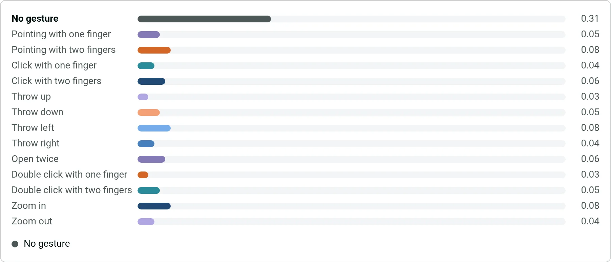
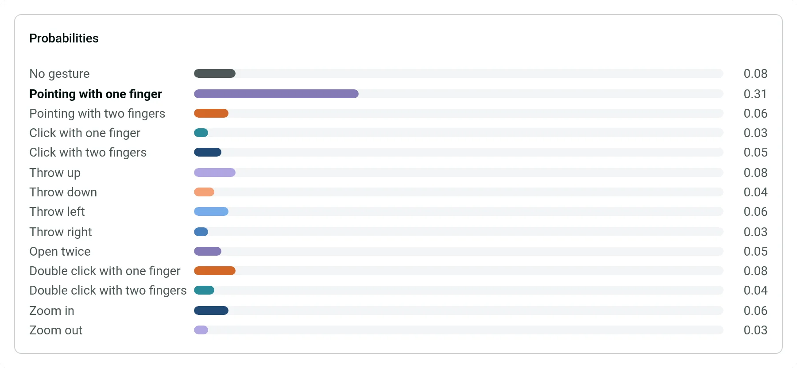

<!-- Written by `npm run docs:pages` from the kit and its examples. Do not edit. -->

# Score bars

_Components › Charts_ · [All topics](../README.md)

A classifier's live output, one bar per class:

```html
<neat-score-bars
  label="Gesture probabilities"
  [scores]="scores"
  [labels]="classes"
  [quiet]="['No gesture']"
/>
```

<picture>
<source media="(prefers-color-scheme: dark)" srcset="../images/score-bars/score-bars.dark.webp">

</picture>

```ts
import { NeatScoreBars, neatLabelColor, neatLabelColour } from '@sima/neat-ui/charts';
```

## Examples

### Gesture scores

The output of a gesture classifier, a score per IPN Hand class. The scores change every 1.5 s; "No gesture" is `quiet`, so it stays muted beside the colored gestures, and the top row's label is bold. The line below the bars colors its dot with [`neatLabelColor`](../components/score-bars.md#neatlabelcolor), so text outside the bars (a timeline's runs, a caption) shows a class in the same color.

<picture>
<source media="(prefers-color-scheme: dark)" srcset="../images/score-bars/score-bars.dark.webp">

</picture>

<details>
<summary>Code</summary>

`1-score-bars.example.ts`

```ts
import {
  ChangeDetectionStrategy,
  Component,
  computed,
  DestroyRef,
  inject,
  signal,
} from '@angular/core';
import { NeatScore, NeatScoreBars, neatLabelColor } from '@sima/neat-ui/charts';
import { CLASSES, NO_GESTURE, scoresAt } from './data';

@Component({
  selector: 'app-gesture-scores',
  imports: [NeatScoreBars],
  changeDetection: ChangeDetectionStrategy.OnPush,
  template: `
    <neat-score-bars
      label="Gesture probabilities"
      [scores]="scores()"
      [labels]="labels"
      [quiet]="quiet"
    />
    <p class="reading">
      <span class="dot" [style.background]="topColor()"></span>
      {{ top().label }}
    </p>
  `,
  styleUrl: './gesture-scores.example.css',
})
export class GestureScores {
  protected readonly labels = CLASSES;
  protected readonly quiet = [NO_GESTURE];
  protected readonly scores = signal<readonly NeatScore[]>(scoresAt(0));
  protected readonly top = computed(() =>
    this.scores().reduce((best, score) => (score.value > best.value ? score : best)),
  );
  protected readonly topColor = computed(() =>
    neatLabelColor(this.top().label, this.labels, this.quiet),
  );

  constructor() {
    let step = 0;
    const timer = setInterval(() => this.scores.set(scoresAt(++step)), 1500);
    inject(DestroyRef).onDestroy(() => clearInterval(timer));
  }
}
```

`data.ts`

```ts
import type { NeatScore } from '@sima/neat-ui/charts';

/** IPN Hand's 14 classes; the first is the quiet one. */
export const CLASSES: readonly string[] = [
  'No gesture',
  'Pointing with one finger',
  'Pointing with two fingers',
  'Click with one finger',
  'Click with two fingers',
  'Throw up',
  'Throw down',
  'Throw left',
  'Throw right',
  'Open twice',
  'Double click with one finger',
  'Double click with two fingers',
  'Zoom in',
  'Zoom out',
];

export const NO_GESTURE = CLASSES[0];

/**
 * The scores at a step of the demo: one class takes most of the weight, a different one each
 * step, the rest share what is left. Softmax-like, so they add up to 1.
 */
export function scoresAt(step: number): readonly NeatScore[] {
  const winner = (step * 5) % CLASSES.length;
  const weights = CLASSES.map((_, index) =>
    index === winner ? 12 : 1 + ((index * 7 + step * 3) % 5) / 2,
  );
  const total = weights.reduce((sum, weight) => sum + weight, 0);
  return CLASSES.map((label, index) => ({ label, value: weights[index] / total }));
}
```

`gesture-scores.example.css`

```css
.reading {
  display: flex;
  align-items: center;
  gap: var(--neat-space-2);
  margin: var(--neat-space-3) 0 0;
  font-size: var(--neat-text-sm);
}

.dot {
  width: 0.625rem;
  height: 0.625rem;
  border-radius: 999px;
}
```

</details>

### Filling a card

The same scores in a card 24 rem tall, as beside a video whose height the card takes. With `size="fill"` the bars share the height the card leaves its content: each row grows, its label and figure stay centered, and its bar thickens up to twice its usual thickness. In a box shorter than the rows need, they keep their usual height and the list overflows.

<picture>
<source media="(prefers-color-scheme: dark)" srcset="../images/score-bars/filling-a-card.dark.webp">

</picture>

<details>
<summary>Code</summary>

`2-filling-a-card.example.ts`

```ts
import { ChangeDetectionStrategy, Component } from '@angular/core';
import { NeatCard } from '@sima/neat-ui/card';
import { NeatScoreBars } from '@sima/neat-ui/charts';
import { CLASSES, NO_GESTURE, scoresAt } from './data';

@Component({
  selector: 'app-filling-a-card',
  imports: [NeatCard, NeatScoreBars],
  changeDetection: ChangeDetectionStrategy.OnPush,
  template: `
    <neat-card title="Probabilities">
      <neat-score-bars
        label="Gesture probabilities"
        size="fill"
        [scores]="scores"
        [labels]="labels"
        [quiet]="quiet"
      />
    </neat-card>
  `,
  styleUrl: './filling-a-card.example.css',
})
export class FillingACard {
  protected readonly labels = CLASSES;
  protected readonly quiet = [NO_GESTURE];
  protected readonly scores = scoresAt(3);
}
```

`data.ts`

```ts
import type { NeatScore } from '@sima/neat-ui/charts';

/** IPN Hand's 14 classes; the first is the quiet one. */
export const CLASSES: readonly string[] = [
  'No gesture',
  'Pointing with one finger',
  'Pointing with two fingers',
  'Click with one finger',
  'Click with two fingers',
  'Throw up',
  'Throw down',
  'Throw left',
  'Throw right',
  'Open twice',
  'Double click with one finger',
  'Double click with two fingers',
  'Zoom in',
  'Zoom out',
];

export const NO_GESTURE = CLASSES[0];

/**
 * The scores at a step of the demo: one class takes most of the weight, a different one each
 * step, the rest share what is left. Softmax-like, so they add up to 1.
 */
export function scoresAt(step: number): readonly NeatScore[] {
  const winner = (step * 5) % CLASSES.length;
  const weights = CLASSES.map((_, index) =>
    index === winner ? 12 : 1 + ((index * 7 + step * 3) % 5) / 2,
  );
  const total = weights.reduce((sum, weight) => sum + weight, 0);
  return CLASSES.map((label, index) => ({ label, value: weights[index] / total }));
}
```

`filling-a-card.example.css`

```css
/* A box of a fixed height, as the space beside a video; the card takes all of it. */
:host {
  display: grid;
  height: 24rem;
}
```

</details>

## API

### `NeatScoreBars`

Component from `@sima/neat-ui/charts`, selector `neat-score-bars`.

Rows keep the order of `scores`, so a bar does not jump about as the scores change. Each row is the label, a bar filled to its score (clamped to 0..1) and the score with two decimals; a value that is not a number draws an empty bar and "–". The fill takes its color from [`neatLabelColor`](../components/score-bars.md#neatlabelcolor), by the label's place in `labels` (empty means the order of `scores`), and `quiet` names the labels that stay muted. The row with the highest score has `data-top` and its label in bold, the first of a tie, and none when no score is a number.

`size` says how tall the list is. `auto`, the default, gives each row the height of its text. `fill` makes the host at least as tall as its container (`min-height: 100%`, so the container needs a height of its own, such as a card a grid row stretches) and shares that height evenly among the rows: each row grows, its label and figure stay centered in it, and its bar thickens with it up to twice its usual thickness. A container shorter than the rows' natural height does not squeeze them: the list keeps that height and overflows, as it does without `fill`.

The host is a group named by `label`. Each bar is a `role="meter"` from 0 to 1 named by its class, so a screen reader gets every value; the top row has no state of its own for it.

**Inputs**

- **`scores`** `readonly NeatScore[]`, required

  The classes and their scores, in the order the rows are drawn.

- **`labels`** `readonly string[]`, default `[]`

  The color order of the labels; empty means the order of `scores`.

- **`quiet`** `readonly string[]`, default `[]`

  Labels drawn in the muted color, such as "No gesture".

- **`label`** `string`, required

  Names the group of bars.

- **`size`** `'auto' | 'fill'`, default `'auto'`

  `auto` sizes the rows to their text; `fill` shares the container's height among them.

### `NeatScore`

Interface from `@sima/neat-ui/charts`.

One class and the score a classifier gave it, 0 to 1.

**Members**

- **`label`** `string`

- **`value`** `number`

  Clamped to 0..1 for the bar; anything that is not a finite number draws an empty bar.

### `neatLabelColor`

Function from `@sima/neat-ui/charts`.

The color of a label that stands for a class, a state or a gesture, as CSS: the series color at the label's place in `labels` (`--neat-series-1` to `-8`, the palette starting again after eight), `--muted-foreground` for a label in `quiet` (the "nothing here" class, which should not compete with the others), and `--neat-chip-neutral` for a label in neither list. One function, so the score bars and an app's timeline of the same labels cannot color them differently. The one exception is the timeline's quiet runs: they fill a stretch of the strip, often most of the window, so the timeline fills them with `--muted` instead and the quiet class is never its heaviest mark; the score bars' quiet fill stays `--muted-foreground`.

```ts
neatLabelColor(label: string, labels: readonly string[], quiet: readonly string[]): string
```

### `neatLabelColour`

Constant from `@sima/neat-ui/charts`.

**Deprecated.** Use [`neatLabelColor`](../components/score-bars.md#neatlabelcolor); this name goes in a later release.

The British spelling of [`neatLabelColor`](../components/score-bars.md#neatlabelcolor), kept so apps that import it keep working.

```ts
const neatLabelColour: (label: string, labels: readonly string[], quiet: readonly string[]) => string
```
