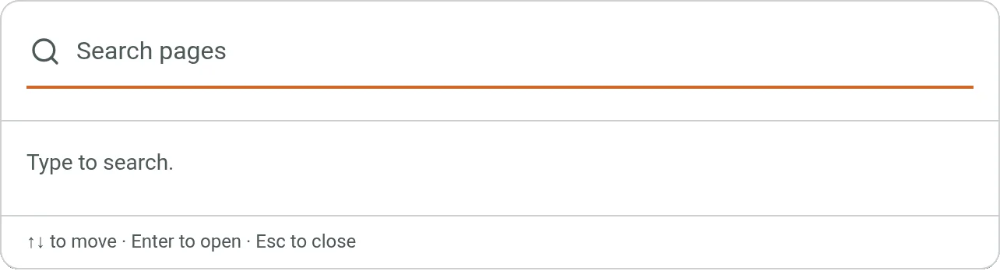

<!-- Written by `npm run docs:pages` from the kit and its examples. Do not edit. -->

# Search palette

_Components › Forms_ · [All topics](../README.md)

A search over the whole app: a trigger that looks like a search field, for the top bar, and the palette it opens, a dialog with a field over the results in groups.

```html
<neat-search-palette neatTopbarEnd label="Search docs" [search]="search" allResults="/search" />
```

<picture>
<source media="(prefers-color-scheme: dark)" srcset="../images/search-palette/searching-an-app.dark.webp">

</picture>

```ts
import { NeatSearchPalette } from '@sima/neat-ui/search-palette';
```

## Examples

### Searching an app

The trigger, and the palette it opens: type "s" to see the matches, move with the arrow keys and open one with Enter. The app's `search` returns the results in groups; here, a few pages of these docs whose name holds what was typed. `picked` tells the app what was opened.

Its Ctrl K is off here: the docs' own search in the top bar has it.

<picture>
<source media="(prefers-color-scheme: dark)" srcset="../images/search-palette/searching-an-app.dark.webp">

</picture>

<details>
<summary>Code</summary>

`1-searching-an-app.example.ts`

```ts
import { ChangeDetectionStrategy, Component, signal } from '@angular/core';
import {
  NeatSearchPalette,
  type NeatSearchGroup,
  type NeatSearchItem,
} from '@sima/neat-ui/search-palette';

/** A few pages of these docs, as an app would list its own. */
const PAGES: readonly NeatSearchItem[] = [
  {
    id: 'search',
    label: 'Search',
    detail: 'Components › Forms',
    icon: 'document',
    path: '/components/forms/search',
  },
  {
    id: 'select',
    label: 'Select',
    detail: 'Components › Forms',
    icon: 'document',
    path: '/components/forms/select',
  },
  {
    id: 'slider',
    label: 'Slider',
    detail: 'Components › Forms',
    icon: 'document',
    path: '/components/forms/slider',
  },
  { id: 'icons', label: 'Icons', detail: 'Theme', icon: 'palette', path: '/theme/icons' },
  {
    id: 'icon-finder',
    label: 'Icon finder',
    detail: 'Theme',
    icon: 'search',
    path: '/theme/icon-finder',
  },
];

@Component({
  selector: 'app-searching-an-app',
  imports: [NeatSearchPalette],
  changeDetection: ChangeDetectionStrategy.OnPush,
  templateUrl: './1-searching-an-app.example.html',
  styleUrl: './searching-an-app.example.css',
})
export class SearchingAnApp {
  protected readonly last = signal<string | null>(null);

  protected readonly search = (query: string): readonly NeatSearchGroup[] => [
    {
      label: 'Pages',
      items: PAGES.filter((page) => page.label.toLowerCase().includes(query.toLowerCase())),
    },
  ];
}
```

`1-searching-an-app.example.html`

```html
<neat-search-palette
  label="Search pages"
  shortcut="false"
  [search]="search"
  (picked)="last.set($event.label)"
/>
<p class="showcase-muted">Last opened: {{ last() ?? 'none yet' }}</p>
```

`searching-an-app.example.css`

```css
:host {
  display: flex;
  flex-direction: column;
  align-items: flex-start;
  gap: var(--neat-space-3);
}

p {
  margin: 0;
  font-size: var(--neat-text-sm);
}
```

</details>

## API

### `NeatSearchPalette`

Component from `@sima/neat-ui/search-palette`, selector `neat-search-palette`.

`search` is the app's: a function from what was typed to groups of results ([`NeatSearchGroup`](../components/search-palette.md#neatsearchgroup)), each item a label, where it is, an icon and the address it opens. The palette shows the first `limit` of each group. The arrow keys move through them, Enter or a click opens one and closes the palette, and with `allResults` (the address of the app's page of every result, which gets the search as `q`) a link at its foot, and Enter while nothing is picked, go there. Each result is a link, so a middle click or Ctrl-click opens it in a new tab.

Ctrl K (⌘K on a Mac) opens it from anywhere on the page, unless `shortcut` is off; the trigger shows the keys as a [`NeatShortcut`](../components/shortcut.md#neatshortcut) and names them in `aria-keyshortcuts`. On a narrow screen the trigger is an icon-only button. Escape clears the field, then closes the palette; a click beside it closes it too. Closing puts the focus back where it was.

`open` is the palette's state, which the app may also set. `picked` tells which result was opened. The field is a `neat-search` acting as a combobox over the results' listbox, and the count of matches is its status, announced politely.

**Inputs**

- **`label`** `string`, required

  The search's name: the trigger's text, and the field's name and hint ("Search docs").

- **`search`** `(query: string) => readonly NeatSearchGroup[]`, required

  The app's search: what was typed, to groups of results. Called as the user types.

- **`allResults`** `string`

  The address of the app's page of every result, which gets the search as its `q` query parameter (`/search`); no such link without it.

- **`limit`** `number`, default `DEFAULT_LIMIT`

  How many results of each group the palette shows.

- **`shortcut`** `boolean`, default `true`, transform `booleanAttribute`

  Whether Ctrl K (⌘K on a Mac) opens the palette from anywhere on the page.

- **`labels`** `Partial<NeatSearchPaletteLabels>`, default `{}`

  What the palette says beside the results, where an app words it differently.

**Models (two-way)**

- **`open`** `boolean`, default `false`

  Whether the palette is open; the trigger and the shortcut open it, the app may too.

**Outputs**

- **`picked`** `NeatSearchItem`

  The result that was opened, by a click, a tap or Enter.

### `NeatSearchGroup`

Interface from `@sima/neat-ui/search-palette`.

Results of one kind, under a heading ("Topics", "API").

**Members**

- **`label`** `string`

- **`items`** `readonly NeatSearchItem[]`

### `NeatSearchItem`

Interface from `@sima/neat-ui/search-palette`.

One result: what it is called, where it is, and the address it opens.

**Members**

- **`id`** `string`

  Stable across searches, so the list keeps its rows.

- **`label`** `string`

- **`detail`** `string`, optional

  Where it is, shown muted at the row's end ("Components › Forms").

- **`icon`** `NeatIconName | NeatIconGlyph`, optional

  A name of the kit's icons, or a Lucide glyph, before the label.

- **`path`** `string`

  The app's address it opens, with any query and fragment (`/components/forms/search#api-NeatSearch`).

### `NeatSearchPaletteLabels`

Interface from `@sima/neat-ui/search-palette`.

What the palette says beside the results; each has a default.

**Members**

- **`empty`** `string`

  Before anything is typed.

- **`noMatches`** `string`

  The status when nothing matches.

- **`matches`** `(count: number) => string`

  The status counting what matched, given the count.

- **`allResults`** `string`

  The link to the app's page of every result.

- **`keys`** `string`

  The keys, at the palette's foot.
