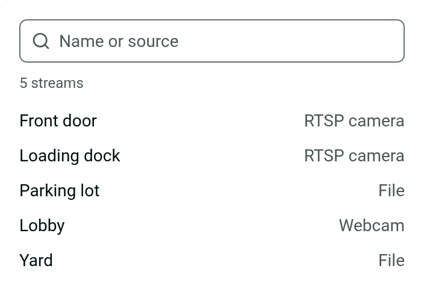
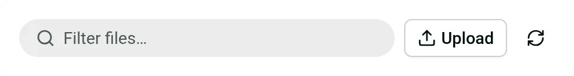
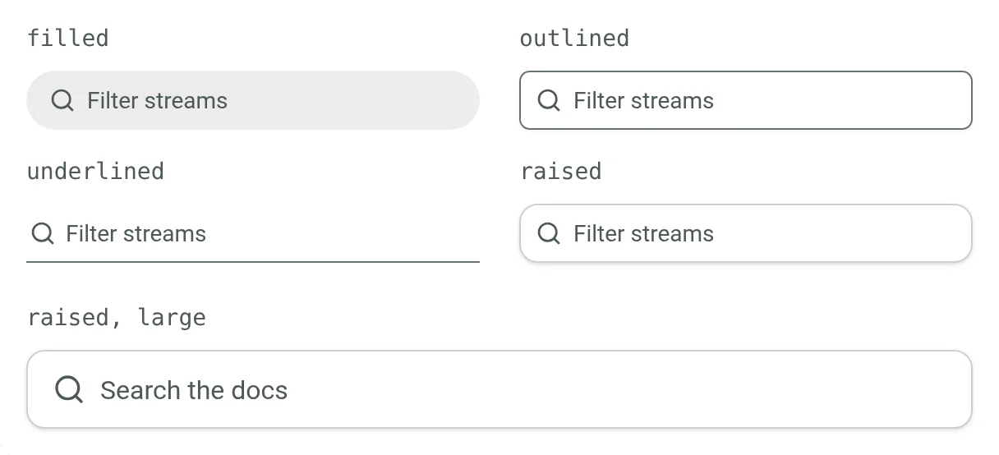

<!-- Written by `npm run docs:pages` from the kit and its examples. Do not edit. -->

# Search

_Components › Forms_ · [All topics](../README.md)

A search field, for filtering what a page shows.

```html
<neat-search label="Filter streams" [(value)]="query" [status]="matches() + ' streams'" />
```

<picture>
<source media="(prefers-color-scheme: dark)" srcset="../images/search/filtering-a-list.dark.webp">

</picture>

```ts
import { NeatSearch } from '@sima/neat-ui';
```

## Examples

### Filtering a list

A search field over a list of streams. The app filters by the field's `value` and says what is left in `status`, which the field shows under itself and announces. The clear button, or Escape, empties it.

<picture>
<source media="(prefers-color-scheme: dark)" srcset="../images/search/filtering-a-list.dark.webp">

</picture>

<details>
<summary>Code</summary>

`1-filtering-a-list.example.ts`

```ts
import { ChangeDetectionStrategy, Component, computed, signal } from '@angular/core';
import { NeatSearch } from '@sima/neat-ui';

@Component({
  selector: 'app-filtering-a-list',
  imports: [NeatSearch],
  changeDetection: ChangeDetectionStrategy.OnPush,
  template: `
    <neat-search
      label="Filter streams"
      placeholder="Name or source"
      [status]="status()"
      [(value)]="query"
    />
    <ul>
      @for (stream of shown(); track stream.name) {
        <li>
          <span>{{ stream.name }}</span>
          <span class="showcase-muted">{{ stream.source }}</span>
        </li>
      }
    </ul>
  `,
  styleUrl: './filtering-a-list.example.css',
})
export class FilteringAList {
  protected readonly query = signal('');
  private readonly streams = [
    { name: 'Front door', source: 'RTSP camera' },
    { name: 'Loading dock', source: 'RTSP camera' },
    { name: 'Parking lot', source: 'File' },
    { name: 'Lobby', source: 'Webcam' },
    { name: 'Yard', source: 'File' },
  ];

  protected readonly shown = computed(() => {
    const query = this.query().trim().toLowerCase();
    return this.streams.filter((stream) =>
      `${stream.name} ${stream.source}`.toLowerCase().includes(query),
    );
  });

  protected readonly status = computed(() => {
    const count = this.shown().length;
    if (count === 0) return 'Nothing matches';
    return count === 1 ? '1 stream' : `${count} streams`;
  });
}
```

`filtering-a-list.example.css`

```css
/* The field and the list share one width, as a filter and what it filters do. */
:host {
  display: flex;
  flex-direction: column;
  gap: var(--neat-space-3);
  max-width: 20rem;
}

ul {
  display: flex;
  flex-direction: column;
  gap: var(--neat-space-2);
  margin: 0;
  padding: 0;
  list-style: none;
  font-size: var(--neat-text-sm);
}

li {
  display: flex;
  justify-content: space-between;
  gap: var(--neat-space-3);
}
```

</details>

### Small in a toolbar

The small field, 2rem high like the small buttons beside it, at the start of a row of tools. It shows no status line: what it filters says what is left.

<picture>
<source media="(prefers-color-scheme: dark)" srcset="../images/search/small-in-a-toolbar.dark.webp">

</picture>

<details>
<summary>Code</summary>

`2-small-in-a-toolbar.example.ts`

```ts
import { ChangeDetectionStrategy, Component, signal } from '@angular/core';
import { NeatButton, NeatIcon, NeatSearch } from '@sima/neat-ui';

@Component({
  selector: 'app-small-in-a-toolbar',
  imports: [NeatButton, NeatIcon, NeatSearch],
  changeDetection: ChangeDetectionStrategy.OnPush,
  template: `
    <div class="tools">
      <neat-search
        size="small"
        label="Filter files"
        placeholder="Filter files…"
        [(value)]="query"
      />
      <button neatButton variant="outlined" size="small">
        <neat-icon name="upload" [size]="16" />
        Upload
      </button>
      <button neatButton variant="text" size="small" iconOnly aria-label="Refresh">
        <neat-icon name="refresh" [size]="16" />
      </button>
    </div>
  `,
  styleUrl: './small-in-a-toolbar.example.css',
})
export class SmallInAToolbar {
  protected readonly query = signal('');
}
```

`small-in-a-toolbar.example.css`

```css
/* The field takes what the buttons leave, up to a width that suits a filter. */
.tools {
  display: flex;
  align-items: center;
  gap: var(--neat-space-2);
  max-width: 28rem;
}

neat-search {
  flex: 1 1 12rem;
}
```

</details>

### Looks and sizes

The four looks at the medium size, then the raised look at the large size, as a page whose main job is searching puts it. `'filled'` is the default; `'outlined'` matches a form's text fields.

<picture>
<source media="(prefers-color-scheme: dark)" srcset="../images/search/looks-and-sizes.dark.webp">

</picture>

<details>
<summary>Code</summary>

`3-looks-and-sizes.example.ts`

```ts
import { ChangeDetectionStrategy, Component } from '@angular/core';
import { NeatSearch, type NeatSearchVariant } from '@sima/neat-ui';

@Component({
  selector: 'app-looks-and-sizes',
  imports: [NeatSearch],
  changeDetection: ChangeDetectionStrategy.OnPush,
  template: `
    <div class="looks">
      @for (look of looks; track look) {
        <div class="look">
          <span class="showcase-code showcase-muted">{{ look }}</span>
          <neat-search
            [variant]="look"
            [label]="'Filter streams, ' + look"
            placeholder="Filter streams"
          />
        </div>
      }
    </div>
    <div class="look">
      <span class="showcase-code showcase-muted">raised, large</span>
      <neat-search
        variant="raised"
        size="large"
        label="Search the docs"
        placeholder="Search the docs"
      />
    </div>
  `,
  styleUrl: './looks-and-sizes.example.css',
})
export class LooksAndSizes {
  protected readonly looks: readonly NeatSearchVariant[] = [
    'filled',
    'outlined',
    'underlined',
    'raised',
  ];
}
```

`looks-and-sizes.example.css`

```css
/* The looks two to a row, each over its name; the large field below them, wider. */
:host {
  display: flex;
  flex-direction: column;
  gap: var(--neat-space-6);
  max-width: 36rem;
}

.looks {
  display: grid;
  grid-template-columns: repeat(auto-fill, minmax(15rem, 1fr));
  gap: var(--neat-space-4) var(--neat-space-6);
}

.look {
  display: flex;
  flex-direction: column;
  gap: var(--neat-space-2);
}
```

</details>

## API

### `NeatSearch`

Component from `@sima/neat-ui`, selector `neat-search`.

The search glyph sits at its start. While the field holds text, a clear button sits at its end, and Escape clears it too. Escape in an empty field is left alone, so a dialog or a page's own handling still gets it. Clearing puts the focus back in the field.

`label` is the field's accessible name, and a `placeholder` is only a hint beside it. `status` is a short line under the field, such as "12 streams" or "Nothing matches", repeated politely to a screen reader as it changes. Without `status` there is no line.

`variant` is its look: `'filled'` by default, `'outlined'` among a form's fields, `'underlined'`, or `'raised'` with `size="large"` for a page whose main job is searching.

It filters as the user types: the app reads `value` and decides what matches. It is a native `input type="search"`, with the browser's own clear button hidden so there is one, and without the browser's suggestions or spell checking, which a filter has no use for.

**Inputs**

- **`label`** `string`, required

  The field's accessible name ("Filter streams"); required, since a hint is no name.

- **`placeholder`** `string`, default `''`

  A hint inside the empty field; none by default.

- **`variant`** `NeatSearchVariant`, default `'filled'`

  The field's look: `'filled'`, `'outlined'`, `'underlined'` or `'raised'`.

- **`size`** `NeatSearchSize`, default `'medium'`

  The field's height, `small` (2rem), `medium` (2.25rem) or `large` (3rem).

- **`clearLabel`** `string`, default `'Clear search'`

  The clear button's accessible name.

- **`status`** `string`

  A short line under the field about what the search found ("12 streams", "Nothing matches"), announced politely as it changes; no line while it is undefined.

**Models (two-way)**

- **`value`** `string`, default `''`

  What the field holds; the app filters by it.

### `NeatSearchVariant`

Type from `@sima/neat-ui`.

The field's look:

- `'filled'` (the default): a tint of the text color with round ends, quiet on the page, a card or a panel. The search glyph and the hint mark it as a field.
- `'outlined'`: the kit's text field (`neatInput`), for a search among a form's fields.
- `'underlined'`: no box, a line under it, the quietest.
- `'raised'`: a card's fill and border with a soft shadow, for a page whose main job is searching.

```ts
type NeatSearchVariant = 'filled' | 'outlined' | 'underlined' | 'raised'
```

### `NeatSearchSize`

Type from `@sima/neat-ui`.

The field's height: `small` (2rem) and `medium` (2.25rem), the heights of `neatInput`, and `large` (3rem, with 1rem text), for a page whose main job is searching.

```ts
type NeatSearchSize = 'small' | 'medium' | 'large'
```
