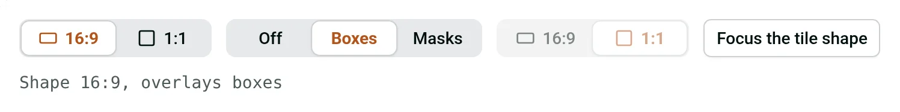
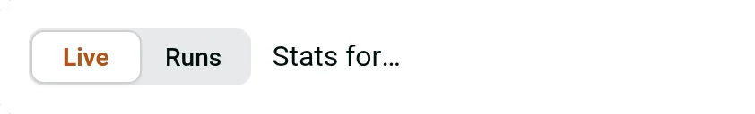
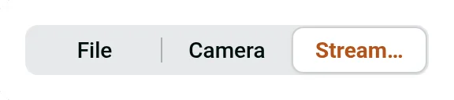

<!-- Written by `npm run docs:pages` from the kit and its examples. Do not edit. -->

# Segmented

_Components › Forms_ · [All topics](../README.md)

A row of mutually exclusive choices, such as a tile shape.

```html
<neat-segmented label="Tile shape" [options]="shapes" [(value)]="shape" />
```

<picture>
<source media="(prefers-color-scheme: dark)" srcset="../images/segmented/choices.dark.webp">

</picture>

```ts
import { NeatSegmented } from '@sima/neat-ui/segmented';
```

## Examples

### Choices

A choice with icons, one with labels only, and a disabled one. The button calls `focus()`, which lands on the checked option of the tile shape.

<picture>
<source media="(prefers-color-scheme: dark)" srcset="../images/segmented/choices.dark.webp">

</picture>

<details>
<summary>Code</summary>

`1-choices.example.ts`

```ts
import { ChangeDetectionStrategy, Component, signal } from '@angular/core';
import { NeatButton } from '@sima/neat-ui';
import { NeatSegmented, type NeatSegmentedOption } from '@sima/neat-ui/segmented';

/** A choice for the tile's shape; the kit's tiles are always 16:9, so this is the app's own. */
type Shape = '16:9' | '1:1';

const SHAPES: NeatSegmentedOption<Shape>[] = [
  { value: '16:9', label: '16:9', icon: 'aspect-wide' },
  { value: '1:1', label: '1:1', icon: 'aspect-square' },
];
const OVERLAYS: NeatSegmentedOption<string>[] = [
  { value: 'off', label: 'Off' },
  { value: 'boxes', label: 'Boxes' },
  { value: 'masks', label: 'Masks' },
];

@Component({
  selector: 'app-choices',
  imports: [NeatButton, NeatSegmented],
  changeDetection: ChangeDetectionStrategy.OnPush,
  template: `
    <div class="showcase-row">
      <neat-segmented #shapeControl label="Tile shape" [options]="shapes" [(value)]="shape" />
      <neat-segmented label="Overlays" [options]="overlays" [(value)]="overlay" />
      <neat-segmented label="Tile shape, disabled" [options]="shapes" value="1:1" disabled />
      <button
        neatButton
        type="button"
        variant="outlined"
        size="small"
        (click)="shapeControl.focus()"
      >
        Focus the tile shape
      </button>
    </div>
    <p class="showcase-code showcase-muted">Shape {{ shape() }}, overlays {{ overlay() }}</p>
  `,
  styleUrl: './choices.example.css',
})
export class Choices {
  protected readonly shapes = SHAPES;
  protected readonly overlays = OVERLAYS;
  protected readonly shape = signal<Shape>('16:9');
  protected readonly overlay = signal('boxes');
}
```

`choices.example.css`

```css
/* The example's rows one gap apart. */
:host {
  display: flex;
  flex-direction: column;
  gap: var(--neat-space-3);
}
```

</details>

### In a crowded row

A 13rem row, as a crowded toolbar is, with a long title beside the control.

<picture>
<source media="(prefers-color-scheme: dark)" srcset="../images/segmented/in-a-crowded-row.dark.webp">

</picture>

<details>
<summary>Code</summary>

`2-in-a-crowded-row.example.ts`

```ts
import { ChangeDetectionStrategy, Component } from '@angular/core';
import { NeatSegmented, type NeatSegmentedOption } from '@sima/neat-ui/segmented';

const VIEWS: NeatSegmentedOption<string>[] = [
  { value: 'live', label: 'Live' },
  { value: 'runs', label: 'Runs' },
];

@Component({
  selector: 'app-in-a-crowded-row',
  imports: [NeatSegmented],
  changeDetection: ChangeDetectionStrategy.OnPush,
  template: `
    <div class="crowded">
      <neat-segmented label="Stats view" [options]="views" value="live" />
      <span class="title">Stats for a stream with a long name</span>
    </div>
  `,
  styleUrl: './in-a-crowded-row.example.css',
})
export class InACrowdedRow {
  protected readonly views = VIEWS;
}
```

`in-a-crowded-row.example.css`

```css
/* A flex row too narrow for its content: the text must give way, not the control. */
.crowded {
  display: flex;
  align-items: center;
  gap: var(--neat-space-3);
  width: 13rem;
  max-width: 100%;
}

.title {
  min-width: 0;
  overflow: hidden;
  text-overflow: ellipsis;
  white-space: nowrap;
}
```

</details>

### In a narrow panel

A container 16rem wide, the content width of an aside at its narrowest: look at the clipped "Stream URL".

<picture>
<source media="(prefers-color-scheme: dark)" srcset="../images/segmented/in-a-narrow-panel.dark.webp">

</picture>

<details>
<summary>Code</summary>

`3-in-a-narrow-panel.example.ts`

```ts
import { ChangeDetectionStrategy, Component, signal } from '@angular/core';
import { NeatSegmented, type NeatSegmentedOption } from '@sima/neat-ui/segmented';

/** The labels of Insight's source switch, too wide together for a narrow aside. */
const SOURCES: NeatSegmentedOption<string>[] = [
  { value: 'file', label: 'File' },
  { value: 'camera', label: 'Camera' },
  { value: 'url', label: 'Stream URL' },
];

@Component({
  selector: 'app-in-a-narrow-panel',
  imports: [NeatSegmented],
  changeDetection: ChangeDetectionStrategy.OnPush,
  template: `
    <div class="panel">
      <neat-segmented label="Source" [options]="sources" [(value)]="source" />
    </div>
  `,
  styleUrl: './in-a-narrow-panel.example.css',
})
export class InANarrowPanel {
  protected readonly sources = SOURCES;
  protected readonly source = signal('url');
}
```

`in-a-narrow-panel.example.css`

```css
/* The content width of an aside at its 18rem minimum: narrower than the labels. */
.panel {
  width: 16rem;
}
```

</details>

## API

### `NeatSegmented`

Component from `@sima/neat-ui/segmented`, selector `neat-segmented`.

It is a radio group named by `label`, with one tab stop: the checked option, else the first. The arrow keys move the choice and wrap, and Home and End jump to the ends. A click on the checked option keeps it checked.

It is drawn as an iOS-style switch: a track with a raised thumb that slides under the chosen label. Its width does not move with the choice: every column is as wide as the widest label needs, in semibold.

It never gives up width to its neighbors. In a flex row too narrow for everything in it, the control keeps its labels whole and the text beside it gives way. That text needs `min-width: 0` to shrink.

It is never wider than its container, though. In one narrower than its labels, such as an aside dragged narrow, the options shrink together and stay equal. Each label then ends in an ellipsis. Its full text is still the option's name, and shows as a tooltip on hover.

**Inputs**

- **`options`** `readonly NeatSegmentedOption<T>[]`, required

  The segments in the order shown, each a value with the label (and icon) it carries.

- **`label`** `string`, required

  The group's accessible name; each option is named by its own label.

- **`disabled`** `boolean`, default `false`, transform `booleanAttribute`

  Turns every segment off at once; there is no per-option disabling.

**Models (two-way)**

- **`value`** `T`, required

  The checked option's value, matched with `===`; bind it two-way, `[(value)]`. A value that is none of the options leaves nothing checked.

**Methods**

- **`focus`**

  ```ts
  focus(): void
  ```

  Focuses the control's tab stop, the checked option (else the first): where Tab enters it.

### `NeatSegmentedOption`

Interface from `@sima/neat-ui/segmented`.

One choice of a `neat-segmented`: its value, its label and an optional icon before the label.

**Members**

- **`value`** `T`

- **`label`** `string`

- **`icon`** `NeatIconName`, optional
