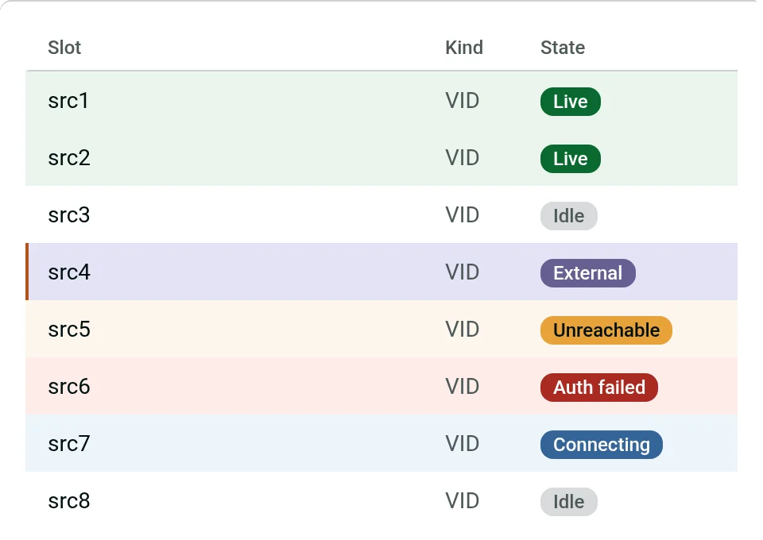
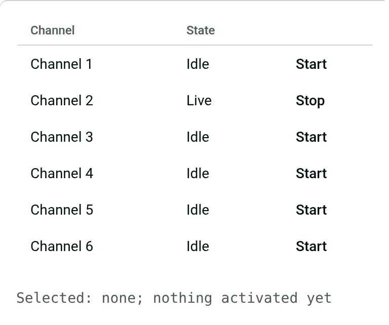
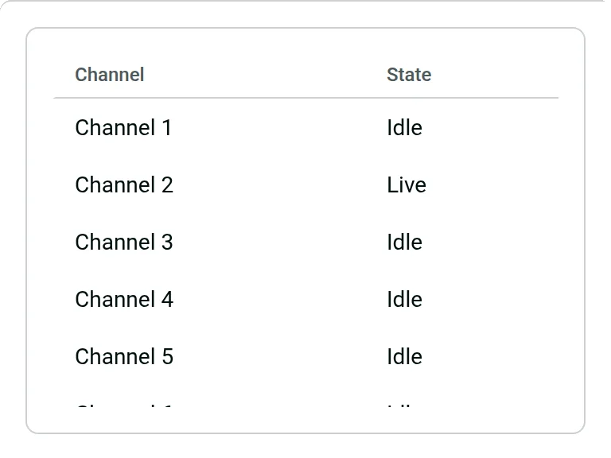
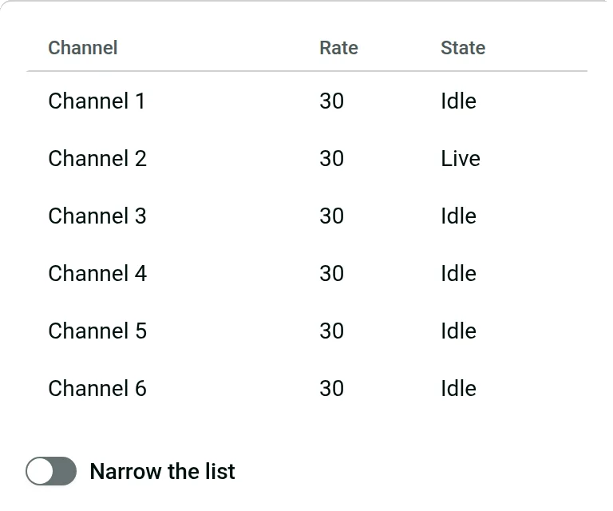
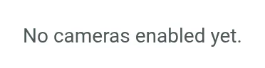
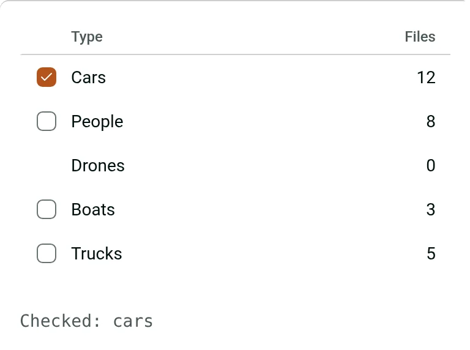
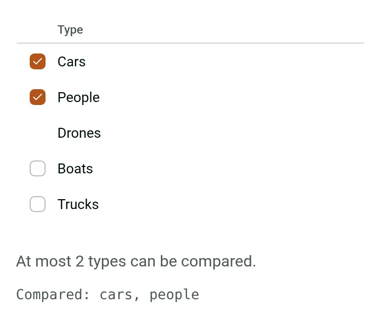
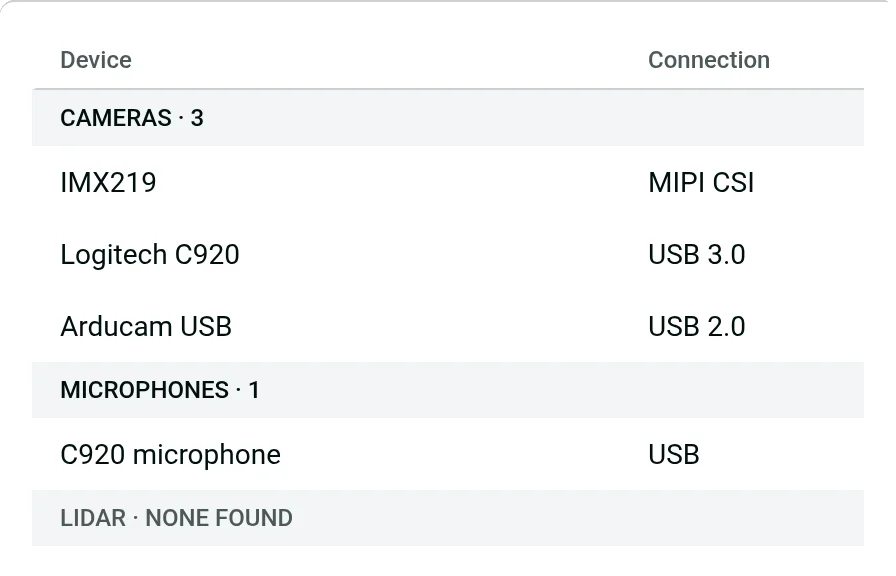

<!-- Written by `npm run docs:pages` from the kit and its examples. Do not edit. -->

# Select list

_Components › Data_ · [All topics](../README.md)

A list of items in columns, one row each, with one row selected.

```html
<neat-select-list label="Streaming slots" [items]="slots()" [trackBy]="slotId" [(selected)]="slot">
  <ng-template neatColumn="name" header="Slot" let-slot>{{ slot.name }}</ng-template>
  <ng-template neatColumn="state" header="State" width="6rem" let-slot>…</ng-template>
</neat-select-list>
```

<picture>
<source media="(prefers-color-scheme: dark)" srcset="../images/select-list/toned.dark.webp">

</picture>

```ts
import { NeatSelectList, NeatColumn } from '@sima/neat-ui/select-list';
```

## Examples

### Channels

Channels in three columns, the last holding a button. Press Up or Down in the list to move the selection, Enter or click a row to activate it. Start and Stop swap the row's object for a new one, as a poll's answer would: the selection stays on its channel.

<picture>
<source media="(prefers-color-scheme: dark)" srcset="../images/select-list/channels.dark.webp">

</picture>

<details>
<summary>Code</summary>

`1-channels.example.ts`

```ts
import { ChangeDetectionStrategy, Component, signal } from '@angular/core';
import { NeatInlineButton } from '@sima/neat-ui';
import { NeatColumn, NeatSelectList } from '@sima/neat-ui/select-list';
import { type Channel, CHANNELS, channelId } from './channels';

@Component({
  selector: 'app-channels',
  imports: [NeatColumn, NeatInlineButton, NeatSelectList],
  changeDetection: ChangeDetectionStrategy.OnPush,
  template: `
    <div class="box wide">
      <neat-select-list
        label="Channels"
        [items]="channels()"
        [trackBy]="channelId"
        [(selected)]="selected"
        (activated)="log.set('Activated ' + $event.name)"
      >
        <ng-template neatColumn="name" header="Channel" let-channel>{{ channel.name }}</ng-template>
        <ng-template neatColumn="state" header="State" width="6rem" let-channel>{{
          channel.state
        }}</ng-template>
        <ng-template neatColumn="action" width="4rem" let-channel>
          <button neatInlineButton type="button" (click)="toggle(channel)">
            {{ channel.state === 'Live' ? 'Stop' : 'Start' }}
          </button>
        </ng-template>
      </neat-select-list>
    </div>
    <p class="showcase-code showcase-muted" aria-live="polite">
      Selected: {{ selected()?.name ?? 'none' }}; {{ log() }}
    </p>
  `,
  styleUrls: ['./channels-box.css', './stack.css'],
})
export class Channels {
  protected readonly channels = signal<readonly Channel[]>(CHANNELS);
  protected readonly selected = signal<Channel | null>(null);
  protected readonly log = signal('nothing activated yet');
  protected readonly channelId = channelId;

  protected toggle(channel: Channel): void {
    const state = channel.state === 'Live' ? 'Idle' : 'Live';
    this.channels.update((channels) =>
      channels.map((candidate) =>
        candidate.id === channel.id ? { ...candidate, state } : candidate,
      ),
    );
  }
}
```

`channels.ts`

```ts
/** A channel of the lists' demos. */
export interface Channel {
  readonly id: number;
  readonly name: string;
  readonly state: 'Idle' | 'Live';
}

/** Two dozen channels, a fifth of them live, so the list scrolls. */
export const CHANNELS: readonly Channel[] = Array.from({ length: 24 }, (_, index) => ({
  id: index + 1,
  name: `Channel ${index + 1}`,
  state: index % 5 === 1 ? 'Live' : 'Idle',
}));

/** An item's identity, as the list's `trackBy` asks for it. */
export const channelId = (channel: Channel): number => channel.id;
```

`channels-box.css`

```css
/* A list fills its container, so the examples give it a size. */
.box {
  height: 16rem;
}

.wide {
  width: 22rem;
}
```

`stack.css`

```css
/* The example's parts, a list and what reports on it, one gap apart. */
:host {
  display: flex;
  flex-direction: column;
  gap: var(--neat-space-3);
}
```

</details>

### On a card

The same list on a card. The card sets `--neat-surface` to its own fill, and the header that stays put over the scrolling rows takes it: scroll the list and look at the header's edge.

<picture>
<source media="(prefers-color-scheme: dark)" srcset="../images/select-list/on-a-card.dark.webp">

</picture>

<details>
<summary>Code</summary>

`2-on-a-card.example.ts`

```ts
import { ChangeDetectionStrategy, Component, signal } from '@angular/core';
import { NeatColumn, NeatSelectList } from '@sima/neat-ui/select-list';
import { type Channel, CHANNELS, channelId } from './channels';

@Component({
  selector: 'app-on-a-card',
  imports: [NeatColumn, NeatSelectList],
  changeDetection: ChangeDetectionStrategy.OnPush,
  template: `
    <div class="box wide card">
      <neat-select-list
        label="Channels on a card"
        [items]="channels"
        [trackBy]="channelId"
        [(selected)]="selected"
      >
        <ng-template neatColumn="name" header="Channel" let-channel>{{ channel.name }}</ng-template>
        <ng-template neatColumn="state" header="State" width="6rem" let-channel>{{
          channel.state
        }}</ng-template>
      </neat-select-list>
    </div>
  `,
  styleUrls: ['./channels-box.css', './on-a-card.example.css'],
})
export class OnACard {
  protected readonly channels = CHANNELS;
  protected readonly selected = signal<Channel | null>(null);
  protected readonly channelId = channelId;
}
```

`channels.ts`

```ts
/** A channel of the lists' demos. */
export interface Channel {
  readonly id: number;
  readonly name: string;
  readonly state: 'Idle' | 'Live';
}

/** Two dozen channels, a fifth of them live, so the list scrolls. */
export const CHANNELS: readonly Channel[] = Array.from({ length: 24 }, (_, index) => ({
  id: index + 1,
  name: `Channel ${index + 1}`,
  state: index % 5 === 1 ? 'Live' : 'Idle',
}));

/** An item's identity, as the list's `trackBy` asks for it. */
export const channelId = (channel: Channel): number => channel.id;
```

`channels-box.css`

```css
/* A list fills its container, so the examples give it a size. */
.box {
  height: 16rem;
}

.wide {
  width: 22rem;
}
```

`on-a-card.example.css`

```css
/* A card as an app draws one: its own surface, which the list's header fills with. */
.card {
  --neat-surface: var(--card);

  box-sizing: border-box;
  padding: var(--neat-space-4);
  border: 1px solid var(--border);
  border-radius: var(--radius);
  background: var(--card);
  color: var(--card-foreground);
}
```

</details>

### Narrowing

A list whose Rate column leaves below 300 px (`hideBelow`). Narrow the list with the switch and the column goes; widen it and it returns.

<picture>
<source media="(prefers-color-scheme: dark)" srcset="../images/select-list/narrowing.dark.webp">

</picture>

<details>
<summary>Code</summary>

`3-narrowing.example.ts`

```ts
import { ChangeDetectionStrategy, Component, signal } from '@angular/core';
import { NeatColumn, NeatSelectList } from '@sima/neat-ui/select-list';
import { NeatSwitch } from '@sima/neat-ui/switch';
import { CHANNELS, channelId } from './channels';

@Component({
  selector: 'app-narrowing',
  imports: [NeatColumn, NeatSelectList, NeatSwitch],
  changeDetection: ChangeDetectionStrategy.OnPush,
  template: `
    <div class="box" [class.wide]="!narrow()" [class.slim]="narrow()">
      <neat-select-list label="Channels, narrowing" [items]="channels" [trackBy]="channelId">
        <ng-template neatColumn="name" header="Channel" let-channel>{{ channel.name }}</ng-template>
        <ng-template neatColumn="rate" header="Rate" width="4rem" [hideBelow]="300">30</ng-template>
        <ng-template neatColumn="state" header="State" width="5rem" let-channel>{{
          channel.state
        }}</ng-template>
      </neat-select-list>
    </div>
    <div class="showcase-row">
      <button neatSwitch [(checked)]="narrow">Narrow the list</button>
    </div>
  `,
  styleUrls: ['./channels-box.css', './narrowing.example.css', './stack.css'],
})
export class Narrowing {
  protected readonly channels = CHANNELS;
  protected readonly channelId = channelId;
  protected readonly narrow = signal(false);
}
```

`channels.ts`

```ts
/** A channel of the lists' demos. */
export interface Channel {
  readonly id: number;
  readonly name: string;
  readonly state: 'Idle' | 'Live';
}

/** Two dozen channels, a fifth of them live, so the list scrolls. */
export const CHANNELS: readonly Channel[] = Array.from({ length: 24 }, (_, index) => ({
  id: index + 1,
  name: `Channel ${index + 1}`,
  state: index % 5 === 1 ? 'Live' : 'Idle',
}));

/** An item's identity, as the list's `trackBy` asks for it. */
export const channelId = (channel: Channel): number => channel.id;
```

`channels-box.css`

```css
/* A list fills its container, so the examples give it a size. */
.box {
  height: 16rem;
}

.wide {
  width: 22rem;
}
```

`narrowing.example.css`

```css
.slim {
  width: 16rem;
}
```

`stack.css`

```css
/* The example's parts, a list and what reports on it, one gap apart. */
:host {
  display: flex;
  flex-direction: column;
  gap: var(--neat-space-3);
}
```

</details>

### No items

A list with no items: `emptyLabel` says why there are no rows.

<picture>
<source media="(prefers-color-scheme: dark)" srcset="../images/select-list/no-items.dark.webp">

</picture>

<details>
<summary>Code</summary>

`4-no-items.example.ts`

```ts
import { ChangeDetectionStrategy, Component } from '@angular/core';
import { NeatColumn, NeatSelectList } from '@sima/neat-ui/select-list';
import { type Channel, channelId } from './channels';

@Component({
  selector: 'app-no-items',
  imports: [NeatColumn, NeatSelectList],
  changeDetection: ChangeDetectionStrategy.OnPush,
  template: `
    <div class="box">
      <neat-select-list
        label="Cameras"
        emptyLabel="No cameras enabled yet."
        [items]="none"
        [trackBy]="channelId"
      >
        <ng-template neatColumn="name" let-channel>{{ channel.name }}</ng-template>
      </neat-select-list>
    </div>
  `,
  styleUrl: './no-items.example.css',
})
export class NoItems {
  protected readonly none: readonly Channel[] = [];
  protected readonly channelId = channelId;
}
```

`channels.ts`

```ts
/** A channel of the lists' demos. */
export interface Channel {
  readonly id: number;
  readonly name: string;
  readonly state: 'Idle' | 'Live';
}

/** Two dozen channels, a fifth of them live, so the list scrolls. */
export const CHANNELS: readonly Channel[] = Array.from({ length: 24 }, (_, index) => ({
  id: index + 1,
  name: `Channel ${index + 1}`,
  state: index % 5 === 1 ? 'Live' : 'Idle',
}));

/** An item's identity, as the list's `trackBy` asks for it. */
export const channelId = (channel: Channel): number => channel.id;
```

`no-items.example.css`

```css
.box {
  width: 22rem;
  height: 6rem;
}
```

</details>

### Checked

Asset types with a box each, Drones having none since it has no files. The Files column fits its content and ends its figures at the column's end. Try Space on a row, Ctrl-click, Shift-click and Ctrl+A.

<picture>
<source media="(prefers-color-scheme: dark)" srcset="../images/select-list/checked.dark.webp">

</picture>

<details>
<summary>Code</summary>

`5-checked.example.ts`

```ts
import { ChangeDetectionStrategy, Component, signal } from '@angular/core';
import { NeatColumn, NeatSelectList } from '@sima/neat-ui/select-list';
import { ASSET_TYPES, hasFiles, typeId } from './asset-types';

@Component({
  selector: 'app-checked',
  imports: [NeatColumn, NeatSelectList],
  changeDetection: ChangeDetectionStrategy.OnPush,
  template: `
    <div class="box">
      <neat-select-list
        label="Asset types"
        checkable
        [items]="types"
        [trackBy]="typeId"
        [canCheck]="hasFiles"
        [(checked)]="checked"
      >
        <ng-template neatColumn="name" header="Type" let-type>{{ type.name }}</ng-template>
        <ng-template neatColumn="files" header="Files" width="max-content" align="end" let-type>{{
          type.files
        }}</ng-template>
      </neat-select-list>
    </div>
    <p class="showcase-code showcase-muted" aria-live="polite">
      Checked: {{ checked().length ? checked().join(', ') : 'none' }}
    </p>
  `,
  styleUrls: ['./asset-types-box.css', './stack.css'],
})
export class Checked {
  protected readonly types = ASSET_TYPES;
  protected readonly typeId = typeId;
  protected readonly hasFiles = hasFiles;
  protected readonly checked = signal<readonly string[]>(['cars']);
}
```

`asset-types.ts`

```ts
/** An asset type of the checked lists' demos; one has no files, so nothing to check. */
export interface AssetType {
  readonly id: string;
  readonly name: string;
  readonly files: number;
}

export const ASSET_TYPES: readonly AssetType[] = [
  { id: 'cars', name: 'Cars', files: 12 },
  { id: 'people', name: 'People', files: 8 },
  { id: 'drones', name: 'Drones', files: 0 },
  { id: 'boats', name: 'Boats', files: 3 },
  { id: 'trucks', name: 'Trucks', files: 5 },
];

export const typeId = (type: AssetType): string => type.id;

/** Only a type with files has a box. */
export const hasFiles = (type: AssetType): boolean => type.files > 0;
```

`asset-types-box.css`

```css
/* A list fills its container, so the examples give it a size. */
.box {
  width: 22rem;
  height: 14rem;
}
```

`stack.css`

```css
/* The example's parts, a list and what reports on it, one gap apart. */
:host {
  display: flex;
  flex-direction: column;
  gap: var(--neat-space-3);
}
```

</details>

### Capped

A cap of two checked types: with two checked, the other boxes are drawn disabled; hover one for the reason. The note under the list says the cap in words, for touch, which has no tooltip.

<picture>
<source media="(prefers-color-scheme: dark)" srcset="../images/select-list/capped.dark.webp">

</picture>

<details>
<summary>Code</summary>

`6-capped.example.ts`

```ts
import { ChangeDetectionStrategy, Component, signal } from '@angular/core';
import { NeatColumn, NeatSelectList } from '@sima/neat-ui/select-list';
import { type AssetType, ASSET_TYPES, hasFiles, typeId } from './asset-types';

/** How many types the list compares at most. */
const CAP = 2;
const CAP_NOTE = `At most ${CAP} types can be compared.`;

@Component({
  selector: 'app-capped',
  imports: [NeatColumn, NeatSelectList],
  changeDetection: ChangeDetectionStrategy.OnPush,
  template: `
    <div class="box">
      <neat-select-list
        label="Types to compare"
        checkable
        [items]="types"
        [trackBy]="typeId"
        [canCheck]="hasFiles"
        [checkBlocked]="atCap"
        [(checked)]="compared"
      >
        <ng-template neatColumn="name" header="Type" let-type>{{ type.name }}</ng-template>
      </neat-select-list>
    </div>
    <p class="showcase-muted">{{ note }}</p>
    <p class="showcase-code showcase-muted" aria-live="polite">
      Compared: {{ compared().length ? compared().join(', ') : 'none' }}
    </p>
  `,
  styleUrls: ['./asset-types-box.css', './stack.css'],
})
export class Capped {
  protected readonly types = ASSET_TYPES;
  protected readonly typeId = typeId;
  protected readonly hasFiles = hasFiles;
  protected readonly note = CAP_NOTE;
  protected readonly compared = signal<readonly string[]>(['cars', 'people']);

  /** The reason a row cannot be checked now: the cap is reached and the row is not checked. */
  protected readonly atCap = (type: AssetType): string | null =>
    this.compared().length >= CAP && !this.compared().includes(type.id) ? CAP_NOTE : null;
}
```

`asset-types.ts`

```ts
/** An asset type of the checked lists' demos; one has no files, so nothing to check. */
export interface AssetType {
  readonly id: string;
  readonly name: string;
  readonly files: number;
}

export const ASSET_TYPES: readonly AssetType[] = [
  { id: 'cars', name: 'Cars', files: 12 },
  { id: 'people', name: 'People', files: 8 },
  { id: 'drones', name: 'Drones', files: 0 },
  { id: 'boats', name: 'Boats', files: 3 },
  { id: 'trucks', name: 'Trucks', files: 5 },
];

export const typeId = (type: AssetType): string => type.id;

/** Only a type with files has a box. */
export const hasFiles = (type: AssetType): boolean => type.files > 0;
```

`asset-types-box.css`

```css
/* A list fills its container, so the examples give it a size. */
.box {
  width: 22rem;
  height: 14rem;
}
```

`stack.css`

```css
/* The example's parts, a list and what reports on it, one gap apart. */
:host {
  display: flex;
  flex-direction: column;
  gap: var(--neat-space-3);
}
```

</details>

### Grouped

Devices under headings. The scan found them in a mixed order and the list sorts them into their groups; LiDAR has none, so its muted heading stands alone. Press Down through the list: the selection crosses the headings without stopping on one.

<picture>
<source media="(prefers-color-scheme: dark)" srcset="../images/select-list/grouped.dark.webp">

</picture>

<details>
<summary>Code</summary>

`7-grouped.example.ts`

```ts
import { ChangeDetectionStrategy, Component, signal } from '@angular/core';
import { NeatColumn, NeatSelectList, type NeatSelectListGroup } from '@sima/neat-ui/select-list';

/** A device, in scan order: the list groups the devices by kind. */
interface Device {
  readonly id: number;
  readonly name: string;
  readonly kind: 'camera' | 'microphone' | 'lidar';
  readonly connection: string;
}

const DEVICES: readonly Device[] = [
  { id: 1, name: 'IMX219', kind: 'camera', connection: 'MIPI CSI' },
  { id: 2, name: 'C920 microphone', kind: 'microphone', connection: 'USB' },
  { id: 3, name: 'Logitech C920', kind: 'camera', connection: 'USB 3.0' },
  { id: 4, name: 'Arducam USB', kind: 'camera', connection: 'USB 2.0' },
];

/** The groups, in order: the app writes each label, its count included. */
const GROUPS: readonly NeatSelectListGroup[] = [
  { key: 'camera', label: 'Cameras · 3' },
  { key: 'microphone', label: 'Microphones · 1' },
  { key: 'lidar', label: 'LiDAR · none found', muted: true },
];

@Component({
  selector: 'app-grouped',
  imports: [NeatColumn, NeatSelectList],
  changeDetection: ChangeDetectionStrategy.OnPush,
  template: `
    <div class="box">
      <neat-select-list
        label="Devices"
        [items]="devices"
        [trackBy]="deviceId"
        [groups]="groups"
        [groupOf]="deviceKind"
        [(selected)]="selected"
      >
        <ng-template neatColumn="name" header="Device" let-device>{{ device.name }}</ng-template>
        <ng-template neatColumn="connection" header="Connection" width="6rem" let-device>{{
          device.connection
        }}</ng-template>
      </neat-select-list>
    </div>
  `,
  styleUrl: './grouped.example.css',
})
export class Grouped {
  protected readonly devices = DEVICES;
  protected readonly groups = GROUPS;
  protected readonly selected = signal<Device | null>(null);
  protected readonly deviceId = (device: Device) => device.id;
  protected readonly deviceKind = (device: Device) => device.kind;
}
```

`grouped.example.css`

```css
/* Tall enough for every group, the muted one at the end included. */
.box {
  width: 26rem;
  height: 20rem;
}
```

</details>

### Toned

Streams with each row tinted by its state, and the same tone on its chip. The fourth is selected: hover another row and compare the two, the selected one keeping its bar. The neutral rows have no tint.

<picture>
<source media="(prefers-color-scheme: dark)" srcset="../images/select-list/toned.dark.webp">

</picture>

<details>
<summary>Code</summary>

`8-toned.example.ts`

```ts
import { ChangeDetectionStrategy, Component, signal } from '@angular/core';
import { type NeatTone } from '@sima/neat-ui';
import { NeatStatusChip } from '@sima/neat-ui/status-chip';
import { NeatColumn, NeatSelectList } from '@sima/neat-ui/select-list';

/** A stream: its state's tone tints the row and colors its chip. */
interface Stream {
  readonly id: number;
  readonly name: string;
  readonly tone: NeatTone;
  readonly state: string;
}

/** What each tone says, as Streaming's slot states do. */
const STATES: Record<NeatTone, string> = {
  neutral: 'Idle',
  success: 'Live',
  warning: 'Unreachable',
  danger: 'Auth failed',
  info: 'Connecting',
  highlight: 'External',
};

const STREAMS: readonly Stream[] = (
  ['success', 'success', 'neutral', 'highlight', 'warning', 'danger', 'info', 'neutral'] as const
).map((tone, index) => ({
  id: index + 1,
  name: `src${index + 1}`,
  tone,
  state: STATES[tone],
}));

@Component({
  selector: 'app-toned',
  imports: [NeatColumn, NeatSelectList, NeatStatusChip],
  changeDetection: ChangeDetectionStrategy.OnPush,
  template: `
    <div class="box">
      <neat-select-list
        label="Streams"
        [items]="streams"
        [trackBy]="streamId"
        [rowTone]="streamTone"
        [(selected)]="selected"
      >
        <ng-template neatColumn="name" header="Slot" let-stream>{{ stream.name }}</ng-template>
        <ng-template neatColumn="kind" header="Kind" width="3rem">
          <span class="showcase-muted">VID</span>
        </ng-template>
        <ng-template neatColumn="state" header="State" width="7rem" let-stream>
          <neat-status-chip [tone]="stream.tone">{{ stream.state }}</neat-status-chip>
        </ng-template>
      </neat-select-list>
    </div>
  `,
  styleUrl: './toned.example.css',
})
export class Toned {
  protected readonly streams = STREAMS;
  protected readonly selected = signal<Stream | null>(STREAMS[3]);
  protected readonly streamId = (stream: Stream) => stream.id;
  protected readonly streamTone = (stream: Stream) => stream.tone;
}
```

`toned.example.css`

```css
/* The list fills its container, so the example gives it a size; it sits on the page, not a card. */
.box {
  width: 28rem;
  height: 20rem;
}
```

</details>

## API

### `NeatSelectList`

Component from `@sima/neat-ui/select-list`, selector `neat-select-list`.

The app lays out the columns with `neatColumn` templates. The list fills its container, which needs a height, and scrolls its rows inside, under a header that stays put.

The header sits in the scrolling area, sticky at its top, and filled with `--neat-surface`. That is the page's background, or the surface a dialog, a popover or an app's card sets.

`trackBy` gives an item's identity, unique in the list. When `items` is replaced by new objects, such as a poll's answer, the selection follows the item with the same key. Rows, with the state in their cells, are kept rather than rebuilt. `trackBy` is called once per item whenever `items` changes, never while the list is only checked or the selection moves.

It is a single-select `listbox` named by `label`, whose `option` rows are `aria-selected`. Selection follows focus. The listbox is the one tab stop, holds the focus, and names the selected row in `aria-activedescendant`.

- ArrowDown and ArrowUp move the selection. When nothing is selected, the first press picks the first or last row.
- Home and End jump to the ends.
- The selected row scrolls into view, within the list's own area only. The page around it stays where it is.
- Enter, and a click on a row, tell `activated` with the row's item. With `activateOn="double-click"`, a click only selects, and a double click tells it. Enter still does.

A double click does not select a row's text. A click on a control in a cell, and every key pressed while one has the focus, are that control's: they neither select nor activate. Controls in cells are ordinary tab stops after the listbox.

The header repeats the columns' labels for the eye, and is hidden from assistive technology. The rows read as the text of their cells in order, as a listbox's options do, since a listbox cannot name its columns.

`hint` is read as the listbox's description, for keys the app adds on top of these.

**Checked mode** (`checkable`) is for acting on several rows. Each row that `canCheck` allows has a box before its cells, and `checked` holds the keys (`trackBy`'s) of the checked rows.

`checked` holds keys rather than items. It keeps the keys of rows it does not list, such as a file in another folder or a type a filter hides. A newly checked key is appended and an unchecked one removed. The rest are left as they are.

The listbox is then multi-selectable, as the WAI-ARIA multi-select listbox has it. A checkable row is `aria-selected` while it is checked. A row that cannot be checked has no `aria-selected`.

The selection that follows the arrow keys (`selected`) stays. It is the row the keyboard is on, named in `aria-activedescendant` and drawn with the bar. In checked mode:

- Space checks or unchecks that row.
- A click on a row's box checks or unchecks it, and does nothing else.
- A click elsewhere on the row selects and activates it, as in the single mode. On the selected row it checks or unchecks it instead, as Space does. A row that cannot be checked is activated again, as before.
- The second click of a double click never checks. A double click on the already selected checkable row checks it once, with its first click. With `activateOn="double-click"`, the `dblclick` then only activates.
- Ctrl-click or Cmd-click on a row checks or unchecks it, and selects it without activating it.
- Shift-click checks the rows from the anchor to the clicked one, inclusive, and selects the clicked one. The anchor is the row last clicked plainly, with Ctrl or Cmd, or checked by Space or its box. Without one, it is the selected row, else the clicked row alone.
- A range only checks, never unchecks. Ctrl+A or Cmd+A checks every row.

None of these checks a row without a box or a blocked one, and a row they do not check stays as it is. The boxes are not tab stops. The multi-selectable listbox says what checking is, so a checked list needs no `hint` of its own.

**Blocked checks** (`checkBlocked`) hold a row's box as it is while the app gives a reason, such as a cap: "At most 8 runs can be compared." The box is drawn disabled. Neither Space nor a click on it checks or unchecks the row.

Everything else about the row stays, since only its box is blocked. The keys still land on it, and a click and Enter still select and activate it.

Its option keeps `aria-selected`, false while unchecked, and is `aria-disabled`. In this listbox selecting is checking. So a disabled option says that Space will not check it, where an enabled one would promise a check that silently fails. `aria-disabled` blocks no events, and the row stays the active descendant, so it is still reached and activated.

The reason describes the option (`aria-describedby`), so a screen reader says it as the keys land on the row. A tooltip on the box shows it on hover. A tooltip never opens on touch, so an app with a cap says it in its own text too.

Any reason but null blocks, so give a non-empty one: it is what is announced. `canCheck` still means whether a row has a box at all.

**Row tones** (`rowTone`) tint a row with a soft fill of a status color, the tone its status chip has ([`NeatTone`](../theme/colors.md#neattone)). So a state reads along the whole row: the app gives both the same tone.

A `neutral` row is untinted. A toned row still shows hover and selection, with more of its tone, and the selected one keeps its bar. The tints are mixed over the content background (`--background`), so a toned list belongs on it, not on a card. The words in the row still carry the state, and the tint repeats them.

**Groups** (`groups`, with `groupOf` naming an item's group by its key) put the rows under headings. The groups come in their order, and each item keeps its order within its group.

A group is a `group` named by its heading, which spans the columns. An empty group shows its heading alone, and a `muted` one grays it. The arrow keys, Home and End move over the rows as shown, never onto a heading. A click on a heading does nothing.

An item whose group is not listed is a mistake in the app. It throws in dev mode. In production it shows after the groups, under no heading and set off from the last group by a rule, rather than going missing.

Typing a letter to jump to a row, Page Up and Page Down, and a disabled row are not offered: none is needed yet.

**Inputs**

- **`label`** `string`, required

  The accessible name of the list.

- **`items`** `readonly T[]`, required

  The items, one row each, in the order given (within its group, with `groups`).

- **`trackBy`** `(item: T) => K`, required

  An item's identity, unique in the list.

- **`checkable`** `boolean`, default `false`, transform `booleanAttribute`

  Checked mode: a box on each row that `canCheck` allows, for acting on several rows.

- **`canCheck`** `(item: T) => boolean`, default `() => true`

  In checked mode, whether an item's row has a box; called once per item as `items` change.

- **`checkBlocked`** `(item: T) => string | null`, default `() => null`

  In checked mode, why a row with a box cannot be ticked or unticked now (a cap that is reached), or null while it can. Any string blocks, so make it a sentence: it is the row's description and its box's tooltip. Called for each row with a box as `items` or `checked` change.

- **`rowTone`** `(item: T) => NeatTone`, default `() => 'neutral'`

  An item's row tone, `neutral` (untinted) by default; called once per item as `items` change.

- **`groups`** `readonly NeatSelectListGroup[] | null`, default `null`

  The groups to show the rows under, in order; `null` (the default) for no headings.

- **`groupOf`** `(item: T) => string`, default `() => ''`

  With `groups`, the key of an item's group.

  It is called once per item as the inputs that shape the rows change: `items`, `groups` and the other per-item functions. It is never called as the selection moves.

- **`emptyLabel`** `string`, default `''`

  What to say, in place of rows, while there are no items.

- **`hint`** `string`, default `''`

  Text for assistive technology that says what keys an app adds beyond the listbox's own.

  Delete on a row is one. The text describes the listbox, and is not shown.

- **`activateOn`** `NeatActivateOn`, default `'click'`

  What the pointer does to a row: `click` (the default) or `double-click`.

  With `click`, a click selects the row and tells `activated`. With `double-click`, a click only selects it, and a double click tells `activated`, as a file manager opens a folder. Enter tells it in both.

**Models (two-way)**

- **`selected`** `T | null`, default `null`

  The selected item: the row the keyboard is on; `null` while there is none.

- **`checked`** `readonly K[]`, default `[]`

  In checked mode, the keys of the checked rows, including rows the list does not show.

**Outputs**

- **`activated`** `T`

  The item of the row that was activated: by a click or double click (`activateOn`), or Enter.

**Methods**

- **`resetScroll`**

  ```ts
  resetScroll(): void
  ```

  Scrolls back to the top, or to the selected row when there is one in the list.

  A different set of rows, such as another folder, needs it. Call it once the new rows are rendered.

- **`focus`**

  ```ts
  focus(): void
  ```

  Puts the keyboard focus on the list, where the arrow keys work.

### `NeatColumn`

Template directive from `@sima/neat-ui/select-list`, selector `ng-template[neatColumn]`.

One column of a `neat-select-list`, as a template for the cells in it:

```html
<ng-template neatColumn="state" header="State" width="6rem" let-slot>{{ slot.state }}</ng-template>
```

The key names the column. `header` is the label over it. With no label on any column, there is no header row. The template gets the item as its implicit context.

`width` is the column's CSS track size in the list's grid, `1fr` by default. The header and the rows share the grid's tracks. So a content-sized width (`auto`, `max-content`) fits the widest of the label and the cells. `align="end"` puts the label and the cells' text at the end of the column, as numbers read best.

A cell is a block that may shrink to nothing (`min-width: 0`), so it does not push the next column out. It does not cut its content, though. A long text wraps, and an unbroken one overflows into the next cell, unless the template truncates it. Truncate with an element that has `overflow: hidden`, `text-overflow: ellipsis` and `white-space: nowrap`.

`hideBelow` is a width of the list in CSS pixels, such as `[hideBelow]="720"`. While the list is narrower, the column and its header leave the layout entirely, as if the template were not there. Use it for columns that matter less than the others on a narrow screen.

**Inputs**

- **`neatColumn`** `string`, required

  The column's name, written as the directive's own attribute: `neatColumn="state"`.

- **`header`** `string`, default `''`

  The label over the column; empty by default, and no header row while no column has one.

- **`width`** `string`, default `'1fr'`

  The column's track size in the list's grid, any CSS grid track size (`6rem`, `auto`).

- **`align`** `'start' | 'end'`, default `'start'`

  Where the label and the cells' text sit in the column.

- **`hideBelow`** `number`

  The list's width in CSS pixels below which the column is not shown; always shown if unset.

### `NeatSelectListGroup`

Interface from `@sima/neat-ui/select-list`.

A group of a `neat-select-list`'s rows, under a heading.

`key` is what `groupOf` returns for its items. `label` is the heading's text, the app's own, a count included if it wants one. `muted` grays the heading, for a group with nothing in it.

**Members**

- **`key`** `string`

- **`label`** `string`

- **`muted`** `boolean`, optional

### `NeatActivateOn`

Type from `@sima/neat-ui/select-list`.

What a pointer does to a row: `click` or `double-click`.

With `click`, a click selects the row and tells `activated`. With `double-click`, a click only selects it, and a double click tells `activated`. Enter tells it in both.

```ts
type NeatActivateOn = 'click' | 'double-click'
```
