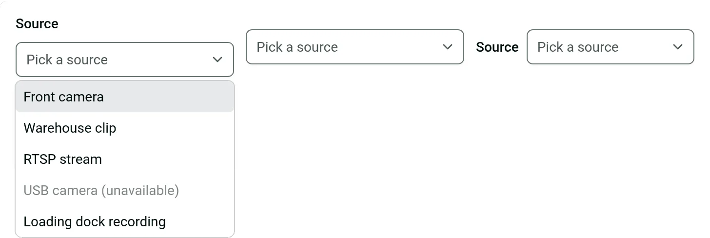
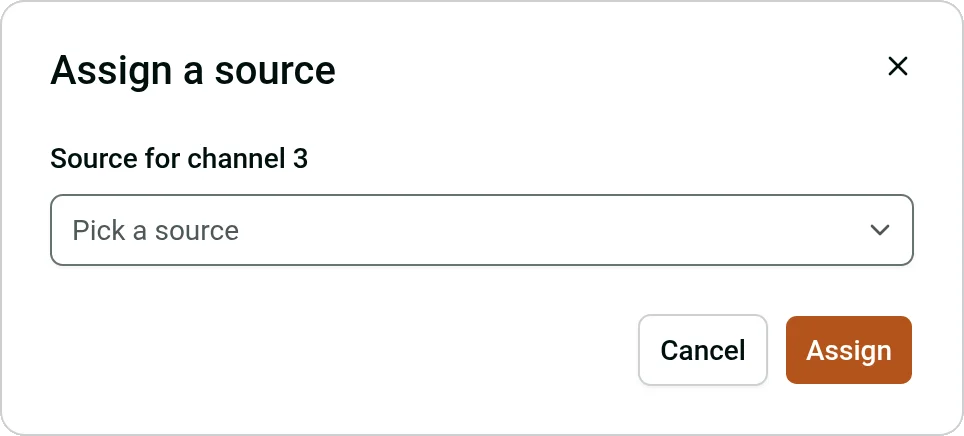

<!-- Written by `npm run docs:pages` from the kit and its examples. Do not edit. -->

# Select

_Components › Forms_ · [All topics](../README.md)

A choice of one value from a list, with no free text:

```html
<neat-select label="Source" placeholder="Pick a source" [options]="sources" [(value)]="source" />
```

<picture>
<source media="(prefers-color-scheme: dark)" srcset="../images/select/label-positions.dark.webp">

</picture>

```ts
import { NeatSelect } from '@sima/neat-ui/select';
```

## Examples

### Label positions

Four selects over one list: the label shown above, the label hidden (it still names the select), the label inline before the select, and a disabled select. The first three share one value, so a pick in any of them shows in the others and in the line below.

<picture>
<source media="(prefers-color-scheme: dark)" srcset="../images/select/label-positions.dark.webp">

</picture>

<details>
<summary>Code</summary>

`1-label-positions.example.ts`

```ts
import { ChangeDetectionStrategy, Component, signal } from '@angular/core';
import { NeatSelect } from '@sima/neat-ui/select';
import { SOURCES } from './sources';

@Component({
  selector: 'app-label-positions',
  imports: [NeatSelect],
  changeDetection: ChangeDetectionStrategy.OnPush,
  template: `
    <div class="selects">
      <neat-select
        label="Source"
        placeholder="Pick a source"
        showLabel
        [options]="sources"
        [(value)]="source"
      />
      <neat-select
        label="Source, label hidden"
        placeholder="Pick a source"
        [options]="sources"
        [(value)]="source"
      />
      <neat-select
        label="Source"
        placeholder="Pick a source"
        labelPosition="inline"
        [options]="sources"
        [(value)]="source"
      />
      <neat-select label="Disabled" disabled [options]="sources" [value]="'rtsp'" />
    </div>
    <p class="showcase-code showcase-muted" aria-live="polite">
      Selected: {{ source() ?? 'none' }}
    </p>
  `,
  styleUrls: ['./stack.css', './label-positions.example.css'],
})
export class LabelPositions {
  protected readonly sources = SOURCES;
  protected readonly source = signal<string | null>(null);
}
```

`sources.ts`

```ts
import type { NeatSelectOption } from '@sima/neat-ui/select';

/** The choices of the select examples; one is disabled, so the keys skip it. */
export const SOURCES: NeatSelectOption<string>[] = [
  { value: 'camera', label: 'Front camera' },
  { value: 'clip', label: 'Warehouse clip' },
  { value: 'rtsp', label: 'RTSP stream' },
  { value: 'usb', label: 'USB camera (unavailable)', disabled: true },
  { value: 'file', label: 'Loading dock recording' },
];
```

`stack.css`

```css
/* The example's rows one gap apart. */
:host {
  display: flex;
  flex-direction: column;
  gap: var(--neat-space-3);
}
```

`label-positions.example.css`

```css
/* A select fills its container's width, so the row gives each one. */
.selects {
  display: flex;
  flex-wrap: wrap;
  align-items: center;
  gap: var(--neat-space-3);
}

neat-select {
  width: 14rem;
}
```

</details>

### In a dialog

A select in a dialog that assigns a source to a channel. Press Escape with its list open, then once more, and see what each one closes; the line below says how the dialog ended.

<picture>
<source media="(prefers-color-scheme: dark)" srcset="../images/select/in-a-dialog.dark.webp">

</picture>

<details>
<summary>Code</summary>

`2-in-a-dialog.example.ts`

```ts
import {
  ChangeDetectionStrategy,
  Component,
  inject,
  signal,
  type TemplateRef,
} from '@angular/core';
import { NeatButton } from '@sima/neat-ui';
import { NeatDialog, NeatDialogActions, NeatDialogBody } from '@sima/neat-ui/dialog';
import { NeatSelect } from '@sima/neat-ui/select';
import { SOURCES } from './sources';

@Component({
  selector: 'app-in-a-dialog',
  imports: [NeatButton, NeatDialogActions, NeatDialogBody, NeatSelect],
  changeDetection: ChangeDetectionStrategy.OnPush,
  template: `
    <div class="showcase-row">
      <button neatButton type="button" variant="outlined" (click)="open(assignDialog)">
        Assign a source…
      </button>
    </div>
    <p class="showcase-code showcase-muted" aria-live="polite">{{ result() }}</p>

    <ng-template #assignDialog let-dialog>
      <neat-dialog-body>
        <neat-select
          label="Source for channel 3"
          showLabel
          placeholder="Pick a source"
          [options]="sources"
          [(value)]="source"
        />
      </neat-dialog-body>
      <neat-dialog-actions>
        <button neatButton type="button" variant="outlined" (click)="dialog.close()">Cancel</button>
        <button neatButton type="button" (click)="dialog.close(source())">Assign</button>
      </neat-dialog-actions>
    </ng-template>
  `,
  styleUrl: './stack.css',
})
export class InADialog {
  private readonly dialogs = inject(NeatDialog);
  protected readonly sources = SOURCES;
  protected readonly source = signal<string | null>(null);
  protected readonly result = signal('Dialog not opened yet');

  protected async open(content: TemplateRef<unknown>): Promise<void> {
    const source = await this.dialogs.open<string | null>(content, { title: 'Assign a source' })
      .closed;
    this.result.set(
      source === undefined ? 'Dialog dismissed' : `Dialog assigned ${source ?? 'nothing'}`,
    );
  }
}
```

`sources.ts`

```ts
import type { NeatSelectOption } from '@sima/neat-ui/select';

/** The choices of the select examples; one is disabled, so the keys skip it. */
export const SOURCES: NeatSelectOption<string>[] = [
  { value: 'camera', label: 'Front camera' },
  { value: 'clip', label: 'Warehouse clip' },
  { value: 'rtsp', label: 'RTSP stream' },
  { value: 'usb', label: 'USB camera (unavailable)', disabled: true },
  { value: 'file', label: 'Loading dock recording' },
];
```

`stack.css`

```css
/* The example's rows one gap apart. */
:host {
  display: flex;
  flex-direction: column;
  gap: var(--neat-space-3);
}
```

</details>

## API

### `NeatSelect`

Component from `@sima/neat-ui/select`, selector `neat-select`.

`label` is the accessible name of the select and of its list; `showLabel` also shows it above the select, and `labelPosition="inline"` shows it before the select on the same row instead (for a select in a toolbar or a heading); a click on the shown label opens the list. The shown label is drawn as `neat-field`'s is, and `size` matches `neatInput`'s and `neatButton`'s, so a select in a row of fields and buttons of the same size lines up with them. `options` are `{ value, label, disabled? }`; the selected value is `value`, `null` while there is none, and the trigger shows the selected option's label or, without one, `placeholder`; a value that is not among the options (a deleted file, options that load later) shows the placeholder as well, in its muted color. The select fills its container's width (inline, the width its label leaves), and its list is as wide as the select.

It follows the WAI-ARIA select-only combobox. On the trigger, Down, Up, Enter and Space open the list; open, Down, Up, Home, End and Page Up and Down move through the options (disabled ones are skipped), typing a few letters jumps to the option whose label starts with them, Enter or Space picks the active option, Tab closes the list and moves on, and Escape closes it without picking. Focus stays on the trigger throughout; `aria-activedescendant` names the active option.

Escape is handled here first. An open select takes it, closes, and stops it there: a dialog around the select (or a page shortcut on Escape) never sees the key that closed the list. With the list closed, Escape goes on to whatever is listening. The list is a popup on the overlay layer, above a dialog that holds the select.

**Inputs**

- **`label`** `string`, required

  The accessible name of the select and its list; shown with `showLabel`, or always when `labelPosition` is `inline`.

- **`options`** `readonly NeatSelectOption<T>[]`, required

  The choices in the order listed, each a value with the label it shows; one may be disabled.

- **`placeholder`** `string`, default `''`

  What the trigger shows while no option is selected.

- **`showLabel`** `boolean`, default `false`, transform `booleanAttribute`

  Shows `label` above the select.

- **`labelPosition`** `NeatSelectLabelPosition`, default `'above'`

  Where the label sits: `above` (the default), as a field's and only with `showLabel`, or `inline`, which shows it before the trigger on its row by itself. It is the same `label` element, for the trigger, either way.

- **`disabled`** `boolean`, default `false`, transform `booleanAttribute`

  Turns the whole select off: it cannot be opened or changed.

- **`size`** `NeatSelectSize`, default `'medium'`

  The trigger's height: `medium` (2.25rem) or `small` (2rem), as the kit's input and button.

**Models (two-way)**

- **`value`** `T | null`, default `null`

  The selected option's value; `null` while there is none. Options are matched with `Object.is`.

### `NeatSelectOption`

Interface from `@sima/neat-ui/select`.

One choice of a `neat-select`.

**Members**

- **`value`** `T`

- **`label`** `string`

  What the option shows, and what a screen reader reads.

- **`disabled`** `boolean`, optional

  A disabled option is shown but cannot be picked, and the arrow keys skip it.

### `NeatSelectSize`

Type from `@sima/neat-ui/select`.

`medium` matches the kit's medium input and button (2.25rem), `small` the small ones (2rem).

```ts
type NeatSelectSize = 'small' | 'medium'
```

### `NeatSelectLabelPosition`

Type from `@sima/neat-ui/select`.

Where a shown label sits: over the select, as a field's does, or before it on its row.

```ts
type NeatSelectLabelPosition = 'above' | 'inline'
```
