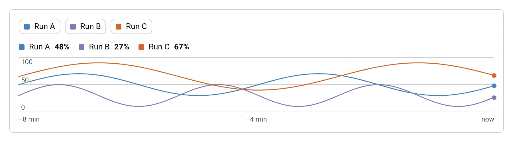
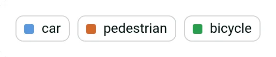

<!-- Written by `npm run docs:pages` from the kit and its examples. Do not edit. -->

# Swatch

_Components › Charts_ · [All topics](../README.md)

A color as a small square, for a label that stands for something drawn in that color (a class in the video overlays or the bird's-eye view, an item in an app's own legend):

```html
<neat-swatch [color]="classColor" /> {{ label }}
```

<picture>
<source media="(prefers-color-scheme: dark)" srcset="../images/series-swatch/run-chips.dark.webp">

</picture>

```ts
import { NeatSwatch, NeatSeriesSwatch } from '@sima/neat-ui';
```

## Examples

### Run chips

A chip for each of three compared runs, over the chart that draws them: the chip's swatch is the run's place in `series`, so it matches the run's line in both themes.

<picture>
<source media="(prefers-color-scheme: dark)" srcset="../images/series-swatch/run-chips.dark.webp">

</picture>

<details>
<summary>Code</summary>

`1-run-chips.example.ts`

```ts
import { ChangeDetectionStrategy, Component } from '@angular/core';
import { NeatSeriesSwatch } from '@sima/neat-ui';
import { NeatTimeChart } from '@sima/neat-ui/charts';
import { percent, RUNS, TIMES } from './data';

@Component({
  selector: 'app-run-chips',
  imports: [NeatSeriesSwatch, NeatTimeChart],
  changeDetection: ChangeDetectionStrategy.OnPush,
  template: `
    <div class="card">
      <ul class="chips" aria-label="Compared runs">
        @for (run of runs; track run.key) {
          <li><neat-series-swatch [index]="$index" />{{ run.label }}</li>
        }
      </ul>
      <neat-time-chart
        label="Load by run"
        headless
        [series]="runs"
        [times]="times"
        [domain]="[0, 100]"
        [format]="percent"
      />
    </div>
  `,
  styleUrl: './run-chips.example.css',
})
export class RunChips {
  protected readonly runs = RUNS;
  protected readonly times = TIMES;
  protected readonly percent = percent;
}
```

`data.ts`

```ts
import type { NeatChartFormat, NeatSeries } from '@sima/neat-ui/charts';

/** A sine wave of `count` samples: a plausible, smooth metric. */
function sine(count: number, cycles: number, low: number, high: number): number[] {
  return Array.from({ length: count }, (_, index) => {
    const wave = (Math.sin((index / count) * cycles * 2 * Math.PI) + 1) / 2;
    return Number((low + wave * (high - low)).toFixed(2));
  });
}

/**
 * Eight minutes of samples four seconds apart, ending at a fixed instant so the demo stands
 * still.
 */
const SAMPLES = 120;
export const TIMES: readonly number[] = Array.from(
  { length: SAMPLES },
  (_, index) => Date.UTC(2026, 9, 24, 12, 0, 0) + index * 4000,
);

export const percent: NeatChartFormat = (value) => `${value.toFixed(0)}%`;

/** Three runs of the same measurement, compared on one chart. */
export const RUNS: readonly NeatSeries[] = [
  { key: 'a', label: 'Run A', values: sine(SAMPLES, 2, 30, 70) },
  { key: 'b', label: 'Run B', values: sine(SAMPLES, 3, 10, 50) },
  { key: 'c', label: 'Run C', values: sine(SAMPLES, 1.5, 40, 90) },
];
```

`run-chips.example.css`

```css
:host {
  display: block;
}

/* The chart draws on the card's fill, so the card says which: for its labels' halos. */
.card {
  --neat-surface: var(--card);

  display: flex;
  flex-direction: column;
  gap: var(--neat-space-3);
  padding: var(--neat-space-4);
  border: 1px solid var(--border);
  border-radius: var(--radius);
  background: var(--card);
  color: var(--card-foreground);
}

/* A run's chip, as an app would draw it: the swatch and the run's name. */
.chips {
  display: flex;
  flex-wrap: wrap;
  gap: var(--neat-space-2);
  margin: 0;
  padding: 0;
  list-style: none;
}

.chips li {
  display: inline-flex;
  align-items: center;
  gap: var(--neat-space-2);
  padding: 0.125rem var(--neat-space-2);
  border: 1px solid var(--border);
  border-radius: var(--radius);
  font-size: var(--neat-text-sm);
}
```

</details>

### Any color

`neat-swatch` shows any color, with the series swatch's look: here a legend of the classes an app draws in colors of its own (the same rows it gives the video tiles and the bird's-eye view as `styles`), so the legend matches the boxes.

<picture>
<source media="(prefers-color-scheme: dark)" srcset="../images/series-swatch/any-color.dark.webp">

</picture>

<details>
<summary>Code</summary>

`2-any-color.example.ts`

```ts
import { ChangeDetectionStrategy, Component } from '@angular/core';
import { NeatSwatch, SIMA_PALETTE } from '@sima/neat-ui';

@Component({
  selector: 'app-any-color',
  imports: [NeatSwatch],
  changeDetection: ChangeDetectionStrategy.OnPush,
  template: `
    <ul class="chips" aria-label="Classes">
      @for (row of classes; track row.label) {
        <li><neat-swatch [color]="row.color" />{{ row.label }}</li>
      }
    </ul>
  `,
  styleUrl: './run-chips.example.css',
})
export class AnyColor {
  protected readonly classes = [
    { label: 'car', color: SIMA_PALETTE.blue },
    { label: 'pedestrian', color: SIMA_PALETTE.orange },
    { label: 'bicycle', color: SIMA_PALETTE.green },
  ];
}
```

`run-chips.example.css`

```css
:host {
  display: block;
}

/* The chart draws on the card's fill, so the card says which: for its labels' halos. */
.card {
  --neat-surface: var(--card);

  display: flex;
  flex-direction: column;
  gap: var(--neat-space-3);
  padding: var(--neat-space-4);
  border: 1px solid var(--border);
  border-radius: var(--radius);
  background: var(--card);
  color: var(--card-foreground);
}

/* A run's chip, as an app would draw it: the swatch and the run's name. */
.chips {
  display: flex;
  flex-wrap: wrap;
  gap: var(--neat-space-2);
  margin: 0;
  padding: 0;
  list-style: none;
}

.chips li {
  display: inline-flex;
  align-items: center;
  gap: var(--neat-space-2);
  padding: 0.125rem var(--neat-space-2);
  border: 1px solid var(--border);
  border-radius: var(--radius);
  font-size: var(--neat-text-sm);
}
```

</details>

## API

### `NeatSwatch`

Component from `@sima/neat-ui`, selector `neat-swatch`.

`color` is any CSS color. For a chart's series, `neat-series-swatch` takes the series' index and finds its color by the kit's one rule; the two share one look (size, shape, corners), stated once in this component's sheet. It is `aria-hidden`: the text beside it names the thing, and a color alone is not a name.

**Inputs**

- **`color`** `string`, required

  The color to show, as CSS.

### `NeatSeriesSwatch`

Component from `@sima/neat-ui`, selector `neat-series-swatch`.

The color of a series as a small square, for a label that stands for that series outside the drawing that uses it (a run's chip, a summary row, a chart's or a diagram's legend):

```html
<neat-series-swatch [index]="i" /> {{ run.name }}
```

`index` is the series' place in the chart's `series`, from 0, and the swatch takes the color that series is drawn in (`--neat-series-1` to `-8`), so a label and its line match in either theme. A chart folds a ninth series and beyond into "Other" (index 7), so an index past 7 names no color. A chart's lone series is drawn in its tone's color instead and needs no swatch.

In the primary, not in `charts`, so the diagram's legend shows it without the charts' d3 (and `@sima/neat-ui/charts` still exports it for the apps that import it from there). The time and stacked charts draw their legends' and readouts' swatches with it, and so does `neat-diagram-legend`. Its look is `neat-swatch`'s (the color square for any color): both take that component's sheet, so the size, shape and corners are stated once. It is `aria-hidden`: the text beside it names the series, and a color alone is not a name.

**Inputs**

- **`index`** `number`, required

  The series' place in the chart's `series`, from 0.
