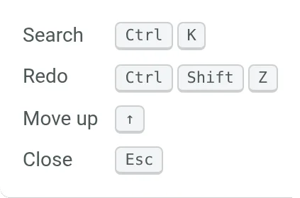
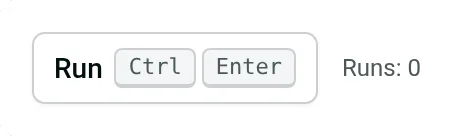

<!-- Written by `npm run docs:pages` from the kit and its examples. Do not edit. -->

# Shortcut

_Components › Actions_ · [All topics](../README.md)

A keyboard shortcut's keys, each drawn as a key, with what a screen reader says for them.

```html
<neat-shortcut [keys]="['Mod', 'K']" />
```

<picture>
<source media="(prefers-color-scheme: dark)" srcset="../images/shortcut/keys-of-an-app.dark.webp">

</picture>

```ts
import { NeatShortcut } from '@sima/neat-ui';
```

## Examples

### Keys of an app

A page's actions beside their keys. `Mod` shows ⌘ on a Mac and Ctrl elsewhere, and a Mac shows its other modifiers as symbols too.

<picture>
<source media="(prefers-color-scheme: dark)" srcset="../images/shortcut/keys-of-an-app.dark.webp">

</picture>

<details>
<summary>Code</summary>

`1-keys-of-an-app.example.ts`

```ts
import { ChangeDetectionStrategy, Component } from '@angular/core';
import { NeatShortcut } from '@sima/neat-ui';
import { NeatDetails } from '@sima/neat-ui/details';

/** What a page does, and the keys that do it. */
interface Action {
  readonly label: string;
  readonly keys: readonly string[];
}

const ACTIONS: readonly Action[] = [
  { label: 'Search', keys: ['Mod', 'K'] },
  { label: 'Redo', keys: ['Mod', 'Shift', 'Z'] },
  { label: 'Move up', keys: ['ArrowUp'] },
  { label: 'Close', keys: ['Escape'] },
];

@Component({
  selector: 'app-keys-of-an-app',
  imports: [NeatDetails, NeatShortcut],
  changeDetection: ChangeDetectionStrategy.OnPush,
  templateUrl: './1-keys-of-an-app.example.html',
  styleUrl: './keys-of-an-app.example.css',
})
export class KeysOfAnApp {
  protected readonly actions = ACTIONS;
}
```

`1-keys-of-an-app.example.html`

```html
<dl neatDetails class="actions">
  @for (action of actions; track action.label) {
    <dt>{{ action.label }}</dt>
    <dd><neat-shortcut [keys]="action.keys" /></dd>
  }
</dl>
```

`keys-of-an-app.example.css`

```css
/* Both columns are short, so the list takes a narrow column rather than the whole card. */
.actions {
  max-width: 16rem;
}
```

</details>

### In a button

A button that shows its shortcut, and the page's handler for it. The button's `aria-keyshortcuts` names the keys to assistive technology, so the shortcut is `aria-hidden` and the button's name stays "Run".

Press Ctrl Enter (⌘ Enter on a Mac), or the button.

<picture>
<source media="(prefers-color-scheme: dark)" srcset="../images/shortcut/in-a-button.dark.webp">

</picture>

<details>
<summary>Code</summary>

`2-in-a-button.example.ts`

```ts
import { ChangeDetectionStrategy, Component, signal } from '@angular/core';
import { NeatButton, NeatNote, NeatShortcut } from '@sima/neat-ui';

@Component({
  selector: 'app-in-a-button',
  imports: [NeatButton, NeatNote, NeatShortcut],
  changeDetection: ChangeDetectionStrategy.OnPush,
  host: { '(document:keydown)': 'onKeydown($event)' },
  templateUrl: './2-in-a-button.example.html',
})
export class InAButton {
  protected readonly runs = signal(0);

  /** Ctrl Enter or ⌘ Enter, as `Mod` says: the handler takes either modifier. */
  protected onKeydown(event: KeyboardEvent): void {
    if (event.key !== 'Enter' || !(event.ctrlKey || event.metaKey)) return;
    if (event.altKey || event.shiftKey) return;
    event.preventDefault();
    this.run();
  }

  protected run(): void {
    this.runs.update((runs) => runs + 1);
  }
}
```

`2-in-a-button.example.html`

```html
<div class="showcase-row">
  <button
    neatButton
    type="button"
    variant="outlined"
    aria-keyshortcuts="Control+Enter Meta+Enter"
    (click)="run()"
  >
    Run <neat-shortcut aria-hidden="true" [keys]="['Mod', 'Enter']" />
  </button>
  <p neatNote aria-live="polite">Runs: {{ runs() }}</p>
</div>
```

</details>

## API

### `NeatShortcut`

Component from `@sima/neat-ui`, selector `neat-shortcut`.

`keys` are named as `aria-keyshortcuts` names them: the browser's key values (`Control`, `Alt`, `Shift`, `Meta`, `Escape`, `ArrowUp`, `K`, `F1`), plus `Mod`, the platform's own modifier. `Mod` shows ⌘ on a Mac and Ctrl elsewhere, as an app's handler that takes either key expects. On a Mac the modifiers are its symbols (⌃ ⌥ ⇧ ⌘). `Escape` is Esc, and the arrows are arrows. A single letter is shown in capitals, and any other name as it is written.

Each key is a `kbd`, hidden from assistive technology, since a screen reader would read "⌘" by its Unicode name. Visually hidden text says the keys in words instead ("Control K", "Command K").

Inside a control whose `aria-keyshortcuts` already names the shortcut, put `aria-hidden="true"` on the part, so the control's name does not say it twice:

```html
<button type="button" aria-keyshortcuts="Control+K Meta+K">
  Search <neat-shortcut aria-hidden="true" [keys]="['Mod', 'K']" />
</button>
```

It only shows the keys: listening for them is the app's.

**Inputs**

- **`keys`** `readonly string[]`, required

  The keys, in the order they are pressed (`['Mod', 'Shift', 'P']`).
