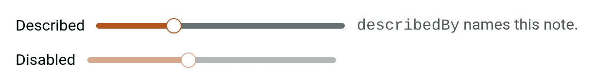
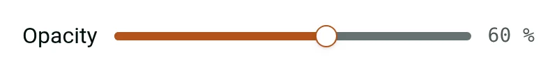

<!-- Written by `npm run docs:pages` from the kit and its examples. Do not edit. -->

# Slider

_Components › Forms_ · [All topics](../README.md)

A horizontal slider for one number.

```html
<neat-slider label="Tile width" [min]="120" [max]="480" [step]="10" [(value)]="width" />
```

<picture>
<source media="(prefers-color-scheme: dark)" srcset="../images/slider/described-and-disabled.dark.webp">

</picture>

```ts
import { NeatSlider } from '@sima/neat-ui/slider';
```

## Examples

### Live value

An opacity slider with its value beside it: drag, and the number follows every step.

<picture>
<source media="(prefers-color-scheme: dark)" srcset="../images/slider/live-value.dark.webp">

</picture>

<details>
<summary>Code</summary>

`1-live-value.example.ts`

```ts
import { ChangeDetectionStrategy, Component, signal } from '@angular/core';
import { NeatSlider } from '@sima/neat-ui/slider';

@Component({
  selector: 'app-live-value',
  imports: [NeatSlider],
  changeDetection: ChangeDetectionStrategy.OnPush,
  template: `
    <div class="field">
      <span>Opacity</span>
      <neat-slider label="Opacity" [min]="0" [max]="100" [step]="5" [(value)]="opacity" />
      <span class="showcase-code showcase-muted">{{ opacity() }} %</span>
    </div>
  `,
  styleUrl: './slider-field.css',
})
export class LiveValue {
  protected readonly opacity = signal(60);
}
```

`slider-field.css`

```css
/* A slider fills its container's width, so the demos give it one. */
.field {
  display: flex;
  align-items: center;
  gap: var(--neat-space-3);
}

neat-slider {
  width: 16rem;
}
```

</details>

### Described and disabled

A slider described by the note beside it, and a disabled one.

<picture>
<source media="(prefers-color-scheme: dark)" srcset="../images/slider/described-and-disabled.dark.webp">

</picture>

<details>
<summary>Code</summary>

`2-described-and-disabled.example.ts`

```ts
import { ChangeDetectionStrategy, Component, signal } from '@angular/core';
import { NeatSlider } from '@sima/neat-ui/slider';

@Component({
  selector: 'app-described-and-disabled',
  imports: [NeatSlider],
  changeDetection: ChangeDetectionStrategy.OnPush,
  template: `
    <div class="field">
      <span>Described</span>
      <neat-slider
        label="Gain"
        describedBy="gain-note"
        [min]="0"
        [max]="100"
        [step]="5"
        [(value)]="gain"
      />
      <span id="gain-note" class="showcase-muted"> <code>describedBy</code> names this note. </span>
    </div>
    <div class="field">
      <span>Disabled</span>
      <neat-slider label="Disabled" [min]="0" [max]="100" [step]="5" [value]="40" disabled />
    </div>
  `,
  styleUrls: ['./slider-field.css', './described-and-disabled.example.css'],
})
export class DescribedAndDisabled {
  protected readonly gain = signal(30);
}
```

`slider-field.css`

```css
/* A slider fills its container's width, so the demos give it one. */
.field {
  display: flex;
  align-items: center;
  gap: var(--neat-space-3);
}

neat-slider {
  width: 16rem;
}
```

`described-and-disabled.example.css`

```css
/* The sliders' rows one gap apart. */
:host {
  display: flex;
  flex-direction: column;
  gap: var(--neat-space-3);
}
```

</details>

## API

### `NeatSlider`

Component from `@sima/neat-ui/slider`, selector `neat-slider`.

`label` is the accessible name, and is not displayed. The arrow keys step. Page Up and Page Down step by ten, as do the arrow keys with Shift. Home and End jump to the ends.

`value` changes on every step of a drag, not only when the pointer is released, so whatever it drives (the tile grid's repacking, for one) previews live. A value outside `min`..`max` is shown clamped and stays as it is until the user moves the slider.

`describedBy` is the id of the element that describes the slider, such as a note on where its value applies. It goes on the thumb, the focusable element, like the name. The disabled state is on the thumb as `aria-disabled` too, since assistive technology reaches the slider through its thumb.

**Inputs**

- **`min`** `number`, required

  The smallest value, at the start of the track.

- **`max`** `number`, required

  The largest value, at the end of the track.

- **`step`** `number`, required

  The distance between values: an arrow key moves by one step, Page Up and Down by ten.

- **`label`** `string`, required

  The accessible name, announced with the value.

- **`describedBy`** `string`

  The id of the element that describes the slider; announced after the name and value.

- **`disabled`** `string | boolean | null | undefined`

  Turns the slider off: it ignores the pointer and the keys and is dimmed.

**Models (two-way)**

- **`value`** `number`, default `0`

  The number, 0 until set; bind it two-way, `[(value)]`. Changes while a drag is under way.
