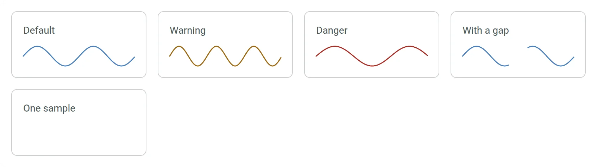

<!-- Written by `npm run docs:pages` from the kit and its examples. Do not edit. -->

# Sparkline

_Components › Charts_ · [All topics](../README.md)

A metric's recent samples as a small line, for a card:

```html
<neat-sparkline [values]="temperatures" label="MLA RTSN-0" [format]="celsius" tone="warning" />
```

<picture>
<source media="(prefers-color-scheme: dark)" srcset="../images/sparkline/tones.dark.webp">

</picture>

```ts
import { NeatSparkline } from '@sima/neat-ui/charts';
```

## Examples

### Tones

A card for each tone, then a series with a gap, which splits the line, and a single sample, which draws no line but keeps the box.

<picture>
<source media="(prefers-color-scheme: dark)" srcset="../images/sparkline/tones.dark.webp">

</picture>

<details>
<summary>Code</summary>

`1-tones.example.ts`

```ts
import { ChangeDetectionStrategy, Component } from '@angular/core';
import { type NeatChartTone, NeatSparkline } from '@sima/neat-ui/charts';
import { celsius, sine, withGap } from './data';

@Component({
  selector: 'app-tones',
  imports: [NeatSparkline],
  changeDetection: ChangeDetectionStrategy.OnPush,
  templateUrl: './1-tones.example.html',
  styleUrl: './tones.example.css',
})
export class Tones {
  protected readonly celsius = celsius;
  protected readonly cards: readonly {
    readonly title: string;
    readonly values: readonly (number | null)[];
    readonly tone: NeatChartTone;
  }[] = [
    { title: 'Default', values: sine(120, 2, 40, 62), tone: 'default' },
    { title: 'Warning', values: sine(120, 3, 70, 88), tone: 'warning' },
    { title: 'Danger', values: sine(120, 1.5, 85, 99), tone: 'danger' },
    { title: 'With a gap', values: withGap(sine(120, 2, 40, 62), 50, 20), tone: 'default' },
    { title: 'One sample', values: [48], tone: 'default' },
  ];
}
```

`1-tones.example.html`

```html
@for (card of cards; track card.title) {
  <div class="card">
    <span class="title">{{ card.title }}</span>
    <neat-sparkline
      [values]="card.values"
      [label]="card.title"
      [format]="celsius"
      [tone]="card.tone"
    />
  </div>
}
```

`data.ts`

```ts
import type { NeatChartFormat } from '@sima/neat-ui/charts';

/** A sine wave of `count` samples: a plausible, smooth metric. */
export function sine(count: number, cycles: number, low: number, high: number): number[] {
  return Array.from({ length: count }, (_, index) => {
    const wave = (Math.sin((index / count) * cycles * 2 * Math.PI) + 1) / 2;
    return Number((low + wave * (high - low)).toFixed(2));
  });
}

/** The same with `gap` samples missing from `from`: a daemon that did not answer for a while. */
export function withGap(values: number[], from: number, gap: number): (number | null)[] {
  return values.map((value, index) => (index >= from && index < from + gap ? null : value));
}

export const celsius: NeatChartFormat = (value) => `${value.toFixed(1)} °C`;
```

`tones.example.css`

```css
:host {
  display: flex;
  flex-wrap: wrap;
  gap: var(--neat-space-4);
}

.card {
  display: flex;
  flex-direction: column;
  gap: var(--neat-space-3);
  width: 12rem;
  padding: var(--neat-space-4);
  border: 1px solid var(--border);
  border-radius: var(--radius);
  background: var(--card);
  color: var(--card-foreground);
}

.title {
  font-size: var(--neat-text-sm);
  color: var(--muted-foreground);
}
```

</details>

## API

### `NeatSparkline`

Component from `@sima/neat-ui/charts`, selector `neat-sparkline`.

The samples are spread evenly, the lowest at the bottom of the box and the highest at the top. So the line shows the shape of the last minutes, not a level: the card says the value. A `null` is a sample that was not taken, and splits the line. Fewer than two numbers draw nothing but the box keeps its size, so a card does not jump when its first samples arrive.

The box fills the width it is given and is 1.75 rem high. The host is an image named by `label` and, in words, by how many samples there are and their range, worded by `format`. The stroke is `--neat-line`, or `--neat-line-warning` and `--neat-line-danger` by `tone`.

**Inputs**

- **`values`** `readonly (number | null)[]`, required

  The samples, oldest first; `null` for one that was not taken.

- **`label`** `string`, required

  What the samples measure, for the image's name: "MLA RTSN-0".

- **`format`** `NeatChartFormat`, default `String`

  Words a value for the description, with its unit.

- **`tone`** `NeatChartTone`, default `'default'`

  The stroke: the line color, or a threshold's.
