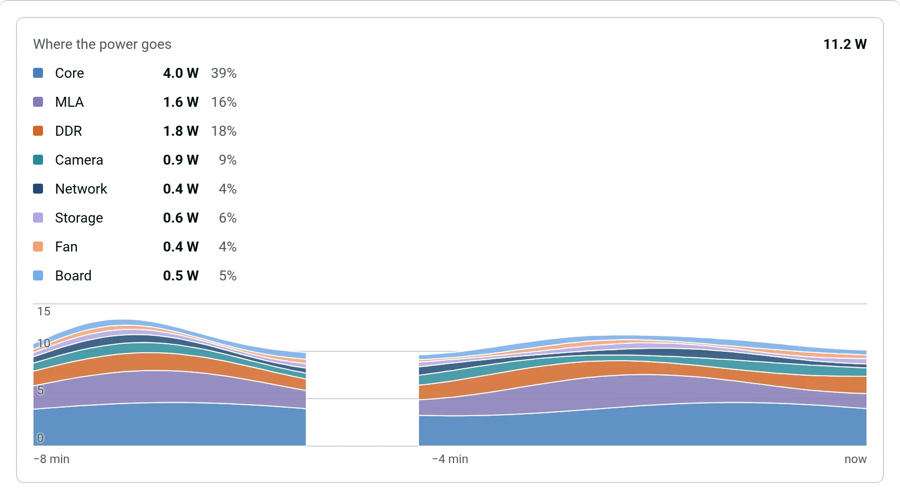
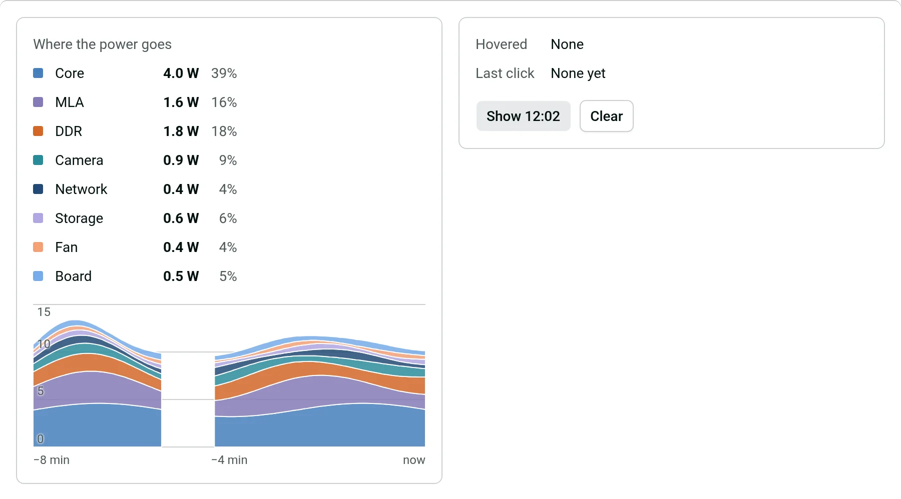

<!-- Written by `npm run docs:pages` from the kit and its examples. Do not edit. -->

# Stacked chart

_Components › Charts_ · [All topics](../README.md)

A total split into its parts over time, as bands stacked into one area:

```html
<neat-stacked-chart
  label="Board power"
  headline="11.4 W"
  [series]="rails"
  [times]="times"
  [domain]="[0, 16]"
  [format]="watts"
/>
```

<picture>
<source media="(prefers-color-scheme: dark)" srcset="../images/stacked-chart/power-rails.dark.webp">

</picture>

```ts
import { NeatStackedChart } from '@sima/neat-ui/charts';
```

## Examples

### Power rails

The board's eight power rails stacked into its total, one band in each series color. The DDR rail did not report for a minute, which breaks the whole stack there. The card sets `--neat-surface` to its fill, for the hairlines between the bands and the labels' halos.

<picture>
<source media="(prefers-color-scheme: dark)" srcset="../images/stacked-chart/power-rails.dark.webp">

</picture>

<details>
<summary>Code</summary>

`1-power-rails.example.ts`

```ts
import { ChangeDetectionStrategy, Component } from '@angular/core';
import { NeatStackedChart } from '@sima/neat-ui/charts';
import { RAILS, TIMES, watts } from './data';

@Component({
  selector: 'app-power-rails',
  imports: [NeatStackedChart],
  changeDetection: ChangeDetectionStrategy.OnPush,
  template: `
    <div class="card">
      <neat-stacked-chart
        label="Where the power goes"
        headline="11.2 W"
        [series]="rails"
        [times]="times"
        [domain]="[0, 16]"
        [format]="watts"
      />
    </div>
  `,
  styleUrl: './power-rails.example.css',
})
export class PowerRails {
  protected readonly rails = RAILS;
  protected readonly times = TIMES;
  protected readonly watts = watts;
}
```

`data.ts`

```ts
import type { NeatChartFormat, NeatSeries } from '@sima/neat-ui/charts';

/** A sine wave of `count` samples: a plausible, smooth metric. */
function sine(count: number, cycles: number, low: number, high: number): number[] {
  return Array.from({ length: count }, (_, index) => {
    const wave = (Math.sin((index / count) * cycles * 2 * Math.PI) + 1) / 2;
    return Number((low + wave * (high - low)).toFixed(2));
  });
}

/** The same with `gap` samples missing from `from`: a rail the board did not report for a while. */
function withGap(values: number[], from: number, gap: number): (number | null)[] {
  return values.map((value, index) => (index >= from && index < from + gap ? null : value));
}

/**
 * Eight minutes of samples four seconds apart, ending at a fixed instant so the demo stands
 * still.
 */
const SAMPLES = 120;
export const TIMES: readonly number[] = Array.from(
  { length: SAMPLES },
  (_, index) => Date.UTC(2026, 9, 24, 12, 0, 0) + index * 4000,
);

export const watts: NeatChartFormat = (value) => `${value.toFixed(1)} W`;

/** Eight rails that sum to about 11 W: the stacked chart uses all eight series colors. */
export const RAILS: readonly NeatSeries[] = [
  { key: 'core', label: 'Core', low: 3.2, high: 4.6 },
  { key: 'mla', label: 'MLA', low: 1.5, high: 3.4 },
  { key: 'ddr', label: 'DDR', low: 1.2, high: 1.9 },
  { key: 'cam', label: 'Camera', low: 0.6, high: 1.1 },
  { key: 'net', label: 'Network', low: 0.4, high: 0.9 },
  { key: 'sto', label: 'Storage', low: 0.3, high: 0.6 },
  { key: 'fan', label: 'Fan', low: 0.2, high: 0.5 },
  { key: 'board', label: 'Board', low: 0.5, high: 0.7 },
].map(({ key, label, low, high }, index) => {
  const values = sine(SAMPLES, 1.5 + index / 3, low, high);
  // DDR does not report for a minute, which breaks the stack there.
  return { key, label, values: index === 2 ? withGap(values, 40, 15) : values };
});
```

`power-rails.example.css`

```css
:host {
  display: block;
}

/* The chart draws on the card's fill, so the card says which: for its halos and band hairlines. */
.card {
  --neat-surface: var(--card);

  padding: var(--neat-space-4);
  border: 1px solid var(--border);
  border-radius: var(--radius);
  background: var(--card);
  color: var(--card-foreground);
}
```

</details>

### Stacked from the app

The app reads the chart and sets it: `hovered` is the moment the readout is on (the pointer's or the keys' sample, or one the app sets, shown at the nearest sample), and `activated` reports a click or Enter with the sample's time and each band's value. The card shows both, and its buttons set the moment from outside.

<picture>
<source media="(prefers-color-scheme: dark)" srcset="../images/stacked-chart/from-the-app.dark.webp">

</picture>

<details>
<summary>Code</summary>

`2-from-the-app.example.ts`

```ts
import { ChangeDetectionStrategy, Component, computed, signal } from '@angular/core';
import { NeatButton } from '@sima/neat-ui';
import { type NeatSamplePick, NeatStackedChart } from '@sima/neat-ui/charts';
import { RAILS, TIMES, watts } from './data';

/** A moment as the card says it: the time of day, in UTC like the demo's data. */
const clock = (time: number) => new Date(time).toISOString().slice(11, 19);

@Component({
  selector: 'app-stacked-from-the-app',
  imports: [NeatButton, NeatStackedChart],
  changeDetection: ChangeDetectionStrategy.OnPush,
  template: `
    <div class="beside">
      <div class="card">
        <neat-stacked-chart
          label="Where the power goes"
          [series]="rails"
          [times]="times"
          [domain]="[0, 16]"
          [format]="watts"
          [(hovered)]="moment"
          (activated)="picked.set($event)"
        />
      </div>
      <div class="report">
        <dl>
          <dt>Hovered</dt>
          <dd>{{ momentText() }}</dd>
          <dt>Last click</dt>
          <dd>{{ pickedText() }}</dd>
        </dl>
        <div class="actions">
          <button
            neatButton
            type="button"
            size="small"
            variant="secondary"
            (click)="moment.set(times[30])"
          >
            Show 12:02
          </button>
          <button
            neatButton
            type="button"
            size="small"
            variant="outlined"
            (click)="moment.set(null)"
          >
            Clear
          </button>
        </div>
      </div>
    </div>
  `,
  styleUrls: ['./power-rails.example.css', './report.example.css'],
})
export class StackedFromTheApp {
  protected readonly rails = RAILS;
  protected readonly times = TIMES;
  protected readonly watts = watts;
  protected readonly moment = signal<number | null>(null);
  protected readonly picked = signal<NeatSamplePick | null>(null);

  protected readonly momentText = computed(() => {
    const time = this.moment();
    return time === null ? 'None' : clock(time);
  });

  protected readonly pickedText = computed(() => {
    const pick = this.picked();
    if (!pick) return 'None yet';
    const total = pick.values.reduce((sum, { value }) => sum + (value ?? 0), 0);
    return `${pick.time === null ? 'A sample' : clock(pick.time)}: ${watts(total)} in all`;
  });
}
```

`data.ts`

```ts
import type { NeatChartFormat, NeatSeries } from '@sima/neat-ui/charts';

/** A sine wave of `count` samples: a plausible, smooth metric. */
function sine(count: number, cycles: number, low: number, high: number): number[] {
  return Array.from({ length: count }, (_, index) => {
    const wave = (Math.sin((index / count) * cycles * 2 * Math.PI) + 1) / 2;
    return Number((low + wave * (high - low)).toFixed(2));
  });
}

/** The same with `gap` samples missing from `from`: a rail the board did not report for a while. */
function withGap(values: number[], from: number, gap: number): (number | null)[] {
  return values.map((value, index) => (index >= from && index < from + gap ? null : value));
}

/**
 * Eight minutes of samples four seconds apart, ending at a fixed instant so the demo stands
 * still.
 */
const SAMPLES = 120;
export const TIMES: readonly number[] = Array.from(
  { length: SAMPLES },
  (_, index) => Date.UTC(2026, 9, 24, 12, 0, 0) + index * 4000,
);

export const watts: NeatChartFormat = (value) => `${value.toFixed(1)} W`;

/** Eight rails that sum to about 11 W: the stacked chart uses all eight series colors. */
export const RAILS: readonly NeatSeries[] = [
  { key: 'core', label: 'Core', low: 3.2, high: 4.6 },
  { key: 'mla', label: 'MLA', low: 1.5, high: 3.4 },
  { key: 'ddr', label: 'DDR', low: 1.2, high: 1.9 },
  { key: 'cam', label: 'Camera', low: 0.6, high: 1.1 },
  { key: 'net', label: 'Network', low: 0.4, high: 0.9 },
  { key: 'sto', label: 'Storage', low: 0.3, high: 0.6 },
  { key: 'fan', label: 'Fan', low: 0.2, high: 0.5 },
  { key: 'board', label: 'Board', low: 0.5, high: 0.7 },
].map(({ key, label, low, high }, index) => {
  const values = sine(SAMPLES, 1.5 + index / 3, low, high);
  // DDR does not report for a minute, which breaks the stack there.
  return { key, label, values: index === 2 ? withGap(values, 40, 15) : values };
});
```

`power-rails.example.css`

```css
:host {
  display: block;
}

/* The chart draws on the card's fill, so the card says which: for its halos and band hairlines. */
.card {
  --neat-surface: var(--card);

  padding: var(--neat-space-4);
  border: 1px solid var(--border);
  border-radius: var(--radius);
  background: var(--card);
  color: var(--card-foreground);
}
```

`report.example.css`

```css
/* The chart beside a card that reports on it; one above the other where there is no room. */
.beside {
  display: grid;
  grid-template-columns: repeat(auto-fit, minmax(min(100%, 18rem), 1fr));
  gap: var(--neat-space-4);
  align-items: start;
}

.report {
  padding: var(--neat-space-4);
  border: 1px solid var(--border);
  border-radius: var(--radius);
  background: var(--card);
  color: var(--card-foreground);
}

.report dl {
  display: grid;
  grid-template-columns: auto 1fr;
  gap: var(--neat-space-2) var(--neat-space-4);
  margin: 0 0 var(--neat-space-4);
  font-size: var(--neat-text-sm);
}

.report dt {
  color: var(--muted-foreground);
}

.report dd {
  margin: 0;
  font-variant-numeric: tabular-nums;
}

.actions {
  display: flex;
  flex-wrap: wrap;
  gap: var(--neat-space-2);
}
```

</details>

## API

### `NeatStackedChart`

Component from `@sima/neat-ui/charts`, selector `neat-stacked-chart`.

The series stack bottom first, in the order given. Each band is in `--neat-series-1` to `-8` at 0.85 opacity, with a hairline in `--neat-surface` between bands. So inside a card, set that to the card's fill. More than eight fold into "Other", as on the time chart.

A sample where any band is missing breaks the whole stack: a partial sum would draw a total that was never measured.

`times`, `domain`, `format`, `size`, `headless` and `valueLabels` are as on the time chart. `domain` must reach the largest total, or the top of the stack is cut off.

The legend lists each band with its current value, and its share of the current total as a whole percent. The share is "—" while the total is nothing, or unknown because a band has no current sample. The colors alone do not tell eight bands apart, which is what the legend is for.

The plot is a tab stop that reads out like the time chart's: "Total", then each band, at the sample the pointer or the keys chose. It has the same keys and the same announcements. `hovered` and `activated` are the time chart's: a moment both ways, and a click's sample.

**Inputs**

- **`label`** `string`, required

  The chart's title, which also names it for assistive technology.

- **`headline`** `string`, default `''`

  The current total as the app words it, beside the title and in the accessible name.

- **`series`** `readonly NeatSeries[]`, required

  The bands, bottom first, each as long as `times`; more than eight fold into "Other".

- **`times`** `readonly (number | null)[]`, required

  When each sample was taken, in ms, oldest first; `null` for one without a time.

- **`domain`** `readonly [number, number]`, required

  The values the box spans, bottom and top: fixed by the app, so the stack never rescales.

- **`size`** `'compact' | 'medium' | 'large'`, default `'large'`

  The plot's height: 3.5, 6 or 9.5 rem. Compact also leaves out the labels and the time axis.

- **`headless`** `boolean`, default `false`, transform `booleanAttribute`

  Leaves out the title row, for a chart under a heading of its own.

- **`valueLabels`** `boolean`, default `true`, transform `booleanAttribute`

  Whether the grid lines carry their values; the lines, the time axis and the readout stay.

- **`format`** `NeatChartFormat`, default `String`

  Words a value with its unit, for the legend, the readout and the accessible name.

**Models (two-way)**

- **`hovered`** `number | null`, default `null`

  The moment the readout is on, in ms: a sample's time.

  It is the pointer's or the keys' sample while they hold one, and null once they let go. Otherwise it is one the app sets, shown at the nearest sample. So charts bound to one `hovered` share a crosshair. It changes only when the sample does.

**Outputs**

- **`activated`** `NeatSamplePick`

  A click on the plot, or Enter with focus: the sample, when it was taken and its values.
